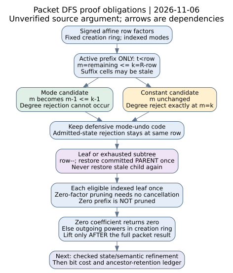

# Packet coefficient DFS: active-prefix and restoration audit

6 November 2026. **PCC-20261106-d6132b — unverified statement.** This packet
gives a written source-refinement argument and explicit proof obligations for
`PacketTensor::entry`. No kernel-checked theorem, new algebraic identity,
execution result or complexity result is asserted. Every source observation
and argument below has unverified producer standing. [pcc:unverified]

The advance is a state correspondence with a **remaining-row capacity
invariant**. It classifies degree rejection as a constant-choice case under
that invariant, while retaining the source's defensive mode-undo branch.
It separates that same-row site from two committed-parent pop sites, excludes
the stale suffix, and relates accepted leaves to ordered row choices. Signs,
multiplicities, zero-divisor behavior and creation precision stay explicit.
[pcc:unverified]

## Source and coordination scope

Native source is pinned to crypto
`75309f57ba69d7683006108e151a21233a04bb48`. The audited entry body matches
the Nov5 source pin, while the file now also contains upstream mutation tests;
`contraction.rs` additionally registers the upstream guards module. Whole-file
or whole-crate equality is not asserted. [sources.json](sources.json) records
full-file and extracted-body identities. [refinement-map.json](refinement-map.json)
links the obligations to exact source lines. [pcc:unverified]

The [Nov5 tuple contract](https://github.com/isogeny-labs/crypto/blob/8ada1df4e4f4fb433a37438ef776f29ab0912aef/research/hashed_ecdl_tuple_invariant_20261105/README.md)
is an **unmerged, unverified candidate** from PR3478. Its conflicted branch,
ledger and journal remain untouched. This additive continuation uses current
main in an isolated worktree, coordinated in PR3478 comment6689804776 before
publication. No earlier claim or event is rewritten. [pcc:unverified]

Read OpenAI Appendix D.1/D.4.5-D.4.7, especially D.4.6's row-product
coefficient and outgoing-power definition, at PDF path last-change
`42907c9e999cc00d6abe7a50bfc1023250edd1b9`, blob
`0503566e95bc587a4076573a45132d97531b8ba6`. Its general entry-work and
retention proof remains a separate obligation. Atlas matching at
crypto-autoresearcher `a97d7c1304033a7863609096d425487cd2e2b31b` selects the
existing hashed-factor-base tensor audit lead. No new mechanism, novelty
clearance or full atlas-delta review. [pcc:unverified]

Sources checked (KB): MCP tools unavailable; repository wrapper
`scripts/research-kb status` exits127, no executable. No KB source IDs,
revision/refresh or successful searches are invented. The fallback is the
pinned atlas, prior packets and primary source; exact query scope and the gap
are recorded in [VALIDATION.md](VALIDATION.md).

## Audit target and assumptions

Work in the packet's fixed creation ring A, with R rows, C columns and q
incoming records. Assume correct commutative-ring operations and faithful
zero testing; no integral-domain or cancellation assumption is needed in the
argument. The implementation of those operations is not independently proved
here. Let beta_j be the stored incoming exponent and E their sum.
[pcc:unverified]

For selected column bits x, let l_i be the local row's column sum, and a_ij
its stored incoming coefficient. For row bit y_i the prepared coefficients
are as follows:

| Row bit | Constant c_i | Mode coefficient d_ij |
| --- | --- | --- |
| true | l_i | a_ij |
| false | 1-l_i | -a_ij |

The existing D.4.6 interpretation supplies the audit target: extract the
beta coefficient of the ordered product of affine factors
`F_i(Z)=c_i+sum_j d_ij*Z_j`, then multiply the outgoing linear forms raised
to their stored exponents. Incoming records are separate formal variables
even if their coefficient vectors agree. This restates the source's semantic
target; it is not a new certified polynomial identity. [pcc:unverified]

Shape preconditions: each local row has C coefficients; each incoming list
has R; outgoing indices are below C; bit arity is R+C. Require representable
R+C, R+1, q+1 and E, and successful allocations. A claimed Ok-return refinement
must establish these caller conditions rather than infer them from a slice
type or an operation-meter count. [pcc:unverified]

## Active-prefix and scan-frontier invariant

For an active depth r, define used_j(r) to count labels j+1 in chosen[k]
**only for k<r**. Label0 chooses the constant. The proposed invariant is:

1. `0 <= r <= R`; only chosen[0..r] is committed. Entries at and beyond r
   may be stale and are excluded from used counts.

2. `left_j = beta_j-used_j(r) >= 0`, and remaining equals the sum of left,
   with `remaining <= R-r` after the initial degree guard.

3. prefix[r] is the ordered product of factors selected by that active
   prefix; prefix[0] is one. Inactive prefix cells are not authoritative.

4. At a non-leaf, choices[r] is the next untried label under the current
   committed ancestors. It advances before any rejection, and is reset only
   when entering a new row under a new ancestor prefix.

5. sum accumulates eligible leaves already closed by this frontier, with
   each ordered choice vector contributing once. Pruned subtrees contribute
   zero to the target coefficient for the reasons below.

These are candidate refinement predicates, with the following source-coupled
review argument; no checked Rust/usize or Lean model is supplied.
[pcc:unverified]

## Transition and restoration argument

| Source transition | Counter/product change | Frontier argument |
| --- | --- | --- |
| Initialize | left=beta, remaining=E, prefix[0]=1, row=0 | Empty committed prefix, no closed leaf |
| Read candidate | choice=choices[row]; increment choices[row] | That label is not retried for this ancestor prefix |
| Exhausted exponent | Skip mode label with left_j=0 | Additional use would exceed beta_j; no later row can undo that use |
| Zero factor | Skip without consuming an exponent | Every descendant product has this zero factor, in any ring |
| Tentative mode | Decrement its left_j and remaining | Candidate contribution is temporarily included |
| Degree rejection | If remaining>R-row-1, source has a guarded in-place mode undo | Under the capacity invariant, rejection can only be a constant choice; no depth was pushed |
| Commit candidate | Write prefix[row+1], chosen[row], then increment row; reset next-row choices | Extends the active prefix by one factor |
| Eligible leaf | If remaining=0 add prefix[R] | Adds exactly this ordered row-choice product |
| Pop from leaf | Decrement row, restore chosen[row] if nonzero | Removes the now-excluded parent's committed contribution |
| Pop exhausted row | Same parent restoration after all row labels are exhausted | Does not restore the stale choice at the exhausted depth |
| Root completion | Break at row0 after empty leaf or exhaustion | No parent exists to restore; closed frontier is final |

The degree-rejection site is **not** a stack pop: row stays fixed and the
trial never enters chosen[0..r]. The guarded mode undo there is retained even
though the capacity argument below makes it unreachable on admitted states.
Conversely, after a leaf or exhausted
subtree the source decrements row first and restores that parent's choice.
The old chosen entry at the current frontier is harmless because the invariant
excludes it. Restoring a speculative trial again as a committed child would
double-count the undo; the source's control paths keep those cases separate.
[pcc:unverified]

For a committed mode choice, used_j increases by one and left_j decreases by
one; after the matching pop both changes reverse. Constant choices change
neither exponent counter. Prefix multiplication records the same selected
factor as chosen, and every later sibling overwrites its own prefix cell.
Together with the persistent next-label cursor, this is the proposed local
simulation relation between the imperative arrays and a row-choice tree.
[pcc:unverified]

## Why the pruning rules fit the target

The initial E>R guard admits only `remaining<=R` if the exponent sum fits.
Each committed push explicitly requires `remaining<=R-row-1`; a pop grows
the row capacity by one and restores at most one consumed exponent. These
give the proposed `remaining<=R-row` induction, independently of assuming
the Nov5 driver-level E<=R argument. [pcc:unverified]

At a non-leaf let m be remaining before trying a candidate and k=R-row>=1.
The capacity invariant gives m<=k. A mode choice has m>=1 and changes it
to m-1<=k-1, so it cannot fail the degree test. A constant leaves m unchanged
and fails exactly when m=k. Thus the source's conditional mode restoration
inside the degree-rejection block is defensive for this admitted-state
model. This is a written reachability argument, not an executed branch test
or a checked theorem; no branch or guard is removed. [pcc:unverified]

After a tentative choice at row r, every remaining affine row contributes
degree0 or one incoming variable. If total residual degree exceeds R-r-1,
no suffix can supply that exponent vector. Rejecting a mode with left_j=0
likewise discards only over-target exponents. Both arguments require
nonnegative formal exponents and affine row factors, not nonzero coefficients.
[pcc:unverified]

Zero testing applies to the **current factor**. The implementation does not
prune merely because prefix[row] is zero. Nonzero factors may multiply to
zero in the creation ring; such branches can still be traversed and add zero.
A cost argument must retain their work. Zero-factor pruning and the final
zero-result shortcuts use annihilation, without dividing or cancelling any
coefficient. [pcc:unverified]

At a leaf, nonnegative left_j values with remaining=0 mean the target beta
was used exactly. Ordered row choices are accumulated individually: matching
coefficient values do not justify deduplication or a factorial adjustment.
The finite row-choice tree and monotonically advanced row cursors supply
the proposed termination argument for successful local execution. This does
not establish the general entry-work or recursion bound. [pcc:unverified]

## Hand-derived trace and edge controls

The following is a symbolic source walkthrough, **not an executed test**.
With two rows, one incoming label and beta=1:

| Prefix / candidate | Effect |
| --- | --- |
| Row0 chooses constant; row1 chooses incoming | First eligible leaf uses the incoming label at row1 |
| Return from that leaf | Pop row1's committed choice and restore its one exponent |
| Exhaust row1 under constant prefix | Pop row0's constant; no exponent restoration |
| Row0 chooses incoming; row1 tries constant | Second eligible leaf uses the incoming label at row0 |
| Row1 next tries incoming | left=0, so the extra use is skipped |
| Return to root exhaustion | Both ordered leaves are closed; no extra leaf is introduced |

For a degree-rejection walkthrough use beta=2 instead: at each of two rows
the constant choice leaves too much degree for the suffix and is rejected;
the mode choice consumes one unit and fits. No speculative mode restoration
is reached under the capacity invariant. Both parent-pop sites keep their
separate role. Equal row coefficients still leave indexed leaf positions.
[pcc:unverified]

At R=0 and E=0, the leaf case reads prefix[0]=1 and breaks without indexing
empty choices/chosen arrays, then applies outgoing factors. At R=0,E>0 the
degree guard returns zero. With q=0, only constant choices remain. Records
with zero target exponent are skipped by the left=0 rule; positivity of
incoming exponents is needed for the earlier q<=E bound, not for this
semantic model. Keep all existing guards. [pcc:unverified]

## Errors, integer state and immutable precision

The relation above concerns successful transitions and Ok results. A failing
ring multiplication can occur after a tentative decrement but before prefix
and chosen are committed. Result::Err exits the function; the local DFS arrays
are discarded, with no suspended state or partial coefficient returned.
Meter charges persist as diagnostics. Do not claim every error-state array
satisfies the active-prefix predicate or that an error is a complete count.
[pcc:unverified]

The shape/width contract also matters. `choices[row]+1` needs q+1 to fit;
row+1 and prefix allocation need R+1. Exponent subtraction occurs only after
left_j>0. A parent pop is guarded by row>0, while R-row-1 is evaluated only
inside row<R. Restoring an actually consumed unit keeps counters at most
their initial beta/E. The unverified Nov5 E<=R caller contract can discharge
the incoming-sum width condition if refined; it is not silently assumed here.
[pcc:unverified]

Outgoing sums are accumulated modulo the stored creation modulus, embedded
as ring integers and exponentiated with the source's repeated-squaring loop.
Exponent0 returns one, including a zero base; actual child construction omits
zero-exponent records. Only after the complete packet entry does Tensor::entry
lift coordinates to the requested precision. The source rejects decreased
precision or a packet/creation mismatch. A canonical lift is not assumed to
commute with the earlier arithmetic. [pcc:unverified]

## Review status and next discriminating step

This packet supplies the signed semantic target, active-prefix/frontier
predicates and a source argument for each trial, prune, commit and restoration.
The missing checked bridge is a faithful coefficient/choice-tree model plus
an imperative-state refinement covering these exact code sites. Lean/lake
are unavailable; no theorem module, transitive axiom audit or polynomial
identity certificate is presented. Standard D.4.6 semantics are being audited,
not promoted as a newly certified algebraic identity. [pcc:unverified]

Next, check that refinement with the stated commutative-ring and machine-state
preconditions. Then combine entry preparation, all attempted DFS choices,
outgoing powers and operand widths with the ancestor-retention ledger.
Kernel coefficients, packing/tuple correspondence and the full general audit
remain explicit dependencies.

The upstream [bounded controls](../prime_ic_elimination_20261101/RANK1_CODE_CONTROLS.md)
and new mutation tests were read as historical/source evidence, not rerun or
substituted for this refinement. No scientific experiment, benchmark, challenge
solve or cloud resource ran. Earlier reports, tests, gates and dependencies
remain unchanged. Canonical leaderboard, progress, curve and performance graphs
receive no new measurement or transfer edge.

The [PDF](report.pdf), [editable diagram](dependency.dot),
[renderer](render_report.py) and [validation note](VALIDATION.md) accompany the
packet. The general-audit problem remains open.
