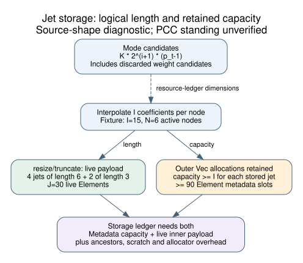

# Native mode and Taylor-data dimension audit

15 November 2026. **PCC-20261115-907a94: unverified**, statement claim with no
proof or signed verdict. All derivations and software observations below are
producer assertions at that standing. [pcc:unverified]

The new `admission::dimensions` utility evaluates exact integer expressions
for attempted mode records, interpolation/jet lengths and a coarse precision
envelope without allocating a graph. Five controls bind these expressions to
the existing native routines. A storage control exposes a missing distinction
in the prior ledger: the length of a truncated jet does not account for its
retained outer-vector allocation. [pcc:unverified]



## Resume point and source scope

Base: `d60f19656854fdfa1b37d4976652e614db7fcc91`. The November 5 saved plan
points to the entry-cost audit. Open [PR #3478](https://github.com/isogeny-labs/crypto/pull/3478)
already has the tuple review; [PR #3569](https://github.com/isogeny-labs/crypto/pull/3569)
includes the later packet recurrence at head
`1581cc7d22dfa89398936638b965352122ac0fa3`. Its next action is to bind modes,
attempts, precision, samples and jets to root size. These unmerged source
reviews are inputs, not accepted proof dependencies. Their divergent PCC
histories were left untouched. This is a successor against current main.

Sources checked (KB): unavailable. No research-kb MCP tools are loaded;
`scripts/research-kb status` exits 127, no backend executable. Intended queries:
"hashed ECDL attempted mode count", "packet recurrence space precision gap",
"tapered Hermite retained jet capacity". Fallback: exact current native files,
the above PR records, and these primary sources:

- [Bochum v0.2](https://github.com/bochum-crypto/subexponential-ecdl/blob/1ee44e562b1b9a50ea339f3b8f81112b5a24b96f/subexponential-ecdl.pdf),
  sections 1.2 and 2, Theorem 2 and Remark 1. This identifies the conditional
  contraction theorem used by the prime-field reduction.
- [OpenAI Appendix D](https://github.com/openai/math/blob/42907c9e999cc00d6abe7a50bfc1023250edd1b9/preprints/The-Exponential-Time-Hypothesis-is-False-October-25-2026/paper.pdf),
  D.1, D.4.1–2 and D.4.4–7; PDF SHA256
  `5b1612dc2eebb2cad5b4cbe62d1fed2982f01ab1908c26f70010a651487e8123`.
  Equations D.4, D.11 and D.13 supply the existing dimensional contracts.
  D.1 explicitly allows exponential entry work but requires polynomial space.

The source-file manifest is [sources.sha256](sources.sha256). Tests modify no
native contraction body. The public recursion guards and finite fallbacks
retain their behavior. This utility does not assert that an input graph has
the dimensions supplied to it, or that the external theorem is certified.

## Component contract and derivation chain

This component fills dimensional inputs to the existing packet resource
ledger. Its interfaces are graph-independent integer data; its consumers are
future Rust/semantic refinements and bit/allocation accounting. It is not an
optimization or a new contraction algorithm. No benchmark or cloud job ran.

For an active node, write M for edges, K for packets, L=2^a for slots,
1 <= u <= min(a,M), 0 <= i < u and p_t >= 1. The utility checks these
inequalities, K>0 and K*L <= 3M. The caller still owes their binding to actual
objects. Its bounds include candidates discarded by zero filtering.

| Quantity | Expression / contract | Existing source |
| --- | --- | --- |
| Tiles | T=2^(i+1) | `deformation::modes` |
| Candidates of one weight | <= K*T <= 6M/(L/2^i) | D.13 and packing capacity |
| All weight-loop attempts | <= K*T*(p_t-1) | includes zero/discarded records |
| Column modpow / row coefficient calls | each <= K*T*(p_t-1)*L | coarse overcount per candidate |
| Samples per active t | I=M*(2L-1)+1 | `recursive::active` |
| Active grid nodes | N=2*(L-L/2^u) | `grid`, `valuation`, `multiplicity` |
| Live jet coefficient count | J=h*((2u-2)*L+2L/2^u), h=ceil(3M/u) | sum of native qt |
| Retained outer-vector slots | >= N*I | interpolation followed by resize/truncate |

The candidate chain first counts packet/tile pairs, then substitutes the
existing packing contract K*L <= 3M. Empty row/column supports can only remove
weight-loop visits. Surviving B is at most the number of attempted candidates;
bound B and attempted construction separately in the operation ledger.

For Taylor data the grid is [-L,L). Exactly L/2^i nodes have valuation i<a.
Each retained level has qt=h*(u-i). Summing these counts yields the displayed
N,J expressions. In particular, h*u <= 3M+u-1 <= 4M and J <= 8M*L. These are
written derivations checked on bounded native instances, not kernel-checked
identities. No `identity.certificate/v1` or Lean theorem is asserted here.
[pcc:unverified]

For the coarse path envelope, let s bound root edges, lambda=ceil(log2(s)),
u0=floor(lambda/131072), A=4u0, L*=2^A and p0>0. The source scale sum gives
a_d <= A. On a path satisfying M_next <= M/8, sum M <= 2s. Each native
precision increment satisfies

```text
delta_p = 8*ceil(3M/u)*(L/2^i) + 8M*(a+1)
        <= 8M*(3L*+A+1).
p_path  <= P = p0+16s*(3L*+A+1).
```

Thus the dimension expressions have polynomial envelopes in s alone **when
p0 has a fixed polynomial bound in s**: candidates <= 3s*P, I <= 2s*L*+1,
N <= 2L*, J <= 8s*L*. The candidate bound uses T<=L. No original-description
length is placed inside these expressions. The original predicates' own
description/evaluation contracts remain separate. [pcc:unverified]

This coarse P **cannot replace** the sharper tapered bound p_t=O(M*D/u)
needed in D.15 to recover the stated branching exponent. That source-to-code
refinement is still open, along with tuple/DFS semantics, rational widths,
allocation unions and entry bit costs. The current utility is not a full
time/space certificate. [pcc:unverified]

## Retained-capacity correction

`ring::interpolate` allocates an I-element result. `active` calls
`resize(qt, zero)` then `truncate(qt)` and stores that vector in a Jet.
Truncation drops excess Elements and their inner coefficient allocations,
but retains the outer vector buffer. The existing jet counter sums lengths;
it is neither a capacity counter nor an aggregate-byte budget.

The native control uses M=2,a=2,u=2: I=15, four nodes of length 6 and two of
length 3. It retains **30 live Elements and at least 90 outer Element slots**.
The latter slots hold metadata, not 90 live coefficient payloads. No RSS,
allocator-byte or runtime ratio is inferred. This is a diagnostic source-shape
fixture, not a publicly admitted recursive execution. [pcc:unverified]

The proposed storage ledger must add retained Vec capacity times Element
metadata size and price the live inner payloads separately. An implementation
change that compacts the buffer is a distinct candidate requiring allocation,
copy-work and peak-coexistence accounting; it is not silently included here.

## Checks and proof map

All checks are producer checks and remain unverified in PCC standing.

| Requirement | Outcome / remaining dependency |
| --- | --- |
| Native dimension utility | implemented; arbitrary-precision counts and explicit input checks |
| Source-routine controls | five tests: grid/qt; per-weight modes with zero filters; precision scales/increments; invalid premises/p=1; interpolation capacities |
| Release library census | 104 passed, zero failures; [log](checks/cargo-test-release-lib.log) |
| Formatting / library lint | cargo fmt --check; strict clippy --lib passed |
| Strict all-target lint | blocked by inherited `manual_range_contains` at `treewidth.rs:848`; reproduced on base |
| Whole-program Rust refinement | open; scalar inputs are not certificates of actual graph dimensions |
| Lean / identity proof | not produced; the missing first consumer is the semantic binding of graph/packing/grid and Vec lifetime operations; displayed chains remain unverified derivations |
| Allocation and bit-space proof | open; capacity lower bound is not a byte upper bound |

Before a Lean edit, the required instance gate must identify the generic
finite-sum/geometric-series law in Mathlib or crypto-lean, bind the native
grid/multiplicity model to that object, and type-check its assembly probe.
No new study-local replacement for those generic laws is introduced.

No speed result, curve transfer, or measured frontier value was produced.
Canonical leaderboard, performance timeline and curve graphs remain unchanged;
this audit's explanatory diagram/PDF accompanies its source and software log.

## Next discriminating step

Bind the native inherited precision to the **sharp** D.11 tapered bound and
enumerator to D.14–15, then refine total retained allocation capacities along
the path. Carry this control as a regression: any proposed byte upper bound
that substitutes J outer slots for N*I must reject this fixture. Preserve the
prior review packets and ledger forks; their integration is a separate issue.

Reproduce software checks from the repository root:

```sh
cargo test --release --locked --manifest-path crates/hashed-ecdl-tensor/Cargo.toml --lib
cargo fmt --manifest-path crates/hashed-ecdl-tensor/Cargo.toml --check
cargo clippy --release --locked --manifest-path crates/hashed-ecdl-tensor/Cargo.toml --lib -- -D warnings
```
