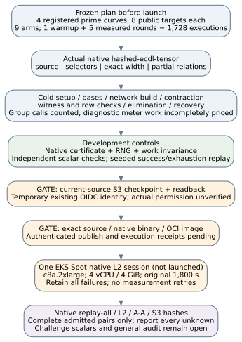

# Native hashed ECDLP through ECBench

The request is to run the implemented algorithm end to end and establish
where it completes, exhausts its budgets, and spends its work. This is the
actual native crate, not ECBench's separate `ic.tensor_contraction_v1` port.
No scientific session has been launched at this engineering checkpoint.

## Implementation and verification

The new [adapter](../../src/cryptanalysis/ecbench/hashed_native.rs) registers
`ic.hashed_native_v1` with four explicit backends: the current unmodified
`reduction::solve` entry, selector-domain witnesses, exact width/cutset
witnesses and odd-order partial-relation collection. Every search/resource
policy is explicit before method identity is hashed. The partial entry now
accepts explicit selector options/statistics; its original entry retains the
same defaults. An opt-in thread-local observer keeps deterministic event
counts separate from clocks and clears itself on early return/panic.

Cold phases include setup, bases, network construction, contraction, witness
and relation checks, elimination and recovery. Every prime group call is
charged in the counted unit, including identity/inverse cases. Diagnostics
are not a complete native arithmetic inventory: S remains a lower bound.
The clock includes native observation overhead; it does not establish an
uninstrumented implementation's speed. The runner checks returned scalars
using its separate word-field arithmetic and replays deterministic results.

The online boundary is the first labelled relation query after initial bases
are ready; earlier curve/target checks remain cold setup, and later retries
remain inside online. Partial base/collector initialization shares a cold
stage. Source-identity/record bookkeeping and the runner's verification are
harness costs, separately retained from the native solve interval. A killed
child may have missing native counters; its work is unknown rather than zero.

The matched development suites pass 90 native tests in crypto and 96 in the
binding integration. Controls compare the entire partial certificate, final
RNG state and charged work with observation off/on and default/explicit
options. The ECBench native integration test solves, records, independently
checks and exactly replays successful and exhausted cases. Raw final checks
and failures are retained in [implementation](implementation/README.md).
Passing these tests is not the independent general audit.

Review corrected independent selector-witness replay being charged to search.
Both copies now distinguish witness replay and matrix assembly. A concurrent
mirror fix was merged without rebase/force and both controls/parent journals
were preserved. The final shared finite-extension file passes 11 controls;
its extra certificate/RNG/work accounting control follows the earlier full
90/96-suite runs. Source manifests distinguish each qualification.

Current main's merge `12d82e2d99d52f6391898583c1856ec6a25572b6` interleaved two
test modules and lost delimiters. This prerequisite repair restores both
complete module bodies from parents `ccb75292fa3ce16e84085b3d454eb93f4829904c`
and `1e11a12d66a14a41f50ae83dd779839346243a47`. Both restored bodies compare
byte-identical to their original parent modules; no assertion is removed.
The original parse failure is retained. Sparse compile/runtime inputs were
restored from tracked Git blobs; frozen fixtures were not rewritten.

## Planned scientific run

[spec.json](spec.json), [protocol.json](protocol.json) and the native
[plan](plan.txt) define one bounded first feasibility session. The protocol
must be frozen and committed before affected data, then bound by fresh source
checkpoint/readback and exact native build/image/execution receipts.

| Roster index / field bits | Prime subgroup r | Registered curve | Readable EC1 |
| --- | ---: | --- | --- |
| 10 | 823 | `icv1-fp10-t5-192cb216` | `EC1P10Cfphcf15d87ab724` |
| 12 | 3889 | `icv1-fp12-t19-d4a315df` | `EC1P12Cfphe249b36f57ee` |
| 14 | 16231 | `icv1-fp14-tm43-158b6914` | `EC1P14Cfph4f360f746508` |
| 16 | 65003 | `icv1-fp16-t351-d433f24e` | `EC1P16Cfph25cb80ed53b2` |

Each curve has eight public `hash_to_subgroup_v1` targets. Nine arms are
interleaved with shared per-workload/round seeds: matched `rho.negation`, its
A/A repeat, `rho.negation_v2` as a positive workload/harness control, source,
selectors, selector A/A, width, partial and the bundled `ic.pipeline` MITM
comparator. One warmup plus five measured rounds gives **1,728 planned
executions**, of which 1,440 are measured. The four native strategies share
m=2, tau=32, a five-million-step bound and all explicit resource policies.
This is not a claim that these parameters or the IC comparator are optimal.

The originally considered seven-bit roster index has a six-bit field and
only a legacy alias; it lacks the required readable EC1. The launch panel
therefore uses the four existing fully named rosters above. This change was
made during pre-data planning, not after observing algorithm outcomes.

Placement is one `c8a.2xlarge` EKS Spot worker, a four-vCPU/4GiB native L2
epoch, one original 1,800-second deadline including provisioning, 30 seconds
per child, and zero automatic retries/restores. There is no matched native
runtime preflight yet. The protocol's 1,800-second value is an explicit hard
budget ceiling, not a measured prediction. This first feasibility protocol
records warmup/first-call behavior without adapting the plan and makes no
power, comparative speed or scaling claim. No local test timing substitutes
for a measurement.

The maintained harness requires every record to verify and earn L2, exact
replays, A/A admission and S3 hashes. A native budget exhaustion can therefore
make the job fail admission; retain that outcome and its artifacts. Do not
drop failed arms, relax a gate, compare only the successes, extend budgets or
automatically resubmit. Report per-curve attempted/verified/exhausted/error/
interrupted flow, exclusive phases, missing counters and unpriced work. Only
complete admitted pairs support exploratory comparisons. Symmetric 0/0.1/1
diagnostic sensitivity does not complete an arithmetic inventory.

## Checkpoint and execution gates

The new main-only [checkpoint workflow](../../.github/workflows/isolab-source-checkpoint.yml)
archives an immutable published source and frozen inputs as data, uses the
existing temporary OIDC role, uploads through the maintained checkpoint tool,
and independently reads back source/spec/protocol/archive hashes. It executes
no source-selected code with the uploader identity and starts no experiment.
Its mocked transport controls accept a valid readback and reject six invalid
input/account/readback cases. Mock success is not AWS authorization evidence.
No new identity or permission is provisioned; a real S3 denial stops launch.

After actual checkpoint success, publish the exact commit image using the
maintained main-branch Iso Lab `publish_only` path; verify source, binary and
OCI identities before submitting this literal spec. Retain the original
GitHub/CodeBuild/job/pod identities and reconcile ambiguous submissions without
duplicates. The earlier image route built/published another source revision,
then failed launch. That is not admission for this native revision. The CLI's
redirected log download was denied; the connected GitHub decoded-log API
subsequently supplied the actual log, retained in the implementation evidence.
It records launcher exit 23, job UID `15b95632-4a59-4ed4-a368-e2e998118d95`,
an empty pod UID and no measurement results URI. No current execution
admission or specific scheduler cause is inferred from that older failure.

## Requirements still open

| Requirement | Status at this checkpoint |
| --- | --- |
| Actual native adapter, all-phase counters/clocks and seeded replay controls | Implemented; development validation retained |
| Four registered/name-qualified curves and matched controls | Plan validates; no scientific data |
| Fresh source S3 upload/readback using the current code | Workflow implemented; actual permission/readback unverified |
| Authenticated current-source native image and L2 execution | Not yet verified or launched |
| Full session, exact replay, controls, export and evidence report | Pending the preceding gates |
| Original frozen 60/24 A/B panel and profiling | Separate and still open |
| Binary domains/full challenge pipeline and schoolbook full-pipeline arm | Primitives exist; end-to-end integration/measurement remains open |
| Both Certicom challenge scalars and independent full audit | Unresolved |

Sources checked: the pinned [Bochum reduction](https://github.com/bochum-crypto/subexponential-ecdl/tree/1ee44e562b1b9a50ea339f3b8f81112b5a24b96f),
the source-backed [finite implementation](../hashed_ecdl_finite_size_20261030/README.md),
[ECBench's unit/replay contract](../../docs/ecbench/README.md), the canonical
protocol schema/checker in crypto-autoresearcher, and Iso Lab's
[access](../../taskq/deploy/eks-karpenter/ACCESS.md) and
[harness](../../taskq/deploy/eks-karpenter/HARNESS.md) contracts. Generic finite
decomposition is not a new algebraic sub-rho theorem. The literal source
packet/recursion guards, frozen evidence and leaderboard graphs are unchanged.
