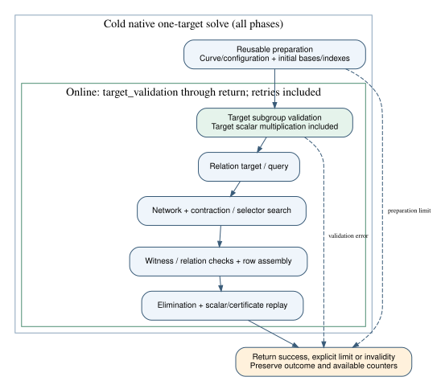

# Native online-accounting correction — 2026-11-04

The native observer now starts the online interval before target subgroup
validation. Initial target-independent curve/configuration/base/index preparation
stays outside that interval; later base retries stay inside it. Source/selector/
width reductions defer the target multiplication until initial preparation is
ready. Partial collection validates its reusable base policies first and enters
the same target-validation boundary. Identity handling and every subgroup,
witness, certificate and scalar check remain. This is a producer implementation
assertion, PCC-20261104-9bb71e, standing unverified. [pcc:unverified]

The adapter retains the actual first online phase in record detail, along with
the source digests, exclusive clocks, counted group work and incomplete arithmetic
inventory. Input normalization and harness bookkeeping retain their cold/harness
scope. This correction supplies a native validation/search interval; it does not
make an unpriced inventory complete. [pcc:unverified]

## Development evidence

| Control | Producer observation | Scope |
| --- | --- | --- |
| Original ordering + same first-query-failure control | Fails: one target scalar multiplication remained in setup instead of zero | Original source at e84d46bb; expected regression |
| Corrected native package in crypto | 121 tests report success | Local native development suite |
| Corrected native package in cryptanalysis | 98 tests report success | Paired library development suite |
| Current finite-extension controls | 12 cases include boundary/certificate/RNG/work checks | Local controls; no scientific timings |
| Native format, strict all-target clippy, Rust 1.78 all-targets | Commands report success in both packages | Exact source and workspace manifests retained |

These observations are producer receipts, not independent signed verdicts.
The mirror statement is PCC-20261104-0f6851, standing unverified. Original and
corrected command logs are retained losslessly beside this report. [pcc:unverified]

The dedicated regression stops on the first oracle call and checks that setup
contains no target scalar call, target_validation contains that call, and the
entire cold clock equals reusable setup/base time plus the online clock. The
canonical online phases still sum exactly to the interval. Existing full
certificate/RNG/meter observation-off/on controls are retained. This is not an
old/new runtime or speedup comparison. Validation now occurs after preparation,
so a preparation limit can be returned before an invalid target is reached;
unknown remains distinct from invalidity and nonexistence. [pcc:unverified]

## Current-main registry integration

The combined-code library run exposed a separate driver integration omission:
`ic.hashed_native_v1` was absent from the exhaustive optimization policy registry.
The original binary reproduces the policy/registry mismatch. The adapter now has
an explicit diagnostic native-grid policy; backend/algorithm choices are knobs,
while trial/work/vector/bit/width/slice/attempt ceilings are resource envelopes.
Other methods keep their previous role classification. A focused regression
checks these roles, and the corrected production code passes strict clippy.
The first incomplete-call-site compile failure is retained with its retry.
These are producer development observations. [pcc:unverified]

PCC-20261104-d06cd6 has unverified standing. The current metadata-only plan
matches all 32 published workload IDs in order and every field of the original
frozen summary: curve identities, generator coordinates, subgroup orders, all nine
resolved arm identities/parameters, 32 workloads and 1,728 executions. It calls
no solver. The original spec and all prior frozen evidence stay unchanged.
`current-plan-summary.json` preserves the comparison input. [pcc:unverified]

## Preserved study and execution prerequisites

The four registered prime sizes, eight public targets, nine arms, seeds,
controls, one warmup and five measured rounds remain the requested 1,728-attempt
plan. Frozen v1/v2 are preserved byte-for-byte. A new pre-data amendment binds
current source and the corrected boundary, plus the current publication,
benchmark-record and finite cloud-cost rules. No scientific measurements are
substituted with local unit timings. [pcc:unverified]

Before any cloud build, obtain current account and lane headroom, including
charged/reserved costs, and enforce the original resource/deadline/retry bounds.
Before measurement, require actual fresh current-source S3 upload/readback and
an authenticated exact native image. Missing headroom stops launch; the user has
been asked for an existing connection/runner name. No IAM, pool, budget or trust
expansion is included. The actual study continues after those prerequisites.

Sources reviewed: existing native reduction/collector code and the pinned
[Bochum reduction](https://github.com/bochum-crypto/subexponential-ecdl/tree/1ee44e562b1b9a50ea339f3b8f81112b5a24b96f),
[review request](https://github.com/isogeny-labs/crypto/pull/2984#discussion_r4426683962),
ECBench's exclusive online accounting contract, main's
[cloud controls](../../../taskq/deploy/eks-karpenter/COST_CONTROLS.md),
[sabotage-resistance contract](../../../docs/SABOTAGE_RESISTANCE.md) and
[benchmark-record contract](../../../docs/benchmark-records.md).

## Custody and sparse-checkout incidents

The published refresh dfa13276 preserves its two parent histories. Current main
2d746d05 merged cleanly as e84d46bb; its tree matches the dry-run tree. There was
no conflict-side fallback. The first sparse PCC append lacked the hidden tracked
main ledger; that uncommitted attempt was preserved separately, the exact main
prefix restored, and canonical appends then passed prefix checks. Missing old
benchmark metadata/raw/report files were restored from exact Git blobs, after
which the unmodified 32-record benchmark gate reports success. No historical
ledger/benchmark record was changed. [pcc:unverified]

Root compile attempts and any subsequent fixture failures are retained with
source identities. They are development checks, not scientific executions.
An archive-based original-source regression and a local reverse-patch copy both
reproduced the same omitted-scalar failure; the local copy's tracked blobs were
compared with the original Git object identities before adding the control.
The failed original ordering is retained, not counted as a passing test. [pcc:unverified]

## Broad combined-code status before driver upload

Producer status PCC-20261104-f78364 has unverified standing. The release
library invocation reports **5,987 passed, 27 failed and 130 existing
ignored cases**. It uses the exact pre-policy source bound in
`broad-run-command.json`; nested child libtest summaries are not added. After
restoring exact historical inputs, the non-policy failed-case reruns report
19 passes and six remaining failures. Two other failures were the missing
native optimization policy; the five fresh current-source policy controls now
pass. Three current adapter controls also pass. There is no single all-green
broad invocation or full-suite pass claim. [pcc:unverified]

The six remaining cases comprise four non-adapter assertions and two diagnostic
clock failures reporting `No such file or directory`. A separate exact main
worktree is compiling those controls; their classification remains pending.
Current CLI debug unit tests report15 passes and1 existing ignore; integration
and the final release build remain pending at this upload. [pcc:unverified]

First debug links ended with SIGBUS while the32GiB overlay was99%full. Removed
only this task's reproducible compiler caches, retained the failed output and
disk snapshots, and retried local debug links with `--strip-debug`. The copied
linker wrapper is retained. An extra full debug namespace was interrupted as
redundant after the required broad release invocation completed; its partial
log is retained without a pass claim. Final release qualification uses the
standard linker and maintained release profile. [pcc:unverified]

Library follow-up1397 is merged as8d054f8843b73d0e2a07c4b1266d93db740cfd0b.
Its expected second parent, recomputed merge tree and main reachability match;
`mirror-1397-merge-custody.json` records the actual first parent rather than
assuming the PR metadata's older base SHA. Tracking that PR ends here.

The frozen v3 protocol hash is
`dcbd69ecce95a742c3f026ce7a839b676b7a31305e596255689167f97e18c58c`,
bound to source commit43ec7065133fc6727382ed744c7c86380170c984.
`frozen-input-files.v3.sha256` names the active inputs; the original manifest
continues to apply at its historical revision. No scientific job was launched.
