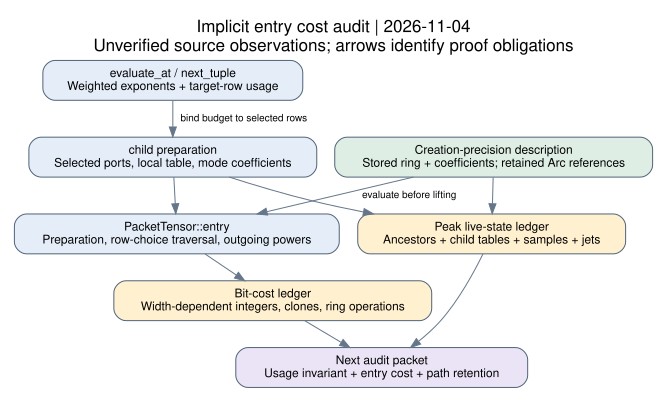

# Implicit tensor entries: traversal, preparation and retention audit

4 November 2026. Claim record **PCC-20261104-1df881** has standing
**unverified**. This is a source-inspection statement, with candidate proof
obligations and resource expressions; it is not a general complexity theorem.
All source observations and interpretations below are unverified assertions.
[pcc:unverified]

The concrete advance is a map from target-row budgets to entry traversal,
including the work and storage outside that traversal. It narrows the next
proof task to local bookkeeping invariants and an aggregate cost ledger.

## Scope and sources

Native source is pinned to crypto main
`2d746d0577ddf797b8706de1f45489fb31ad3d31`. Relevant contraction files
have the same blobs as the prior assessment snapshot, while surrounding
main has advanced. The earlier [assessment](../hashed_ecdl_leads_20261030/README.md)
and [bridge](../hashed_ecdl_leads_20261030/BRIDGE.md) remain unchanged.
Sources and locators are in [sources.json](sources.json); the structured
audit ledger is [audit-map.json](audit-map.json). [pcc:unverified]

Primary text: OpenAI, *The Exponential Time Hypothesis is False*, Appendix
D.1 and D.4.5-D.4.7. The current publisher path's last-change commit is
[`42907c9e`](https://github.com/openai/math/tree/42907c9e999cc00d6abe7a50bfc1023250edd1b9/preprints/The-Exponential-Time-Hypothesis-is-False-October-25-2026).
Its PDF blob matches the cached text used here, also available at the older
implementation pin `7ef5c0cc`. The theorem permits an exponential entry-work
allowance, rather than requiring each entry to take polynomial time.
The child-entry argument uses bounded affine row products and fixed creation
descriptions; the total-call argument prices entry evaluations separately.
These are source statements, not independently checked results here.
[pcc:unverified]

Atlas main `774611edb0a58861c2991372b81e49be0a0644b4` now contains
`LEAD-EXO-hashed-factor-base-tensor-ecdl`. This round advances its independent
audit action; it does not repeat the already delivered selector, width,
partial-relation or binary implementations. Relevant atlas matching was run;
no complete atlas-delta review or new mechanism is claimed.
[pcc:unverified]

## The newly isolated link: target rows to incoming modes

`evaluate_at` builds a bound for each packet/target group by counting real
row ports with that group label. `next_tuple` increments the matching usage
when increasing a mode exponent, and subtracts it on carry/reset. `child`
selects the same packet/group rows and retains only positive exponents as
incoming records. The per-packet entry then consumes those exponents across
its row choices. These are the precise source sites to join in one invariant,
rather than treating incoming-mode count as a new independent free parameter.
[pcc:unverified]

**Next local obligation:** establish that every enumerated tuple's target
usage equals its sum of incoming exponents and does not exceed the selected
row count. Under that invariant, positive incoming records are controlled by
the same row budget. This conditional interpretation is not a completed
formal proof of the enumerator, of weighted-mode coverage, or of its cost.
[pcc:unverified]

## Symbols for the audit ledger

| Symbol | Meaning |
| --- | --- |
| R, C | Selected row and column ports of one packet/group |
| ell | Packet slot capacity; distinct from total description length |
| q, h | Positive incoming and outgoing mode-record counts |
| E | Sum of incoming exponents for the entry |
| B, K | Total modes and packets at the current call |
| D, p | Extension-ring coordinate count and current coefficient precision |
| I, J | Interpolation samples and retained tapered coefficients |

These are symbolic source dimensions, not measured values. Local container
lengths do not by themselves specify allocator bytes or peak process memory.

## Source-to-cost and storage ledger

| Component | Observed loops/data | Quantity the general audit must price |
| --- | --- | --- |
| `child` selection | Scans packet slots; retains old vertices by Arc; builds local row/column arrays | All groups for every tuple, including graph/port allocation and label scans |
| Packet preparation | Local R-by-C table of Elements; q row-coefficient lists; outgoing sparse terms; repeated linear lookups in mode lists | Table construction, coefficient lookup/clone work, stored D-coordinate values and p-bit arithmetic |
| Entry preparation | Constants per row and q coefficient lists are built before the E>R zero shortcut | Preparation still costs work when extraction returns zero immediately |
| Coefficient traversal | Depth-first row choices with remaining exponents, exhausted-mode/zero-factor filters and row-capacity pruning | Attempted choices, rejected choices and ring products; not just accepted monomials |
| Entry scratch | Constants, coefficient lists, prefix products, row-choice vectors and remaining exponents | Simultaneously live Elements and integer/vector overhead, not all full row assignments |
| Outgoing evaluation | Sparse coefficient sums followed by `Ring::pow` and multiplication | BigUint addition/remainder plus repeated-squaring products for every retained power |
| Tuple/group driver | Weighted tuple vector, per-group usage and bounds; group children visited sequentially | Carry/reset scans, child preparation and every evaluated child before zero-product shortcuts |
| Interpolation/recovery | Sample nodes/values and tapered jets; rational numerators/denominators in recovery | Concurrent ancestor state, retained coefficients and rational bit growth |

All rows are source observations and open cost obligations, not calibrated
operation counts or independently checked bounds. [pcc:unverified]

## Traversal contract to check

`PacketTensor::entry` has an explicit depth-first traversal. It branches on a
constant term or an available incoming mode for each row, decrements the
chosen exponent, and restores it when backing up. It rejects zero factors and
prefixes with more required degree than remaining rows. The traversal's
scratch contains a prefix-product vector rather than a table of all complete
choices. A proposed cost bound must include unsuccessful choice scans as well
as coefficient additions and products. [pcc:unverified]

The source's row-product argument is the relevant comparator for this inner
traversal. To transfer it, connect packet capacity, positive-exponent support,
ring precision and mode-description size uniformly to the root parameters.
This review does not replace that induction with a numerical experiment or
with a low-rank assertion. The row budget narrows a proof obligation; it does
not establish the whole recursive bound. [pcc:unverified]

## Creation precision and live descriptions

`Tensor::entry` evaluates a stored packet at its own creation ring and only
then lifts coordinates. `child` copies retained Arc references without
wrapping an old entry callback inside a new packet. New packets store local
coefficient data and incoming/outgoing records. This confirms the earlier
source map's representation reading; nested parent-evaluator composition is
not the outstanding issue identified in this code. [pcc:unverified]

The remaining retention ledger must combine ancestors' packing and mode data,
old packet descriptions still reachable through Arc, newly prepared child
tables, interpolation samples and accumulated jets. Depth-first traversal
avoids retaining every sibling contraction, but it does not make all ancestor
state disappear. `child_precision` increases the working precision by node
and evaluation losses; the audit must bound those widths along the path.
[pcc:unverified]

## Logical meter units and bit cost

The public `Meter` explicitly describes diagnostic primitive steps. Ring
addition charges coordinates, while multiplication charges selected
coefficient products and reduction updates. Integer coefficient multiplication
still depends on operand width. Mode construction also calls BigUint modular
exponentiation directly, and outgoing sparse sums use addition/remainder
without a separate charge inside that loop. Coefficient cloning and allocator
work must also appear in a bit/space ledger. [pcc:unverified]

`Meter::vector` checks one requested length; it is not an aggregate live-byte
counter. `Meter::bits` checks a supplied width; it is not a cost model for every
operation at that width. These distinctions do not establish a semantic bug
or a violation of the source theorem. They identify why a meter total alone
cannot certify the required bit complexity or total retained space.
[pcc:unverified]

## Next discriminating proof packet

1. State and check the tuple-weight and target-usage invariants across an
   increment, carry/reset and termination, including the empty-mode case.

2. Bind `child`'s selected rows and positive incoming records to that usage;
   record preparation before the zero-entry shortcut.

3. Account for the coefficient traversal and outgoing powers with an explicit
   arbitrary-precision arithmetic model; include skipped and failed choices.

4. Sum retained descriptions, scratch, modes, samples and jets along a strict
   shrinking path, using the source precision bounds at each creation point.

This is a review packet with checkable interfaces. A complete proof or a
specific disagreement would decide the next action. No runtime guard,
precision convention, mode contribution or verifier has been changed.

## Delivery and evidence status

This source map and its structured ledger are the deliverable for this round.
The statement record has no proof artifacts and no signed verdict; its standing
is unverified. A new theorem, independent kernel check, identity certificate
or measurement is not asserted. The existing general-audit problem remains
open with the local obligations above. [pcc:unverified]

The [PDF](report.pdf), [editable diagram](dependency.dot), and
[document renderer](render_report.py) accompany the report. Existing canonical
leaderboard, progress and curve graphs receive no new measured value or
transport edge. No scientific experiment, benchmark, challenge solve or paid
resource ran. Source snapshots and all old reports/manifests are preserved.
