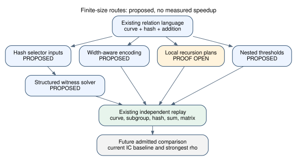

# Finite-size extensions of hashed-factor-base ECDLP

30 October 2026. Status: literature/code review and proposed implementation
directions; no new implementation, experiment, theorem or performance result.

The question is whether the hashed-base relation language can be useful below
the enormous onset of the manuscript's general contraction recursion. The
answer worth testing is yes: retain the relation language and independent
replay, and change the finite-size search strategy. The onset is a guard in
one algorithm, not a lower bound for solving its particular input networks.
The manuscript's asymptotic conclusion is conditional on its cited Boolean
tensor-contraction claim; this note does not independently validate it.

## Scope and identities

Source review uses native code at `edfadbab5ac71471be7fd2971a9e50825307363f`,
Bochum v0.2 at `1ee44e562b1b9a50ea339f3b8f81112b5a24b96f`, and the
lead atlas at `fc26d24369e56ad20995380475989c40a5e0e84f`. No timed run or
curve-panel input was generated. Native source inspection is development
evidence; cited historical results are not reproduced by this review.

The prime-field target is the official ECCp-131 fixture
`crates/hashed-ecdl-tensor/examples/eccp131-certified-hash.json` at the native
revision above: short Weierstrass model over prime
`p=1550031797834347859248576414813139942411`,
`a=1399267573763578815877905235971153316710`,
`b=1009296542191532464076260367525816293976`, subgroup order
`r=1550031797834347859219047037805205710577`, cofactor one. The certified
hash modulus is `s=3102808443644027376164572183694178153449`.
ECC2K-130 is a separate binary-field problem: use its complete pinned
[parameter record](https://github.com/isogeny-labs/crypto/blob/ac60ab732e71a040a9ead9282c3469c7e25b426d/research/btn_ecdl_20261029/README.md),
not a prime-field surrogate. Its field extension degree is 131; it has no
intermediate subfield other than GF(2). Proposed binary XOR/Frobenius routes
are not automatically prime-field routes.

## Candidate extensions, ranked by the next engineering decision

| Route | Concrete change | What would justify continuing |
| --- | --- | --- |
| Hash-preimage inputs | Branch on each hash interval value, derive the encoded point, reject failed decodes/subgroup checks | Lower full relation cost at the same useful relation yield |
| Witness-oriented structured backend | Export typed arithmetic constraints; search for one decomposition with propagation or exact SAT/SMT rather than counting every completion | Above-leaf pruning and reduced charged cost, including failed attempts |
| Width-aware encoding and contraction | Plan low-arity exact factors, elimination order and cutsets; choose arithmetic gadgets by resulting width | A checked time/memory plan that wins against the current native baseline |
| Instance-certified recursion | Admit small packet parameters only after checking the exact local correctness and termination obligations | Valid transformations with genuinely smaller/priced children |
| Nested bases and partial relations | Use inner/outer hash thresholds; retain relations with a bounded number of outer-base points and eliminate them | More independent useful relations per total cost, including graph/matrix work |

### 1. Make inverse-hash selectors the free inputs

`FactorBase::enumerate` already loops over the threshold interval and inverts
the affine hash to obtain point encodings. `decomposition_network` instead
allocates free point coordinates and then constrains membership. Reuse the
existing enumeration parameterization *inside the relation search*: a bounded
selector determines a candidate code; a decoder determines its point.
There are roughly `ceil(log2(tau))` free selector bits per slot, with a range
check, rather than two freely chosen field coordinates. Arithmetic and
decoder witnesses still cost work and auxiliary variables.

This requires deterministic canonical decoding, rejection of invalid codes,
and a faithful subgroup check. Fixed cofactor projection can introduce
multiple source assignments; do not silently equate assignment counts with
distinct decompositions. A functional decoder or solver propagator may be
useful before a fully bit-blasted decoder circuit exists. Preserve source
counting and witness APIs separately. This is a proposed use of the existing
inverse map, not a new certified algebraic identity or a sub-rho algorithm.
Enumerating every selector tuple remains generic decomposition search.

### 2. Solve for a witness and preserve algebraic structure

Relation collection needs a verified decomposition. The native functional
witness path already avoids repeated counts, but still branches over its
declared free inputs and checks a count-precision policy. A separate explicit
witness-only backend could combine the selector domain with propagation,
incremental target assumptions, and SAT/SMT; native XOR support is especially
relevant to binary fields. Opaque `FnPredicate` closures are not a CNF exporter:
a typed gate/arithmetic representation or checked propagators are needed.

This is an engineering hypothesis with strong prior cautions. The atlas's
[binary decomposition entry](https://github.com/isogeny-labs/crypto-autoresearcher/blob/fc26d24369e56ad20995380475989c40a5e0e84f/knowledge/leads/ecdlp/ic-binary/LEAD-ICB-decomposition-encoding-and-sat.yaml)
records negative scaling for previously tested SAT/enumeration encodings.
Its separate SAT/XOR lead remains open for honest pricing, not a validated
end-to-end win. The [WDSat primary paper](https://pmc.ncbi.nlm.nih.gov/articles/PMC7334981/)
supports structure-aware binary PDP solving; it does not establish a win
over rho or on this prime-field hashed language. Timeouts are UNKNOWN, not
UNSAT. Every returned relation must pass curve/hash/group replay. Any new
claimed advantage must identify the pruning mechanism missing from those
older families, and charge conflicts, propagation and unsatisfiable attempts.

### 3. Optimize width, not only edge count

For conventional exact contraction, peak intermediate rank and the number
of slices determine feasibility. A linear-edge Fourier gadget can build
quickly while contracting poorly. Compare its actual contraction structure
with ripple/schoolbook or other native multiplication encodings at the
intended small widths. Keep sparse/functional predicates intact when helpful;
never materialize an exponential truth table merely to enter a tensor API.
Factorization into low-rank tensors needs a valid structured factorization,
not a general assumption that every predicate can be split cheaply.

[TensorOrder](https://arxiv.org/html/1908.04381v1) supplies a primary-source
precedent for decomposition-guided contraction and conditional tensor
factorization. This repository's historical binary bucket/cutset prototype
already encountered width growth on tiny fields; that result is a warning,
not a measurement of the different native Fourier encoding. Exact counts
must remain exact: approximate SVD/truncation or floating-point count
accumulation cannot certify zero solutions. Permutation sorting is also
invalid across distinct slot-specific bases unless interchangeability is
proved or the base distribution is deliberately changed and reanalyzed.

### 4. Replace the global recursion schedule with checked local plans

The literal native schedule sets its root scale from a logarithmic size
parameter divided by 131072. Machine-indexable graphs therefore never get
a positive production scale. The source footnote explicitly describes the
small-size brute-force fallback. This does not show that every possible
smaller packet transformation is invalid or unhelpful.

Small forced controls in `contraction/recursive.rs` and
`contraction/coupled_controls.rs` already compare transformed contractions
with direct counts. They establish only their tested cases. A research
extension would separate identities required for correctness from sufficient
conditions used to prove asymptotic shrinkage. An admitted plan must check
packing/no-collision conditions, all coefficient/mode contributions,
precision/valuation losses, reconstruction, child sizes, resource limits and
termination. Start with one transformed layer and a real priced fallback.
Simply changing epsilon or copying test parameters does not inherit the
manuscript's correctness or complexity guarantee. This is the closest route
to lowering the *same recursion's* onset, and has the largest proof gap here.

### 5. Nested hash bases and partial-relation collection

Two thresholds on the same hash define a small inner base and a larger
enumerable outer base. A proposed collector can admit one or two outer
points and combine partial relations, rather than discard every near miss.
This is a large-prime technique transferred to hashed point bases. Price
outer-base setup, storage, duplicates, elimination and final matrix rank;
slot/point identities and coefficients modulo the odd subgroup order must
be preserved. Ordinary binary graph-cycle cancellation is not sufficient.

The atlas's [large-prime review](https://github.com/isogeny-labs/crypto-autoresearcher/blob/fc26d24369e56ad20995380475989c40a5e0e84f/knowledge/leads/ecdlp/ic-binary/LEAD-ICB-large-prime-variants.yaml)
reports unqualified historical component observations improving a binary
collector, with rho still ahead. Those observations are neither independently
qualified here nor transferable speedup evidence for the hashed contractor.
Negation/Frobenius orbit bases are a separate possible constant improvement;
their membership, enumeration and coverage proofs must be rebuilt, and the
rho reference must receive the same available symmetry benefit.

## Decision and remaining work

Proposed implementation order: selector-domain witness search, then a
width/propagation-aware backend. Keep checked adaptive recursion as a separate
proof-and-planner track. Generic MITM, a bigger arity, and a faster SAT wrapper
alone do not supply the missing algebraic advantage. Better than the current
IC baseline is still a useful engineering result even if rho remains ahead.

The [draft backlog card](../../backlog/XP-20261030-hashed-ecdl-finite-size/README.md)
retains a possible finite-size study. Its driver, frozen curve identities,
protocol, cost envelope and independent checker do not exist yet; it is not
ready or authorized for unattended execution. No scientific run occurred.
S3 checkpoint upload/readback succeeded earlier; authenticated native image
and execution readiness remain distinct unverified prerequisites. Preserve
the existing frozen matched A/B panel, challenge-solve tasks and full audit.
No measured speedup, practical 130-bit reach, scalar recovery, or novelty
claim follows from this review.

Graph audit: `docs/index-calculus-scoreboard.html`,
`docs/ic/progress-timeline.json`, `docs/ic-leaderboard.html`,
`docs/curves/`, `docs/performance-gains/` and `figures/` have no new measured
fact or curve-transport edge to add. No canonical graph or leaderboard is
changed. The editable [diagram](routes.dot), [PDF report](report.pdf) and its
[source](report.tex) are part of this planning record.

Additional sources checked: [original manuscript](https://github.com/bochum-crypto/subexponential-ecdl/tree/1ee44e562b1b9a50ea339f3b8f81112b5a24b96f),
[native relation code](https://github.com/isogeny-labs/crypto/blob/edfadbab5ac71471be7fd2971a9e50825307363f/crates/hashed-ecdl-tensor/src/reduction.rs),
[generic oracle scope/cost review](https://github.com/isogeny-labs/crypto-autoresearcher/blob/fc26d24369e56ad20995380475989c40a5e0e84f/knowledge/leads/ecdlp/ic-engine/LEAD-ICE-generic-oracle-arity-cost-floor.yaml).
No comprehensive novelty audit or independent validation of the historical
atlas measurements was performed.
