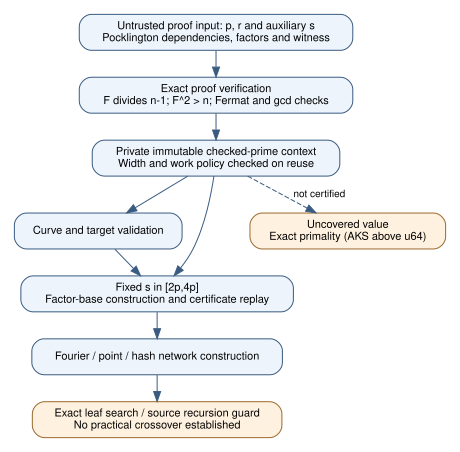

# Checked hash-prime setup for native ECCp-131

Engineering/correctness update, 2026-10-30. The curve proof path already landed
in crypto #2891 / cryptanalysis #1305. This follow-up carries checked auxiliary
prime facts through hash-modulus selection, factor-base construction and replay.
It does not establish a runtime improvement or practical contraction.

## Finding and correction of attribution

The user reported a 54-minute setup hang, Fourier-network construction of
2.5 ms at 131 bits / 10 ms at 1,024 bits, a u64 primality path at most 17 us,
and a 65-bit AKS timeout at 180 seconds. These are user-reported observations;
this session did not independently reproduce or admit those timing comparisons.
The source trace confirms the >u64 AKS branch and the repeated factor-base
primality call. A primality timeout is not evidence that Fourier-network
construction is impractical. The earlier attribution is corrected accordingly.

There is one important qualification: `Curve::with_cofactor_and_certificates`
already sets up official ECCp-131 with checked p/r proofs. Plain `Curve::new`
and uncovered `is_prime` inputs retain the exact AKS fallback. The remaining
gap was that the checked facts were discarded before hash-prime/factor-base
setup and replay.

## Source-supported implementation

Bochum v0.2, section 3, fixes any prime s in [2p,4p]; the hash seeds are uniform
for that fixed modulus. The later running-time discussion permits selecting
s once. Uniform sampling of s is not a prerequisite for the factor-base lemma.
The pinned primary PDF's Git blob is
`44b1e3de53927ff576b2e0f761f5f39e1df30a61` at revision
`1ee44e562b1b9a50ea339f3b8f81112b5a24b96f`.

- A curve now retains its private set of verified proof facts. Callers cannot
  insert an unchecked prime. Reuse still checks the current width/work limits.
- `FactorBase::new` uses this context; certificate replay follows the same
  checked construction. An uncovered modulus still requires exact primality.
- Optional `Config.hash_prime` / JSON `hash_prime` selects an explicitly
  declared fixed s. `None` retains the original candidate stream and RNG draws;
  32 seeded controls compare both the selected prime and final RNG state.
- Explicit selection consumes no random-prime draws. It is a declared input
  change, and must not be silently substituted into the frozen default panel.
- Runner `validate` checks p, r, target and configured s. Runner replay rejects
  a nonidentity certificate whose modulus differs from the declared pin.

The new example `eccp131-certified-hash.json` supplies
`s = 3102808443644027376164572183694178153449` (132 bits). Its additional
Pocklington node uses the already certified divisor
`q = 20182705700968071083965838734546093` of s-1 and witness 2. The existing
verifier checks every dependency, divisibility, strict F^2 > s, Fermat and gcd
conditions under [HAC Fact 4.40](https://cacr.uwaterloo.ca/hac/about/chap4.pdf).
No probable-prime result is accepted as a proof.

The retained native `prepare-certified-hash` example constructs this public
fixture by bounded candidate-proof attempts. It found the checked node after
68 candidates and 371,334 diagnostic charged steps. This is proof-fixture
preparation, not a general fast prime-proving algorithm. Its cost belongs in
future cold accounting; the original p/r proof-generation costs remain unpriced.

## Actual development evidence

All six targeted controls passed: official 132-bit hash setup / multiple bases;
width, work, range and seed guards; missing-proof exact fallback; a separately
factored 65-bit Pocklington case; a tiny fixed-hash solve with algebraic replay;
and runner preflight / pinned-modulus rejection. Parameter, target and hash
preflight charged **5,897 uncalibrated steps**, below the original 2,000,000
policy. This is neither elapsed time nor a runtime speed ratio.

Full native suites, lint/MSRV results, source hashes and the initial corrected
fixture-preparation compile failure are retained beside this report. Tests
exercise the implementation; they do not close its independent general audit.
The complete panels pass 44 tests in crypto (35 library, 3 panel, 6 new
integration) and 55 in cryptanalysis (38 library, 5 runner, 3 panel, 6 new
integration, 3 strict-JSON). Both strict all-target clippy, formatting and Rust
1.78 all-target checks pass. Raw suite elapsed times are development diagnostics
and are not compared across these different integrations.
The two integrations preserve their independently landed main-branch changes,
including cryptanalysis's strict input/point handling and dependency pruning.
The new fixture, preparer, integration tests and feature patch agree; inherited
implementation differences are not represented as whole-source parity.

## Remaining walls and measurement status

The literal recursion guard is unchanged: root_u = ceil(log2(2E))/131072 with
integer division. Positive root_u requires E > 2^131070; this is a necessary
guard, not a demonstrated usable crossover. In this machine-indexed
implementation lambda <= usize::BITS, so the production guard stays zero for
every representable graph. Existing forced-recursion tests do not change that
fact. Practical factor-base size, exact leaf search and configured resource
limits remain separate downstream obligations.

Generic uncertified >u64 primality still uses AKS. Passing the supplied p/r/s
setup does not mean every large input can be proved quickly, enumerate a full
challenge base, produce a relation, or recover a scalar. Both challenge solves,
the independent general correctness/complexity audit and the admitted matched
performance comparison remain open. S3 checkpoint upload/readback is already
verified in docs/hashed-ecdl-s3-checkpoint.md; native image/execution and profiling
remain unverified. No scientific/profile/benchmark run was launched here.

The frozen prior study's diagrams and leaderboard/curve/isogeny graphs were
checked for relevance: their recorded results and routes have not changed.
This setup flow is new, additive evidence. No timing series or leaderboard row
is promoted, and the earlier report/protocol/source snapshots remain historical.

[Primary source](https://github.com/bochum-crypto/subexponential-ecdl/tree/1ee44e562b1b9a50ea339f3b8f81112b5a24b96f)
· [Diagram source](setup.dot) · [PDF](report.pdf) · [PDF source](report.tex)
