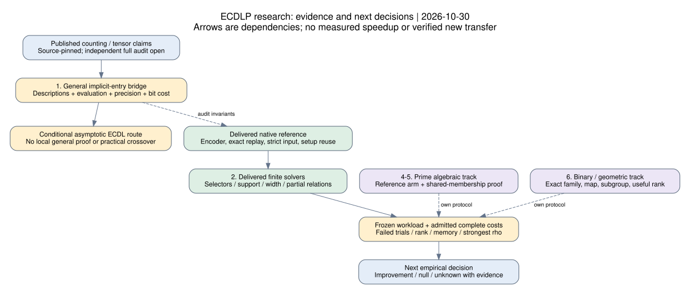

# ECDLP research program: state, leads and next decisions

30 October 2026, 15:21 UTC snapshot. Evidence assessment and source-level
investigation; no new algorithm, theorem, experiment, benchmark or challenge
solve. The renewed request is to assess the program and keep pursuing leads.

**Assessment:** code availability is no longer the central hashed-ECDL gap.
The priorities are independent validation of the general contraction route
and complete-cost evaluation of the finite algorithms already delivered.
Generic engineering, algebraic solving and special-family transfers remain
separate tracks. Progress in one does not establish the others.

## Snapshot and method

Reviewed crypto main `fc9af16fa1ce0654ee9df3ce63101c487ed215fb`,
cryptanalysis main `5939def096fd181973e1abb7279644a8aa531557`, and atlas
`58f41b1625c66c637b0bf2b373b5cf65c17cf85c`. This is a targeted assessment,
not an exhaustive audit of all repository experiments. Merged PRs were not
reopened or put back into tracking.

Read canonical problems, implementation receipts, leaderboard qualifications
and atlas matches before searching current primary sources; then inspect
native admission/search code and actual formalization entry points. Pins and
hashes are in [sources.json](sources.json). The [bridge map](BRIDGE.md) records
the first pursued lead and remaining obligations. The [PDF](report.pdf),
[editable diagram](dependency.dot) and [renderer](render_report.py) accompany it.

The old local atlas brief reported 150 leads. Reading current pinned records
gives **152**: 52 open with a next step, 17 blocked, 9 unexamined, 74 in closed or
exhausted categories. These are metadata counts, not probabilities or a
complete literature census. Relevant changed records were reviewed; no full
atlas-delta stamp was made. Sparse checkout's earlier 0/0 ledger coverage is
not a coverage finding. Atlas matching was run before proposing mechanisms;
new questions below advance existing leads rather than claim novelty.

## What is established, and what is missing

| Track | Current evidence | Gap that matters next |
| --- | --- | --- |
| Conditional hashed-ECDL | Compact encoder, exact counter, forced recursive controls, reduction/replay and strict inputs exist | Independent general proof-to-code and complexity audit; practical source guards select finite fallback |
| Finite hashed-ECDL | Selectors, last-slot derivation, exact width/cutset plans, support propagation, partial relations and binary components implemented and development-tested | No admitted matched full-cost panel or evidence of an exponent improvement |
| Prime algebraic IC | PKM/tower machinery and preregistered fall-degree program exist | Naive prime-field reference arm is still a plan; solving degree and complete relation cost unresolved |
| Generic IC engineering | Table/pair/root-finding and setup improvements are implementation work | Compare against strongest matched rho; no algebraic exponent gain follows |
| Binary and transfer work | Frobenius-aware bases and special GHS-weak-family results exist | Preserve exact field/family, executable map, subgroup transport, useful relation rank and total cost |
| Execution/evidence | Historical checkpoint upload/readback recorded | That does not grant this session a native execution route or admit a new run |

The canonical leaderboard says no row of tables A-C is below its reference.
It also reports special GHS-weak-family wins outside those tables; those must
not be generalized to arbitrary curves. Table C is 32-target batch work, not
primary one-target evidence. Table B's prime IC/rho ratios 5.47-13.5 carry
`validated_with_caveats`, including `pricing_ok=False` and partly frozen
protocol status. These are historical board entries, not new fully admitted
measurements or a universal security conclusion. See the
[pinned board](https://github.com/isogeny-labs/crypto/blob/fc9af16fa1ce0654ee9df3ce63101c487ed215fb/docs/ic/LEADERBOARD.md).

The finite-size review's first five proposals have since received an
[implementation follow-up](../hashed_ecdl_finite_size_20261030/implementation/README.md).
Do not propose their implementation again. Checked local plans certify finite
conditioning/elimination, not a smaller-parameter Appendix-D packet transform.
Partial-relation provenance exists; useful rank, yield, storage and total cost
remain to be evaluated. Main's independent additions remain intact.

## What changed in the external literature

Bochum v0.2 remains at
[1ee44e56](https://github.com/bochum-crypto/subexponential-ecdl/tree/1ee44e562b1b9a50ea339f3b8f81112b5a24b96f).
It reports a conditional asymptotic ECDL reduction using general Boolean tensor
contraction. Fixed cofactor and growing decomposition arity accompany its use.
This is not a locally independently verified theorem or a concrete deployed-
parameter attack.

Two primary formalization releases merit separate inspection:
[OpenAI's scope and linked development](https://github.com/openai/math/blob/4eaee87548250b2682affda7d05d947c05554bae/lean/docs/378.md)
and [Anthropic's ETH project](https://github.com/anthropics/formal-math/tree/16a5ce41304fcdaea4e0be7c132e1c361dc26da5/eth).
Both publish counting/SAT statements; they are not interchangeable certificates
for arbitrary succinct arithmetic predicates. This round read statement and
entry files, not full proof dependency graphs, and did not run Lean.

The Hexagon [weighted-counting extension](https://hexagonmath.org/2610.00594v1)
reports local weights over commutative rational algebras. Our
[existing integration](../hexagon_cscc_20261030/README.md) distinguishes its
exhaustive weighted reference from a port of that asymptotic engine. Ring,
representation and coefficient-cost bridges remain research obligations.

Searches also returned quantum resource estimates and guess-and-determine
claims. They were not advanced as classical hashed-ECDL leads: abstract/search
listings do not discharge a classical complete-cost bound. This search is
not evidence that no other method exists. No claim of novelty, consensus
acceptance, impossibility or deployed-curve break follows.

## Lead pursued now: theorem to code

**Completed source finding:** `lean/formalization.yaml` names
`OAI.Algorithms.SubexponentialSAT.SqrtLogSpace.exact_count_and_sat` in
`SqrtLogSpace/Final.lean`. Comparator JSON loads
`OAI.Algorithms.SubexponentialSAT.Main`, which imports the actual solution.
The comparator's `sorry` is an intentional statement placeholder, not a proof
defect. The solution entry has proof terms; reading them is not kernel checking
or an axiom audit.

The advertised endpoint counts fixed-width CNFs, with its exponent measured
in CNF variables. Bochum needs a general implicit tensor theorem parameterized
by network size, with specific entry-description and evaluation hypotheses.
Arithmetic-circuit auxiliary variables must be charged. Polynomial-time
predicate evaluation alone does not retain the quantitative saving; the
source paper warns that naive low-arity expansion can erase it.

**Completed native finding:** `Setup::new` computes logarithmic size in
`usize`; `parameters` divides it by 131072 before admitting recursion. On
at-most 64-bit targets that scale is zero for every public representable graph.
`Counter::count` selects Functional/Direct fallback or returns a resource error.
Forced controls bypass admission and remain bounded correctness evidence.
This known source boundary was checked again on current main; it does not
refute an unbounded asymptotic theorem. No guard was changed.

[BRIDGE.md](BRIDGE.md) separates source statements, formal endpoints, native
invariants, entry work and acceptance criteria. It advances the audit from
“read the proof” to named interfaces while leaving general validation open.
The next source trace also found that newly created packet descriptions have
no nested parent callback: they retain coefficient data and their own ring.
The open cost target narrows to coefficient-extraction traversal, preparation,
mode enumeration, retained data and aggregate bit work, rather than assuming
callback composition is a present defect.

## Next steps, ordered by the decision they resolve

| Priority | Lead and next artifact | Discriminating criterion |
| --- | --- | --- |
| 1 | General tensor bridge: pinned hypothesis/endpoint map, then declaration/dependency and bit-cost audit | Faithful general endpoint or quantitative reduction preserving the size saving; otherwise name the missing lemma |
| 2 | Finite solver discrimination: prepare paired complete-cost contract for delivered selectors, propagation and width plans | Charge decodes, supports, failures, slices, memory, useful rank and replay; continue on complete-cost improvement over frozen native baseline |
| 3 | Local packet admission: separate transform identities from sufficient asymptotic guards | Packing, every mode, creation precision, reconstruction, termination and total child/evaluator costs together; changing epsilon alone rejected |
| 4 | Prime algebraic reference: implement/price already specified Semaev-naive arm | Same instances, full solver cost, strongest matched rho and full pricing band; low first-fall degree alone insufficient |
| 5 | Shared membership coefficients: advance existing norm/quotient/Graeffe lead | Chart correspondence, full root/point recovery and preserved yield before comparing solve cost; excluded charts or hidden degree fail the shortcut |
| 6 | Binary/geometry: advance Frobenius and transfer obligations on exact fields | Replayable useful relation or executable subgroup-preserving transfer, then rank/cost; map or rank alone not a faster solver |

Items 1, 3, 5 have source/proof work before paid computation. Item 2 prepares the
existing measurement requirement; it does not turn test durations into speed
claims. Existing approved jobs are not expanded by this assessment. No paid
or scientific job was launched.

## Fresh questions, without claiming new mechanisms

**Typed predicate export.** Native `FnPredicate` closures hide structure from
solvers; width propagation enumerates their remaining support. Investigate
a typed arithmetic/XOR representation with replayable propagation certificates.
Preserve exceptional point cases and count multiplicities, and price building
the representation. A cheaper answer from a different counted language is not
a solver improvement. This advances existing SAT/encoding leads.

**Complete plan cost before execution.** A maximum-rank certificate does not
price slice count, repeated tables, bit lengths and coefficient arithmetic.
Can a source-bound per-instance cost certificate reject bad plans before
solving? Compare to existing greedy plans only under an admitted protocol.
This is a planning hypothesis, not an optimality certificate or measured gain.

**Joint membership before independent root tests.** Atlas lead
`LEAD-ICP-shared-coefficient-membership` remains unexamined. Its norm/chart
correspondence is a concrete proof task. Keep its empty squarefree-chart
negative control, repeated-root arm and point recovery. It may expose a useful
representation or only move degree cost elsewhere; neither outcome is a
universal obstruction.

**Weighted contraction as a separate bridge.** Map rational coefficients and
costs to the exact local ring/count interface first. Do not substitute min-plus
or approximate truncation for exact counting. Existing exhaustive profiles
are a reference, not the fast engine.

## Immediate continuation and boundaries

First lead pursued: [BRIDGE.md](BRIDGE.md). Next inspect general implicit-entry
recursive description/evaluation work against immutable creation-precision
callbacks. Preserve a first counterexample if found; do not lower guards to
make an example run. The [general-audit problem](../../problems/hashed-ecdl-tensor-backend.md)
stays open.

Verified this round: current pins; delivered/planned distinction; relevant
atlas collisions and current metadata counts; formal endpoint tracing; native
admission source review; scoped report and visual validation. Partial: general
proof-to-code audit and broad program coverage. Not done: kernel verification,
new experiments, timing, challenge solves, novelty certification, new transfers
or scientific state promotions.

No new measured cost, curve or admitted bound: canonical leaderboard,
progress-timeline, index-calculus scoreboard and curve/performance graphs stay
unchanged. The diagram is explanatory. Exact curve/subgroup identities for a
later run must come from its frozen protocol; this assessment targets no key
or live instance. Old root/setup receipts remain source-specific historical
validation, not tests of current main.

Conductor is absent (127); documented warn-and-allow fallback, no reservation.
Sparse-file reads were repaired by materializing tracked paths. A guessed Lean
URL returned 404; published scope/catalog links located the actual solution.
An initial patch rejected duplicate delete/add operations before applying;
rewrote only the unpublished draft after saving a scratch copy. Earlier draft
wording prematurely claimed a PDF/diagram; those artifacts are checked before
publication here. No frozen receipt, manifest, dependency or gate was edited.
