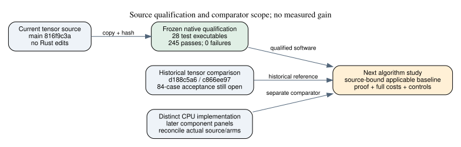

# Native counter qualification and baseline reconciliation

23 November 2026. The unchanged current native crate builds, and its 28 frozen
test executables report **245 passed, zero failed or ignored**. The previously
reported missing-module build failure does not reproduce at this source pin.
This is a fresh software qualification, with unsigned producer standing
**PCC-20261123-d1840d**. [pcc:unverified]

The user's continuing goal is a substantiated classical prime-field ECDLP
algorithm, followed by improvements against the applicable recorded baseline.
Quantum algorithms and S3 are excluded. A component improvement counts at its
measured scope; these software checks do not discharge the algorithm goal.
[pcc:unverified]

## Source and execution

Tested HEAD: `1f71987723a5c2d069e22abd4f99fc3303f51fee`. Its only differences
from main `816f9c3a942efed569049618c056d12a0c56d693` are ACTIVE/session tracking.
No native Rust source was changed. The official Rust 1.99.1 compiler is
`58cf8f9c35b355199727627d07ae34a4e2846d67`; all five installation-component
archives matched the official channel-manifest digests. [pcc:unverified]

The build command was `cargo test --locked --release --manifest-path
crates/hashed-ecdl-tensor/Cargo.toml --no-run --message-format=json`, with two
compiler jobs. It exited zero. Before executing tests, all 42 compiler-produced
executables were separately copied, made read-only and hashed; the immutable
[pre-call manifest](checks/pre-call.json) schedules all 28 test executables.
They ran serially with `--test-threads=1`; eleven binary harnesses contain no
tests, so the case total is 245, not 28 nonempty suites. Original and qualified-copy hashes
matched before and after; the tracked crate source manifest also matched after
execution. [pcc:unverified]

The test phase had a 600-second original deadline, a 300-second cap per test
executable, and a whole-cgroup physical-memory stop at 15,032,385,536 bytes.
There were no retries. The complete [post-call record](checks/post-call.json)
retains each scheduled executable, exit and stdout/stderr digest. These were
local development checks with other retained data occupying memory; their
durations and cgroup readings are not solver performance comparisons.
[pcc:unverified]

## Baselines that must remain distinct

The following is a source-linked reading of historical producer records,
**PCC-20261123-3d00d0**, rather than a rerun or an exhaustive frontier review.
[pcc:unverified]

| Work | Actual recorded reference | Evidence and next comparison obligation |
| --- | --- | --- |
| Frozen 84-case tensor panel | Baseline `d188c5a6775dff07129084ab2f3f7ae39547c9fc`; sizing candidate `c866ee97` | [Protocol](../hashed_ecdl_speed_20261029/PROTOCOL.md), [status](../hashed_ecdl_speed_20261029/comparison.json), [actual sizing identity](../hashed_ecdl_speed_20261029/sizing-L0-20261031/IDENTITY.txt). Only a two-case, one-A/A/one-A/B sizing diagnostic is recorded there. Full 84-case acceptance remains open. |
| Current tensor implementation | Unchanged native source at main `816f9c3a942efed569049618c056d12a0c56d693` | [Encoding reductions](../hashed_ecdl_dedupe_20261115/README.md) and [five optional collector paths](../point_hash_five_leads_20261116/README.md) already exist. Reusable tables, batched inversion or compressed coordinates alone cannot be presented as an untried mechanism. |
| CPU hashed-ECDLP implementation | A separate implementation and series of component arms | [CPU panels](../hashed_ecdl_cpu_20261030/README.md), [round18](../hashed_ecdl_cpu_20261030/round18/README.md), [round23](../hashed_ecdl_cpu_20261030/reports/round23/README.md). Later source/protocol/arm reconciliation is still needed before naming the strongest applicable CPU arm. These historical L0 records are not current L2 measurements. |

All 85 entries in the original input SHA256SUMS (manifest plus 84 problem
files) match. That is an input-integrity check, not 84 new solver executions.
The old deadline-amendment document explicitly says **proposal, not adopted**;
neither that protocol nor its previous data was changed. S3 access is not a
prerequisite imposed on this local continuation. [pcc:unverified]

The earlier `comparison.json` records baseline/candidate binary digests
`e522c1c1...` / `84276e2c...`; the later sizing identity records
`7c431843...` / `48a4f023...`. They are distinct build/receipt stages, not
interchangeable executable identities. Current option switches do not reconstruct
the historical source. [pcc:unverified]

## Requirements and remaining evidence

| Requirement | Evidence in this continuation / remaining work |
| --- | --- |
| Reproduce the reported standalone build gap | Current unmodified locked release build exits zero; no speculative module repair was made. |
| Bind execution to source and binaries | Separate build/pre-call/post-call records, 42 copied executables, before/after hashes and full native test output. |
| Preserve controls and failures | All 28 scheduled test executables and their outputs retained; setup failures are recorded separately. |
| Larger complete-solver cohort | Original 84 inputs verified, but no new 84-case solve or historical matched A/B run occurred here. |
| General counter correctness and complexity | Still open; forced small recursive tests exercise the kernel below its public size admission and cannot prove the external theorem. |
| Compare an improvement with its baseline | No new candidate or matched performance result is asserted; choose a current source-bound comparator, retain setup, failed attempts, memory and final replay. |
| Novelty and independent mathematical review | No novelty conclusion; KB retrieval is unavailable. A component evidence review is separate from breakthrough review. |

The next proof-oriented audit is the existing
[sharp precision obligation](../hashed_ecdl_dimensions_20261115/README.md): bind
the actual inherited `child_precision` to the tapered D.11 bound, then charge
all attempted modes, retained capacities and entry work. The coarse polynomial
envelope already implemented there does not supply the sharper branching
exponent. Review the pinned primary text and prior tuple/packet work before
adding a purported new mechanism; retain the first exact disagreement if one
appears. The [general audit problem](../../problems/hashed-ecdl-tensor-backend.md)
remains open. This next step does not close other leads. [pcc:unverified]

## Reproduction and provenance

Use the official compiler metadata in [toolchain-plan.json](checks/toolchain-plan.json)
and the original [build plan](checks/build-plan.txt). The administrative freeze
script and thin shell launcher are in `reproduction/`; they run existing native
Rust executables and implement no cryptographic algorithm. Output directories
are exclusive. Build JSON is retained locally with its exact digest in
[build-json-receipt.json](checks/build-json-receipt.json): its 66,102 bytes exceed
the repository's 64 KiB JSON-data threshold, and S3 is excluded. No data was
renamed or recompressed to evade that publication rule. The local handoff
capsule contains the complete original JSON and qualified binaries.
[pcc:unverified]

[Setup/KB gaps](checks/setup-and-sources.txt) · [raw test outputs](checks/)
· [two-page report](report.pdf) · [editable report](report.tex).

Doctests, strict lint, Rust 1.78 compatibility, the root repository regression,
independent execution attestation and general mathematical audit were not performed.
Existing frozen reports, challenge
records and canonical benchmark values were preserved.

