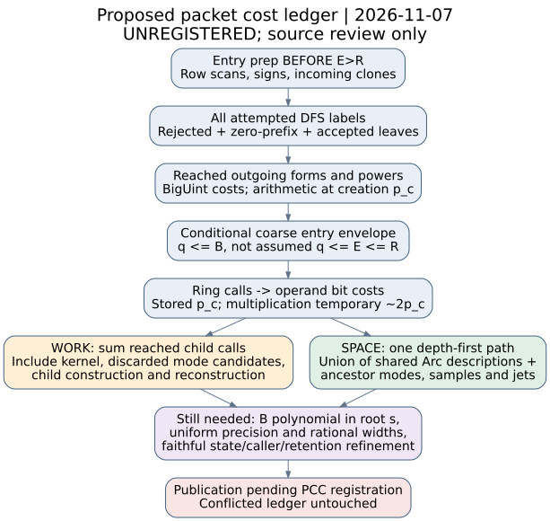

# Packet work and live-storage recurrence: review proposal

7 November 2026. **Unregistered working proposal.** This is a source-pinned
budget specification for review, not a proved bound, executed control or
registered PCC result. It has no claim ID or signed verdict. Publication and
result citation are pending the registration boundary in
[REGISTRATION.md](REGISTRATION.md). All proposed arguments below are
unverified. [pcc:unverified]

The proposed advance joins packet preparation, every attempted DFS choice,
outgoing integer arithmetic, child construction, interpolation and retained
ancestors in one cost ledger. The coarse entry budget uses the full current
mode count B; it does not require the unverified q<=E<=R candidate. That
candidate remains relevant to tuple/child correctness and sharper budgets.
This proposal supplies conditional inequalities and a trace-accounting
recurrence, not a checked complexity theorem. [pcc:unverified]

## Source scope and obligations

Source pin: crypto **08fb3510592ce4849abaf660bbee88191d3d6263**, the published
head of PR3569. The native source still has the Nov6 audited bodies; current
main metadata and prior packets are separately pinned in sources.json. No
whole-program parity is inferred. The prior DFS argument and Nov5 tuple
argument are unverified inputs, not checked lemmas. This study leaves every
old packet, claim and event intact. [pcc:unverified]

Primary source: OpenAI Appendix D.1/D.4.5-D.4.7, PDF last-path change
42907c9e999cc00d6abe7a50bfc1023250edd1b9, blob
0503566e95bc587a4076573a45132d97531b8ba6. D.1 explicitly permits exponential
entry work and polynomial entry space. D.4.6 prices expansion of at most L
row factors and repeated squaring; D.4.7 accumulates depth-first state and
Taylor data. This is the existing audit target, not a new identity claim.
[pcc:unverified]

Sources checked (KB): tools absent, wrapper status exits127 (no executable).
The intended queries and unavailable retrieval are in KB-AND-ATLAS.txt.
Refreshed atlas dfc2d3793c5693404f1147c6e1c954f1e0eafd21 still assigns this to
LEAD-EXO-hashed-factor-base-tensor-ecdl's independent audit. Retrieval scores
are not evidence; no full-delta stamp or novelty conclusion.

## Dimensions and preconditions

| Symbol | Definition; not a measured value |
| --- | --- |
| s, L_desc | Root edge scale and total original graph/tensor-description length |
| m, ell, K, B | Current edges, packet slot capacity, packets, retained modes |
| R,C,q,h | One stored packet's rows, columns, incoming and outgoing records |
| beta_j,E | Incoming target exponents and their sum |
| d,p_c,p | Ring coordinates, immutable packet creation precision, requested precision |
| a_c | Number of selected column bits for this entry |
| n_false | Number of false row bits |
| A,P,F | Attempted candidate labels, committed pushes, eligible visited leaves |
| h_run,S_run | Outgoing records reached and their selected sparse terms scanned |
| W | Machine word bits; vector metadata and indices are charged separately |

Assume valid shapes, canonical coefficients, successful allocations, exact ring
operations, nonnegative exponents and representable R+C,R+1,q+1,E. Refining the
Ok-return path is separate from charging an Err prefix. A limit or arithmetic
error is not an answer or complete traversal. Original Boolean callbacks need
D.1's own uniform evaluation hypothesis; their trait type supplies no bound.
[pcc:unverified]

## One packet entry: a conditional work envelope

Define Add(d,p_c), Sub(d,p_c), Mul(d,p_c), Clone(d,p_c), Zero(d,p_c), and
Lift(d,p_c,p) as **bit costs**, including canonicality checks and allocations
where applicable. BigAddMod(p_c) prices the outgoing BigUint addition/remainder;
its cost is not a Ring::add charge. Define Elem(d,p_c) as an allocated element
footprint; a payload proxy d*(p_c+W) is conditional on a capacity bound, not an
RSS observation. [pcc:unverified]

### Preparation is paid even on the zero-degree exit

Preparing row constants uses R*a_c ring additions and n_false*(q+1)
subtractions. True rows clone their q incoming coefficients instead of negating
them; container initialization and zero/one construction also cost work.
A proposed safe preparation budget is

`Prep_entry = R*a_c*Add + n_false*(q+1)*Sub + O(R*q*Clone + (R+q)*Elem + R*C + q)`.

The R*C term pays bit-index scans even when no selected column causes a ring
addition. Exponent-vector creation and summation cost O(q) word work under the
sum-width premise. The source performs all this BEFORE testing E>R. If that
guard returns zero, the DFS and outgoing costs vanish, not preparation.
The expression is an unverified envelope, not an exact meter total.
[pcc:unverified]

### Traverse attempted labels, not surviving coefficients

Every attempt increments choices[row] and charges the extraction meter before
rejecting an exhausted exponent, zero factor or excessive remaining degree.
Every committed push calls Ring::mul; every eligible leaf calls Ring::add.
The source does not prune zero prefix products: zero divisors do not allow us
to remove those visits from A, P or F. Signs and indexed multiplicities stay
as in the previous source-semantic target. [pcc:unverified]

For review, let b=q+1. A coarse full-tree envelope is

`A <= b * sum_{r=0..R-1} b^r; P <= sum_{r=1..R} b^r; F <= b^R`.

Empty sums are zero; when q=0, use A<=R,P<=R,F<=1 without division by b-1.
These are candidate bounds obtained by embedding the cursor traversal in the
ordered row-choice tree; a faithful state/termination refinement is still
required. Pruning only lowers visits if that refinement holds. The earlier
unverified restoration/capacity argument is not being silently promoted to a
checked lemma. [pcc:unverified]

Proposed DFS bit work:

`DFS_entry <= O((A+P+F+R+q)*W + A*Zero(d,p_c)) + P*Mul(d,p_c) + F*Add(d,p_c)`.

This deliberately includes rejected labels and all backtracking. It may
charge zero tests for attempts that skip before a factor is obtained; that
is a safe overcharge under the stated model, not a measurement.
[pcc:unverified]

### Outgoing arithmetic and final lift

For each reached outgoing record with exponent e, Ring::pow calls mul exactly
`popcount(e) + max(bitlength(e)-1,0)` times on a successful path. It then
multiplies the coefficient sum by that power once. A proposed outgoing budget is

`Out_entry <= S_run*BigAddMod(p_c) + sum_reached [Embed + (popcount(e)+max(bitlength(e)-1,0)+1)*Mul] + scan/zero/allocation work`.

Count all sparse-term bit checks, including unselected terms; S_run in the
arithmetic term counts selected terms, while the separate scan term counts
all reached terms. A zero initial coefficient skips every outgoing record;
a later zero product skips only the remaining records. e=0 still constructs
and multiplies one; child normally omits such records. No factorial or mode
deduplication is introduced. [pcc:unverified]

Packet arithmetic uses p_c throughout. Tensor::entry validates requested
precision and creation identity, then lifts the completed packet result.
Thus `Entry_work <= Prep_entry + DFS_entry + Out_entry + Lift + overhead`.
Substituting p for p_c inside earlier arithmetic would change semantics and
would also overstate which widths actually occurred. [pcc:unverified]

## Translating ring calls into bit work

Ring::add/sub/check scan d canonical coordinates. Ring::mul has at most d^2
coordinate products and O(d^2) reduction updates, with immediate masking.
Canonical input coordinates are below 2^p_c, so a product/update temporary
can need about 2*p_c+1 bits even though stored outputs use p_c bits. A
conditional school-operation envelope is

`Mul(d,p_c) <= O(d^2 * (M_int(p_c)+p_c) + d*p_c + allocation work)`.

M_int is the actual arbitrary-precision multiplication cost, not one unit.
Scratch holds O(d) output coordinates, not a retained d-by-d product table.
Ring::pow uses that cost repeatedly; BigUint::modpow in mode preparation and
BigUint remainder in outgoing forms require their own bit-cost contracts.
Ring/unit inverse and initial irreducible-polynomial selection remain explicit
cost terms. No implementation complexity or allocator bound is proved here.
[pcc:unverified]

## Preparation outside the entry must not disappear

Child construction scans all old vertices and allocates port maps, scans every
packet's slots, builds its R*C local kernel table, scans ALL B modes per packet,
and copies selected incoming/outgoing coefficient records. Incoming lookup is
linear in mode.rows for each selected row; outgoing lookup is linear in
mode.columns for each selected column. Cloning an Arc is cheap reference work;
cloning an Element or BigUint copies coefficient storage. [pcc:unverified]

A proposed construction ledger is

`ChildPrep = graph/map/slot/edge work + sum_packets [R*C*KernelWeight + B*ModeTest + sum_in R*(RowLookup+Clone) + sum_out C*(ColumnLookup+Clone)]`.

KernelWeight is a creation-ring operation cost, not an entry callback.
New packets contain coefficient data and no parent evaluator. They do not
retain the whole current mode vector, but the parent evaluate_at frame keeps
that vector live while the child is evaluated. [pcc:unverified]

Mode construction tries packet/tile/weight candidates before discarding empty
or zero records. Charge their column modpow calls and row mode_coefficient
calls, including discarded candidates. With tile count 2^(i+1), a crude
candidate bound is K*2^(i+1)*max(p-1,0), with separate slot/row scans and
per-candidate column/row work. Stored B alone is not the preparation counter.
Cauchy::new builds its grid/factor inverses before tuple enumeration. All these
are definitions of terms to bound, not established global polynomial bounds.
[pcc:unverified]

## Whole-call work recurrence

Let T(n) price one successful contract call n, including its descendants.
For an active node, I=m*(2*ell-1)+1 samples are used at every active t; local
precision p_t follows child_precision. Let tuples(n,t,j) denote the tuples
actually visited, and groups(beta) the children reached before a zero-product
shortcut. A checkable **trace-accounting specification** is

`T(n) = FrameSetup + Pack(n) + sum_t [RingView(t) + SampleSetup + sum_{j<I} (At(n,t,j)+SampleStore) + Interpolate(I,d,p_t) + JetStore(t)] + Recover(n) + Cleanup`

`At = Kernel + Modes_attempted + BoundsInit + TupleSetup + sum_beta [ProductInit + sum_{g in groups(beta)} (ChildPrep_g + T(child_g) + Mul(d,p_t) + ZeroTest + GroupControl) + Add(d,p_t) + NextTupleScan] + Cleanup`.

Initial ring construction/irreducible selection and Setup are a separate root
setup term, not hidden inside contract. The final NextTupleScan that returns false is included. Empty modes still
produce the initial zero tuple and one group loop. An Err is charged only
through its executed prefix, not treated as a successful term. Neither
recurrence is a newly certified mathematical equality; it is the proposed
partition of source work that a refinement/operation model must check.
[pcc:unverified]

At a fallback leaf with m edges, retain every visited assignment and vertex
entry before the product-zero break. A conservative envelope is

`T_leaf <= 2^m * [assignment/port work + sum_vertices (Entry_work(v) + Mul(d,p)) + Add(d,p)]`.

Original predicates use their supplied bound; retained packet descriptions
use their own p_c and local dimensions. Do not replace every entry by the
cheapest newly created packet. Public machine guards/fallback remain unchanged.
[pcc:unverified]

## Live storage: one recursive path plus reachable descriptions

A new packet's stored logical payload includes

`Desc(P) = R*C*Elem(d,p_c) + R*q*Elem(d,p_c) + outgoing sparse coefficients/indices + exponent/vector/ring metadata`.

Entry scratch adds approximately `(R*q+2*R+O(1))*Elem(d,p_c)` for coefficients,
constants and prefix cells, plus O((R+q)*W) counters; outgoing pow adds only a
constant number of Elements at a time. Actual Vec/BigUint capacities must be
bounded separately. R=0 retains its empty-product behavior. [pcc:unverified]

Let U_path be the union of tensor-description allocations reachable from ALL
live ancestor/child graph Arcs. Count each allocation once by identity. A
retained Arc shares the same description; a new packet adds a fresh allocation.
The active frames also retain graph/packing/port arrays, Cauchy factors, full
mode tables, beta/usage/bounds, accumulated products/sums and temporary child
construction. [pcc:unverified]

While evaluating the jth sample, nodes/values for previous samples and all
previous jets of that frame remain live. After interpolation, current sample
arrays coexist with coefficients until scope exit. The Lagrange implementation
stores O(I) Elements at once but does polynomial arithmetic repeatedly;
recovery retains all jets plus series/quotient scratch and rational
numerators/denominators. Charge actual maximum rational bit widths, not p_t
alone. Earlier samples/jets from EVERY ancestor remain live during descent.
[pcc:unverified]

A proposed peak-storage recurrence is

`Peak(path) <= Bytes(U_path) + sum_live_frames [GraphPacking + KernelModes + TupleState + SamplesJets + FrameScalars] + max(CurrentChildPrep, EntryScratch, InterpolationScratch, RecoveryScratch)`.

Equivalently, a local frame contributes its nonshared live storage plus the
maximum reached child peak, with shared descriptions charged by the union.
Do NOT sum sibling peaks or multiply the parent entry evaluator into a new
packet; do NOT omit ancestors. Samples need up to 2*I Elements; retained jets
need sum_previous q_t Elements at their individual p_t. [pcc:unverified]

## What is needed to compare with Appendix D

| Proposed transfer | Preconditions still to discharge |
| --- | --- |
| New-packet entry envelope exp(O(ell*log s)) times polynomial factors | R<=ell, q<=B with B polynomial in s alone, bounded d,p_c and coefficient/allocator costs |
| D.1 exp(O(s^(9/10))) entry allowance | ell<=s^(1/1000) uniformly; constants fixed; root predicates satisfy original-description hypothesis |
| Polynomial description/live space | Polynomial K,B,I,total jets, coefficient and rational widths per path; logarithmic-depth/shared-identity retention induction |
| D.4.7 total call bound | Correct weighted-tuple enumeration/count, child shrinkage/precision bounds, leaf cutoff and every per-term construction/recovery cost |

The coarse entry envelope needs q<=B, not the sharper q<=E<=R. In particular,
B must be polynomial in s itself for the paper's log s exponent: merely
polynomial in s+L_desc could put log L_desc inside the exponential and lose
D.1's fixed polynomial dependence on original description length. This is a
conditional dependency distinction, not an established bound for the native
backend. [pcc:unverified]

**Disposition:** the source recurrence is prepared, but the complete D.1/D.4.7
allowance is NOT discharged. Faithful tuple/DFS refinement, uniform mode and
precision bounds, ring/BigUint/rational bit complexity and the allocation-union
induction remain obligations. No finite control was run as a substitute.
[pcc:unverified]

Next discriminating step: bind B and all attempted mode-preparation candidates
to root s and the tapered p_t along one recursive path, together with exact
sample/jet lifetimes. That would close the missing dimensional inputs to this
ledger before a faithful machine/refinement proof can claim its bounds.

The general audit remains open. No canonical leaderboard, curve or performance
graph obtains new measurements or transfer edges. Existing measured graphs
and historical reports stay unchanged. This draft has editable source/PDF
and metadata checks; registration and PR publication are explicitly pending.
