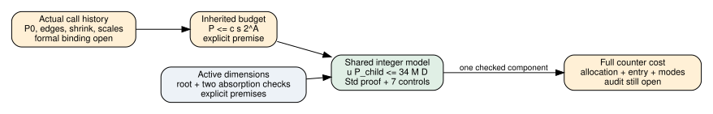

# Tapered precision: checked scalar bound and controls

The shared integer model now has kernel-checked increment and conditional
precision bounds, with **one valid scalar instance and six premise-deletion
counterexamples**. The native PCC Lean verifier and the seven-control proof
gate pass after two retained memory interruptions. The local verifier passes;
the producer claim **PCC-20261123-75fa8c remains unsigned and unverified in
ledger standing**. [pcc:unverified]

This advances a component of the classical prime-field ECDLP counter audit.
The symbols below describe network/precision dimensions: `M` is the current
number of edges and `P` is precision in bits, not the prime-field modulus.
Quantum algorithms and Amazon S3 storage remain excluded.

## Exact statement and meaning

Let `a=A+2u`, `D=2^(a-i)` and `h=ceil(3M/u)`. The source/native precision
expression is `P_child=P+8hD+8M(a+1)`. The shared theorem proves
[pcc:unverified]

```text
u * P_child <= 34 * M * D
```

under all six explicit premises: `u<=M`, `i<u`, `s<=M*q`,
`P<=c*s*2^A`, `c*q*u<=2^(u+1)`, and
`8u(A+2u+1)<=2^(A+u+1)`. The inherited coefficient `c` is a parameter.
These assumptions do not restate the precision conclusion: the two absorption
checks concern dimensions, while the input budget has a separate history
obligation. The source ceiling, natural subtraction and multiplication are
exact; no floating-point or unverified native evaluation is used.
[pcc:unverified]

The proof bounds the three terms by `MD`, `32MD` and `MD` after multiplying
through by `u`. A second shared theorem bounds a single zero-input increment
by `40M2^a` for positive `u<=M`. All proofs compose Lean/Std's existing natural
arithmetic laws. They model the unbounded integer expression, rather than
bounded Rust overflow/error behavior. [pcc:unverified]



## Source fidelity and ownership

Primary proof read directly: openai/math
[`42907c9e`](https://github.com/openai/math/blob/42907c9e999cc00d6abe7a50bfc1023250edd1b9/preprints/The-Exponential-Time-Hypothesis-is-False-October-25-2026/build/quantitative-contraction.tex),
the tapered-Hermite precision formula and `eq:tensor-precision-bound` (D.11).
The exact TeX blob is `51ba54efc29f51bbc0426f848003030da484f354`, SHA256
`671642d7b53154d92344e8c4be0240f18929632ebcfdf73b07c3e9939b873860`.

The reusable model is in its owner, [crypto-lean PR35](https://github.com/aburan28/crypto-lean/pull/35),
commit `3e47fb776a4eb5231de4c8aad2bb6e756c2f89a1`. The
[qualification copy](formal/CryptoLeanCore/TaperedPrecision.lean) is byte-identical
to upstream blob `42ed02cde305b5df5c8145cff3e83df653580831`; it is frozen
dependency source, not a study reimplementation. The
[consumer controls](formal/PrecisionControls.lean) are separate instances.
No Rust solver source, proof gate, trust list, dependency or toolchain pin changed.
[pcc:unverified]

On active inputs `i<u<=a`, the native `2^a >> i` is the model's `2^(a-i)`.
The checked natural ceiling matches native `div_ceil` when the native checked
operations return successfully. An independent same-team reviewer found no
blocking scalar/source/control issue and independently matched the shared
commit, blob and declaration hash; see [SCALAR-REVIEW-01.json](checks/SCALAR-REVIEW-01.json).
This is separate from an execution attestation or a full Rust refinement.
[pcc:unverified]

## Controls and evidence flow

| Control | Outcome and exact scope |
| --- | --- |
| Valid instance | `P=64,M=128,u=16,A=0,i=15,s=128,q=8,c=81`; theorem application passes all premises and the bound. |
| Delete active valuation | A counterexample keeps the other five premises but has `i>=u`. |
| Delete scale/edge bound | A counterexample keeps the other five premises but has `u>M`. |
| Delete inherited budget | A counterexample keeps the other five premises but raises input precision. |
| Delete root comparison | A counterexample keeps the other five premises but decouples root/current size. |
| Delete inherited absorption | A counterexample keeps the other five premises but violates its dimension bound. |
| Delete evaluation absorption | A counterexample keeps the other five premises but evaluation loss exceeds that allocation. |

All seven are closed Lean theorems. Deletion counterexamples show that a
premise cannot simply be omitted from the uniform statement; they do not say
each sufficient condition is pointwise necessary. These numerical instances
are not allocated, publicly admitted recursive graphs or new ECDLP solves.
Control observation claim **PCC-20261123-a53245** is unsigned.
[pcc:unverified]

The three shared statements and seven controls have separate
`#print axioms` output: the inequalities use only `propext` and `Quot.sound`;
the six finite counterexamples have no axioms. The native seven-control gate
reports `PASS 7 thm 0 trusted`. The theorem's exact normalized declaration
SHA256 is `72b48b96db59bc71d059360987abec830ef5c8019625d01758dbd3ba1e7034c1`.
[pcc:unverified]

## Remaining mathematical and solver work

| Requirement | Status / next obligation |
| --- | --- |
| Source scalar formula, one-step and conditional precision bounds | Kernel and native proof-gate checks pass within the stated scalar scope. |
| Full inherited-history bound | Written derivation and Mathlib assembly only; no complete formal history binding. |
| Eventual absorption from all source guards | Not established by checking the conditional scalar endpoint. |
| Complete counter correctness/complexity | Packet/mode, creation-precision, allocation unions, rational widths and entry bit-work bridges remain open. |
| New algorithm improvement / solver comparison | No timing or algorithm experiment here; the frozen 84-case comparison and current optimized comparator reconciliation remain open. |
| Whole-library/current-root CI | Focused scalar qualification does not replace the shared Mathlib library gate or broader native root checks. |

The proposed history coefficient `81` requires **both** `P0<=s` and
`M0<=s`, plus successful 1/8 path shrinkage. The native nonempty normalization
`s=2E, P0=E+1` supplies that initial scale; the manuscript's more general
`P0<=C*s` alone does not fix coefficient81. The source refinement still owes
the complete history binding and its formal composition. Preserve this
distinction when pursuing the next proof step. [pcc:unverified]

## Resource and failure record

The [fresh-directory launcher](reproduction/check.sh) was also executed with
its Lean search path restricted to the new output library plus the pinned
standard library. Core build, seven controls, axiom queries, PCC proof check
and controls gate pass without either Mathlib cache. Reproduce from the repo
root with Lean4.35.0 and Lake available:

```sh
bash research/hashed_ecdl_precision_20261123/reproduction/check.sh NEW_DIRECTORY
```

This is a second qualification environment for the same seven logical
controls, not fourteen independent instances or a new solver cohort.
[pcc:unverified]

Runs were local, with one Lean worker, a 600-second original phase cap,
15,032,385,536-byte whole-cgroup stop and USD0 additional external spend.
Initial root-path, managed-loader-cap, typing/import and Std projection errors
are retained as development failures. Native gate06 and07 were interrupted at
the same physical stop with no verdict; gate09 passes after fixed-footprint
compaction. No theorem assumption, source, gate or trust rule was weakened.
[pcc:unverified]

Generated external Mathlib editor indexes and a bounded private-cache subset
were losslessly archived, fully byte-compared and rehashed before compacting
their duplicate uncompressed copies. All bytes remain in local archives;
owned source, raw research records, partial proof checkpoints and native
executables are unchanged. Restore the documented caches **before a Mathlib
build** and preflight its memory. The Std-only result imports neither Mathlib
pin, and needs neither compressed cache. The two stopped gates remain visible.
[pcc:unverified]

KB tools/backend remain unavailable (wrapper127); the primary source, native
code and previous dimension/packet audits were read directly. No novelty
clearance or frontier closure follows from that limited source review.

[Proof/instance map](PROOF-MAP.md) · [raw checks](checks/)
· [report](report.pdf) · [editable report](report.tex)
· [prior qualified native baseline](../hashed_ecdl_native_baseline_20261123/README.md).

The proof map is a versioned successor with later gate/resource outcomes.
The exact [earlier reviewed map](checks/PROOF-MAP-reviewed-snapshot.md) and
all62 original local review inputs remain byte-identical to that review's
manifest; the original review is not relabeled as a review of later records.
[pcc:unverified]
