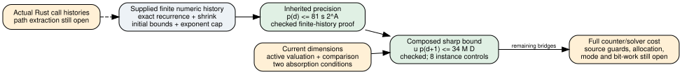

# Finite inherited precision and composed sharp bound

The exact integer precision recurrence now has a kernel-checked finite-history
bound, and a formal composition with the shared sharp endpoint. Three history
statements and eight instance controls compile on the original Lean4.35.0
kernel. The native local PCC theorem verifier passes. The theorem claim
**PCC-20261123-dc026e** and observation **PCC-20261123-8bf465** remain unsigned;
local proof verification does not create signed ledger standing.
[pcc:unverified]

This successor advances the [earlier scalar component](../hashed_ecdl_precision_20261123/PUBLICATION.md)
without changing its frozen report, reviews or manifests. It establishes a
finite numeric history theorem. Extraction of actual successful Rust call
histories and the remaining counter/cost/source-guard obligations are separate.
No solver or timing experiment ran here. Work remains classical and local,
with Amazon S3 storage excluded. [pcc:unverified]

## Exact history theorem

For supplied natural-number arrays `M,u,a,i,p`, finite length `d` and bound
`A`, assume all of the following:

- `M(0)<=s` and `p(0)<=s`;
- for every `k<d`, `8*M(k+1)<=M(k)`;
- for every `k<d`, `0<u(k)<=M(k)` and `a(k)<=A`;
- for every `k<d`, the exact recurrence
  `p(k+1)=childPrecision(p(k),M(k),u(k),a(k),i(k))`.

Then **`p(d)<=81*s*2^A`**. This conclusion is derived from the recurrence;
an inherited precision budget is not assumed. `M` counts network edges and
`p` is precision in bits; neither symbol is the prime-field modulus.
[pcc:unverified]

The proof applies Mathlib's existing finite-index `Monotone.seq_le_seq`
and geometric-sum bound over the rationals to obtain `sum(M(k),k<d)<=2s`.
Only steps `k<j<d` are used; it does not assume an infinite positive shrinking
history. The shared `increment_le` gives each increment at most `40*M(k)*2^A`.
`sum_range_succ` telescopes the exact Nat recurrence, giving
`p(d)<=s+80*s*2^A<=81*s*2^A`. Existing generic laws are instantiated;
no new geometric-series law, evaluator or algebraic structure is defined.
[pcc:unverified]

## Formal composition

At the next numeric call, assume its precision equals the shared expression
with exponent `A+2*u(d)`. Also supply current `u(d)<=M(d)`, `i(d)<u(d)`,
`s<=M(d)*q`, and the two dimension conditions

```text
81*q*u(d) <= 2^(u(d)+1)
8*u(d)*(A+2*u(d)+1) <= 2^(A+u(d)+1).
```

The composed theorem proves
**`p(d+1)*u(d)<=34*M(d)*2^(A+2*u(d)-i(d))`** by deriving the inherited
budget first. The current dimension conditions remain explicit; this is not
their derivation from the implementation's admission guards.
[pcc:unverified]

The prior exponent array is bounded only at `k<d`. The next exponent is
specified directly in its own recurrence; `a(d)` is not linked to that
expression. The coarse history theorem needs no past active-valuation or
cumulative-parameter law. A real-source refinement must supply those additional
facts when extracting an actual path. [pcc:unverified]



## Ownership, sources and initial normalization

The reusable Std-only precision model remains owned by
[crypto-lean PR35](https://github.com/aburan28/crypto-lean/pull/35), commit
`3e47fb776a4eb5231de4c8aad2bb6e756c2f89a1`, source SHA256
`92e4300c71c4b1570ab193df4de22fe31b04a9d7ca0f0212191169555951989a`.
The [history instance](formal/PrecisionHistory.lean) assembles the existing
generic laws at that exact source recurrence; [consumer controls](formal/PrecisionHistoryControls.lean)
are separate. No shared generic law, native Rust algorithm, proof gate,
dependency pin or trust list changed. [pcc:unverified]

Primary source is openai/math
[`42907c9e`](https://github.com/openai/math/blob/42907c9e999cc00d6abe7a50bfc1023250edd1b9/preprints/The-Exponential-Time-Hypothesis-is-False-October-25-2026/build/quantitative-contraction.tex),
Appendix D.11, exact TeX blob `51ba54efc29f51bbc0426f848003030da484f354`.
Native source remains main816f9c3a: `contraction/recursive.rs` precision and
strict shrink checks, plus `contraction.rs` root precision and subdivision.
The original Boolean edge count `E` becomes **`M0=s=2E`** in
`Bipartite::from_boolean`, while initial precision is `E+1`.
For nonempty `E`, `E+1<=2E`; the root edge budget follows by equality to `s`.
The helper normalization theorem's first conjunct `E<=2E` concerns the original
unsubdivided edge count, not a claim that actual root `M0=E`.
[pcc:unverified]

This instance uses exact Mathlib pin
`56a005855ea17e0b0958f73ec801ae140b0a1679` from the existing public-proof
runtime, with Lean4.35.0. It does not substitute that pin for crypto-lean's
different `cfc55...` Mathlib dependency: only its Std-only core is imported.
Whole-library/current-root CI remains separate from this standalone instance.
[pcc:unverified]

## Eight controls and axiom boundary

| Control | Scope |
| --- | --- |
| Empty history | No increments; initial bound is sufficient. |
| Two-step history | Exact two-step increments with edges64,8,1 and bounded exponents. |
| Composed endpoint | Finite history plus explicit dimension checks proves the sharp current bound. |
| Delete initial precision | Other named hypotheses hold but a large initial precision violates81. |
| Delete root edge bound | Other named hypotheses hold but initial edges decouple from root size. |
| Delete shrink | Exact repeated increments with constant edges violate the uniform bound. |
| Delete exponent cap | A prior exponent exceeds the supplied common cap. |
| Delete exact recurrence | Remaining dimensions leave the final precision unconstrained. |

These are eight distinct numeric logical instances, not eight solver runs.
Deletion controls retain the other named hypotheses; they do not make every
sufficient condition pointwise necessary. The composed positive is a synthetic
history: it has native-sized initial precision but `M0=E`, not the actual
subdivided `2E`, and its scale increases from1 to16. It is not an extracted
source-admitted path or allocated recursive graph. [pcc:unverified]

All eleven axiom queries (three statements, eight controls) pass. The history,
normalization, composition and positive instances use standard `propext`,
`Classical.choice`, `Quot.sound`; the five deletion controls use only
`propext`, `Quot.sound`. No custom axiom, sorry or native_decide is used.
[pcc:unverified]

## Qualification and retained failures

The first history attempt failed on a cast parameter name and nonlinear
normalization. Their corrected version compiles without raising limits.
Gate18 passes for the exact composed declaration SHA256
`94e6d3b3d053f6c67f8014c4fb8a1ebd158dd58dfc7dcbba9aa13dfbce9afc8d`.
Gate19 hit the unchanged physical stop and produced no verdict.
[pcc:unverified]

Fresh attempt20 passes its proof checks, but its startup overlaps gate19 by
one second. It is **not accepted as isolated qualification**. A termination
check found it already completed; no live process was killed. Future outer
launches acquire the shared worker lock before execution. The native proof
gate itself is unchanged. Isolated fresh-directory phase22 passes all build
and axiom stages, the PCC verifier and controls gate, with exit0 and no physical
stop. The same eight logical controls are checked again, not another solver
cohort. Its sampled whole-cgroup peak is14,740,750,336bytes.
The raw controls gate reports `PASS 9 thm 0 trusted`: eight named control
theorems plus the definitional equation
`CryptoLeanCore.TaperedPrecision.childPrecision.eq_1`. This is nine audited
declarations, not nine independent control instances.
[pcc:unverified]

Malformed registration `PCC-20261123-f665ec` used a JSON-file path instead
of a structured Lean proof. Its local verifier fails and it is not evidence.
Its bytes/ledger row remain unchanged; `dc026e` is the corrected new claim.
An early cache verification also ran before extraction completed, failed with
missing-file status, and was repeated only after extraction was terminal.
These administrative lapses do not change theorem statements.
[pcc:unverified]

The required455 private cache files (122,739,848bytes) were selectively restored
and all hashes verified. A further bounded subset outside the inventoried
compiler import closure was losslessly archived, byte-compared and rehashed
before compacting duplicate uncompressed cache copies. Source, raw research,
partial proof checkpoints, native executables and previous handoffs remain
intact. Restore documented remaining caches before broader Mathlib work.
All qualifications retain the600-second phase deadline and
15,032,385,536-byte whole-cgroup stop, with no performance inference, new
capacity, external spend or Amazon S3 storage. [pcc:unverified]

## Reproduction and remaining work

The [fresh launcher](reproduction/check.sh) takes a new output directory,
the exact Mathlib56 source root and its compiled dependency search path.
It rejects prior study-check paths, freezes the four inputs, rebuilds the
core/history/controls into a fresh library, queries all axioms and runs the
native theorem/control gates. The existing Mathlib dependencies must be
available; this is not a full rebuild of Mathlib or shared-library CI.

Remaining source obligations are actual path extraction, successful checked
arithmetic, cumulative parameters, source-guard absorption, packet/mode and
construction precision, allocation unions, rational widths and entry bit-work.
The reconciled optimized-baseline84-case/larger complete-solver comparison
remains a separate task. Neither component proof supplies an algorithmic
scaling or novelty conclusion. [pcc:unverified]
