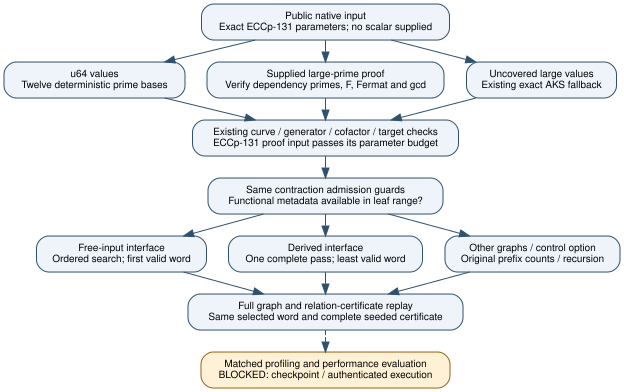
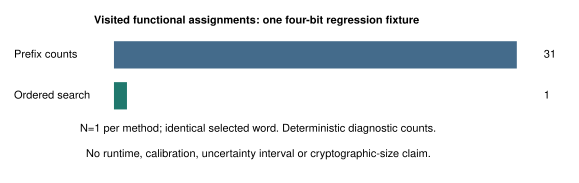

# Exact primality and functional witness optimization

Engineering update, 2026-10-30. User request: speed up the native Certicom
challenge work. **Implementation and bounded correctness checks complete;
matched performance evaluation blocked, both challenge scalars unresolved.**

| Requirement | Current status | Evidence |
| --- | --- | --- |
| Preserve baseline before changing code | development binary saved, not uploaded to S3 | [setup](SETUP.md), baseline source/binary identities |
| Freeze matched baseline/candidate inputs and holdouts | published before implementation/results | [protocol](PROTOCOL.md), crypto PR #2891 |
| Remove avoidable exact-primality startup work | implemented, correctness checked | bounded u64 primality and verified Pocklington proof nodes; native parameter check passes under original budget |
| Avoid repeated functional witness counts | implemented, exact parity checked | same least word and complete seeded relation certificate; original path remains selectable |
| Preserve exactness and failure behavior | 34 native tests pass | [full transcript](development-tests-02.txt), [targeted assertion](development-targeted-03.txt) |
| Native lint, formatting, minimum toolchain | checked | [strict lint](development-clippy-01.txt), [Rust 1.78](development-msrv.txt); fmt/check and paired workspace check |
| Obtain a profile | blocked | probe exits 2 for missing gawk; no profiler samples or estimated counters |
| Execute frozen baseline/candidate and full-pipeline comparison | blocked, not run | checkpoint push/gate exits 1, no S3 transport; native image/execution access unresolved |
| Establish practical end-to-end or runtime speedup | not established | no admitted A/A or A/B, calibrated common units, S/rho, or matched runtime interval |

## Implemented changes

The default exact primality function retains trial division in its original
tiny range, uses twelve deterministic prime-base tests for u64, and keeps AKS
above u64. Sorenson/Webster's published first-twelve-base threshold exceeds
the whole u64 range. Products widen to u128 before reduction; no probable-prime
result is promoted to proof for larger integers.

`primality::verify_certificates` verifies supplied Pocklington nodes in numerical
dependency order. It checks every prime factor, distinctness, positive bounded
exponents, the complete divisor F, divisibility of n-1, strict F²>n, the Fermat
identity and every gcd identity. Missing large-factor dependencies, duplicate
nodes/factors, insufficient F, forged witnesses, composite factors and resource
exhaustion are errors. The curve constructor also retains generator/order,
cofactor, nonsingularity and full-cardinality checks. Replay receives and checks
the proof data in the problem receipt.

The official ECCp-131 p/r now have four compact proof nodes with exact u64
leaves. GNU factor supplied **untrusted fixture preparation**; the native
verifier establishes the actual statements. Its raw factor output is retained
in [certificate-preparation.txt](certificate-preparation.txt). Proof generation
and setup are not priced; no cold total-cost comparison follows from proof
verification alone. The old uncertified input remains unchanged as a control.

For functional leaves, witness search visits input assignments once. When every
unfixed interface signal is a free input, it prioritizes those inputs in
interface order and stops at the first satisfying assignment. For derived
interface signals it scans the complete input space and retains the least
word. Pins and aliased signals are respected. Every accepted assignment still
passes the complete graph evaluation. Exact counts and recursive admission
guards are unchanged; arbitrary caller graphs retain prefix self-reduction.
The original method is public as `witness_by_counts`, and the whole reduction
can select it with `functional_witnesses = false`.

## Observed correctness evidence

- Native ECCp-131 parameter and target validation succeeds at **5,589 charged
  diagnostic steps**, within the unchanged 2,000,000-step input budget. These
  are uncalibrated Meter units, not cycles, common operations or a speed ratio.
  [Actual command/output](development-validate-certified.txt).
- The full suite passes **34 tests**. The seeded tiny full reduction returns
  the identical complete certificate under prefix counts and optimized search,
  then checks scalar replay, supplied replay entropy and corrupted certificates.
- Prime tests compare every value through 100,000 with an independent sieve,
  include large u64 primes/strong pseudoprimes and reject forged/incomplete
  Pocklington nodes. Missing subgroup-order proof still reaches exact AKS and
  returns a resource error under the original bound.
- Witness controls include arbitrary graphs, free/derived/reordered/empty
  interfaces, all ternary pin patterns on a derived output, conflicting aliases,
  UNSAT and zero budgets. In the unpinned four-bit fixture, the same selected
  word requires **31** visited assignments under prefix counts and **1** under
  ordered search. One fixture per algorithm; this is a regression-counter
  observation, not a runtime benchmark or a claim about cryptographic sizes.
- Strict clippy passes. The native crate compiles on declared Rust 1.78 with
  all targets. The mirrored cryptanalysis workspace's native package/all-target
  check also exits 0. Sources/fixtures remain byte-identical between owners.

Raw test-suite times are unisolated development diagnostics. Do not compare
them with historical suite times: the current suite also includes the old-path
comparison and extra proof controls. No profile, frozen performance panel,
holdout measurements, cold native challenge solve or EKS benchmark ran.

## Failure history and scope

The initial new test code had a Rust borrow error; its output is retained in
[development-initial-tests.txt](development-initial-tests.txt). The next full
suite passed 33 controls but failed the old assertion that optimized witness
search must perform more than 13 count queries. The assertion is now retained
on the selectable original path, while the optimized path checks its separate
search diagnostic and complete certificate equality. No mathematical check,
source guard or scanner rule was disabled. [Failed suite](development-tests-01.txt).

Profiler/checkpoint/access failures are recorded in [SETUP.md](SETUP.md).
No scientific run was launched after the checkpoint gate failed. Local native
builds, public proof-fixture preparation and regression checks are development
work. A user question asks which existing authenticated runner to use, without
requesting credentials. The full requested benchmark remains open; the tiny
correctness cases do not discharge it.

The published challenge scalars, downstream hash-prime certification and full
relation-search feasibility, the independent general correctness/complexity
audit and any end-to-end improvement remain unresolved. Source theorem
constants, factor-base selection, RNG draws and the old proof/control paths
are preserved. This is an engineering change, with no new mathematical theorem,
Lean proof or asymptotic result claimed.

Sources: [HAC §4.3.2/Fact 4.40 and notes](https://cacr.uwaterloo.ca/hac/about/chap4.pdf),
[Sorenson/Webster](https://arxiv.org/abs/1509.00864), the existing native code and
the pinned contraction sources in docs/hashed-ecdl.md. The original native
validation receipt/source manifest remains historical; use this study's new
source manifest for this revision. No existing paper figure, curve/isogeny
route, canonical leaderboard result or benchmark row is changed.

[Diagram source](paths.dot) · [PDF](report.pdf) · [PDF source](report.tex) ·
[Rebuild script](build-report.sh) · [Open measurement record](comparison.json).
