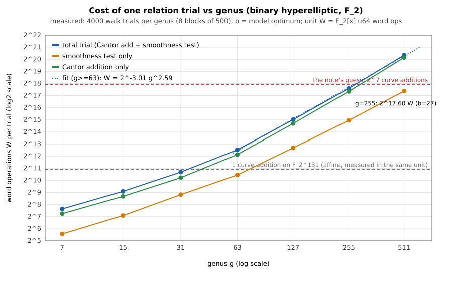

# Cost of one relation trial on a high-genus binary Jacobian (2026-10-24)

Prices the open unit conversion in
[`ghs_counterfactual_n130_20261013`](../ghs_counterfactual_n130_20261013/README.md)
finding 6. Frozen design: [`PROTOCOL.md`](PROTOCOL.md) (written before any
data). Labels: **measured** (counted by `trial_cost.rs`), **derived**
(arithmetic on measured values), **model** (the note's cost model, or a fit
extrapolation), **assumption**. This is a model-pricing study of an abstract
tower; it attacks no registry curve and builds no GHS cover.

## Result in one paragraph

One relation trial (one Cantor addition on `y^2+hy=f` over F_2, then one
distinct-degree smoothness test of `u(x)` at the model's `b`) costs
**198,149 word operations at g = 255** (measured, `b = 27`), which is
**103 additions of a point on a binary curve over F_2^131 = 2^6.69**
(derived, same counted unit; the note guessed 2^7). Substituting it into the N = 130 model moves the
margin from +4.71 bits to **-1.83 bits** (derived): the index-calculus
cost becomes 2^62.15 against rho 2^60.31. The note's own 2^7 gives -2.15.
The margin survives only while one trial costs at most about 29 curve
additions (2^4.85, derived); the smoothness test alone costs 16.5 (2^4.04),
so no Cantor step, however fast, leaves more than 0.81 bit.

## What a trial is (read from `window.rs::price`)

`price` charges `relations = log2|FB| - log2 P(smooth)`, `linear algebra =
2 log2|FB| + log2 g`, `total = max + 1`; its doc says one operation is "one
divisor-class step plus one smoothness test". The trial measured:
`D <- D + A_r` (Cantor, `A_r` from a 16-entry table of random classes, one
group step per trial), then smooth(`u(D)`, `b`) by distinct-degree
factorisation with the early exits of PROTOCOL section 2. Unit **W** =
executed F_2[x] u64 word operations (carry-less shift-xor, division,
squaring), identical code for the F_2^131 curve addition used as the
denominator. `b` per genus is the model's optimum (f64 port of `price`
reproduces the note: g = 128 b 17 -> 36.41, g = 255 b 27 -> 55.60, g = 256
-> 55.65; control passed).

## Cost per trial against genus (measured; 4000 trials per genus, 8 blocks of 500)

| g | b (model) | W Cantor add | of which compose | W smooth test | **W / trial** | block sd | native events | reduction steps | curve additions (W / 1925) |
|---:|---:|---:|---:|---:|---:|---:|---:|---:|---:|
| 7 | 2 | 152 | 108 | 47 | **199** | 2 | 30.5 | 1.8 | 0.10 |
| 15 | 3 | 410 | 243 | 136 | **546** | 6 | 45.2 | 3.6 | 0.28 |
| 31 | 6 | 1,197 | 533 | 453 | **1,650** | 13 | 69.8 | 7.5 | 0.86 |
| 63 | 10 | 4,497 | 730 | 1,398 | **5,895** | 37 | 106.8 | 15.8 | 3.06 |
| 127 | 17 | 26,562 | 2,890 | 6,575 | **33,137** | 137 | 198.3 | 31.6 | 17.2 |
| **255** | 27 | 166,385 | 8,622 | 31,764 | **198,149** | 940 | 357.3 | 63.6 | **102.9 (2^6.69)** |
| 511 | 42 | 1,164,425 | 32,255 | 170,378 | **1,334,802** | 3,093 | 660.5 | 127.5 | 693 (2^9.44) |

Reference (measured, W per op on F_2^131, `z^131+z^8+z^3+z^2+1`): multiply
501, square 142, inversion (Euclid) 761, **affine curve addition 1,925**.
The Lopez-Dahab mixed addition priced as 8M+5S+9A is 4,741 (model op count),
so the affine addition is the smaller denominator and is the headline one
(PROTOCOL section 3: smaller denominator, conservative against the margin).
Wall time per trial (practicality only, shared host): g = 255, about 0.42 ms;
affine addition 9.1 us; ratio 46, not used.

Graph: 
(`cost_per_trial_vs_genus.svg` / `.png`, drawn by `trial_cost.rs` from
`results.json`; the PNG is a 150 dpi render of the SVG).

### Scaling (fit of log2 W on log2 g; measured points, fit is model)

| fit range | total | Cantor add | smoothness test |
|---|---|---|---|
| g = 63..511 | W = 2^-3.01 g^2.59 | slope 2.65 | slope 2.29 |
| g = 15..511 | W = 2^-0.23 g^2.23 | slope 2.28 | slope 2.02 |

Extrapolation to g = 255 from the g = 63..511 fit: 2^17.68 W (model) against
the direct measurement 2^17.60 (0.08 bit); from g = 31, 63, 127 only: 2^17.04
(0.56 bit low). Direct measurement at 255 is what the margin below uses.

### Preregistered predictions against what happened

| prediction (PROTOCOL section 6) | outcome |
|---|---|
| Cantor add slope in [1.8, 2.3] over 63..511 | **missed**: 2.65 |
| total slope in [2.2, 2.8] | hit: 2.59 |
| test slope in [2.2, 2.8] (stated for the total) | 2.29 |
| smoothness test dominates the Cantor add for g >= 63 | **wrong**: at g = 255 the add is 84% of the trial |
| EC addition in [2^11, 2^13] W | affine 2^10.91 (just below); LD model 2^12.2 (inside) |
| CAE at g = 255 in [2^5, 2^9] | hit: 2^6.69 |

Why the Cantor slope missed: the textbook reduction loop runs about g/4
steps (measured 63.6 at g = 255), each with full-size products and a division,
so the reduction costs 158k of the 166k W while composition is 8.6k. A
Cantor-type algorithm with an O(g^2) reduction (interleaved composition and
reduction, Harley or NUCOMP style) is not implemented here; scenarios B and C
below bracket it.

## N = 130 margin with the measured conversion (g = 255, rho 2^60.315)

Model terms at `b = 27`: `rel = 54.462`, `lin = 54.603`, total `2^55.603`,
margin +4.711 (the note). The conversion enters the relation term:
`total = max(rel + log2 CAE, lin) + 1`. Because `lin - rel = 0.14` bit, the
margin is `4.711 - (log2 CAE - 0.14)` once the conversion exceeds 0.14 bit.

| scenario | W / trial | curve additions | total | margin vs rho | label |
|---|---:|---:|---:|---:|---|
| note's guess | - | 2^7 | 2^62.46 | -2.15 | model |
| **A: measured trial (textbook Cantor + test)** | 198,149 | 2^6.69 (103) | 2^62.15 | **-1.83** | measured/derived |
| B: composition only + test (no reduction cost) | 40,387 | 2^4.39 | 2^59.85 | +0.46 | lower bound for a Cantor-type step |
| C: smoothness test only (divisor step free) | 31,764 | 2^4.04 | 2^59.51 | +0.81 | floor under this test |

Re-optimising `b` with the measured cost per `b` (scan b = 8..64 at g = 255,
300 trials each, `results.json` `bscan255`) keeps `b = 27` best, margin -1.83
(derived). The margin does not survive the measured conversion.

### Section 5a band (unpriced native work at 0, 0.1, 1 GAE per event)

Native event = one polynomial primitive call (mul, sqr, divmod, gcd/xgcd),
counted in the trial (A: 357.3, B: 102.7, C: 90.7 events). IC trial = 1
divisor-class step + w x events; rho step = 1 + w x n_rho with **assumed**
n_rho = 3 native events per step (canonicalisation, distinguished-point test,
partition hash; not measured here), sensitivity n_rho = 0 and 10. The
linear-algebra term stays at the note's unit. Margin in bits (derived):

| scenario | w = 0 | w = 0.1 | w = 1 | sign across the band |
|---|---:|---:|---:|---|
| A (n_rho 0 / 3 / 10) | +4.71 | -0.35 / +0.03 / +0.65 | -3.63 / -1.63 / -0.17 | not positive at every weight: unresolved, negative at w = 1 and at the calibrated point |
| B (n_rho 0 / 3 / 10) | +4.71 | +1.36 / +1.74 / +2.36 | -1.84 / +0.16 / +1.61 | positive only if n_rho >= 3 at w = 1: unresolved |
| C (n_rho 0 / 3 / 10) | +4.71 | +1.52 / +1.90 / +2.52 | -1.67 / +0.33 / +1.79 | same |

Only w = 0 reproduces the note's +4.71. Per section 5a the arms are not
ranked: the "breaks rho: yes" entry of the N = 130 row is **unresolved at the
band boundary** for the lower-bound scenarios and **fails** for the measured
trial (A) at the calibrated point and at w = 1. The calibrated point (the
ratio above) is shown beside the band, never in place of it.

## Controls (all passed; `controls_failed = 0`)

- **Cantor outputs**, every g (7..511): 200 additions plus 16 table entries
  per g: `u` monic, `deg u <= g`, `deg v < deg u`, `u | v^2 + hv + f`; **0
  failures**.
- **Group law**, every g: 100 triples each: associativity, commutativity,
  `A+0 = A`, `A + (-A) = 0`, `(A+A)+B = A+(A+B)`; **0 failures**.
  Curves are nonsingular (`gcd(h, h'^2 f + f'^2) = 1`). The order check
  `[ord]D = 0` was not run (the group order is not computed at these genera).
- **Smoothness vs full factorisation**: A, 300 random squarefree polynomials
  (deg 8..96, b 2..24) against DDF + equal-degree (trace map): 45 smooth, 255
  not, **0 disagreements**; B, 300 polynomials (deg <= 24, 295 with repeated
  factors, b 2..10) against trial division by all monic polynomials of
  degree <= 12: 248 smooth, 52 not, **0 disagreements**.
- **EC**: modulus irreducible; 60 points on curve; associativity on 50
  triples; **0 failures**.
- **Model port**: matches the note at 128, 255, 256 to 0.01 bit and `b`.
- **Smooth-rate fidelity** (not gated; 200,000 trials each, one curve per g):

| g | b | walk | random monic u | model P(smooth) |
|---:|---:|---:|---:|---:|
| 7 | 2 | 0.1474 | 0.1572 | 0.2745 |
| 11 | 2 | 0.00112 | 0.02105 | 0.0496 |
| 15 | 3 | 0.00170 | 0.01103 | 0.0243 |
| 23 | 4 | 0.00067 | 0.00093 | 0.00222 |
| 31 | 6 | 0.00221 | 0.00085 | 0.00160 |

The walk's smooth rate differs from the model's by factors from 0.02x (g = 11) to 1.4x (g = 31)
and from random polynomials by up to 19x at small g (a single curve's class
group is far from the random-polynomial picture at g <= 15, and the main
sweep's g = 15 curve gave 4.6%, against 0.17% here). The model's divisor
count includes the point at infinity (N_1 = 3), which a Mumford `u` omits, so
the model is about 2x optimistic against random polynomials at g = 31. The
effect on the g = 255 margin was not computed. The cost per trial does not
depend on how often a trial succeeds, so it is unaffected; the relation
count `1/P` is the model's.

## Run record

| field | value |
|---|---|
| source | `trial_cost.rs`, sha256 `b59da59417e9ef15f6a69f979984544b9efed92cc7806478657f9fe35acd58f5` |
| build and run | `rustc -C opt-level=3 -C target-cpu=native trial_cost.rs -o trial_cost && ./trial_cost <dir>` (about 50 s) |
| outputs | `results.json` sha256 `dc445045f6f8e97e0431f8d422f17369af90be0f9f4a62a96f269302a48df371`, `run.log`, SVG, PNG |
| seeds | master 20261024, per-g `splitmix64(master xor g)` |
| host | Linux 6.18.44, 4-core Intel Xeon (cloud VM), `rustc 1.97.0`, single thread, no isolation claimed; counts are deterministic (identical across the reruns), wall times and hence the JSON hash are not |
| failed or earlier runs | first run hung at g = 63 (a place-divisor sampler looped forever when the unique degree-2 irreducible had no solution of the quadratic); found with gdb, bounded the retries, reran from the start. A later edit added the composition/reduction split and the plot fixes; the reported run is the last one, all controls re-executed |
| PDF | `report.pdf` from `report.typ` (pandoc `-t typst` of this README, compiled with the `typst` 0.15.0 Python wheel in a scratch venv; no LaTeX engine is installed). Rendered and read |

## Not established

- Cost with a hardware carry-less multiply, an O(g^2) Cantor/NUCOMP step, a
  sieved or batched smoothness test, or a cheaper rho step (Koblitz Frobenius,
  bit-sliced); each moves the ratio. A rho step twice cheaper adds one bit to
  `log2 CAE`.
- Whether the walk (one Cantor step per trial) is the cheapest way to
  generate trials; a fresh random combination costs about k additions.
- The linear-algebra term in the model is kept at 1 operation per modular
  multiplication; it was not converted (it binds only within 0.14 bit).
- The rho reference is the note's `2^60.31`; no rho run was measured, and
  n_rho = 3 is an assumption.
- One curve per genus; no GHS cover, no Jacobian subgroup of an ECDLP
  instance, no relation to any registry curve.
- The Mumford-`u` smooth probability against the model (above).
