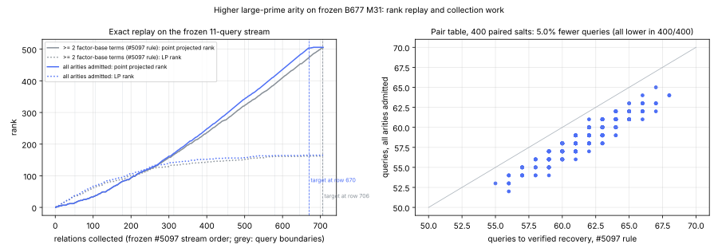

# Higher-arity projected-rank replay on B677 M31, and its effect on collection work

2026-11-26, Claude Code. Development measurements on one shared 4-vCPU cloud VM.
Unsigned. [pcc:unverified]

## Question

The B677 graph-control consumer (crypto #5097) admits a relation only if it has at least
two factor-base (Dickson) terms. Relations with three or four large-prime (Y7) terms are
dropped: on the frozen ten-query capture, 32 of 645 rows.

- #5076 replayed the 613 admitted rows natively.
- #5122 derived, on paper, what admitting all 645 rows does: LP rank 164, point projected
  rank 481, and still no target certificate after ten queries.

Owner priority 4 asks two things:

1. Complete that higher-arity replay.
2. Measure whether admitting higher arity reduces the collection work needed to recover
   the target logarithm.

## 1. Exact replay on the frozen stream

**Input.** [`evidence/exact-replay/stream.json`](evidence/exact-replay/stream.json) is the
#5097 eleven-query stream, regenerated by #5184's `exact` arm. Its 707 rows have SHA-256
`f1bbab69…`, byte-identical to #5097's rows. The first 645 rows, ten queries, are the #5076
capture.

**Method.** [`tools/replay.py`](tools/replay.py) uses independent Python big-integer
arithmetic.

- It replays every relation on the curve.
- It eliminates over Z/n in the #5097 pivot order: large-prime columns, then factor-base
  columns, then the target column (coefficient −b, right-hand side a).
- It runs under both rules: `fb2`, at least two factor-base terms, and `all`.

| Rows (queries) | Rule | Admitted | LP rank | Point projected rank | Target identifiable |
| --- | --- | ---: | ---: | ---: | --- |
| 645 (10) | fb2 | 613 | **161** | **452** | no |
| 645 (10) | all | 645 | **164** | **481** | **no** |
| 707 (11) | fb2 | 669 | 162 | 505 | yes, first at **row 706** |
| 707 (11) | all | 707 | 165 | 506 | yes, first at **row 670** |

Both earlier results are reproduced exactly:

- **#5076's native numbers:** 613 rows give LP rank 161 and useful rank 452.
- **#5122's derivation:** all 645 rows give LP rank 164 and point projected rank 481, with
  no target-only certificate after ten queries.

Both rules recover the same log 987654321, which is checked by d·G = Q. Admitting all arities
makes the target identifiable **36 relations earlier (706 → 670, 5.1% fewer)**. Both points
still fall in query 11, so a source that must finish each query sees no saving: #5097 scans
the whole table every query.

## 2. Collection work with an early-stopping source

**Instrument.** The library pair table (crypto #5202, now on the #5188 branch) stops at
query granularity with about 11 relations per query. `examples/pair_table_rank_rate.rs` now
accepts `ADMIT=fb2|all` (default `fb2`, the #5097 rule). Everything else is unchanged:
window 8/256, 1 thread, the same queries, the same replay and elimination.

[`tools/panel.sh`](tools/panel.sh) pairs the two rules on the same salt (which sets the
same probe windows). Every one of the 880 runs recovered and verified 987654321.

| Metric (median) | fb2 | all | Change with `all` | `all` lower in |
| --- | ---: | ---: | --- | --- |
| queries | 62 | 59 | **−5.0%** [−5.1, −4.9] | **400 / 400** |
| probes | 1,773,200 | 1,687,400 | **−5.0%** [−5.1, −4.9] | 400 / 400 |
| relations collected | 702.5 | 668.5 | −5.0% | 400 / 400 |
| probe time | 40.6 ms | 38.7 ms | −4.4% [−6.2, −2.5] | 266 / 400 |
| elimination time | 14.2 ms | 15.0 ms | **+5.3%** [+3.2, +7.6] | 149 / 400 |
| cold time to recovery | 81.5 ms | 80.2 ms | −1.4% [−3.1, +0.2], **not significant** | 224 / 400 |

The table is panel-02, with 400 paired salts. The intervals are 95% bootstraps over
geometric means of paired ratios. Panel-01, with 40 salts, agrees.



## Findings

1. **The higher-arity replay is complete and agrees with #5076 and #5122 exactly.**
   Admitting the 32 excluded rows adds three LP dimensions and 29 point-projected dimensions
   at ten queries. That is still not enough to identify the target from ten queries.
2. **Required collection work falls about 5%.** On the frozen stream, the target is
   identified 36 relations earlier. On the pair table, every one of 400 paired salts needs
   fewer queries, with 5.0% fewer queries and probes. The saving is deterministic in the
   counted units.
3. **Wall-time gain is small and not resolved here.** The saved probes are about 4% of probe
   time, but the admitted higher-arity rows add about 5% to elimination, because each carries
   up to four large-prime columns. Net cold time is −1.4% [−3.1, +0.2]. On this workload, the
   gain in collection is mostly spent in the consumer.
4. **The change is purely an admission rule.** There is no change to the relation source and
   no new arithmetic. It is safe to adopt as the default wherever probes are the dominant
   cost, for example larger fields where probe cost grows faster than elimination cost.

## Scope and limits

- **Workload:** one fixed workload (frozen B677 base, public target Q); not an exponent
  change.
- **Host:** a shared development VM, so wall times are indicative. No isolated host was
  used, since the EKS route is blocked.
- **Default unchanged:** the admission switch is opt-in.

## Replay

```
python3 tools/replay.py evidence/exact-replay/stream.json ../semaev_fast_path_rank_20261125/b677_points.csv
cargo build --release --example pair_table_rank_rate
PANEL=panel-02 SALTS=400 tools/panel.sh
python3 tools/summarize.py evidence/panel-02
```

Each panel's raw runs are kept, one JSON per line, in `evidence/panel-0*/runs.jsonl`.
