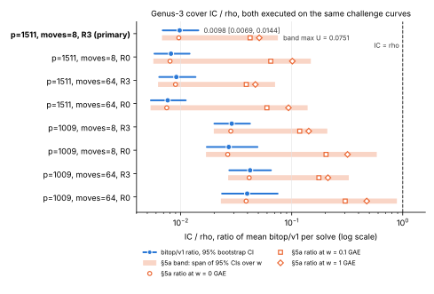
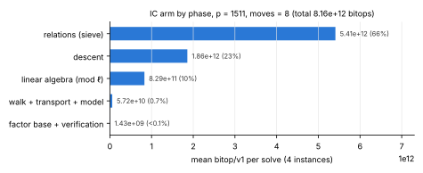

# The weak-class cover row re-priced in `bitop/v1`, both arms executed

**Report:** [`REPORT.pdf`](REPORT.pdf) (source [`REPORT.typ`](REPORT.typ)).
**Figures:** [`figures/ratio_vs_rho.svg`](figures/ratio_vs_rho.svg) (IC/rho per
row with 95% CI and the §5a band) and
[`figures/ic_phases_primary.svg`](figures/ic_phases_primary.svg) (IC bitops by
phase at the primary row), PNG renders beside them, drawn by
[`figures/plots.py`](figures/plots.py) from `analysis.json` only.

**Question** (PROTOCOL.md, frozen before any run in commit `9a6e3de35`): does
the scoreboard row "Whole method from a curve that is not weak (section 18):
p = 1,511 (subgroup 2^61.4), 4 seeds" (`0.010×`) stay below Pollard rho? Here
both arms run on the same challenge curve and seed, and both are counted in
`bitop/v1` primitives. The row's original denominator was never executed: it
was a rho `S` pooled from smaller sizes.

**Verdict, primary row** (`p = 1511`, `moves = 8`, against the strong rho R3):
**stays below rho.** IC/rho is **0.0098**, with a 95% interval of
`[0.0069, 0.0144]`. The largest upper bound over the `bitop/v1` ratio and the
three §5a band weights is **0.0751**, which is below 1. Every control passed.

Class: **accounting** (a re-measurement, not an improvement). The distance
remaining to rho is that the IC arm costs about 1% of the strong rho at
`ℓ = 2^61.4`, on the weak class only. The weak class has full rational
2-torsion and a genus-3 cover, and it never contains prime-order curves.



## Table (`analysis.json`, `examples/jv_cover_bitop_analyse.rs`)

The ratio is IC/rho, a ratio of means, with a percentile bootstrap of 10⁴
resamples. The band columns re-price every arm's `word_op` and `hash_probe`
work at `w` GAE per operation, with 1 GAE = 5.11·10⁵ bitops at `p = 1511`
and 4.26·10⁵ at `p = 1009`. The legacy column is the old unit against the
pooled 1.3609, recomputed on these cold, one-thread runs.

| p | moves | rho | IC mean (bitops) | rho mean (bitops) | IC/rho [95%] | band w=0 | w=0.1 | w=1 | legacy S/rho (pooled) | verdict |
|--:|--:|:--|--:|--:|:--|:--|:--|:--|--:|:--|
| **1511** | **8** | **R3** | **8.16e12** | **8.34e14** | **0.0098 [0.0069, 0.0144]** | 0.0096 [0.0068, 0.0142] | 0.0422 [0.0298, 0.0625] | 0.0510 [0.0357, 0.0751] | 0.0049 | **below rho** |
| 1511 | 8 | R0 | 8.16e12 | 9.98e14 | 0.0082 [0.0058, 0.0120] | 0.0080 [0.0057, 0.0115] | 0.0647 [0.0461, 0.0939] | 0.1013 [0.0719, 0.1487] | 0.0049 | below rho |
| 1511 | 64 | R3 | 7.61e12 | 8.34e14 | 0.0091 [0.0064, 0.0136] | 0.0090 [0.0062, 0.0133] | 0.0390 [0.0271, 0.0584] | 0.0471 [0.0325, 0.0708] | 0.0046 | below rho |
| 1511 | 64 | R0 | 7.61e12 | 9.98e14 | 0.0076 [0.0054, 0.0111] | 0.0075 [0.0053, 0.0110] | 0.0598 [0.0419, 0.0882] | 0.0935 [0.0657, 0.1391] | 0.0046 | below rho |
| 1009 | 8 | R3 | 6.64e12 | 2.31e14 | 0.0288 [0.0201, 0.0421] | 0.0283 [0.0199, 0.0413] | 0.1180 [0.0817, 0.1725] | 0.1423 [0.0986, 0.2093] | 0.0179 | below rho |
| 1009 | 8 | R0 | 6.64e12 | 2.45e14 | 0.0271 [0.0172, 0.0492] | 0.0265 [0.0169, 0.0476] | 0.2038 [0.1285, 0.3657] | 0.3181 [0.2020, 0.5837] | 0.0179 | below rho |
| 1009 | 64 | R3 | 9.73e12 | 2.31e14 | 0.0422 [0.0274, 0.0650] | 0.0414 [0.0268, 0.0639] | 0.1757 [0.1141, 0.2680] | 0.2120 [0.1376, 0.3268] | 0.0274 | below rho |
| 1009 | 64 | R0 | 9.73e12 | 2.45e14 | 0.0397 [0.0236, 0.0747] | 0.0388 [0.0230, 0.0729] | 0.3033 [0.1807, 0.5685] | 0.4739 [0.2801, 0.8863] | 0.0274 | below rho |

There were 4 IC instances per row, 16 R3 runs and 8 R0 runs per `p`. Every
run solved and verified:

- each IC run verified `[d]G = Q` on the challenge curve;
- each rho run verified `[d′]G = Q` with its own arithmetic.

### Where the IC arm's bitops go (mean, `p = 1511`, `moves = 8`)

| phase | bitops | share |
|:--|--:|--:|
| relations (sieve) | 5.41e12 | 66% |
| descent | 1.86e12 | 23% |
| linear algebra (mod ℓ) | 8.29e11 | 10% |
| walk + transport + model | 5.7e10 | 0.7% |
| factor base | 1.3e09 | <0.1% |
| verification | 1.1e08 | <0.1% |
| unattributed | 0 | 0 |



For rho R3 at `p = 1511`, the walk is 8.33e14, collision detection 6.9e11,
precomputation 3.1e10 and verification 5.6e7.

## What moved, and why the answer did not change

- The row's 0.010× divided by a pooled, unexecuted rho. With rho executed on
  the same curve, the strong rho R3 measures `S = 0.896` and R0 `S = 1.127`
  in the legacy unit at `p = 1511`. R3 is cheaper per step in the legacy unit
  but not in `bitop/v1`: its batch products and negation-map work are
  priced, and its mean bitops (8.3e14) are close to R0's (1.0e15).
- `bitop/v1` charges what the legacy unit left free:
  - additions;
  - F4's additions;
  - Wiedemann modulo a 62-bit `ℓ`, each operation about 31 `F_p`-product
    equivalents rather than a flat 16;
  - probes and scans.

  These raise the IC arm's price relative to its legacy count by about the
  same factor as rho's. In the legacy unit against these executed runs, the
  primary row reads 0.0067/0.896 ≈ 0.0075; in `bitop/v1` it reads 0.0098.
- The §5a band at 1 GAE per word or probe raises the ratios 4–12×.
  This is because the sieve's per-`x` factor-base tests and counter updates
  are its dominant native work. The order still holds at every weight.
- **Rho-favouring price, descriptive.** The tuned `F_{q³}` prices
  (`jv_rho_strong::TUNED`: Karatsuba 24, Chung–Hasan 18, adjugate 62) cut
  rho's product, squaring and inversion counts to 0.33–0.44 of the harness
  prices. They leave additions unchanged. The primary upper bound 0.0144
  would therefore become at most about 0.044, still below 1.
- These cold runs differ from the committed §18.4 runs in three ways: the
  trace cache is cold per run, the descent runs on one thread, and the round
  plan is set to 4. Their legacy route counts are lower, so the row read
  0.0049 in the old unit rather than 0.010. The walk, transport and model
  counts reproduce the committed ones exactly in all 16 runs.

## Controls (all pass; `analysis.json` → `controls`)

1. **Positive control, rho.** The mean `steps/√ℓ` was 1.120 for R0 (16
   runs, window `[0.9, 1.7]`) and 0.946 for R3 (32 runs, window
   `[0.55, 1.25]`).
2. **A/A, rho.** R3 run index 0 against run index 1 gave 1.07
   `[0.57, 1.83]` at `p = 1009` and 1.30 `[0.75, 2.19]` at `p = 1511`. Both
   intervals contain 1.
3. **A/A, IC.** A second process re-ran `p = 1511`, seed 1, `moves = 8`, and
   gave identical per-phase counts and an identical legacy total. In
   addition, the one R0 run the killed card 2 had completed equals its
   re-run exactly (deviation 1).
4. **IC reproduction.** The walk, transport and model legacy counts equal
   `experiments/40_jv_cover_e2e_fast.json` in 16 of 16 runs.
5. **Completeness.** There were zero hook calls on unclaimed threads, and
   zero operations on an unclassified modulus inside the attack. 739–968
   operations occurred in the instance phase (prime searches of the
   instance's construction), which is excluded.
6. **Instrument unit tests.** See the commit report.
   - The `Fq3` product is 55 `field_mul` + 44 `field_add`, and the inversion
     150 + 104 + 1 `field_inv`, as the legacy 166 = 150 + 16 implies.
   - A counted rho run equals the uncounted one and verifies.
   - Rho on the challenge curve recovers `d`.
   - Hooks classify by modulus.

## Lost attempts and deviations

Every run that executed is in `raw/` and is charged. No run failed. Inside
each run, the algorithm's own lost work is charged:

- surplus sieve rounds;
- failed core and linear-algebra attempts;
- residuals that did not decompose;
- rho restarts.

PROTOCOL.md's appended deviations log records two things. Card 2 was killed
by a host restart; its R3 output was complete and kept, and its R0 command
was re-run in full as card 2b. Cards 1–4 also ran concurrently.

## Known uncounted

These items are reported and not priced:

- memory;
- control flow and allocation;
- RNG internals beyond one word per draw;
- the standard-monomial search of `solve_zero_dim`'s linear stage.

F4's symbolic preprocessing and pair criteria are charged per step from each
matrix's actual entries, columns and basis size. This structural charge
bounds them rather than counting them instruction by instruction. It is in
`word_op`/`hash_probe`, so the §5a band covers it. No instruction audit
(`ecbench audit-ir`) was run, so neither arm is admitted as a `bitop/v1`
bound in the sense of BITOPS.md. The comparison is a measured ratio under
the convention.

## Validation gate

This row is **not** added to the IC leaderboard or to `benchmarks/README.md`.
The validation gate (`docs/VALIDATION_GATE.md`) needs a `VALIDATION.json` in
this directory naming three artifacts, and two are missing:

- **replay certificate:** missing. No independent replay of the recorded IC
  and rho runs with scalars verified has been made.
- **validator report:** missing. No independent recompute of the headline
  ratios from `raw/` has been made.
- **matched rho reference:** present in substance (R3, the strong rho named
  by PROTOCOL.md, executed on the same curves in the same unit and process,
  with the §5a band at 0, 0.1 and 1 GAE), but not yet recorded in a
  `VALIDATION.json`.

Until those exist, the study stays a research record. Separately, no
`ecbench audit-ir` instruction audit was run, so neither arm is an admitted
`bitop/v1` bound.

## Files and runtimes

| path | content |
|:--|:--|
| `raw/ic_{1511,1009}.jsonl`, `raw/ic_aa_1511.jsonl` | IC runs: per-phase primitives, bitops and legacy fields |
| `raw/rho_{1511,1009}_{R3,R0}.jsonl` | rho runs: native counts, set-up, verification, `Fq3` price vectors, phases and bitops |
| `raw/killed_card2/` | the killed attempt's partial R0 file and the killed command's streams, not used |
| `cards/` | task cards 1, 2, 2b, 3 and 4 with receipts (card 2 has none: it was killed) |
| `analysis.json` | the analysis output |
| `figures/` | SVG/PNG figures and `plots.py` (plots recorded values only) |
| `REPORT.typ`, `REPORT.pdf` | the visual report (Typst) |

Wall times are descriptive, since up to 16 workers ran on a shared 4-core
host:

| arm | mean per run | max per run |
|:--|--:|--:|
| IC, `p = 1511` | 790 s | 1090 s |
| IC, `p = 1009` | 475 s | 815 s |
| R3, `p = 1511` | 1585 s | 4318 s |
| R0, `p = 1511` | 966 s | 1478 s |
| R3, `p = 1009` | 682 s | 1405 s |
| R0, `p = 1009` | 712 s | 1396 s |

By card:

| card | content | time |
|:--|:--|--:|
| 1 | IC, `p = 1511` | 1793 s |
| 1 | IC A/A | 227 s |
| 3 | IC, `p = 1009` | 1010 s |
| 4 | rho, `p = 1009` | 2862 s + 1501 s |
| 2b | R0, `p = 1511` | 2448 s |

Reproduce:

```sh
cargo build --release --example jv_cover_ic_vs_rho_bitops --example jv_cover_bitop_analyse
JV_SIEVE_ROUND_THREADS=4 F4_FP_THREAD_OPS=1 target/release/examples/jv_cover_ic_vs_rho_bitops \
    --arm ic --p 1511 --seeds 1,2,3,4 --moves 8,64 --jobs 4 --json ic_1511.jsonl
target/release/examples/jv_cover_ic_vs_rho_bitops --arm rho --p 1511 --seeds 1,2,3,4 \
    --moves 8,64 --rho R3 --runs 0,1 --jobs 4 --json rho_1511_R3.jsonl
target/release/examples/jv_cover_bitop_analyse --committed experiments/40_jv_cover_e2e_fast.json \
    --aa raw/ic_aa_1511.jsonl --out analysis.json raw/ic_*.jsonl raw/rho_*.jsonl
```
