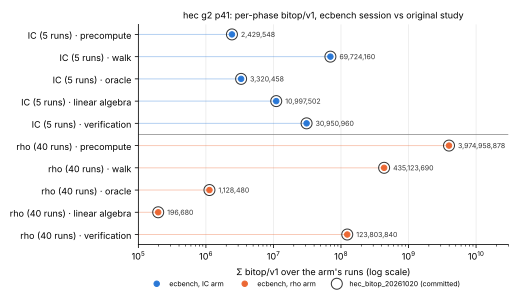

# The hyperelliptic head-to-head as ecbench records

Index calculus on a hyperelliptic Jacobian and its Pollard rho reference now
run as ecbench methods: each run is a sealed, replayable record priced in
`bitop/v1` by `ecbench work`. Before this item they ran only through the
standalone example `examples/hyperelliptic_ic_vs_rho_bitops.rs`.

**Result.** The genus-2, `p = 41` row of `research/hec_bitop_20261020`
(N = 1321, k = 447), run through ecbench, gives the study's `bitop/v1` total
for every one of the 45 runs, exactly. It also gives the study's per-phase
sums for both arms. The port is faithful. This is an accounting port, not an
improvement: no IC cost changed. Protocol: [`PROTOCOL.md`](PROTOCOL.md),
frozen before the session ran.

**Report:** [`REPORT.pdf`](REPORT.pdf) (source [`REPORT.typ`](REPORT.typ)).
**Figures:** [`figures/phases_ecbench_vs_study.svg`](figures/phases_ecbench_vs_study.svg)
(per-phase `bitop/v1` of each arm, ecbench vs the study's committed counts) and
[`figures/runs_ecbench_vs_study.svg`](figures/runs_ecbench_vs_study.svg)
(per-run totals, all 45 on `y = x`), PNG renders beside them, drawn by
[`figures/plots.py`](figures/plots.py) from `analysis/equivalence.md` only.

## What was ported

| piece | where | what |
|---|---|---|
| curve `hec_thread {p, genus}` | `src/cryptanalysis/ecbench/hec.rs`, `workload.rs` | the thread's instance rule (`thread_instance`), genus 2–4, `p < 2^15`; `D = (u, v)` packed in two words; `#Jac` not computed (`group_order = cofactor = 0`), so planted targets only |
| target law `planted_hec_thread` | `workload.rs` | `k = ⌊r/3⌋ + 7 + index`, the study's fixed target (the seeded default law also works) |
| `hec.ic_fb_walk` | `hec.rs`, `methods.rs` | `hec_index_calculus_dlp`: full factor base, factor-base walk, gcd smoothness, sparse elimination |
| `hec.rho_full_width` | `hec.rs`, `methods.rs` | `pollard_rho_jacobian_with(DistinguishedPointsFullWidth)` |
| pricing | `work.rs` | each `ops::Phase` is a record phase whose `native` map holds its primitive counts; `work` prices them 1:1 at `bits(p)` / `bits(r)`; `validation_<prim>` counters are reported, not added |
| `fixed_seed` | both methods | replaces the harness seed, so one arm per study seed reproduces the study's seed lists |

Neither method sees the planted scalar. The runner checks `[k]D₁ = Q`
itself. No wall-clock calibration enters a record.

## Session

`specs/g2-p41.json` → `sessions/g2-p41` (`ECBS1he77b325d1865`): 5 IC arms
(seeds 20260916–20260920) and 40 rho arms (seeds 0xC0FFEE + 0…39), one round,
`--cpus none`, `RAYON_NUM_THREADS=1`.

- **Runs:** 45 records, 45 verified.
- **Audit:** `ecbench verify --replay 2` passed with 0 problems. Both replays
  (seq 0, IC, and seq 22, rho) were `identical` (`sessions/g2-p41.audit.json`).
- **Pricing:** `ecbench work --counted` priced all 45 records `complete`, with
  nothing unpriced and nothing known-uncounted (`analysis/work.jsonl`).

## Equivalence

`examples/hec_ecbench_equivalence.rs` (Rust) compares the two run for run.
Its output is in [`analysis/equivalence.md`](analysis/equivalence.md).

| arm | runs | equal runs | ecbench Σ bitop/v1 | study Σ bitop/v1 | mean per run |
|---|---:|---:|---:|---:|---:|
| `hec.ic_fb_walk` | 5 | 5 | 117,422,628 | 117,422,628 | 23,484,525.6 |
| `hec.rho_full_width` | 40 | 40 | 4,535,211,568 | 4,535,211,568 | 113,380,289.2 |

All 12 phase sums (6 phases × 2 arms) are equal too.

The IC/rho ratio is therefore the study's: 0.207 at this row. IC needs
0.207× the gates of the matched full-width rho here, so this row is already
below rho. That is the study's figure carried over, with its disclosed
coverage limits (`research/hec_bitop_20261020/PROTOCOL.md`), not a new result.

## Limits

- **One row.** Genus 3 and 4, and the other primes, are not run here. No
  bound fit, since one size gives no slope.
- **GAE figure.** In the group-addition unit, these records carry only the
  Jacobian operations the algorithms count. They name
  `jacobian_field_ring_and_word_work_outside_group_operations` as unpriced,
  so `S` is a lower bound. The `bitop/v1` work block is the complete figure.
- **Floor.** `work`'s `floor_bitops` and `ratio_to_floor` use an elliptic
  affine addition's price. For a Jacobian they are not a calibrated floor.
- **Counting conventions.** The conventions are the study's: one word
  operation per RNG draw, memory movement uncounted, and validation inside
  the total.
- **Validation gate.** No `VALIDATION.json` (replay certificate, validator
  report), so no IC leaderboard or `benchmarks/` row. No `ecbench audit-ir`
  instruction audit was run on these records.
