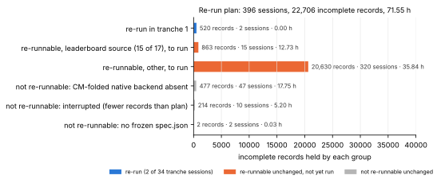

# ic-acct-6: completing the archive's `bitop/v1` accounting

Protocol: [`PROTOCOL.md`](PROTOCOL.md) (frozen before any re-run). Generated
tables: [`BEFORE_AFTER.md`](BEFORE_AFTER.md), [`PLAN.md`](PLAN.md),
[`TRANCHE.md`](TRANCHE.md), all from `examples/ic_acct6_archive.rs`.

**Report:** [`REPORT.pdf`](REPORT.pdf) (source [`REPORT.typ`](REPORT.typ)).
**Figures** (SVG, PNG renders beside them), drawn by
[`figures/plots.py`](figures/plots.py) from the committed breakdowns,
`plan.json` and `TRANCHE.md` only:
[`before_after_totals`](figures/before_after_totals.svg) (archive status before/after phase A),
[`before_after_categories`](figures/before_after_categories.svg) (what the new rules changed),
[`rerun_plan`](figures/rerun_plan.svg) (the re-run plan by status) and
[`tranche1`](figures/tranche1.svg) (the two re-run sessions).

## Phase A: rules (no runs)

`docs/units/BITOPS.md`, "Extensions", 2026-10-21. No primitive weight
changed; `committed_vectors_are_frozen` passes. On the archive at main
`cde2881dd` (73,012 verified non-warm-up records), complete 50,273 → 50,306,
incomplete 22,682 → 22,706, unpriceable 57 → 0. Every change is one of the
new rules: the 57 `extension`-family records now price (33 complete, 24
incomplete), and the 628 projected-base, 96 isogeny-tower and 477 CM-folded
records no longer name unpriced counters but stay incomplete, because the
never-counted index-calculus items (and, for CM-folded, the native backend's
unmetered work) remain.

## Phase B: re-runs

`PLAN.md`: 396 sessions hold an incomplete record (22,706 records, 71.6
hours on the hosts that ran them); 337 are re-runnable unchanged (22,013
records, 48.6 hours), 17 of them leaderboard sources (1,383 records, 12.7
hours); 59 are not (CM-folded sessions whose pinned native backends are absent
here, sessions without a frozen spec, interrupted sessions).

### First tranche (card 2)

Card 1 (05:07–07:08 UTC) never acquired the host's shared build lock, which
another study's card held for that whole window; it was stopped with no
session started and no receipt. Card 2 ran 07:16–10:20 UTC with deadline
10:16. In that window the lock was free long enough for two sessions: their
compute was 22.8 s and 18.5 s of process wall time. Everything else was the
wait for the lock. The other 32 sessions of the tranche were not launched.

Both re-runs (`p001`, `p002`, the n37 `ic.shared_rank` leaderboard sessions)
plan to the committed spec ids, and both audits pass: 384 records each, two
replays reproduced, no problems. Neither prices complete. The current binary's
`ic.shared_rank` writes only the `counted:base_index_builds` marker, so 520 of
its 640 counted records still miss `gauss_column_scans_and_pivot_inversions`,
`relation_row_construction`, `table_insert_attempts` and `walk_bookkeeping`.
The 120 complete records are the rho arms. The plan's `seen` column (0/6,
0/2) predicted this.

### Recommended amendment before the next tranche

This is not applied to the frozen protocol. A re-run only completes a record
when its method's code writes every `counted:` marker. Two changes follow:

- Order the next tranche to put first the sessions whose incomplete
  configurations all have a complete record somewhere in the archive (`seen`
  equal to its total). By `plan.json` that is 24 re-runnable sessions, 1,833
  incomplete records, about 2.0 hours.
- Instrument `ic.shared_rank`'s rank, row, walk and table paths before
  re-running its sessions, which include four of the leaderboard's first five.

### Validation gate

No `VALIDATION.json`, so no IC leaderboard or `benchmarks/` row: this is
accounting, not a performance result.
