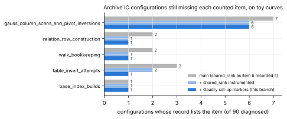

# ic-acct-7: counting the five never-counted index-calculus items

Follow-up to [`research/ic_acct6_archive_20261021`](../ic_acct6_archive_20261021/README.md)
(item 6). Class: **accounting**. No measured cost changes and nothing here is
an improvement of the index-calculus baseline (CLAUDE.md, success criterion).

**Report:** [`REPORT.pdf`](REPORT.pdf) (source [`REPORT.typ`](REPORT.typ)).
**Figures** (SVG, PNG beside them), drawn by [`figures/plots.py`](figures/plots.py)
from recorded values only:
[`items_by_config`](figures/items_by_config.svg) and
[`archive_totals`](figures/archive_totals.svg).

## What changed in the code

- **`ic.shared_rank` writes every counted marker**
  (`src/cryptanalysis/ic_framework/shared_rank.rs`). At the site that does the
  work: the folded table's `setup_work_native` (`table_insert_attempts`, in
  `oracle_setup`); its matrix's `work_counters` after the full-rank check's
  `pinned` reads (`gauss_entries_scanned`, `pivot_inversion_steps`, in
  `linear_algebra`); every 64-bit word the `StdRng` hands out, through a
  forwarding wrapper that leaves the stream unchanged (`target_rng_draws`, in
  `relations` for the rank trials and `target_query` for the residual
  shifts); the rows (`row_build_words` for the zeroed row and the transcript
  copy, `row_build_modr_adds` a summand, `row_build_modr_muls` for `h·a`; the
  target's dense row in `target_relation_check`); the target's `is_on_curve`
  (`curve_equation_checks_uncharged`); and the descent's `Σ coef·log`, `·h⁻¹`,
  `− a` and the `h⁻¹ = h^{r−2}` products as `combination_modr_muls/adds`
  (new rules, `docs/units/BITOPS.md` "Extensions", 2026-11-07; no primitive
  weight changed). The base keeps the marker `compact-orbit-scan` already
  wrote.
- **`gaudry-d4` and `gaudry-d4-bin`** set-ups interpolate the symmetrised
  system (solver work, priced in the solver block) and build no table, so
  they now return `counted:table_insert_attempts` with nothing to insert;
  `gaudry-d4-bin` with large primes on keeps the item listed (its pivot store
  is not counted).
- `ecbench::work::known_uncounted` is unchanged: an item leaves a record's
  list only when that record carries the marker, so every other path keeps it.

## Coverage of the archive's configurations (diagnostic, not a measurement)

`coverage/configs.jsonl` is one example of each of the 106 distinct IC
configurations in the specs of item 6's 396 sessions. The `#[ignore]` test
`ecbench::methods::complete_counters_coverage::coverage_of_archive_configs`
runs each on a toy curve of the same kind (large curves swapped, sizes capped)
and prints what its record still leaves (`coverage/coverage-final.tsv`; the
run before the Gaudry change is `coverage/coverage-intermediate.tsv`). It
answers "does this code path write its markers", not "what did the session
cost". Of the 97 configurations run: 68 complete; 19 could not run inside the
library test (16 need the ecbench binary's registered plug-ins
`koblitz-standard-subspace`, `binary-standard-subspace`, `koblitz-closure`,
`pdp-split`; 3 need the absent `ic.cm_folded_*` native backends; 1 needs a
curve with an invariant subspace); 10 incomplete. The nine `gaudry-d4`
configurations over `F_{p⁴}` (Macaulay 14 and 26) were not run: one did not
finish in 25 minutes on a toy curve.

| still incomplete on this branch | configurations | why |
|:--|--:|:--|
| deferred sparse solvers (`sparse-cado`, `wiedemann`, `lanczos`, `filter+wiedemann`, `filter+lanczos`) | 5 | `SparseRows::solve` (filter, merge, block Krylov, Berlekamp–Massey over `BigUint`) has no per-site counters; `gauss_column_scans_and_pivot_inversions` stays listed |
| `ic.k4_gaudry` | 1 | its own `ecbench::fp4` pipeline counts none of the five items (plus its modelled solve and oracle hashing) |
| `ic.large_prime` | 1 | its own collector counts none of the five items (plus `large_prime_merge_rebuilds`) |
| `gaudry-d4-bin` | 1 | the five items are now all counted; its solver gaps (`solver_engine_work`, `field_sqrt` over a binary field, `solver_F_q_multiplications`) remain |
| `cyclotomic` bases | 2 | the five items are counted; `abscissae_enumerated_uncharged` has no fixed price (BITOPS.md) |

`ic.cm_folded_*` (native C++ backend) were not reachable here and keep the
five items and their backend gap.

## The committed archive, before and after

[`BEFORE_AFTER.md`](BEFORE_AFTER.md), generated by
`examples/ic_acct6_archive.rs` (`breakdown` with each binary, then `render`),
over every `research/**/records.jsonl` at main `a2be66091`: 876 session
directories (123 unreadable), 107,921 verified non-warm-up records.

| | before (main rules) | after (this branch) |
|:--|--:|--:|
| complete | 78,245 | 78,245 |
| incomplete | 27,676 | 27,676 |
| unpriceable | 2,000 | 2,000 |

The two `breakdown-*.json` files are identical apart from their label. That is
expected: a committed record carries the markers its binary wrote, and this
branch's only pricing change is two rules for counter names no committed
record carries (`grep -rl combination_modr --include=records.jsonl research`
finds none). Committed records become complete only by re-running on this
binary. No leaderboard row's pricing changed, so the leaderboard and
dashboard were not regenerated.

## Re-run tranche: blocked

Item 6's PLAN.md asks next for the 24 re-runnable sessions whose incomplete
configurations all have a complete record somewhere (about 2.0 h). They were
**not run**. This host has no `aws` CLI or AWS identity, and
`scripts/checkpoint.sh gate` refuses ("no AWS profile 'ecc-challenges-new',
no CHECKPOINT_UPLOAD_TOKEN, no /root/.config/checkpoint/upload-token"), which
are the stated stop conditions (CLAUDE.md resume checkpoints; AGENTS.md §9a).
No archive record is superseded by this change.

## Validation gate

No `VALIDATION.json`, no leaderboard or `benchmarks/` row: accounting, not a
performance result.
