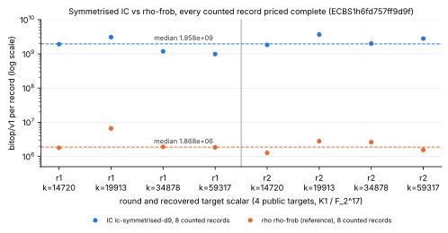

# bitop/v1 completeness of the symmetrised oracle (ic-acct-7)

Protocol: [`PROTOCOL.md`](PROTOCOL.md) (frozen 2026-10-21, before any data).
Section A was run here; section B (the Koblitz exponent ladder,
`specs/koblitz-exponent-n{13,19,23}.json`) is frozen and **not run**.
This is an accounting change. It is not an improvement and makes no
security claim (AGENTS.md "Success criterion").

**Report:** [`REPORT.pdf`](REPORT.pdf) (source [`REPORT.typ`](REPORT.typ)).
**Figures:** [`figures/bitops_per_record.svg`](figures/bitops_per_record.svg)
(bitop/v1 per counted record, IC vs rho) and
[`figures/ir_per_gate.svg`](figures/ir_per_gate.svg) (Callgrind Ir per counted
gate), PNG renders beside them, drawn by [`figures/plots.py`](figures/plots.py)
from `audit/` and the session's records only.

## What was changed

Commit `fd93ddfe2` ("bitop/v1: make the symmetrised oracle's records complete"):

- `src/cryptanalysis/bitop_tally.rs`: `Tally::add_work_native` folds a
  tally into a phase's `work_native` as `tally_{word_ops,hash_probes,
  field_adds,field_muls,field_sqrs,field_invs}`.
- `src/cryptanalysis/koblitz_symmetrised.rs`: the base build (kernel basis,
  `span_f2`, re-basis set probes, frame change and lifts, point index, `T`),
  the Frobenius-orbit view, the `eps` variable, `sym_pow` copies and
  `system_degree`'s scan are counted where they execute.
- `src/cryptanalysis/koblitz_groebner.rs`: `SymElement::zero/constant/
  from_subspace_vars` and `FieldSum::constant` are counted.
- `src/cryptanalysis/ic_framework/plugins.rs`: the base builder reports its
  tally in the `factor_base` phase. `SymmetrisedOracle::prepare` tallies the
  `F_u` rebuild, the membership probes, the field tables and the generator
  system's build and shape, and reports them in `oracle_setup` with the
  `counted:table_insert_attempts` marker (it builds no table).
- `src/cryptanalysis/ecbench/work.rs`: each `tally_*` counter is priced at
  one primitive of its kind.
- `src/cryptanalysis/ecbench/methods.rs`: `koblitz-symmetrised` and
  `symmetrised` are registered for binary curves (`run` and `fb`), and the
  base's divisor is copied to the oracle.

The new counts are stored only in `work_native` and the solver's `bitop_*`
keys, and replay compares neither, so committed sessions replay unchanged
(`bitops::tests::committed_vectors_are_frozen` passes).

## Result (section A): pass

Session `sessions/n17-symmetrised/` (`ECBS1h6fd757ff9d9f`): `K_1 / F_{2^17}`,
4 public targets, 2 rounds + 1 warm-up, `ecbench run --cpus 1`.

- `ecbench verify --replay 2`: `audit OK: 24 records, 24 verified, 2 replays reproduced, 0 problems`
  (receipt: `audit/n17-verify-replay2.json`).
- `ecbench work --counted` (`audit/n17-work-counted.jsonl`): **every**
  counted record of both arms has `complete: true`, `unpriced: []` and
  `known_uncounted: []`.

| arm | counted records | complete | median bitop/v1 (min–max) | median GAE |
|---|---|---|---|---|
| `ic-symmetrised-d9` | 8 | 8 / 8 | 1.958 × 10^9 (0.982–3.667 × 10^9) | 897.1 |
| `rho-frob` (reference) | 8 | 8 / 8 | 1.868 × 10^6 (1.269–6.582 × 10^6) | 254.6 |

The protocol rules out a speed claim from four 17-bit targets. As the
distance remaining, the median IC record costs about 1050× the matched rho
in bitop/v1. One IC record (seq 8) splits by phase as follows:
`relations` 1.897 × 10^9, `factor_base` 1.44 × 10^7, `oracle_setup`
6.86 × 10^6, `linear_algebra` 4.9 × 10^5 and `verify` 7.3 × 10^4.

## Instructions per counted gate (`ecbench audit-ir`, Callgrind)

`ecbench audit-ir --spec specs/koblitz-symmetrised-n17.json --seq 8 9 10 11`
re-executes the session's plan entries under Callgrind
(`--cache-sim=no --branch-sim=no`) with the same binary as the session
(sha256 `bf8196c2…`). Each re-execution reproduced its session record's
bitop count exactly. Lines: `audit/n17-audit-ir.jsonl`.

| seq | arm | solve Ir | bitop/v1 | Ir per counted gate | Ir per GAE |
|---|---|---|---|---|---|
| 8 | `ic-symmetrised-d9` | 619 426 201 | 1 918 789 753 | 0.323 | 690 481 |
| 10 | `ic-symmetrised-d9` | 933 159 174 | 3 065 370 384 | 0.304 | 1 010 984 |
| 9 | `rho-frob` | 2 490 625 | 1 785 258 | 1.395 | 10 220 |
| 11 | `rho-frob` | 2 907 615 | 6 581 823 | 0.442 | 4 574 |

The symmetrised arm executes about 0.30–0.32 instructions per counted gate,
consistent across its two records. The rho reference moves from 1.40 to
0.44 between its two solves. These are short walks (≈ 2–7 × 10^6 gates),
and per-solve work that does not grow with the walk would produce that
pattern, but this has not been checked against the Callgrind parts. Two
records per arm describe this session and support no general ratio.

## Not done

- Section B (the exponent ladder) is frozen, not run, as the task scoped.
- No `benchmarks/` or leaderboard row: this is an accounting proof, not a
  performance result, and there is no `VALIDATION.json`.
