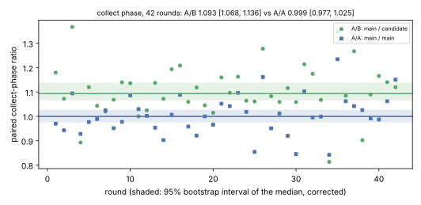
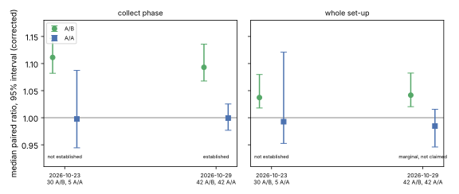

# Aimed gather, follow-up: a larger same-session A/A (2026-10-29)

[`PROTOCOL.md`](PROTOCOL.md) was committed and pushed (`5d726412b`) before
the first run. Report PDF: [`report/report.pdf`](report/report.pdf). The
first session is [`../README.md`](../README.md); its records are unchanged.

**Class: engineering.** A native component speed-up of IC relation
collection. On the measured params every counted operation is identical
between arms (the change hands the folding kernel the same summands in the
same order); identity was checked here on these params only.

## Result

42 rounds of baseline `a`, baseline `q` and candidate `c` of `ic price`
(rule v3 `k0n53/T01`, curve `icv1-f2m53-tm56619371-dac20a85`), the order
cycling through all six permutations; 126 processes under
`isolated_bench --cpus 3`, none contended, none failed, no round dropped (71
launches refused for CPU pressure and retried).

| metric | A/B median (main / candidate) | A/B 95% | rounds > 1 | A/A 95% | verdict |
|:--|--:|:--|--:|:--|:--|
| collect phase | 1.093 | 1.068 – 1.136 | 38 / 42 | 0.977 – 1.026 | **established** |
| whole set-up | 1.042 | 1.020 – 1.082 | 29 / 42 | 0.946 – 1.015 | marginal (+0.005), not claimed |

Intervals are from [`summary-corrected.json`](summary-corrected.json):
the bootstrap `summarise.sh` ran drew only odd-numbered rounds, a defect the
independent validator found, and the first correction still drew every
resample half odd and half even rounds (found in review); [`CORRECTION.md`](CORRECTION.md) gives the
as-run intervals beside these and how each verdict is read.

- **Collect phase:** median 230.3 ms and 235.2 ms (main, `a` and `q`)
  against 212.5 ms (candidate). The rule declared on 2026-10-23 holds: the
  A/B lower end clears 1 and the A/A upper end, by 0.042.
- **Whole set-up:** marginal, not claimed. With the corrected bootstrap the
  A/B lower end, 1.020, clears the A/A's 1.015 by 0.005; with the as-run
  one it did not. The generator was fixed after the data were seen, so this
  is reported and not claimed. The set-up includes phases the change does
  not touch.
- **Identity:** all 126 processes recovered `518509155375`,
  `all_verified: true`.
- The collect verdict holds under the as-run and the corrected generator,
  and under 500 of 500 independent seeds (validator).




## Limits

- One host class (an x86-64 cloud VM with AVX-512), one size (n53), one
  params file. Not on Iso Lab: see `PROTOCOL.md`, "Route".
- The leaderboard's `icv1-f2m53-tm56619371-dac20a85` one-target row (rule
  v7, S timed) was measured before this change and is not re-priced here.
- No IPC: no hardware PMU.

## Reproduce

```sh
# ic-baseline at d34b9b390 and ic-candidate at 6bc18857b:
cargo build --release --bin ic --bin isolated_bench
sha256sum -c research/ic_aimed_gather_20261023/aa2_20261029/runs/arms.sha256   # in the binaries' directory
BIN=<dir> bash research/ic_aimed_gather_20261023/aa2_20261029/run.sh
bash research/ic_aimed_gather_20261023/aa2_20261029/summarise.sh
bash research/ic_aimed_gather_20261023/aa2_20261029/correct_bootstrap.sh   # the intervals reported above
python3 research/ic_aimed_gather_20261023/aa2_20261029/report/plots.py
```
