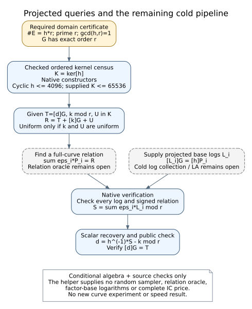

# Projected query and verified-relation plumbing

This is implementation work following the cofactor audit, not a complete IC
experiment, new speed result or new measured crossover. It does not change any
frozen HKY instrument, original producer cost or historical subgroup receipt.

## Sources checked before implementation

- The study's `COFACTOR_PROJECTION_PROTOCOL.md`, `PROTOCOL.md` and README distinguish
  strict original-point membership from relations after cofactor projection.
- The lead atlas was searched with `cofactor projection subgroup query randomization
  kernel`. `LEAD-ICB-cofactor-torsion-quotients` records the existing obstruction to
  treating small cofactor labels as a new general speedup; it does not price this
  proposed complete pipeline. Projection is a known mechanism, with no novelty claim.
- [SEC 1 v2](https://www.secg.org/sec1-v2.pdf), sections 3.1.2, 3.1.2.2 and 3.3.2,
  was read for the binary-curve order/cofactor convention, prime-order generator
  checks and cofactor multiplication. Download SHA256:
  `54687189af3de645756a30a801b596fd14c6566992c13bfd58eede399f324a89`.
  SEC 1 supplies those definitions; it does not prescribe this IC query protocol.
- Gaudry's 2009 paper was located through the author's current publication page
  and the official HAL API: DOI `10.1016/j.jsc.2008.08.005`, HAL `inria-00337631`.
  Its document endpoint returned HTTP403, so this additional review does not claim
  to have read that paper. The older LIX publication URL returned HTTP404. These
  access failures are not negative mathematical evidence. No novelty or asymptotic
  conclusion relies on an unread source.

Conductor is unavailable on this host; no reservation is claimed. New source is
confined to `examples/ic_projected_query_law.rs` and its `core.rs` support file,
plus this note and source-check receipts. The native244-child HKY continuation runs in its separate frozen worktree; four historical legacy caps remain separate.

## Conditional algebra and the corrected query law

Assume a correct finite abelian curve group E of cardinality h*r, a point G of
prime order r, and gcd(h,r)=1. The ambient cardinality must have its own valid
certificate; checking the order of G alone does not certify it.

Let H=<G> and K=ker[h]. Multiplication by h is invertible on H. Since r divides
the cardinality exactly once, the r-primary subgroup is H; consequently [h]E=H
and |K|=h. An element of H intersect K is killed by both r and h, so Bezout's
identity makes it zero. Addition therefore gives a bijection H x K -> E.

For a target T=[d]G, sample independent uniform k in Z/r and U in K, and query

    R = T + [k]G + U.

Translation preserves the bijection, so R is uniform on E under those sampling
assumptions. This is a conditional algebraic derivation, not an empirical
randomness test. The source helper accepts indices; it provides no random sampler.

The earlier prospective draft used U=O. That still gives a sound projection
identity but only samples H, which can miss cofactor cosets and cannot justify
full-curve uniformity or useful relation yield. Kernel randomization corrects
that design before any new projected-query experiment.

For an actually verified signed full-curve relation sum eps_i P_i=R, let
L_i=log_G([h]P_i), with every supplied log independently checked. Then

    sum eps_i L_i = h*(d+k) mod r,
    d = h^(-1) * sum eps_i L_i - k mod r.

For setup queries T=O the right-hand side is the known scalar h*k. For R=O,
the direct-sum decomposition forces U=O and d=-k; the direct hit must still be
verified and charged. Neither identity computes factor-base logs or finds a
decomposition.

Five algebraic dependencies in `proofs/ProjectedQueryLaw.lean` pass the fresh
repository proof gate with zero trusted exceptions. The complete finite-group,
cardinality and sampling bridge is not formalized. Finite source tests do not
constitute that general proof.

| Readable dependency | Lean declaration | Exact scope |
|---|---|---|
| Project away a kernel translation | `kernel_translation_projects_away` | explicit additive projection, zero and kernel hypotheses |
| Solve the projected scalar equation | `recover_scalar_from_projected_sum` | commutative ring, supplied inverse and log-sum equation |
| Known setup right-hand side | `known_setup_right_hand_side` | commutative ring, supplied inverse and setup equation |
| Scalar at an identity hit | `projected_identity_hit_scalar` | commutative ring, supplied inverse and zero projected shift |
| Coordinates imply unique decomposition | `certified_coordinates_give_unique_decomposition` | supplied left/right coordinate identities; does not construct them |

The first and last declarations use no axioms; the ring declarations use only
`propext`, `Classical.choice` and `Quot.sound`. No sorry, custom axiom or
`native_decide` exception. Receipt: `pipeline-receipts/projected-query-law-lean-20261026/`.

## Implemented checks and limits

The native core verifies an odd prime r<=2^32-1 by exact trial division, coprimality, ambient-order metadata consistency and nonzero order-r G. The original cyclic constructor has1<=h<=4096; the supplied-kernel constructor checks a complete ordered census with1<=h<=65536. The cyclic constructor enumerates its h points; the supplied constructor checks the provided h distinct points and their annihilation by h. The cyclic constructor rejects a noncyclic kernel. The subsequent supplied constructor accepts noncyclic censuses. The original E0 cofactor4232 fits its size cap, but no actual E0 kernel or new curve-order certificate has been constructed or claimed. These implementation
limits do not invalidate the mathematical law
for a noncyclic kernel with a correct general enumeration.

Certificates retain the complete arithmetic-domain parameters, and query
construction rejects a different domain, invalid subgroup targets or out-of-range indices.
The binary binding also rejects disagreement between metadata and its actual
field/curve backend.
Recovery rechecks the query context, every point and projected logarithm, the
signed full-curve relation, and finally [d]G=T. Zero projections, repeated points,
negative signs and verified identity hits stay explicit. There is no unverified
log anchor, hidden use of the target scalar, relation discovery or LA solver.

The binary adapter counts its group calls, including validation calls. Binary
field operations, membership tests, construction and all other phases lack a
complete price here. Its group ledger is not an end-to-end cost or speed metric.
The backend must supply a correct certified ambient order; general certification
of the qualified n22/n25 curve records is not replaced by this interface.

## Source verification and remaining work

Seven standalone native tests pass. They check bijective coverage on four small
cyclic groups for every target, the missing-kernel control, signed recovery with
independently looked-up logs, invalid relations/logs/ranges, direct identity hits,
and rejection of a noncyclic kernel, incompatible order data or reuse with a
different arithmetic domain. The first six-test receipt is retained with its
original source hash; the seventh was added after static domain-binding review.

The Cargo source gate adds an independently enumerated small binary curve,
reference polynomial-basis projections/logs and full query/recovery checks. Its
first attempt failed before compilation because sparse checkout omitted the
existing `isogeny_algos` path dependency. That exact dependency was materialized;
offline locked metadata now passes, with Cargo.lock unchanged. The second gate failed before library compilation on five existing compile-time
inputs omitted by the sparse checkout. Those exact files have now been restored;
the third gate passed eight Cargo tests and default Clippy on0670ec6fa. The supplied-kernel continuation passes11Cargo tests and10bare-core tests on84ddcb9b0; default Clippy exits0 with seven unchanged base-library warnings and no own-helper diagnostics. All raw failures and final statuses are retained in
`pipeline-receipts/projected-query-law-source-checks-20261026/`.

| Requirement | Status |
|---|---|
| Checked abstract query/relation helper | implemented;10standalone core tests pass on84ddcb9b0 |
| Binary backend binding | implemented;11Cargo tests including independent binary reference pass on84ddcb9b0 |
| Full-curve order/kernel receipts for actual qualified cells | no new run; original receipts unchanged |
| Uniform bounded sampler and frozen projected-IC protocol | not implemented/frozen |
| Factor-base projection, signed deduplication, cold log collection and mod-r LA | incomplete |
| Complete relation oracle, target solve and every phase's price | incomplete |
| Same-instance current IC baseline, strongest rho, genuine A/A and external solver comparison | pending full instrument/protocol |
| General finite-group Lean specialization and cardinality/uniformity bridge | open |

Next: check integration against the newer repository base, then build the missing cold pipeline before
freezing an actual projected-IC comparison. Use the existing qualified public
models with explicit curve-order provenance, preserve every construction/query
failure and count all setup, sampling, lifting, projection, relation, LA and
verification work. Differences in a whole method's query law must remain in its
variable ledger; they do not isolate an individual stage gain. No projected
experiment or additional VM has launched. The total additional cloud-compute
ceiling remains USD100 including replay.

## Supplied-kernel continuation: source checks pass

The original eight-test result at0670ec6fa remains source-specific. A subsequent
native constructor, certify_with_kernel, accepts a fully supplied ordered
kernel census, including noncyclic kernels, with an explicit65536-element cap.
It checks exact prime/order/generator preconditions, list length, membership,
annihilation, uniqueness and the identity. Caller order remains the index map;
it does not discover the kernel or certify ambient cardinality. Hash-based
uniqueness avoids quadratic pair scans. The existing cyclic constructor keeps
its4096cap and original interface.

The size cap now includes4232, but no original E0 curve/kernel receipt has been
created by this implementation work. Its new cofactor4232 test uses an abstract
cyclic group and must never be relabelled as an E0 curve test. New negative
controls reject incomplete, duplicate and non-kernel censuses. A noncyclic
Z/7 x Z/2 x Z/2 fixture checks complete coverage and supplied-relation recovery
for every target. All11Cargo tests and10bare-core tests pass on84ddcb9b0889c2dbe70ff26f879a8b534ac17c42. Its default Clippy exits0 with seven unchanged library warnings and no own diagnostics. The source-specific receipt is pipeline-receipts/projected-query-law-supplied-kernel-20261026/; current-base integration is a separate gate.

The finite counting justification is conditional on a correct backend and
certified ambient cardinality. Addition from the prime subgroup times the
supplied h annihilated, distinct points is injective: equal sums imply a point
killed by both r and h, hence zero by coprimality. Domain and codomain both
have h*r elements, so the map is bijective. This proves completeness of the
supplied census under those conditions; it does not establish the backend's
cardinality certificate or a random sampler. The general Lean bridge remains
open. The residual has a separate native certificate IDC1h08a8b0da9bbd7a55:32issuer points plus256extra checker points, one exact commutative-ring Lean lemma with0trusted additions, and an inverse-missing negative control all pass on28f2797dc. The actual proof-source hash is checked. Neither this polynomial certificate nor those finite source tests proves the general counting bridge.

## Bounded kernel construction from supplied points, 2026-10-27

`Law::certify_from_points` fills a source-level construction gap without adding
an oracle. Given the same correct abelian backend, certified ambient order h*r,
prime r and gcd(h,r)=1, it projects caller-supplied points by[r], adjoins their
cosets in deterministic input order, and then invokes the existing complete
kernel-census checker. Both kernel size and candidate count are bounded65536.
It supplies neither candidate search nor randomness. A proper generated span
returns `IncompleteKernelSpan { found, expected }`; invalid complete input,
including unused trailing points, is rejected. Construction and final checks
remain charged backend calls; membership/field costs are still incompletely
priced. This is standard finite-group subgroup generation, not a novelty claim.
Sources and conditional cardinality assumptions are the same SEC1/group-law
review and earlier implementation notes above; no unread Gaudry source is used.

The first standalone Rust development gate passes13core tests. A subsequent
source change exercises construction at abstract h4232 and the binary adapter;
its second standalone gate also passes13core tests. A direct native rustc test
then links the checked974f2e9cd46b library (recorded file hash) and passes all
14core-plus-binary/reference tests on component sourcec0d2b94f1. Its receipt is
`pipeline-receipts/projected-kernel-builder-binary-development-20261027/`.
This does not replace the pending ordinary Cargo integration gate. Core receipts:
`pipeline-receipts/projected-kernel-builder-development-20261027/` (initial and
attempt-2 have distinct recorded hashes). Controls include a noncyclic kernel,
multiple cosets over an existing subgroup, incomplete spans, invalid trailing
points, excessive candidate counts and the trivial kernel. The4232case remains
an abstract cyclic group, not an E0 curve/cardinality/kernel result. Actual E0
construction/query-yield experiments, general Lean counting, a sampler,
relation/log collection, LA and complete cold cost remain open. No scientific
frozen source, protocol or active native replay has changed.

## Original E0 fixture: kernel-construction API conformance

The next development check uses the exact existing public fixture
EC1N22Cbinhd39a9df391db: polynomial4194307, a2=0, b=1, recorded ambient
order4193912, prime r991, cofactor4232 and G=(97814,2630359). The ambient
order is imported from the earlier fixture-subgroups-enumerated receipt;
this check performs no new point count or cardinality proof.

Its first candidate set, the independent reference lifts of x0..63, generated
only2116kernel points and was correctly rejected. That failed first source
attempt remains intact. The corrected positive fixture supplies reference
lifts of both x0..63 and trace_one XOR x0..63, where trace_one is the first
polynomial-basis element with absolute trace1. The first proper span remains
an explicit negative control. The constructor now returns4232distinct points;
independent BinaryCurve arithmetic checks every point on-curve and annihilated
by4232. It also verifies36fixed known-target/query/recovery cases using supplied
known logs. The complete native development executable passes15tests.

Receipts are `pipeline-receipts/projected-kernel-e0-development-20261027/`
(build0/test101,14pass/1fail) and the distinct `...-attempt-2/`
(build0/test0,15pass). Both record source hashes and the actual uncommitted
test-source patch against310592396; raw output is preserved. Ordinary Cargo
integration still needs its separate gate. This supplies functional conformance
for the actual E0 kernel under its existing order receipt, rather than only the
abstract4232group test. It supplies no unknown-log recovery, relation oracle,
sampling/yield measurement, full cost or general formal counting bridge.
