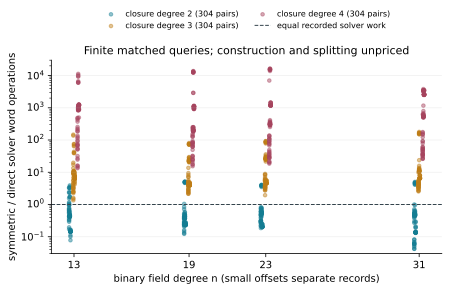

# Algebraic decomposition and quartic IC pursuit

Owner-requested campaign, begun 2026-10-23; evidence snapshot 2026-10-25.
**The campaign is partial.** The finite results below do not establish a
bounded degree law, global guess minimum, complete-price IC improvement or
measured rho crossover. [PROTOCOL.md](PROTOCOL.md) preserves the original
scope, amendments, limits and deviations.

## Measured structural result

The native symmetric formulation has fewer recorded solver word operations
in 263 of 304 completed paired queries at closure degree 2. At closure
degrees 3 and 4 it has more in every completed pair. Smaller product spaces
alone did not yield a uniform gain when stacked with extra closure.

| Closure cap | Raw rows | Complete extractions, all forms | Completed direct/symmetric pairs | Symmetric fewer words | Symmetric/direct word ratio |
|---|---:|---:|---:|---:|---:|
| 2 | 1,152 | 768 | 304 | 263 | 0.04200896--5.12320089 |
| 3 | 1,152 | 891 | 304 | 0 | 1.34249804--178.51670155 |
| 4 | 1,152 | 923 | 304 | 0 | 13.37332864--16,500.11984829 |



Fields n=13,19,23,31, dimensions ell=2,3,4; prefix, geometric,
trace-zero geometric and random bases; shared public subgroup targets.
Duplicate prefix replicates remain in raw records and are excluded from
the primary comparison. Each panel has 336 unique queries; 32 unpaired
or incomplete cases remain unknown. The direct hybrid solver raises its
effective extraction degree to the input degree, up to six: these are
**closure-cap ablations, not equal-solving-degree comparisons**.

Independent direct point enumeration found zero mismatches. Across the
304 completed symmetric queries in each panel, 8,100 algebraic roots
produced four verified x-multisets; 8,096 roots failed splitting or signed
lifting. Construction, splitting and physical conversion are not priced
by these solver-word ratios. Shared-host wall times earn L0 and are diagnostic.

The [results PDF](reports/local-structural-20261025/report.pdf) accompanies
the [degree-2](reports/run-structural-d2-20261023/report.pdf),
[degree-3](reports/run-structural-d3-20261023/report.pdf) and
[degree-4](reports/run-structural-d4-20261023/report.pdf) run reports.

## Guessing and exact controls

All eight assignments of the balanced three-set `[7,15,23]` on original
ell=8 draw 0 saturate degree four without refuting. Branches 0--3 have
rank 129,221; branches 4--7 have rank 129,473; all have 136,698 columns.
The recorded total charges every branch: **4,738,566,310,210 solver word
operations and 5,982,980 closure products**. This rejects this set on this
draw; it is not a minimum over all variable subsets. [Run report](reports/run-guess-k3-draw0-20261023/report.pdf).

The upstream PR already reports branch-0 failure on draws 0,3,5 and
all-eight refutation on draw 6. Our draw-0 replay agrees and fills the
other seven branches; it does not claim priority. The original four-set's
all-64-branch result is still upstream, unmerged evidence, not independently
replayed here. Our 28 k=0/1/2 attempts hit a column cap and remain inconclusive.
Eight earlier three-guess attempts hit the library's default internal cap;
they are retained and excluded from the successful process counts.

A [separate curve-membership audit](reports/run-fixture-group-audit-20261025/report.pdf)
checks every y root by substitution and an independent trace criterion.
Original UNSAT draw 5 and SAT draw 4 are not liftable on the recorded E0
curve; draw 0 is liftable. These remain valid Boolean fixtures, but not all
are ordinary curve queries. Target and base subgroup membership remain
unknown. The [native receipt](pipeline-receipts/fixture-group-audit-20261025/receipt.json)
retains both positive and negative outcomes.

The [200,000-column continuation](GUESS_CAP200K_PROTOCOL.md) is queued
locally after the current quartic/HKY process. Its 116 branch attempts
cover the remaining balanced k=0--4 cells with the same 12-GiB/900-second
limits. This is a queued local process, not a completed result or a cloud
allocation. The earlier capped attempts remain unchanged and inconclusive.

Exact independent fixture counting reproduces `0,6,6,0,18,0,0`, with
checked Boolean witnesses for all three SAT controls. Small controls
check 2,304 assignments, 373 corresponding symmetric roots and 2,880 signed
lifts, including repeated roots. The campaign-local u128 chain builder
matches the library's equations for m=3--6; sparse and parallel fixed points
match dense controls. These are finite correctness checks.

First-two-summand exchange is checked on all 308 coordinate equations
of the original fixtures. [IDC1ha27a77e72057f9cb](proofs/s3-swap.identity.json)
and its [receipt](proofs/guess-swap.receipt.json) relate degree verdicts for
`[7,23,24]` and `[15,23,24]`, not their costs; no formal-proof pointer is set.

## Complete DLP and quartic status

[PIPELINE.md](PIPELINE.md) documents the native ecbench adapters and their
accounting limits. The n=13 smoke verified all ten arms/targets and replayed
all ten with equal deterministic counters. The n=23 session verified nine
records and timed out once; its independent replay is separate. The n=7
session exhausted all ten attempts, including rho. K0 n=17 was refused by
the constructor. These failures remain evidence, not zero-cost solves.

An [exhaustive n=7 support audit](pipeline-receipts/structured-n7-support.json)
checks all 64 ordered signed-base triples: none sum into its prime subgroup.
All 29 subgroup points produce only three canonical representatives, none
passing the configured four-bit distinguished-point predicate. These exact
finite support failures explain the two exhausted methods; they do not
generalize to larger fields or retune the frozen session.

The [corrected n=13 report](reports/run-structured-n13-20261025-01-pricing-correction/report.pdf) and
[corrected n=23 report](reports/run-structured-n23-20261025-01-pricing-correction/report.pdf) quote the
native cost bands. All nine verified n=23 records independently replayed;
the incomplete direct arm is excluded from the complete-arm plot. The
[setup-refusal report](reports/run-pipeline-setup-refusals-20261025/report.pdf)
preserves the n=17 refusal and the later sparse-input setup failures.

**Pricing correction:** our earlier prose incorrectly called these S
values wall-priced. Completed n=13/n=23 solvers use fixed pinned word
rates; the measured n=7 solver term is removed. The
[native pricing audit](pipeline-receipts/pricing-audit-20261025/receipt.json)
rebuilds the available IC charges from counts and fixed prices. Raw S
remains an incomplete fixed-price estimate. The native band at n=13 gives mean S for
direct/symmetric/pair-table/strong-rho of
`19.573/19.473/54.285/14.330` at weight 0,
`7290.842/2883.805/58.245/14.552` at 0.1, and
`72732.257/28662.791/93.889/16.553` at 1.
Uncounted construction and split arithmetic remain missing at every weight.
There is no robust complete-price gain over the existing references.

The [pricing-audit PDF](reports/run-pricing-audit-20261025/report.pdf)
documents the native reconstruction and its byte-identical reproduction.
The quartic smoke has 24/24 verified records at m=6,8,10,12; its complete
scalar replay is still running in this snapshot. Canonical `ecbench band`
refuses its constructed curve slugs because the virtual calibration rows
are absent from the global table. The audit reproduces those deterministic
count conventions without changing the table and separately labels an
additional scenario that varies counted Fq solver work. Neither scenario
is hardware calibration or an algorithmic gain.

Quartic IC remains separate over GF((2^m)^4), requiring its proper
intermediate field. The historical single-target m=14 gap near 4.3 times
measured rho and crossover extrapolation near subgroup size 2^68 remain
historical, distinct claims. Current native arithmetic explicitly refuses
m=16--18; wider coefficients, keys, order and scalars are required.
[Width problem](../../problems/quartic-binary-ic-wide-scalars.md).

## Same-input external correctness

The [Singular correctness report](reports/run-external-cas-20261025-01/report.pdf)
covers 22 frozen equation systems, including two constructed positive
controls. All 44 `std`/`slimgb` commands finish. Native reconstruction and
complete Boolean enumeration agree with every external zero set and every
complete native extraction. All original generators reduce to zero against
the returned bases. The strengthened independent validator also checks the
exact exported ideals and reproduces the original receipt byte for byte.

This is a correctness baseline at L0, with explicit Boolean field equations,
single-threaded 60-second/1-GiB external limits. A complete basis computation
and root extraction have different output contracts, so no speed ratio is
claimed. Magma, msolve, FGb, fastest-tool and hardware comparisons remain
open. [Protocol](EXTERNAL_CAS_PROTOCOL.md),
[receipt](pipeline-receipts/external-cas-strengthened-20261025/replay.json),
[reproduction](verify-external-cas.sh); the separate hash-checked raw archive
preserves all generated scripts, package hashes, outputs and statuses.

## Requirement status

| Requirement | Status | Evidence or remaining gap |
|---|---|---|
| A1: independent structural replay | partial | exact original fixtures and small equations/roots checked; upstream large fall-degree panel not fully replayed |
| A2: native structured bases and symmetric formulation | verified, finite pilot | Rust implementations, all four families, identity/splitting/repeated-root controls; limits in PIPELINE.md |
| A3: combine formulations and closure | verified, finite stage panel | three matched panels above; no whole-query performance conclusion |
| B1: ell=8 minimum guesses | partial | all eight balanced k=3 draw-0 branches fail; 116 remaining balanced branch attempts queued at cap 200k; alternative sets and finite-query relevance remain |
| B2: ell=9 and four summands | implemented, unverified | 1,152 fresh fixtures across nine cells/four families, frozen selection and remote shards; no larger-guess result yet |
| B3: N=58/60/100 continuation | implemented, unverified | u128/sparse engines and exact fixtures; fixed-point measurements outstanding |
| C1: quartic independent replay | partial | m=6/8/10/12 smoke has 24 verified records; all-record scalar replay running; m=14/15 full panels outstanding |
| C2: m=14--18 ladder | blocked in part | supported rungs outstanding; m=16--18 need wider arithmetic |
| C3: complete method and full native price | partial | n=13 complete-answer replay, other smoke outcomes retained; construction/split counts and qualified comparison missing |
| D1: external/hardware controls | partial | all 44 same-input Singular correctness checks agree on 22 cases; fastest-tool performance and actual hardware comparisons remain |
| D2: durable evidence and PR | partial | source/protocol/raw archive/native validator/visual PDFs provided; wider campaign remains open |

[Cost/scaling problem](../../problems/ic-low-degree-complete-cost-and-scaling.md)
and the four `XP-20261023-*` backlog cards preserve unresolved obligations.
Completed documentation or a passing PR does not complete those experiments.

## Reproduction and provenance

[report-data.json](report-data.json) is independently recomputed by
[native Rust](../../examples/ic_campaign_report_data.rs) directly from raw
rows and passed point-oracle audits; derived summary ratios are not inputs.
The [evidence archive](evidence/runs-local-20261023.tar.xz) preserves all
33 original local run directories, command JSON, hashes, source revisions,
stdout/stderr, exits and host metadata. Run:

```sh
bash research/ic_algebraic_crossover_20261023/verify-recorded.sh
```

The verifier extracts into a fresh temporary directory and byte-compares
the complete recomputation. The plotting Python only renders recorded
native values; it executes no experiments or numerical research.

Native experiment source was built at d67f6085; adapter smoke source was
pushed through a5ff7036. Individual receipts pin exact binaries and source
files. A later source-only parity lint fix is distinct from the recorded
instrument binary. Source-pinned inputs and their manifest remain under
`inputs/`. The first timer-less setup and jq argument failure are retained.
The original structural outer shell ended with a syntax error after all
96 native commands succeeded; editing its running script caused that tail
error. Subsequent panels used the preserved frozen runner copies.

Full library tests passed: 4,487 passed, 119 ignored. Native instrument:
nine tests; ecbench adapters: two tests. Initial sandbox socket failures
and the network-enabled successful rerun are both retained. Strict clippy
is blocked by two unchanged base lints; the scoped check passes with only
those command-line exceptions, without committed lint allowances.

No value is promoted to the IC leaderboard, progress ratio series or
admitted benchmark table: the complete-price and validation gates remain
unmet. Their historical figures remain unchanged; the scoreboard receives
a separate finite-stage panel. Visual copies in `benchmarks/` are expressly
unadmitted evidence, not a new admitted benchmark row.

The owner's total additional cloud-compute budget is **USD 100**, including
replay ([BUDGET.json](BUDGET.json)). No paid cloud job has been launched in
this snapshot. Local runs and a read-only GitHub Actions access probe are
separate; prepared shard plans are not a queued cloud allocation.
The [completed probe](access/ci-probe/status.json) authenticated but hit an
explicit identity-policy denial of `ssm:GetParameter` for `/ephemeral/config`
in us-east-1 ([masked log](access/ci-probe/failure.txt)). The prescribed
launcher cannot proceed with that identity. No IAM policy was changed.

Sources: [fall degree PR 2214](https://github.com/aburan28/crypto/pull/2214),
[guessing PR 2429](https://github.com/aburan28/crypto/pull/2429),
[cryptanalysis structured bases](https://github.com/aburan28/cryptanalysis/tree/claude/cryptanalysis-repo-setup-p59kek/experiments/pdp-degree-heuristics),
[historical quartic study](../gaudry_quartic_d4_char2_20261015/README.md).
