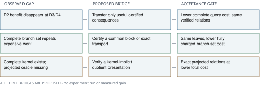

# Three ECDLP index-calculus follow-ons

Untested proposals; no new scientific execution or measured gain

Prioritize selective constraint transfer, then exact work sharing across the registered guess branches. Keep the implicit cofactor quotient as a higher-risk, family-specific construction test. These are proposed experiments within existing lead families, not claims of new attacks or a completed novelty audit.

## 1. Selective transfer between symmetric and direct systems

**Evidence.** In the recorded campaign, the symmetric formulation used fewer solver words in 263/304 completed degree-two pairs, but in none of the completed degree-three/four pairs. Across the reported symmetric queries, 8,100 algebraic roots yielded four verified x-multisets. These are historical, small-instance diagnostics; solving, lifting and total query cost differ.

**New experiment.** Use the cheap symmetric closure only to produce a small, selected set of certified consequences. Translate those consequences into direct coordinates and finish in the direct chain with physical relation verification. The proposed change is constraint exchange between the representations, rather than another standalone symmetric solve or an assumed multiplication of their gains.

**Discriminating test.** On a new, separately registered pilot using small exactly enumerable queries, compare direct, symmetric and consequence-transfer arms on identical instances. Certify every added consequence against the original system; include positive and negative controls. Charge translation, elimination, failed roots, signed lifting, subgroup checks and duplicate removal. Advance to larger cells only after a complete query-cost improvement survives held-out queries.

**Stop.** Stop if pulled-back constraints increase degree/support enough to erase the saving, change the solution set, or improve solver words while cost per independently verified relation worsens.

**Prior work.** Adjacent families: LEAD-ICB-decomposition-encoding-and-sat and LEAD-ICE-boolean-f4-f5-f6-engines are closed in their measured regimes. This pilot tests a particular unmeasured bridge between the campaign's two representations; it does not reopen those families or imply an exponent change.

## 2. Exact work sharing across guessed branches

**Evidence.** The completed three-guess draw-zero replay charges all eight branches and about 4.74 trillion solver word operations. Its branch ranks fall into two groups. Equal rank alone does not establish equivalent equations or reusable certificates.

**New experiment.** Look for an exact common elimination block or a verified coordinate transport between residual systems. Reuse only work whose applicability to each branch is independently checkable. The fresh question is how much of the complete branch set can share mathematically valid work, beyond already-known compiler caching or F4 learn/apply trace reuse.

**Discriminating test.** First compare residual row spaces and candidate transports on the small registered-style controls; do not assume rank matches prove equivalence. Then price one complete new branch-set pilot against independent solves, including preprocessing, every branch, transport checks, proof replay and memory. Require the same per-branch outcomes and actual positive controls.

**Stop.** Stop if pivot changes destroy the common block, residual equivalence cannot be certified cheaply, or complete cost fails to improve. No branch is dropped or counted as refuted from a shared rank alone.

**Prior work.** Advances LEAD-ICE-hybrid-guess-determine-l7. Generic F4 trace reuse is already known and faster-engine work has a closed measured regime. The original minimum-guess/scaling obligations remain open; this proposal neither changes the frozen replay nor supplies its missing outcomes.

## 3. Kernel-implicit cofactor quotient oracle

**Evidence.** The campaign has a supplied-point complete-kernel constructor and an audited E0 control with prime subgroup order 991 and cofactor 4,232. It has no complete projected relation oracle. The small prime subgroup makes this a construction control, not a cryptographic-size result.

**New experiment.** Construct and verify an explicit quotient isogeny using the complete rational cofactor kernel, then test a pulled-back relation system that represents the quotient implicitly rather than enumerating every kernel correction. This is an oracle-representation question, not a claim that moving to an isogenous curve improves relation yield.

**Discriminating test.** Begin with audited small-cofactor controls. Verify the actual map, full kernel, subgroup transport and every physical relation against enumeration before attempting the E0 case. Compare with the complete explicit-kernel baseline, pricing map construction/evaluation, equation growth, solving, lifting and verification. Count distinct projected points and independent relations, preserving kernel collisions and failed lifts.

**Stop.** Stop if the isogeny raises the equation degree or term count enough to dominate the saved kernel enumeration, or if projected collisions erase useful rank. No extrapolation to ordinary small-cofactor or prime-degree challenge families follows.

**Prior work.** LEAD-ICB-cofactor-torsion-quotients is closed for the small-cofactor ECC2K-130 setting, with a large smooth cofactor explicitly listed as a revisit condition. The campaign's E0 control supplies that different test regime. LEAD-ICP-isogeny-transported-relation-yield remains separate; no yield gain or universal transfer is asserted.

## Scope and sources

The current guessing/scaling and quartic extension-field programme remains partial. This nomination adds no scientific execution, process-liveness observation, frozen workload/cap/deadline change or new paid compute. It proposes no new bounded-degree theorem, general ECDLP improvement, stacked gain or measured crossover. Its note, diagram, reproducible sources and PDF are included in the research PR for review.

The atlas was reviewed on 24 October: 147 leads, with newer changes pending reconciliation. Relevant atlas entries and connected default-branch code searches were read on 28 October. This is a scoped duplication check, not proof of global novelty. Existing trace constraints, liftability equations, F4 trace reuse, affine target compilation and block filtrations are prior work.

- [Campaign finite results and controls, same published source snapshot](https://github.com/isogeny-labs/crypto/blob/72db6b71b8abe3106ac13a89572947eb73b3562c/research/ic_algebraic_crossover_20261023/README.md)
- [Existing affine target compiler: prior work, not a new lead](https://github.com/isogeny-labs/cryptanalysis/blob/ae8994ab14e942c774818704dc19402f6671d848/experiments/groebner-f6-affine-target-20261009/README.md)
- [Existing block-filtration pilot and its Boolean-grading caveat](https://github.com/isogeny-labs/cryptanalysis/blob/ae8994ab14e942c774818704dc19402f6671d848/experiments/homogeneous-fraction/README.md)
- [Kosters and Yeo: trace law and first-fall/solving-degree warning](https://arxiv.org/html/1503.08001v3)
- [Huang et al.: last-fall theorem hypotheses and ECDLP limits](https://arxiv.org/html/1505.02532v2)
- [Galbraith, chapter 25: explicit isogenies from kernel subgroups](https://www.cambridge.org/core/books/abs/mathematics-of-public-key-cryptography/isogenies-of-elliptic-curves/08E8C9D099ABC5FFBE15C6DD8469C985)

The author-hosted chapter PDF timed out; the publisher's chapter text was read for the established kernel-isogeny construction. The double-large-prime paper's full PDF returned 403; no new large-prime lead is based on that inaccessible body. The atlas already records a quartic/genus-three 2LP variant making the whole solve 2.31 times costlier, so a generic 2LP proposal was excluded.

No new measured or proved value is added. The campaign's local-structural-20261025/closure-ratios.svg remains historical. The canonical scoreboard and progress-timeline paths are absent in this older local review tree; their coverage was not verified here and no copy was regenerated. All three lanes in the new explanatory diagram are explicitly proposed.
