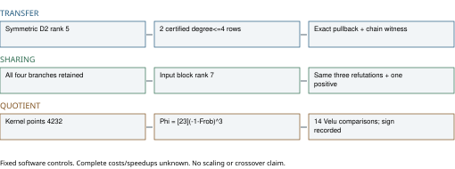
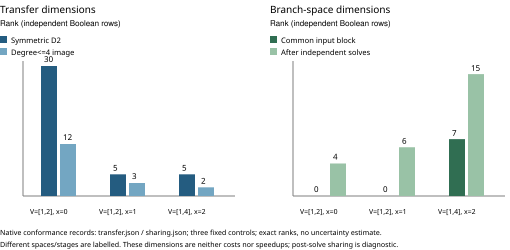

# Checked components for three ECDLP index-calculus follow-ons

29 October 2026. **Six native conformance tests, strict Clippy and seven
conditional Lean lemmas pass. Complete query/branch-set costs and speedups
remain unknown. No cloud experiment was launched.**

This advances the [three published proposals](../new-leads-20261028/REPORT.md)
to executable, source-linked components. It does not complete their priced
pilots, the original frozen programme or a novelty audit. The native crate is
standalone: its checked source does not depend on the older review tree's
crypto library. Earlier sixteen-test library results keep their old-source
scope; they are not a test of the current merged library.

## 1. Selective symmetric-to-chain transfer

The new component builds the actual b=1 binary symmetric S4 system over the
product spaces V, V^2 and V^3, retaining exact Boolean source multipliers for
every degree-two closure row. Its substitution into three factor-base legs
is checked coefficient-for-coefficient. An exact quadratic-resultant Bezout
witness then expresses each pulled-back row in the original two-S3 chain.
This avoids assuming a nonzero leading coefficient or dropping exceptional
roots.

For quadratics f=az^2+bz+c, g=dz^2+ez+f0, put u=ae-bd and v=af0-cd.
The checked identity is

    R = v^2-u(bf0-ce)
      = (duz+eu-dv)f + (av-auz-bu)g.

It is proved in a commutative ring and reduces correctly to characteristic2.
Certificate **IDC1h02c42d4a878d05d0** binds that identity and the checked Lean
source. The Boolean representation and its substitution remain separately
checked native components, not a full Lean formalization of the solver.

Low-degree selection is the kernel of projection onto terms above degree4.
It considers combinations of rows; simply discarding displayed high-degree
basis rows missed useful cancellations in the initial development version.
The original records were preserved and the amended component adds a
cancellation control, a corrupted-certificate control and a genuine
prime-subgroup positive control.

All controls use E0: y^2+xy=x^3+1 over F32, modulus z^5+z^2+1. Three
summands in V give six x-bits; the chain adds five intermediate-point bits.
The last row uses the first nonidentity [4]P in the deterministic point order,
V=<1,x([4]P)>=<1,4>, and target [3]([4]P), whose abscissa is2.

| V basis | target x | symmetric D2 rank | exact degree<=4 image rank | maximum pullback degree | verified subgroup x-assignments |
| --- | ---: | ---: | ---: | ---: | ---: |
| 1,2 | 0 | 30 | 12 | 6 | 0 |
| 1,2 | 1 | 5 | 3 | 6 | 0 |
| 1,4 | 2 | 5 | 2 | 6 | 1 |

For each row, all 64 x-assignments and all 2048 chain assignments are checked.
The chain has respectively 9, 11 and 1 solutions; every selected consequence
preserves them. The first two controls have ambient-curve relations but no
prime-subgroup positive relation. They cannot serve as prime-subgroup query
evidence. The added third control supplies that missing positive check.

**Conclusion in scope:** two degree-at-most-four consequences survive exact
selection in the prime control, despite individual pullbacks reaching degree6.
This supplies a valid transfer mechanism. It does not show that these rows are
new to the direct chain's same-degree closure, reduce solving degree, or lower
complete verified-query cost. Translation, certificate replay, failed roots,
signed lifting and all verification still need pricing.

## 2. Exact sharing across all guessed branches

The component fixes the first two x-bits and retains all four leaves. It
computes the exact intersection of residual row spaces and replays each
common row against the original generators separately in every leaf.
An equal-rank counterexample, span{x} versus span{y}, has zero intersection;
equal ranks are never used as an equivalence certificate.

A separate path identifies literally common Macaulay input rows, eliminates
their common block once, and then finishes every leaf with its own source
certificate. It takes the residual generators as input and does not require
the reference leaf solutions. The audit also computes independent closures
for comparison; that reference work is not a free preprocessing step.

| V basis; target x | independent leaf ranks | intersection after solves | common input rows | common input block rank |
| --- | --- | ---: | ---: | ---: |
| 1,2;0 | 12,14,13,12 | 4 | 0 | 0 |
| 1,2;1 | 14,12,14,14 | 6 | 0 | 0 |
| 1,4;2 | 16,16,15,16 | 15 | 10 | 7 |

In the prime control the branch outcomes are exactly **refuted, refuted,
one positive assignment, refuted**. The shared-input and independent paths
have equal row spaces and preserve every outcome. No leaf is omitted.
The active system has only four Boolean variables and closure degree4;
this finite completeness is not evidence of a degree4 law at larger sizes.

**Conclusion in scope:** a seven-row pre-elimination block exists for the
prime control. The two other controls have no literally common input block,
even though their post-solve intersections are nonzero. Post-solve rank15 in
the prime control includes information already obtained by refuting three
leaves; it is not a zero-cost shared solver. Compilation, common-block
discovery, per-leaf certificates/replay, memory and the remaining solves may
erase any saving. No full branch-set cost improvement is claimed.

## 3. An explicit quotient for the existing large-cofactor E0 fixture

The existing fixture is binary, not a prime-field curve: degree 22, modulus
z^22+z+1 (integer 4194307), E0 with a2=0,b=1, recorded ambient order
4193912=991*4232 and known generator (97814,2630359).
That ambient order is an input retained from the earlier audited fixture;
this component does not prove a new cardinality result.

Let pi be coordinate Frobenius. E0(F2) consists of infinity,(0,1),(1,0),(1,1),
so its F2 trace is -1. The standard Frobenius characteristic equation is
pi^2+pi+[2]=0. Hence V=-1-pi is its Verschiebung, with pi V=V pi=[2].
The concrete maps are

    Phi = [23] V^3,      Psi = [23] pi^3,
    Psi Phi = [23^2] (pi V)^3 = [4232].

The general polynomial identity is certificate
**IDC1hf913cc1220ef209b**. Its specialization is checked in Lean under the
explicit commuting/FV=2 assumptions. The actual elliptic-curve geometry is
standard source material and is not formalized by that ring lemma.

Here is the fixed-fixture kernel argument. Conditional on the recorded order
and coprimality, the h-multiplication kernel has4232 points. The constructed
set contains4232 distinct points killed by[h], so it covers that kernel.
The native check kills every one with Phi. Conversely, Psi Phi=[h] implies
that every Phi-kernel point is killed by[h]. The two kernels are therefore
equal. Phi is nonzero on the known order 991 generator, hence injective on
that prime subgroup. The written argument uses standard finite-group and
Frobenius facts; the Lean kernel/subgroup lemmas expose their coverage and
injectivity hypotheses rather than assuming the desired Phi-kernel.

Using standard isogeny degree facts, V is separable of degree 2 and[23] has
degree 529; Phi is an explicit separable degree 4232 quotient on E0. This
geometric degree statement is not a full Lean proof. The native map uses
three V steps and scalar multiplication by23 and does not enumerate 4232
kernel corrections during evaluation. This is a construction mechanism,
not a measured speedup or an implicit algebraic relation oracle.

An independent Vélu formula implementation provides the comparison. Complete
small controls over F32,F64,F128 enumerate 44, 56 and 116 rational points, verify
all 1936, 3136 and 13456 homomorphism pairs, and have respective kernel sizes 4, 8 and 4
and image sizes 11, 7 and 29. Lifting is also checked against every affine pair.
Both map implementations share the native field/point backend; no external
independent arithmetic implementation or runner is claimed.

For the degree 22 fixture, all 4232 kernel points pass, while the retained
2116-point incomplete-span control remains incomplete. Fourteen nonkernel
and kernel-translate comparisons agree with **minus Phi** after the Vélu
target normalization y'=y+1. The normalized target has the same E0
parameters. This is finite comparison evidence, not a proved global equality
of expanded rational maps. The complementary identity is also checked on
the recorded point controls.

**Conclusion in scope:** the proposed quotient now has a concrete E0-specific
construction and verified component controls. An isogeny preserves the
unknown-log problem; it supplies no scalar solver. The image factor base,
algebraic map encoding/degree, exceptional cases, signed lifting, duplicate
images, independent relation rank and every cold phase still need an oracle
implementation and complete comparison. The small-cofactor challenge-family
atlas closures are not reopened.

## Verification and precise completion status

- Six release library tests pass, no failures/ignores; strict all-target
  Clippy with -D warnings passes. These are local development checks, with
  no admitted benchmark timing or calibrated operation comparison.
- Seven Lean 4.34.1 lemmas pass. Five use only propext, Classical.choice and
  Quot.sound; two conditional kernel/transport bridges use no axioms. No
  sorryAx, custom research axiom or native_decide. Fresh lean4checker is
  unavailable. See the proof map for missing representation/geometry proofs.
- Each v1 identity passed 32 issuer-derived plus 64 separately seeded checker
  points, and an added-one false identity was rejected. The checked Lean
  source hashes match the proof pointers. This is same-session verification,
  not external independent replay or leaderboard admission.
- Executable components/certificates/proof checks: verified in the stated
  finite/conditional scope. Full-query and full-branch-set prices: not
  measured. Complete quotient relation oracle: not implemented. Growing-size
  scaling, external-tool comparison and crossover: not attempted here.

Final raw component records, the exact input-file inventory, proof hashes and
error/repair logs are in ../../followons_20261029/validation/. Initial missing
dependency/serialization and proof-zero-step issues were corrected, not waived.
The incomplete basis-row-only selector was replaced by exact degree projection;
the old development records are retained separately and are not a baseline
performance comparison. No frozen evidence was rewritten.

## Full-pilot blocker and next discriminating work

The three priced pilots remain open in the linked problem record. The
existing AWS CLI was located and used; STS returned NoCredentials. There is
no connected EKS or workflow-dispatch tool. The inspected main workflow
accepts ecbench specifications and builds ecbench, not this standalone crate.
It does not turn these new components into supported experiment adapters.
No cloud launch, image or execution is claimed, and no identity, pool cap,
frozen workload or original deadline was changed.

Next: integrate exact transfer and pre-elimination into the fully charged
native query harness; build the algebraic quotient oracle; then run matched
baseline/candidate/held-out queries with all costs, failures, lifting and
verification under the authorized EKS contract. No smaller control here
discharges the original ell8/ell9/m4 or quartic requests. Keep the original
29 October 20:02:21 UTC deadline and USD100 total; do not silently reset either.

## Sources, novelty and graphs

The scope check read the 147-lead atlas and relevant hybrid-guess, cofactor
quotient and isogeny-yield records. Its recorded review is 24 October and newer
work remains unreconciled; this is not global novelty proof. Update those
entries at the next scoped atlas review without changing their old closures.
The contribution here is a checked application and executable certificate
path for the three nominated experiments, not discovery of these standard
algebraic identities or a new generic ECDLP algorithm.

- Existing source: examples/ic_algebraic_followup.rs,
  src/cryptanalysis/binary_semaev_s4.rs, examples/ic_projected_query_law.rs.
- Kosters--Yeo, https://arxiv.org/abs/1503.08001, section 4: first-fall degree
  can stay small while solving degree increases.
- Huang--Kosters--Yang--Yeo, https://arxiv.org/abs/1505.02532: zero-dimensional
  theorem hypotheses and explicit ECDLP limitation.
- Galbraith, chapter 25, https://www.cambridge.org/core/books/abs/mathematics-of-public-key-cryptography/isogenies-of-elliptic-curves/08E8C9D099ABC5FFBE15C6DD8469C985 . The earlier author-PDF access gap remains; no new full-PDF read is claimed.
- SageMath primary software documentation for Frobenius maps and finite-curve
  characteristic polynomials, read 29 October:
  https://doc.sagemath.org/html/en/reference/arithmetic_curves/sage/schemes/elliptic_curves/hom_frobenius.html and
  https://doc.sagemath.org/html/en/reference/arithmetic_curves/sage/schemes/elliptic_curves/ell_finite_field.html .

The algebraic/generic decomposition distinction in current main AGENTS is
preserved. Truth-table/group enumeration here is a correctness reference,
not algebraic IC progress. The current-head progress-timeline contract was
checked: no cold IC/rho ratio or admitted cost exists to plot. The canonical
scoreboard/leaderboard/progress figures and the historical closure-ratio
figure are therefore unchanged. The new diagrams show component dimensions
and verification scope only; no performance, curve-roster or ledger row is
promoted.
