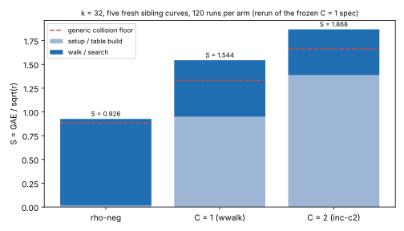

# Single-target IC parity: the C = 1 headroom and the algebraic gap (2026-11-15) — `[pcc:unverified]`

Owner goal: "work on reaching index calculus parity for single target", then "attack the algebraic gap and 1" (1 = the C = 1 arm toward its generic floor). Every number below is `[pcc:unverified]`.

## 1. C = 1: rerun and phase split

The frozen C = 1 confirmation spec at k = 32 (`../curve25519_autolab_20261104/c1/spec-confirm-k32.json`, copied unchanged to `spec-k32.json`) was rerun with `ecbench run --cpus none --allow-busy` (L0), because the original records sit in the artifact store, which this container cannot reach. Session `session-k32/` (`ECBS1h6cced8742dd9`): 540/540 runs verified. Bench record `benchmarks/records/20261115T1708Z-c1-headroom-k32-rerun.json`. Summary `summary.json`, graph `c1_phases.{svg,png,pdf}` (`plot.py`). [pcc:unverified]

The rerun reproduces the published means: C = 1 S = 1.545 (published 1.545), rho-neg 0.928 (0.928), C = 2 baseline 1.874 (1.874).

| arm | setup / table build | walk / search | S | generic floor | above floor |
|:--|--:|--:|--:|--:|--:|
| rho-neg | 0.015 | 0.911 | 0.928 | 0.886 | 5 % |
| C = 1 (`wwalk`, x = 0.7) | 0.949 | 0.595 | 1.545 | 1.329 | 16 % |
| C = 2 (`inc-c2`) | 1.387 | 0.481 | 1.874 | 1.662 | 13 % |

Ratio of means C = 1 / rho-neg = 1.665. Paired per-run ratio (geometric mean of 120 pairs) 1.86 [1.63, 2.14].

**Reading.**
- `wwalk` is a table-and-walk design: it stores a table of about 0.7 √r points (`table_insert_attempts` = 16,219 = 0.7 √r per run), then walks until the walk hits it. Collisions can only form between walk and table. The 1.329 floor counts collisions among all points, as rho's do, so table-and-walk sits above it by construction.
- The design that does reach the F = 1 floor is a distinguished-point rho on two unknowns, the target and the seed, with all points able to collide. That is rho on two targets: a second, unneeded discrete log. Its ideal cost is 1.5x single-target rho.
- So the C = 1 arm's remaining headroom is at most about 10 % (1.545 → about 1.40 = 1.329 x rho's 5 % walk overhead, ratio 1.67 → 1.5). Reaching it means turning C = 1 into rho on two targets. That is a relabelling, which the success rule excludes. No such arm was built.

## 2. The algebraic gap (no run)

- The algebraic screen's smallest gap (`../curve25519_rho_parity_bound_20261104/ALGEBRAIC_SCREEN.md`, "m = 2, full coverage, one root-find per base point", 265x at w = 0.1) is not an algebraic oracle. The two roots of S3(x_i, X, x_R) are x(R − P_i) and x(R + P_i). Root-finding them computes what `rootfind-subtract:m=2` gets with one batched group addition, which is cheaper than a square root. At full coverage this is the generic pair scan, whose cost the screen itself puts at about 12.5 w √r per run (exponent 1 against rho's 1/2). [pcc:unverified]
- On the real algebraic base (L13, `../curve25519_leads_wave4_20261104/l13_grid_limit_control/`, isogeny base t = 5, 22 columns, k = 20), even a free oracle loses badly: S(w = 0) = 27.04 against rho-neg 1.58, 17x. The faster grid oracle and a pair table on the same base change only the w > 0 part (42x and a further 76x). The gap at w = 0 is coverage: too few points of the curve are sums over the base.
- So the binding constraint is the base, not the solver. Parity would need a prime-field base with near-full coverage and a membership decision of a few field operations per trial (≤ 3 at w = 1, `ALGEBRAIC_SCREEN.md`). No such base is known. That is the open problem of prime-field summation-polynomial methods (Semaev 2004; Petit, Kosters and Messeng, PKC 2016). Solver engineering cannot close it.

## Conclusion

Single-target parity is out of reach on both tracks.
- C = 1: the generic F = 1 floor is 1.5x rho, and the last ~10 % of headroom is reachable only by rewriting the arm as rho on two targets.
- Algebraic: the gap is set by the base's coverage, about 17x at k = 20 even with free native work. Solver speed cannot remove it.

## Not done

No new oracle built. One rerun at one size, L0 (not isolated). The S3 checkpoint and raw upload were skipped: this container has no AWS credentials.
