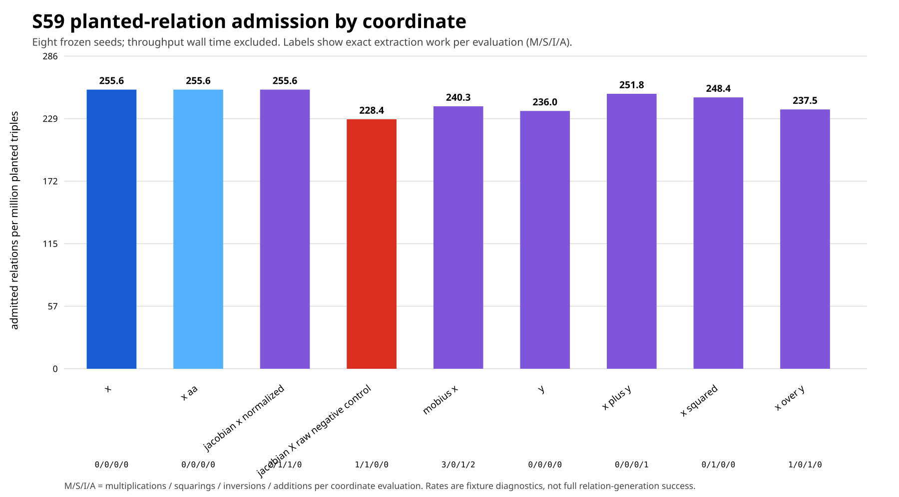
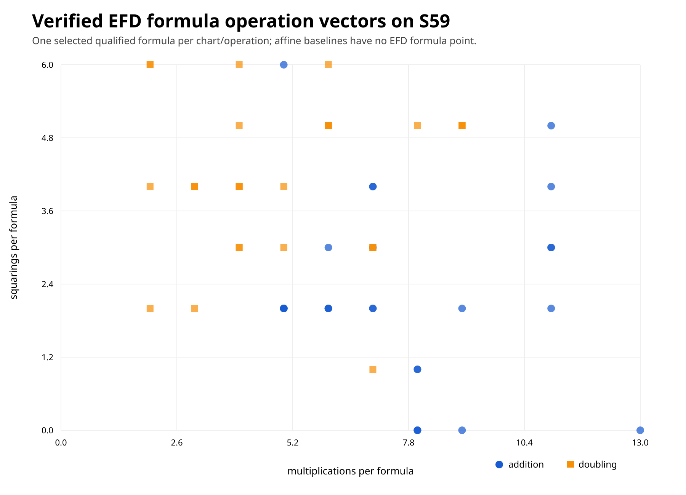

# S59 coordinate Rosetta — counted comparison

## Outcome

The frozen correctness/counting pass completed for eight seeds, nine fixed-curve coordinate arms, and the full EFD matrix. All hard controls passed. These are counted and rate results; the four-worker wall fields are inadmissible and are not reported as benchmarks.

## Fixed-curve coordinate results

### Admission statistics

Each arm evaluated 2,097,152 planted triples.

| coordinate | admitted | rate / M | density | density adj. | Δ vs x | Holm p |
| --- | ---: | ---: | ---: | ---: | ---: | ---: |
| x | 536 | 255.58 | 6.2233% | 1.060 | +0 | — |
| x (A/A) | 536 | 255.58 | 6.2233% | 1.060 | +0 | — |
| Jacobian x normalized | 536 | 255.58 | 6.2233% | 1.060 | +0 | 1.0000 |
| raw X (control) | 479 | 228.40 | 6.2429% | 0.939 | -57 | 0.2061 |
| Mobius x | 504 | 240.33 | 6.2403% | 0.989 | -32 | 0.8325 |
| y | 495 | 236.03 | 6.2385% | 0.972 | -41 | 0.4351 |
| x+y | 528 | 251.77 | 6.2643% | 1.024 | -8 | 1.0000 |
| x^2 | 521 | 248.43 | 6.2507% | 1.017 | -15 | 1.0000 |
| x/y | 498 | 237.46 | 6.2400% | 0.977 | -38 | 0.3108 |

### Algebraic and extraction properties

| coordinate | algebraic class | neg. inv. | scale inv. | ops / evaluation |
| --- | --- | ---: | ---: | --- |
| x | degree-2 Kummer x class | 100.0% | 100.0% | 0M/0S/0I/0A |
| x (A/A) | degree-2 Kummer x class | 100.0% | 100.0% | 0M/0S/0I/0A |
| Jacobian x normalized | degree-2 Kummer x class | 100.0% | 100.0% | 2M/1S/1I/0A |
| raw X (control) | not intrinsic; projective-scale control | 100.0% | 0.0% | 1M/1S/0I/0A |
| Mobius x | degree-2 Mobius reparameterization of x | 100.0% | 100.0% | 3M/0S/1I/2A |
| y | degree-3 curve function | 0.0% | 100.0% | 0M/0S/0I/0A |
| x+y | degree-3 curve function | 0.0% | 100.0% | 0M/0S/0I/1A |
| x^2 | degree-4 composition through x | 100.0% | 100.0% | 0M/1S/0I/0A |
| x/y | rational function; torsion-model caveat | 0.0% | 100.0% | 1M/0S/1I/0A |

The x A/A arm and normalized-Jacobian x arm are exactly identical to affine x on every non-cost field. Raw projective X is negation-invariant but has zero projective-scale invariance, so its apparent admission rate is a negative-control artifact rather than an intrinsic factor-base result. Degree-3 and degree-4 rows are not comparable to the degree-2 Semaev x system on admission rate alone.

The editable vector source is `figures/coordinate_rate_and_cost.svg`.

## EFD representation matrix

All 43 emitted rows verified: 33 maintained catalogue charts plus 10 affine round-trip baselines across 10 models. Qualified selected formulas were available for 28 addition rows, 32 doubling rows, 4 differential-addition rows, and 4 ladder rows. Affine baselines are conversion/oracle controls and have no EFD formula-count point.

| operation | formula rows | M range | S range | I range | A range |
| --- | ---: | ---: | ---: | ---: | ---: |
| addition | 28 | 5–13 | 0–6 | 0–0 | 3–16 |
| doubling | 32 | 2–9 | 1–6 | 0–0 | 3–18 |
| diffadd | 4 | 3–8 | 2–4 | 0–0 | 4–6 |
| ladder | 4 | 6–14 | 4–7 | 0–0 | 8–11 |

The editable vector source is `figures/efd_operation_counts.svg`.

## Evidence and limits

- Protocol SHA-256: `49730a13d2e769868dbd20c85d529cd4eb58ce6090937f08810ec17ab08b54e4`
- Instrument commit: `557938934909ee0d7ba2c7e77a811b7305acac58`
- Instrument binary SHA-256: `af6ef75bc26176385ff9d339e2d790579b520077812bcaa80b1d993230a94977`
- Rust reducer source SHA-256: `e87d52ca652fe5d51a7ecd2b32b69d486bd2b9f60287696a3b786f02a250aabe`
- Hard-control verdict: `passed`
- Bootstrap: 50000 deterministic paired resamples; centered empirical p-values with Holm correction across seven registered coordinate comparisons. No comparison survived correction.
- The raw rows preserve amendment A1's intended same-seed-per-instance matching. The canonical export tool instead cycles an explicit seed list globally across arm/instance/replicate tuples, so protocol v2 is not used for a full canonical export or an L2 submission.
- No local or multi-worker wall time is a result. L2 single-worker timing remains separate and requires a newly frozen timing protocol.
- Plane-quartic and hyperelliptic Jacobian rows remain out of the fixed elliptic-group comparison without a certified transfer and recovery path.
- This public S59 fixture supports engineering and algebra checks only; it is not evidence of a practical NIST-curve break or a sub-square-root ECDLP algorithm.
