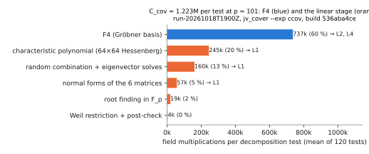
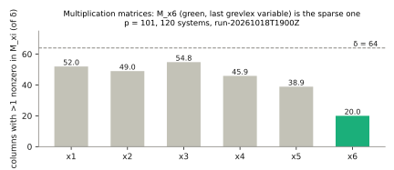
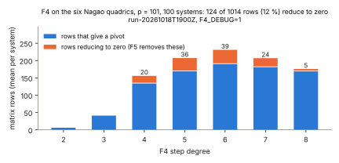
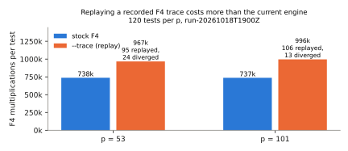

# Where a Jacobian-cover decomposition test spends its cost, and the next leads (2026-10-18)

**Question.** After #1717 made `f4_fp` 5× cheaper inside `examples/jv_cover.rs` (#2182), what does one Nagao decomposition test cost now, part by part? Which optimisations are worth building next?

**Answer in one line.** Per test, C_cov = 1.223M field multiplications at p = 101. F4 is 60 % of that and the linear stage after it is 39 %. Relation collection is 99.99 % of the end-to-end S, so every per-test saving passes almost one-for-one into S/rho.

The ranked leads are:

1. **L1:** sparse-FGLM on the sparse `M_x6`, an estimated 1.22×–1.29× on C_cov (derived).
2. **L2:** F5 signatures: 12 % of rows reduced to zero in this recorded F4 trace (measured share, not an F5 work bound).
3. **L3:** the existing F4 trace replay is now a regression (measured +31 % to +35 %). Rebuild it or retire it.
4. **L5:** measure how S/rho falls with p, to see where the line meets rho.
5. **L6:** a large-prime variation, the only lead that changes the exponent.

Status of every number: **measured** values come from the run below. **Derived** values are computed from measured ones and show their formula. **Proposed** items are not built.

## Run

`run-20261018T1900Z` ([run report](reports/run-20261018T1900Z/report.pdf), [raw records](reports/run-20261018T1900Z/raw/)):

- **Command:** `run.sh`, then `aggregate.sh <outdir> 100` (awk/jq over retained records; F4 row totals divided by 100 declared systems). The graphs come from `plot.py`.
- **Binary:** release build of `examples/jv_cover.rs` at `536aba4ce`. Its `f4_fp.rs` and `jv_cover.rs` are identical to main `3c192c34c`.
- **Instrumentation:** the linear-stage split uses the same build with [`raw/instrument.patch`](reports/run-20261018T1900Z/raw/instrument.patch) applied. The patch adds `eprintln` only, enabled by `LEADS_DBG=1`.
- **Workload:** `--exp ccov --seeds 1 --residuals 100 --constructed 20 --max-degree 24 --budget 300`, at p = 53 and 101 (120 tests per p). The linear-stage split and F4-per-degree data are at p = 101.
- **Host:** 4 vCPU shared VM, L0. Counted multiplications do not depend on load; no wall-time claims are made.
- **Controls:**
  - Every run found the 20 planted decompositions (20/20) and had 0 oracle mismatches.
  - The parts below add up to the recorded `lin_muls` and `c_cov` means exactly: 481,526 and 1,222,627.

## Measured: one test at p = 101

| part | mults per test | share |
|:--|--:|--:|
| F4 to a reduced Gröbner basis (degree 8, 42 polynomials) | 736,927 | 60 % |
| characteristic polynomial of a dense 64×64 `M_ℓ` (Hessenberg) | 244,693 | 20 % |
| forming `M_ℓ = Σ c_i M_xi` (6·δ²) + one 64×64 eigenvector solve per F_p root | 160,337 | 13 % |
| normal forms filling the six multiplication matrices | 57,168 | 5 % |
| roots of the characteristic polynomial in F_p | 19,328 | 2 % |
| Weil restriction + post-check | 4,174 | 0.3 % |

End to end, in #2182's dlp records, S/rho = relation share + linear-algebra share = 850.30 + 0.015, 369.49 + 0.016, 193.92 + 0.005 and 373.31 + 0.005. The relation stage is therefore all of S, and S ≈ (#relations) × (tests per relation ≈ 720) × C_cov.

### The linear stage: `M_x6` is sparse

- **Columns:** column j of `M_xi` is NF(x_i·b_j). It is a unit vector whenever x_i·b_j is itself a standard monomial. The retained instrumentation counts columns with more than one nonzero entry: the last variable's matrix `M_x6` has **20.0 of 64** such columns, against 39–55 for x1..x5 (mean of 120 systems). It does not distinguish zero columns, unit columns, and single-entry columns with a coefficient other than one among the remaining 44.
- **Current method:** the stage ignores this. It forms a dense random combination, takes its 64×64 characteristic polynomial, and does a dense 64×64 null-space solve for every root in F_p.

### F4: few rows reduce to zero

| degree | 2 | 3 | 4 | 5 | 6 | 7 | 8 | total |
|:--|--:|--:|--:|--:|--:|--:|--:|--:|
| rows (mean per system) | 6.0 | 41.0 | 153.9 | 205.3 | 235.9 | 204.9 | 170.2 | 1,017 |
| reduce to zero | 0 | 0 | 20.0 | 36.0 | 40.1 | 24.0 | 4.8 | **125 (12 %)** |

The six quadrics form a regular sequence, so every zero reduction comes from a Koszul syzygy, which an F5-style signature criterion discards before reduction. The degree-7 and degree-8 steps hold 37 % of the rows and add only about 6 of the 42 basis elements.

### F4 trace replay is now a regression

| p | stock F4 mults | `--trace` F4 mults | replayed / diverged |
|:--|--:|--:|:--|
| 53 | 737,960 | 967,067 (+31 %) | 95 / 24 |
| 101 | 736,927 | 995,628 (+35 %) | 106 / 13 |

The recorder was written before Gebauer–Möller pruning (#1717). Its replay now reduces more rows than a fresh run, and 11–20 % of the replays diverge and fall back to a full run.

## Leads, ranked

| | lead | what changes | estimate | status |
|:--|:--|:--|:--|:--|
| **L1** | **Sparse-FGLM on `M_x6`** (Faugère–Mou) | Build only `M_x6`. Get its minimal polynomial by Wiedemann / Berlekamp–Massey on `uᵀ M_x6^i v`. Explore recovery from the 44 columns with at most one nonzero entry, verifying their coefficients and chain connectivity before reducing the remaining solve. A unit column gives `w[x6·b] = r·w[b]`; the retained counts alone do not establish a 20-unknown recovery system. Fall back to today's path when x6 does not separate points. | linear stage 482k → ~210k–260k: matvecs 2δ·(20δ + 44) ≈ 169k, BM ≈ 8k, roots 19k, NF ≈ 10k–57k, recovery ≈ 3k per root (derived). C_cov 1.22M → ~0.95M–1.0M, **≈ 1.22×–1.29×**. A cheaper first step, keeping Hessenberg on `M_x6` but recovering by chains, gives about 1.18× (derived). | proposed |
| **L2** | **F5 / signature criteria in `f4_fp`** | Discard the Koszul zero reductions before they are built. | 125 / 1,017 recorded rows (12 %) reduced to zero; about 1.08× on C_cov is a heuristic estimate if work scales with that row share. Row costs and a signature engine's changed reduction schedule are unmeasured; this is not an upper bound | proposed. #1717's notes measured about 58 % of pair rows reducing to zero on its benchmark systems; on these systems, after Gebauer–Möller pruning, 12 % remain. |
| **L3** | **Rebuild or retire the F4 trace replay** | Record only the rows that give pivots, on the current engine. Otherwise drop `--trace`. | −23 % to −26 % of F4 multiplications compared with today's `--trace` (measured); improvement against stock F4 remains unmeasured | measured regression |
| **L4** | **Stop F4 once the needed normal forms are fixed** | L1 would narrow the needed normal forms to `M_x6`; the observed 20 multi-entry columns motivate checking the complete border set. The degree-7/8 steps hold 37 % of the F4 rows. | up to 37 % of F4 rows, if a sound early stop exists | speculative. The `--stop` staircase mode is no cheaper since #1717 (`jv_cover` test). |
| **L5** | **Measure S/rho against p** | `--exp dlp` at p = 251, 503 and 1009 with several seeds. S grows like p·720·C_cov (relations ≈ \|F\| ≈ p/2), while rho on E(F_{p^6}) grows like p³. | Means over the two seeds: S/rho ≈ 610 at p = 53 and ≈ 284 at p = 101, a slope of about p^-1.2 (2 seeds each). Extrapolated, the line meets rho somewhere between p ≈ 1.7k (if the slope were p^-2) and p ≈ 12k (at p^-1.2). The range is wide, so measure it. | proposed. Highest value per CPU-hour. |
| **L6** | **Large-prime variation in the cover attack** | Accept decompositions with one (or two) points outside the factor base and combine them through the large-prime graph (Gaudry–Thomé–Thériault–Diem). Joux–Vitse 2012 is the source of this pipeline. | Changes the exponent of relation collection, the only lead here that does. Not estimated. | proposed. `jv_cover` has no large-prime path; `ecbench_large_prime.rs` and `hyperelliptic_index_calculus.rs` have one for other pipelines. |

The per-test leads L1–L4 target constant factors on C_cov. Combining the upper end of L1's illustrative estimate with L2's row-proportional estimate gives about 1.4× (1.29×1.08). This is an unvalidated combined estimate, not an upper bound on these methods. The distance to rho (194–850×) is decided by L5's slope and L6's exponent.

## References

- J.-C. Faugère, C. Mou, *Sparse FGLM algorithms*, J. Symbolic Comput. 80 (2017); ISSAC 2011.
- J.-C. Faugère, *A new efficient algorithm for computing Gröbner bases without reduction to zero (F5)*, ISSAC 2002.
- J. Berthomieu, C. Eder, M. Safey El Din, *msolve*, ISSAC 2021: its tracer.
- P. Gaudry, E. Thomé, N. Thériault, C. Diem, *A double large prime variation for small genus hyperelliptic index calculus*, Math. Comp. 76 (2007).
- A. Joux, V. Vitse, *Cover and decomposition index calculus on elliptic curves made practical*, Eurocrypt 2012.
- Prior studies: [#2182 f4_fp in the IC](../f4_fp_ic_effect_20261018/), [#1717 msolve parity](../f4_fp_msolve_parity_20261011/).

## Review corrections and reproducibility (2026-10-21)

The original five aggregate files first reproduced byte-for-byte from frozen raw records. Review then found that the F4 table divided by the number of step records, although its chart claimed a per-system mean. Degrees 6 and 8 have 103 and 98 step records across 100 systems. The corrected table divides every degree total by 100: 1,017.05 rows and 124.89 zero reductions per system (12.28%). Corrected derived files and their input hashes are retained in [reports/review-20261021](reports/review-20261021/). The other four aggregates are unchanged. The current report distinguishes the observed zero-row share from a hypothetical F5 work estimate and labels the column statistic as columns with more than one nonzero entry. The historical run report is preserved; its column label, F4 means, and F5 bound language are superseded by these corrections. No new engine execution or performance comparison was used for these corrections.

`run.sh` now copies the frozen instrumentation patch into a fresh output directory, honors `CARGO_TARGET_DIR`, records the source revision and both executable hashes, and reverses instrumentation on command failure. It refuses an existing evidence directory and tracked native-source edits. Run it from a checkout where the recorded instrumentation patch applies; it does not modify the frozen run.
