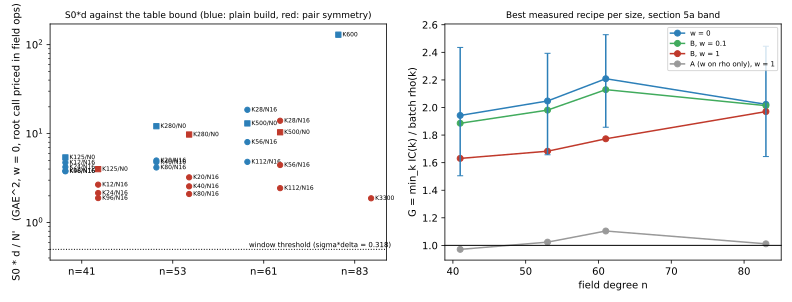

# Per-target descent cost d of compact-orbit Koblitz IC: profile, reductions and the n = 73/83 ranking (2026-10-30)

**Verdict.**

- **Measured:** the cheapest credible reductions cut the counted S0·d by **2.5x at n = 41, 2.4x at n = 53 and
  3.75x at n = 61** against the cold-tuned KIC_NORM recipe, in the same producer and the same unit. They are:
  - a larger table, which trades S0 for d (1.2x to 1.9x);
  - the producer's existing pair-symmetric build, which halves the build and leaves d unchanged (2x).
- **Count projection, not implemented:** batching the S3 inversions on the n ≤ 63 path, as the n ≥ 71 path already
  does, gives 1.6x to 2.1x more. That projection puts all three sizes at S0·d/N' ≈ 1.1.

- **This is a constant factor, not a change in scaling.** At the best recipes S0·d/N' is flat at 1.8 to 2.3 across
  n = 41, 53, 61 and 83. The reason is that the descent is a table collision:
  - the build costs B S3 solves;
  - each target costs about r/(4En) root calls, with E = B table entries for a plain build and 2B for a symmetric one;
  - so S0·d ≥ c²N'/4, where c is the price of one root call in GAE.

  No retuning in this family moves that bound.

- **Many-target crossover against batch rho:** still no k*. The best measured G is 1.88 / 1.98 / 2.14 at
  n = 41 / 53 / 61 and 2.12 at n = 83 (w = 0). The projection gives about 1.5. A window needs a root call cheaper
  than **1.41 GAE** at w = 0. Today's field-operation counts put it at 2.2 GAE (batched) and 2.8–3.2 GAE (unbatched).
  The n = 83 clock calibration gives about 4.5 to 4.9 rho steps per root call.

- **Section 5a ranking (variant B: w priced on both arms):** rho is ahead at every weight at n = 41, 53, 61, 73 and 83.
  - n = 73 is now counted, at the two recipes run: G = 52.3 (K20 norm32) and 11.5 (K40 norm32) at w = 0, and 49.8 and
    10.9 at B, w = 1. Both are dominated by the rank stage and far from the floor.
  - n = 83 (recorded K3300): G = 2.12 at w = 0 and 2.02 at B, w = 1. K600: 17.6 and 16.7.
  - The IC-favourable variant A (w on rho only) is knife-edge at w = 1. Best rows are G = 0.94 (n = 41), 0.99 (n = 53), 1.07 (n = 61) and 1.06 (n = 83).
  - With a root call priced at 1 GAE, every best row is below 1.
  - So the ranking depends on the price of a root call. The field-operation count and the clock calibration both put that price above the threshold.
- **Single target (k = 1):** the pair-symmetric build lowers the cold cost S = S0 + d of the tuned KIC_NORM recipe by
  1.76x / 1.54x / 1.69x at n = 41 / 53 / 61 (1.45x / 1.32x / 1.43x at B, w = 1).
  - This is a recipe change: it switches on an existing flag (`KIC_PAIR_SYMMETRY=1`, already used by the recorded
    n = 83 K3300 run) that the KIC_NORM tuning in `research/ic_improve_20261023` left off. It is not a new mechanism.
  - It is a constant factor measured at three sizes. It does not change scaling.

Class:

- **improvement** (constant factor, single-target and multi-target) against the repo's tuned KIC_NORM producer, in counted units;
- **accounting** for the n = 73/83 band ranking.

It is not compared against published IC here. Owner request: IC research-program follow-up B (cut d, rank n = 73/83).

## 1. What the producer does per target (the d profile)

`examples/koblitz_orbit_dlp_fast_online.rs` (`compact_orbit_online_pair_symmetry_v1`) decomposes a target Q as a
sum of four factor-base points by meet in the middle:

- **Index (setup).** For every pair of orbit representatives (P_i, P_j) and relative Frobenius shift, one S3 solve
  gives the two x-coordinates of P_i ± P_j. They are stored by canonical normal-basis rotation, which quotients out
  Frobenius.
  - Build: B = W²n solves with W = K·(number of Z[τ] multipliers).
  - With pair symmetry: W(W+1)n/2 solves. Mate states share their canonical roots, so the table is identical.
- **Target.** For each state U and each of the n shifts:
  - one S3 solve S3(x_U, x_Q, v) gives the two x-coordinates of Q ∓ U;
  - each one is probed (rotation canonicalisation plus hash lookup).
  - A hit is lifted and checked (4 points, ≤ 3 additions per sign choice), then the logs are combined.
- **Rank stage.** The same search on [a]G − R_j until the K column logs are fixed: about K + 1 searches.

Table 1 confirms d is almost all the probe scan, in counts and on the clock:

- the PDP share of the per-target interval is 94–100% (56–84% only at n = 41 K48/K96, where a target needs only 78–319
  root calls and the fixed recovery check, about 0.02 ms, shows);

- every target needs exactly one relation check;
- the log combination and the recovery check are microseconds.

What does not apply:

- **Early-abort smoothness:** n/a. There is no smoothness test; a probe is an exact table lookup.
- **Relation-database reuse for the individual log:** already the design. One relation per target is resolved by
  the column logs from the rank stage.

**The bound** (derived, then checked against counts).

- The table holds E ≈ (1 + sym)·B canonical roots: the two roots of a state are also its mate state's, so a plain build stores about one new root per solve (entries/candidates is 0.98–1.00 in every plain run), and a symmetric build stores both roots of half as many solves. Each covers n x-coordinates, so E·n x-values out of the r/2
  x-coordinates of the subgroup.

- A probe hits with probability E·n/(r/2). Each root call makes two probes, so a target costs about r/(4En) root calls.
- With a plain build, E ≈ B: build × d_rc ≈ r/(4n) = N'/2. With a symmetric build: N'/4.
- Measured build × d_rc / N' (last column of Table 2):
  - plain build: 0.43–0.49 at the largest tables of n = 41, 53, 61;
  - symmetric build: 0.22–0.25;
  - small tables at n = 61 run higher (0.66–0.84), and n = 83 K3300 (a = 1, symmetric) is 0.35.

So S0·d ≥ c²N'/4 + rank work. Since rho1² ≈ πN'/2, σδ ≥ c²/(2π). The window condition σδ < 0.318 then needs
c < 1.41 GAE at w = 0. Under variant B at w = 1 it needs c + 2w < 1.41(1 + w), i.e. c < 0.83.

## 2. Pricing a root call

These counts are from the producer's source:

| operation | field multiplications | GAE (1 GAE = batched affine addition = 5 M) |
|:--|:--|--:|
| S3 root call, u64 path (n ≤ 63), unbatched | 8 M + Itoh–Tsujii inversion (6/7/8 M at n = 41/53/61); both roots always exist, so the post-trace multiplication always runs | 2.80 / 3.00 / 3.20 |
| S3 root call, wide path (n ≥ 71), inversion batched over 2n | 2 (prepare) + 3 (batch) + 6 (finish) M + I/(2n) | 2.21 |
| relation check (3 unbatched additions) | 3(I + 2 M) | 4.8–6.0 |
| probe (n-step rotation canonicalisation + hash lookup); table insert | none (word operations, linear maps) | w ∈ {0, 0.1, 1} |

**Calibration (§5a allows it as an extra point, not a replacement):** the n = 83 records give clock time per counted
operation, each pair measured on one runner.

- IC K3300 spends 0.94 µs and 1.24 µs of PDP time per root call, including its two probes, in the two runs.
- Plain rho spends 0.19 µs and 0.275 µs per addition, including its canonicalisation.
- That is a ratio of 4.9 and 4.5.

Both the count and the clock place a root call well above the 1.41 GAE threshold.

## 3. Results

### Table 1: where d goes (per target, mean over the run's targets)

| n | recipe | targets | root calls | probes (mean / median / max) | relation checks | skipped mate states | PDP ms | relation-check ms | log combination ms | recovery check ms | PDP share of target ms |
|--:|:--|--:|--:|:--|--:|--:|--:|--:|--:|--:|--:|
| 41 | K125 norm0 | 32 | 3305 | 6610 / 3412 / 24349 | 1.00 | 0.0 | 1.747 | 0.0082 | 0.00061 | 0.0206 | 98.3% |
| 41 | K125 norm0 sym | 32 | 3254 | 6508 / 3412 / 24349 | 1.00 | 0.6 | 1.141 | 0.0072 | 0.00148 | 0.0207 | 97.5% |
| 41 | K12 norm16 | 32 | 5556 | 11112 / 7072 / 42351 | 1.00 | 0.0 | 3.244 | 0.0151 | 0.00050 | 0.0212 | 98.9% |
| 41 | K12 norm16 sym | 32 | 5556 | 11112 / 7072 / 42351 | 1.00 | 0.0 | 4.965 | 0.0089 | 0.00062 | 0.0217 | 99.4% |
| 41 | K24 norm16 | 32 | 1390 | 2779 / 2200 / 6681 | 1.00 | 0.0 | 0.844 | 0.0237 | 0.00063 | 0.0212 | 94.9% |
| 41 | K24 norm16 sym | 32 | 1390 | 2779 / 2200 / 6681 | 1.00 | 0.0 | 0.977 | 0.0092 | 0.00067 | 0.0275 | 96.3% |
| 41 | K48 norm16 | 32 | 319 | 638 / 370 / 2244 | 1.00 | 0.0 | 0.139 | 0.0071 | 0.00026 | 0.0198 | 83.6% |
| 41 | K96 norm16 | 32 | 78 | 155 / 92 / 1371 | 1.00 | 0.0 | 0.037 | 0.0080 | 0.00028 | 0.0201 | 56.5% |
| 41 | K96 norm16 sym | 32 | 78 | 155 / 92 / 1371 | 1.00 | 0.0 | 0.074 | 0.0113 | 0.00071 | 0.0270 | 65.4% |
| 53 | K20 norm16 | 32 | 34373 | 68745 / 51906 / 224106 | 1.00 | 0.0 | 30.156 | 0.0144 | 0.00085 | 0.0424 | 99.8% |
| 53 | K20 norm16 sym | 32 | 34373 | 68745 / 51906 / 224106 | 1.00 | 0.0 | 17.654 | 0.0150 | 0.00095 | 0.0353 | 99.7% |
| 53 | K280 norm0 | 32 | 22980 | 45960 / 29661 / 179464 | 1.00 | 0.0 | 9.141 | 0.0113 | 0.00086 | 0.0319 | 99.5% |
| 53 | K280 norm0 sym | 32 | 22894 | 45787 / 29661 / 179464 | 1.00 | 0.8 | 10.901 | 0.0154 | 0.00157 | 0.0328 | 99.5% |
| 53 | K40 norm16 | 32 | 10841 | 21681 / 16684 / 74439 | 1.00 | 0.0 | 9.969 | 0.0119 | 0.00085 | 0.0354 | 99.5% |
| 53 | K40 norm16 sym | 32 | 10841 | 21681 / 16684 / 74439 | 1.00 | 0.0 | 9.898 | 0.0291 | 0.00091 | 0.0505 | 99.2% |
| 53 | K80 norm16 | 32 | 2518 | 5036 / 2710 / 21850 | 1.00 | 0.0 | 1.119 | 0.0108 | 0.00043 | 0.0317 | 96.3% |
| 53 | K80 norm16 sym | 32 | 2518 | 5036 / 2710 / 21850 | 1.00 | 0.0 | 2.764 | 0.0170 | 0.00072 | 0.0333 | 98.2% |
| 61 | K112 norm16 | 32 | 7618 | 15235 / 9282 / 53068 | 1.00 | 0.0 | 4.173 | 0.0214 | 0.00123 | 0.0432 | 98.4% |
| 61 | K112 norm16 sym | 32 | 7618 | 15235 / 9282 / 53068 | 1.00 | 0.0 | 5.952 | 0.0267 | 0.00382 | 0.0509 | 98.7% |
| 61 | K18 norm32 | 32 | 117222 | 234443 / 169522 / 1544663 | 1.00 | 0.0 | 54.440 | 0.0175 | 0.00086 | 0.0435 | 99.9% |
| 61 | K18 norm32 sym | 32 | 117222 | 234443 / 169522 / 1544663 | 1.00 | 0.0 | 57.830 | 0.0145 | 0.00093 | 0.0408 | 99.9% |
| 61 | K28 norm16 | 32 | 233374 | 466747 / 330234 / 1538843 | 1.00 | 0.0 | 116.289 | 0.0333 | 0.00410 | 0.1118 | 99.9% |
| 61 | K28 norm16 sym | 32 | 232916 | 465832 / 330234 / 1531523 | 1.00 | 3.8 | 284.965 | 0.4395 | 0.02347 | 0.0551 | 99.8% |
| 61 | K500 norm0 | 32 | 42826 | 85651 / 56056 / 419144 | 1.00 | 0.0 | 18.909 | 0.0141 | 0.00089 | 0.0404 | 99.7% |
| 61 | K500 norm0 sym | 32 | 42826 | 85651 / 56056 / 419144 | 1.00 | 0.0 | 21.684 | 0.0142 | 0.00131 | 0.0411 | 99.7% |
| 61 | K56 norm16 | 32 | 46126 | 92251 / 62030 / 345423 | 1.00 | 0.0 | 56.626 | 0.0301 | 0.00139 | 0.0489 | 99.9% |
| 61 | K56 norm16 sym | 32 | 46126 | 92251 / 62030 / 345423 | 1.00 | 0.0 | 31.159 | 0.0242 | 0.00139 | 0.0812 | 99.7% |
| 73 | K20 norm32 | 8 | 120516174 | 241032265 / 87566307 / 846313503 | 1.00 | 0.0 | 77956.824 | 0.0562 | 0.00658 | 0.0974 | 100.0% |
| 73 | K40 norm32 | 8 | 10822542 | 21644946 / 8567750 / 78371179 | 1.00 | 0.0 | 7925.265 | 0.0466 | 0.00759 | 0.0959 | 100.0% |
| 83 | K600 (recorded, a=1) | 16 | 1989790 | 3979401 / 1125816 / 18098258 | 1.00 | 0.0 | 2024.687 | 0.0302 | 0.00072 | 0.1254 | 100.0% |
| 83 | K3300 (recorded, a=1, sym) | 16 | 39742 | 79485 / 52294 / 267565 | 1.00 | 0.0 | 37.181 | 0.0069 | 0.00059 | 0.0892 | 99.7% |

### Table 2: counted S0 and d, every run (GAE; root call priced in field multiplications; w = 0 unless named)

| n | recipe | root call [GAE] | build root calls | rank root calls | S0 | d | S0*d/N' | sigma*delta | G, w = 0 [95%] | G, B w = 0.1 | G, B w = 1 | G, A w = 1 | G, root call = 1 GAE (IC-favourable) | root-call price for G = 1 at A w = 1 | build x d root calls / N' |
|--:|:--|--:|--:|--:|--:|--:|--:|--:|:--|--:|--:|--:|--:|--:|--:|
| 41 | K125 norm0 | 2.80 | 6.406e5 | 6.614e5 | 3.646e6 | 9.260e3 | 5.04 | 3.21 | 3.17 [2.65, 3.64] | 3.07 | 2.58 | 1.59 | 1.13 | 1.76 | 0.316 |
| 41 | K125 norm0 sym | 2.80 | 3.204e5 | 6.566e5 | 2.736e6 | 9.116e3 | 3.72 | 2.37 | 2.73 [2.25, 3.20] | 2.66 | 2.34 | 1.36 | 0.98 | 2.05 | 0.156 |
| 41 | K12 norm16 | 2.80 | 5.904e5 | 8.759e4 | 1.898e6 | 1.556e4 | 4.41 | 2.81 | 2.97 [2.49, 3.45] | 2.85 | 2.30 | 1.49 | 1.06 | 1.88 | 0.489 |
| 41 | K12 norm16 sym | 2.80 | 2.953e5 | 8.759e4 | 1.072e6 | 1.556e4 | 2.49 | 1.58 | 2.23 [1.80, 2.61] | 2.18 | 1.91 | 1.12 | 0.80 | 2.51 | 0.245 |
| 41 | K24 norm16 | 2.80 | 2.362e6 | 5.096e4 | 6.755e6 | 3.897e3 | 3.93 | 2.50 | 2.80 [2.50, 3.10] | 2.68 | 2.14 | 1.40 | 1.00 | 2.00 | 0.490 |
| 41 | K24 norm16 sym | 2.80 | 1.181e6 | 5.096e4 | 3.449e6 | 3.897e3 | 2.00 | 1.28 | 2.00 [1.80, 2.23] | 1.95 | 1.71 | 1.00 | 0.72 | 2.80 | 0.245 |
| 41 | K48 norm16 | 2.80 | 9.446e6 | 2.051e4 | 2.651e7 | 8.984e2 | 3.55 | 2.26 | 2.67 [2.19, 3.08] | 2.55 | 2.03 | 1.33 | 0.96 | 2.10 | 0.450 |
| 41 | K96 norm16 | 2.80 | 3.779e7 | 8.732e3 | 1.058e8 | 2.229e2 | 3.52 | 2.24 | 2.65 [2.07, 3.23] | 2.54 | 2.01 | 1.33 | 0.97 | 2.10 | 0.439 |
| 41 | K96 norm16 sym | 2.80 | 1.889e7 | 8.732e3 | 5.293e7 | 2.229e2 | 1.76 | 1.12 | 1.88 [1.47, 2.36] | 1.83 | 1.60 | 0.94 | 0.68 | 2.99 | 0.220 |
| 53 | K20 norm16 | 3.00 | 2.120e6 | 8.784e5 | 8.995e6 | 1.031e5 | 4.67 | 2.97 | 3.06 [2.57, 3.50] | 2.94 | 2.36 | 1.53 | 1.02 | 1.96 | 0.367 |
| 53 | K20 norm16 sym | 3.00 | 1.060e6 | 8.784e5 | 5.816e6 | 1.031e5 | 3.02 | 1.92 | 2.46 [2.06, 2.80] | 2.39 | 2.05 | 1.23 | 0.82 | 2.44 | 0.184 |
| 53 | K280 norm0 | 3.00 | 4.155e6 | 6.741e6 | 3.269e7 | 6.895e4 | 11.35 | 7.23 | 4.77 [3.88, 5.56] | 4.59 | 3.82 | 2.38 | 1.59 | 1.26 | 0.481 |
| 53 | K280 norm0 sym | 3.00 | 2.078e6 | 6.738e6 | 2.645e7 | 6.869e4 | 9.15 | 5.83 | 4.28 [3.49, 5.04] | 4.15 | 3.57 | 2.14 | 1.43 | 1.40 | 0.240 |
| 53 | K40 norm16 | 3.00 | 8.480e6 | 6.323e5 | 2.734e7 | 3.253e4 | 4.48 | 2.85 | 2.99 [2.51, 3.45] | 2.86 | 2.25 | 1.50 | 1.00 | 2.00 | 0.463 |
| 53 | K40 norm16 sym | 3.00 | 4.240e6 | 6.268e5 | 1.460e7 | 3.253e4 | 2.39 | 1.52 | 2.19 [1.75, 2.53] | 2.12 | 1.82 | 1.09 | 0.73 | 2.74 | 0.232 |
| 53 | K80 norm16 | 3.00 | 3.392e7 | 2.183e5 | 1.024e8 | 7.561e3 | 3.90 | 2.48 | 2.79 [2.18, 3.32] | 2.67 | 2.08 | 1.40 | 0.93 | 2.15 | 0.430 |
| 53 | K80 norm16 sym | 3.00 | 1.696e7 | 2.183e5 | 5.154e7 | 7.561e3 | 1.96 | 1.25 | 1.98 [1.57, 2.34] | 1.92 | 1.65 | 0.99 | 0.66 | 3.03 | 0.215 |
| 61 | K112 norm16 | 3.20 | 7.652e7 | 9.840e5 | 2.480e8 | 2.438e4 | 4.53 | 2.88 | 3.01 [2.52, 3.47] | 2.86 | 2.20 | 1.50 | 0.94 | 2.13 | 0.437 |
| 61 | K112 norm16 sym | 3.20 | 3.826e7 | 9.840e5 | 1.256e8 | 2.438e4 | 2.29 | 1.46 | 2.14 [1.81, 2.51] | 2.07 | 1.74 | 1.07 | 0.67 | 2.99 | 0.218 |
| 61 | K18 norm32 | 3.20 | 7.906e6 | 1.656e6 | 3.060e7 | 3.751e5 | 8.60 | 5.47 | 4.15 [3.22, 5.09] | 3.96 | 3.09 | 2.08 | 1.30 | 1.54 | 0.694 |
| 61 | K18 norm32 sym | 3.20 | 3.953e6 | 1.649e6 | 1.793e7 | 3.751e5 | 5.04 | 3.21 | 3.18 [2.57, 3.86] | 3.07 | 2.58 | 1.59 | 0.99 | 2.01 | 0.347 |
| 61 | K28 norm16 | 3.20 | 4.782e6 | 4.958e6 | 3.117e7 | 7.468e5 | 17.43 | 11.10 | 5.92 [4.86, 6.85] | 5.68 | 4.58 | 2.96 | 1.85 | 1.08 | 0.836 |
| 61 | K28 norm16 sym | 3.20 | 2.391e6 | 4.954e6 | 2.351e7 | 7.453e5 | 13.12 | 8.35 | 5.14 [4.32, 5.90] | 4.97 | 4.18 | 2.57 | 1.61 | 1.24 | 0.417 |
| 61 | K500 norm0 | 3.20 | 1.525e7 | 2.204e7 | 1.193e8 | 1.370e5 | 12.25 | 7.80 | 4.95 [4.22, 5.77] | 4.75 | 3.86 | 2.48 | 1.55 | 1.29 | 0.489 |
| 61 | K500 norm0 sym | 3.20 | 7.625e6 | 2.202e7 | 9.486e7 | 1.370e5 | 9.74 | 6.20 | 4.41 [3.70, 5.13] | 4.26 | 3.59 | 2.21 | 1.38 | 1.45 | 0.245 |
| 61 | K56 norm16 | 3.20 | 1.913e7 | 2.234e6 | 6.836e7 | 1.476e5 | 7.56 | 4.81 | 3.89 [3.24, 4.43] | 3.71 | 2.87 | 1.94 | 1.22 | 1.65 | 0.661 |
| 61 | K56 norm16 sym | 3.20 | 9.565e6 | 2.234e6 | 3.776e7 | 1.476e5 | 4.17 | 2.66 | 2.89 [2.45, 3.32] | 2.79 | 2.35 | 1.45 | 0.90 | 2.21 | 0.330 |
| 73 | K20 norm32 | 2.21 | 1.168e7 | 1.328e9 | 2.960e9 | 2.663e8 | 1337.64 | 851.57 | 52.30 [26.54, 73.19] | 51.84 | 49.77 | 26.15 | 23.67 | 0.08 | 2.389 |
| 73 | K40 norm32 | 2.21 | 4.672e7 | 6.879e8 | 1.623e9 | 2.391e7 | 65.88 | 41.94 | 11.50 [6.69, 15.48] | 11.39 | 10.87 | 5.75 | 5.20 | 0.38 | 0.858 |
| 83 | K600 (recorded, a=1) | 2.21 | 2.988e7 | 7.249e8 | 1.668e9 | 4.397e6 | 142.04 | 98.65 | 17.61 [9.20, 23.77] | 17.44 | 16.70 | 8.81 | 7.97 | 0.25 | 1.152 |
| 83 | K3300 (recorded, a=1, sym) | 2.21 | 4.519e8 | 9.543e7 | 1.209e9 | 8.782e4 | 2.06 | 1.43 | 2.12 [1.72, 2.58] | 2.10 | 2.02 | 1.06 | 0.96 | 2.09 | 0.348 |

### Table 3: reductions of S0*d against the cold-tuned KIC_NORM recipe (same producer, same unit, w = 0)

| n | baseline S0*d/N' | best retuned K, plain build | pair symmetry, same K | best retuned K + pair symmetry (measured) | with batched root calls (count projection, not run) | G: baseline -> best measured -> projected |
|--:|--:|:--|:--|:--|:--|:--|
| 41 | 4.41 | K96 norm16: 3.52 (1.25x) | 2.49 (1.77x) | K96 norm16 sym: 1.76 (2.50x) | 1.10 (4.00x; root call 2.80 -> 2.21 GAE) | 2.97 -> 1.88 -> 1.48 |
| 53 | 4.67 | K80 norm16: 3.90 (1.20x) | 3.02 (1.55x) | K80 norm16 sym: 1.96 (2.38x) | 1.07 (4.37x; root call 3.00 -> 2.21 GAE) | 3.06 -> 1.98 -> 1.46 |
| 61 | 8.60 | K112 norm16: 4.53 (1.90x) | 5.04 (1.71x) | K112 norm16 sym: 2.29 (3.75x) | 1.10 (7.84x; root call 3.20 -> 2.21 GAE) | 4.15 -> 2.14 -> 1.48 |
| 73 | 1337.64 | K40 norm32: 65.88 (20.30x) | not run | not run | n/a (wide path already batched) | 52.30 -> 11.50 |

### Table 4: single-target (k = 1) cold cost S = S0 + d, GAE

| n | baseline recipe | baseline S, w = 0 | best measured recipe | best S, w = 0 | gain, w = 0 | gain, B w = 1 |
|--:|:--|--:|:--|--:|--:|--:|
| 41 | K12 norm16 | 1.914e6 | K12 norm16 sym | 1.088e6 | 1.76x | 1.45x |
| 53 | K20 norm16 | 9.098e6 | K20 norm16 sym | 5.919e6 | 1.54x | 1.32x |
| 61 | K18 norm32 | 3.097e7 | K18 norm32 sym | 1.830e7 | 1.69x | 1.43x |
| 73 | K20 norm32 | 3.226e9 | K40 norm32 | 1.647e9 | 1.96x | 1.98x |
| 83 | K600 (recorded, a=1) | 1.672e9 | K3300 (recorded, a=1, sym) | 1.210e9 | 1.38x | 1.37x |

*Figure.* Left panel: S0·d/N' for every run (GAE², w = 0). Blue points are plain builds and red points are
pair-symmetric builds; squares are plain (non-Z[τ]) bases. The dotted line is the window threshold σδ = 0.318,
which is S0·d/N' = 0.5. Right panel: G for the best measured recipe at each size across the §5a band. Error bars
are 95% bootstrap intervals over targets (400 draws). Sample sizes: 32 targets per run at n ≤ 61, 8 at n = 73,
16 at n = 83.

## 4. Skeptical reading and limits

1. **What the result rests on.**
   - **Counts.** Root calls, probes, inserts and relation checks are emitted by the producer and deterministic.
     They are identical between the plain and symmetric runs at every K. `skipped_symmetric_states` is 0 to 4 per
     target, so d is unchanged by symmetry.
   - **Prices.** The GAE prices come from a multiplication count in the source, not from a measured primitive
     benchmark. The clock calibration in §2 is the only empirical check on them.
2. **Rho reference.**
   - At n ≤ 73, rho1 is the floor sqrt(πN'/2), with one canonicalisation per addition. The repo's measured
     counted/floor ratio is 1.02 to 1.08, so using the floor favours rho by up to 8% in G (√1.08 ≈ 4%).
   - At n = 83 it is the mean of the 16 recorded plain-rho walks (8.62e6 additions against a floor of 9.0e6).
3. **Batched root calls are a count projection.** The n ≤ 63 path was not changed or rerun. The n ≥ 71 path
   already batches, and its count per call is the projected one.
4. **n = 73 did not reach the floor.**
   - The two runs are K20 norm32 (W = 400, the untuned recipe of `research/ic_improve_20261023`) and K40 norm32
     (W = 800), each with 8 targets.
   - **`KIC_PAIR_SYMMETRY=1` was passed to the K40 run, but the wide path ignores it in this binary.** Its summary has
     no `pair_symmetry` field and `regular_states` = W²n. The row is labelled as a plain build, and the files were
     renamed `_s0_`.
   - Both rows are dominated by the rank stage (rank root calls 1.3e9 and 6.9e8, against builds of 1.2e7 and 4.7e7),
     so G is 52 and 11.5.
   - The descent is also less efficient there than the coverage bound:
     - build × d_rc / N' is 2.39 at K20 and 0.86 at K40, against 0.5 for a plain build;
     - at n = 61 the small-K Z[τ] recipes show the same thing more mildly (0.66–0.84);
     - it improves with more seeds per multiplier. The cause was not isolated. Additive structure among the Z[τ]
       images of few seeds is a guess, not a finding.
   - Peak RSS was 2.7 GB (W = 400) and 10.9 GB (W = 800). A table near the floor at n = 73 (W of a few thousand) was
     not attempted, because host memory is unknown and about 10 GiB of disk is free.
   - The n = 73 rows give the counted §5a ranking that part (0) asked for, not a tuned n = 73 point.
   - The single-target gain at n = 73 (1.96x) is a retune of an untuned recipe.
5. **n = 83 is a = 1 and recorded.**
   - Counts are from `research/20261016-n83-precomputed-rho-control/records/run-38855595549`. Run
     `-38878565324` has identical counts.
   - The K3300 summary has no rank root-call total. It is taken as probes/2, which holds exactly in K600, where
     both totals exist: S3(x_U, x_Q) always has its two roots when U and Q are points.
6. **Selection.** The "best" recipe at each size is the minimum over 4 to 7 measured recipes, one seed, and 32
   targets. The Table 2 intervals (about ±20%) are the guide.
7. **Not compared with published IC.** FGHR, GGMP and Petit-type summation-polynomial descents have no table
   counterpart at these sizes. The baseline here is the repo's tuned KIC_NORM producer (`research/ic_improve_20261023`).
8. **No benchmarks row.** `benchmarks/README.md` admits rows only through the validation gate (a replay certificate,
   a validator report, and a matched rho named by `VALIDATION.json`). None of that was produced here, so the row
   is a follow-up and not part of this commit.

## 5. Where to go next

- **The constant that decides the crossover is the root-call price c.** The window needs c < 1.41 GAE at w = 0,
  and c < 0.83 under variant B at w = 1. A target-side S3 solve with x_Q fixed shares half its products across a
  target and needs about 11 M. Getting below about 7 M per call (1.41 GAE) would need a different solve, for
  example sharing the x_Q-dependent products across the n shifts of one state. That was not tried, and it is not
  known to be possible.
- **Batch the n ≤ 63 path** (1.6x to 2.1x in S0·d, by count). It is a small change; the wide path's `RootBatch128` is
  the template.
- **Leaving the table family.** Anything that beats S0·d ≈ c²N'/4 has to recognise decomposable points without
  enumerating them. That is a summation-polynomial or Gröbner/SAT descent per trial, whose per-trial cost at these
  n is many orders above c (`ic descent` tables).

## Files

- `descost/`: native Rust (std + `serde_json`). It reads the run outputs and the n = 83 records and writes
  `results.json` and `tables.md`. The tables in §3 are pasted from `tables.md` unchanged. Build with
  `cargo build --release --offline` in `descost/`, then run
  `descost runs <crypto>/research/20261016-n83-precomputed-rho-control/records/run-38855595549 .`
- `run.sh`, `all.sh`, `extra.sh`: the run commands. `run.sh <n> <K> <norm> <targets> <sym>` runs
  `KIC_NORM=<norm> KIC_PAIR_SYMMETRY=<sym> koblitz_orbit_dlp_fast_online construct:<n>:0:<K> <targets> 1 <out>`.
  - Binary: `target/release/examples/koblitz_orbit_dlp_fast_online`, built 2026-10-26 from source at or after
    `2385f77e46`, sha256 `ce8f8d23f6aa9abcc470b7f24fcf79e13e3125d2822615201fe0ec20fc1a8da9`.
  - Host: shared Apple-silicon Mac, load average about 19, single thread, no isolation. Wall times are practicality
    notes only.
- `runs/`: one `<tag>.stdout` (summary line), `<tag>.jsonl` (per-target records), `<tag>.targets` and
  `<tag>.stderr` per run. `targets/`: seeded known-answer scalars (seed 20261030 + n).
- `plot.py` (layout only, reads `results.json`), `s0d_and_g.svg`/`.png`, `report.pdf` (this README rendered).
- Subgroup orders r (largest prime factor of #E(F_2^n)): 549756390943, 21044858204113, 162888033982417,
  86020738150056119 (a = 0, n = 41/53/61/73), and 8569786107849059 (a = 1, n = 83).
