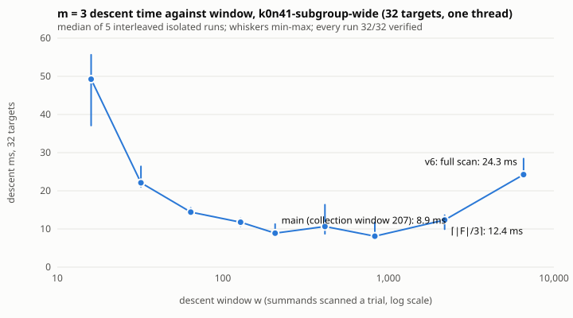

# The m = 3 descent window on the k0n41 gate rung

2026-11-24. A stage measurement on the `ic` end-to-end gate rung
`docs/ic/params/k0n41-subgroup-wide.json`, made to explain why the gate has
failed on `main` since 2026-11-22, and to decide between reverting and
freezing a new reference. Every number is a producer measurement,
`[pcc:unverified]`.

## Question

Since #4899, the `m = 3` descent walk scans a cyclic third-summand window
(`45e447d9ba`) whose length is read from `collection_window`, falling back to
`⌈|F|/3⌉`. The k0n41 rung sets `collection_window: 207` (|F|/32, tuned for
aimed collection) and descends with `m = 3`, so its descent scans 207 of the
6,560 base points a trial. v6 froze the full scan. Is that window a
regression in descent cost, an improvement, or neither, and where is the
optimum? [pcc:unverified]

## Boundary and method

- **What is timed.** The descent (the `solve` stage) only: the sum of the 32
  targets' own `elapsed_seconds`, which is the gate's
  `ic_descent_seconds_total`. Select, collect and logs run in every arm and
  are identical; ρ is off (`baseline.rho: false`, `params/k0n41-w-norho.json`,
  otherwise the rung's file byte for byte). [pcc:unverified]
- **Arms.** One binary, `main` at `dae5b3dc9e` plus `KIC_DESCENT_WINDOW`
  (this PR): `w16`, `w32`, `w64`, `w128`, `w207`, `unset`, `w414`, `w828`,
  `d3` (⌈|F|/3⌉ = 2,187) and `full` (`0`, the v6 behaviour). `unset` and
  `w207` are the same configuration, so they are the A/A pair.
- **Runs.** 5 rounds × 10 arms, arm order rotated each round
  (`scripts/sweep.py`). Each run is a fresh `ic workflow` in its own
  directory, so every run is cold, under `tools/isolated_bench.py run --cpus 3`
  with `RAYON_NUM_THREADS=1`. Isolation records: `data/isolation.jsonl.gz` (gzipped to stay under the artifact policy's 64 KiB data limit),
  0 of 50 contended.
- **Host.** 4-vCPU KVM guest, Intel Xeon @ 2.10 GHz with AVX-512 (F, BW, DQ,
  VL, VBMI2, IFMA, VPOPCNTDQ), GFNI, VPCLMULQDQ; 16 GB; Linux
  6.18.44; `rustc 1.97.0`; no hardware PMU.
- **Correctness.** Every run verified 32 of 32 targets, and every run in every
  arm recovered the same 32 logarithms (one digest, `c5d3445282285920`).

## Results



| arm | window | descent trials | summands scanned | descent ms, median [min, max] | verified |
|:--|--:|--:|--:|:--|:--|
| `w16` | 16 | 59,034 | 944,544 | 49.26 [37.10, 55.65] | 32/32 in all 5 runs |
| `w32` | 32 | 24,789 | 793,248 | 22.10 [21.00, 26.40] | 32/32 in all 5 runs |
| `w64` | 64 | 11,993 | 767,552 | 14.41 [14.02, 15.52] | 32/32 in all 5 runs |
| `w128` | 128 | 6,309 | 807,552 | 11.76 [10.73, 12.77] | 32/32 in all 5 runs |
| `w207` | 207 | 2,908 | 601,956 | 8.90 [8.52, 11.27] | 32/32 in all 5 runs |
| `unset` | 207 | 2,908 | 601,956 | 8.96 [8.41, 11.65] | 32/32 in all 5 runs |
| `w414` | 414 | 1,652 | 683,928 | 10.64 [8.72, 16.36] | 32/32 in all 5 runs |
| `w828` | 828 | 832 | 688,896 | 8.11 [7.88, 11.78] | 32/32 in all 5 runs |
| `d3` | 2,187 | 453 | 990,711 | 12.36 [9.95, 13.61] | 32/32 in all 5 runs |
| `full` | 6,560 | 346 | 2,269,760 | 24.26 [23.79, 28.44] | 32/32 in all 5 runs |

Paired within a round:

| ratio | rounds, sorted | median |
|:--|:--|--:|
| full / unset | 2.166, 2.659, 2.700, 2.813, 3.383 | 2.700 |
| unset / w207 (A/A) | 0.750, 0.944, 1.013, 1.055, 1.150 | 1.013 |
| w828 / unset | 0.788, 0.879, 0.896, 0.965, 1.393 | 0.896 |
| d3 / unset | 1.127, 1.183, 1.249, 1.375, 1.518 | 1.249 |
| w414 / unset | 0.748, 0.998, 1.184, 1.396, 1.945 | 1.184 |
| w128 / unset | 1.009, 1.197, 1.334, 1.357, 1.519 | 1.334 |

## What it says

1. **The drift is an improvement.** The windowed descent that `main` runs on
   this rung is 2.70× faster than v6's full scan (5 of 5 rounds, 2.17–3.38),
   for the same 32 logarithms. It scans 3.8× fewer summands for 8.4× more
   trials: a full scan keeps only the sorted witness of each triple, a window
   accepts whichever of the three raw witnesses lands in it.
2. **The control reproduces v6.** With `KIC_DESCENT_WINDOW=0` every pinned
   counter of the rung equals v6's (346 descent trials) and the gate passes it.
3. **There is a flat optimum, and `main` is on it.** 207 to 828 are within the
   A/A spread of each other (per-round A/A range 0.75–1.15). Smaller windows
   pay for their trials (each one a walk advance); ⌈|F|/3⌉ is 1.25× slower
   than 207 in every round (1.13–1.52). No window change is proposed.
4. **Coupling.** The descent reading `collection_window` is a coupling
   between two stages with different cost shapes. On this rung it lands on
   the optimum by accident of scale (|F|/32 for aimed collection); a rung that
   tunes `collection_window` far below |F|/32 would push the descent onto the
   steep side (w ≤ 64 costs 1.6–5.5×). Decoupling it is left to the owner of
   #4899; `KIC_DESCENT_WINDOW` is only an experiment control. [pcc:unverified]

## Tried and dropped

- **`descent_summands: 2` on this base.** In the smoke round 2 of 32 targets
  exhausted the rung's `max_trials` (100,000) without a decomposition, and
  the rest averaged about 20,000 trials. The "3.7× cheaper at degree 41"
  that the `descent_m` documentation cites was measured on a 10,496-point
  base; at 6,560 points `m = 2` does not finish. Not run further.

## Not done here

No `bench.record/v1`, S3 raw data or `.resume` checkpoint: S3 and Conductor
are not reachable from this container. No leaderboard or `benchmarks/README.md`
row: this measures engineering already merged in #4899 and carries no
validator report (validation gate).

## Reproduce

```sh
cargo build --release --bin ic
python3 research/ic_descent_window_20261124/scripts/sweep.py target/release/ic OUT 5
python3 research/ic_descent_window_20261124/scripts/analyze.py research/ic_descent_window_20261124
```

`sweep.py` expects `params/` beside its own directory and writes
`OUT/rows.jsonl` and `OUT/isolation.jsonl`; `analyze.py` reads them from
`data/` (gzip `isolation.jsonl` first).
