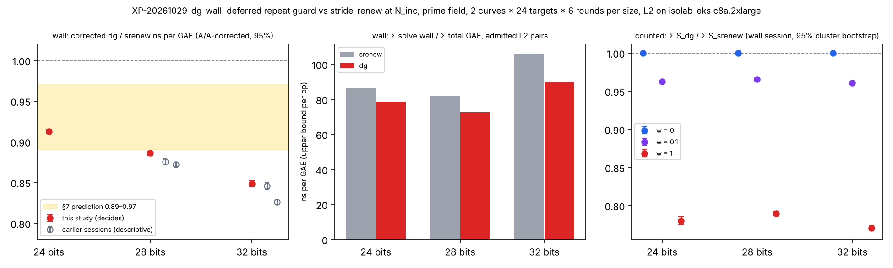

# Prime-field IC: the deferred repeat guard lowers wall time per charged operation (XP-20261029-dg-wall)

Frozen protocol: `backlog/XP-20261029-dg-wall/PROTOCOL.md` (commit 6e4804417baa, approved with edits E1–E11 in `APPROVAL.md`). Verdict commit: f1e65b1c74 (`VERDICT.md`).

**Question.** `targets = stride-renew-deferred-guard` (#2831, "dg") probes the repeat guard only on targets that decompose. Against `targets = stride-renew` ("srenew") at the same factor base N_inc it charges the same work at w = 0 and less unpriced native work. Does that removed native work cost real time? This study measures it as wall time per charged GAE, at L2 with a native A/A correction.

Every number below is read from `ecbench compare` or `ecbench band` output in `P<b>/{wall,counted}/analysis/`. Nothing here is computed by hand.

## Decision (§6.2)

Statistic: the `wall` block of `ecbench compare --a srenew --b dg --weight 0` on the wall session. `corrected_ratio` = `ratio_b_over_a / aa_ratio`, with A/A `srenew-aa / srenew`. Each size has 288 admitted L2 pairs, from 2 curves × 24 targets × 6 rounds.

| b | N_inc | srenew ns/GAE | dg ns/GAE | A/A ratio | **corrected dg / srenew** | §7 prediction | reading |
|--:|--:|--:|--:|:--|:--|:--|:--|
| 24 | 162 | 86.10 | 78.58 | 0.9998 [0.9983, 1.0013] | **0.9128 [0.9099, 0.9157]** | 0.89–0.97 | **improvement** (inside prediction) |
| 28 | 407 | 81.93 | 72.60 | 0.9999 [0.9986, 1.0013] | **0.8862 [0.8837, 0.8887]** | 0.89–0.97 | **improvement** (larger than predicted) |
| 32 | 1024 | 106.17 | 89.98 | 0.9987 [0.9970, 1.0005] | **0.8486 [0.8451, 0.8521]** | 0.89–0.97 | **improvement** (larger than predicted) |

Wall-session §6.1 conditions 1–8 hold at every size:
- the job exits 0 from a single pod;
- the audit is ok, with 1,440/1,440 replays identical;
- both A/A ratios are exactly 1.000 at w = 0, 0.1 and 1;
- the input spec is JSON-equal to the frozen spec, on build `be2969ce` with ecbench `88070375…`;
- all 1,680 executions are L2;
- the native admission in `control-comparison.json` is `admitted`;
- the decision file's A/A selection is `includes arm A` (`srenew`, `srenew-aa`);
- `dg / srenew` is 1.000 at w = 0, and below 1 with its upper bound below 1 at w = 0.1 and 1.

**The ns/GAE figures are upper bounds per operation.** Both arms carry unpriced native work, so each ns/GAE overstates the cost of one charged operation, and it does so for both arms.

**Not relabelling, not accounting.** The charged work is the same: at w = 0, `dg / srenew` is 1.000002, 1.0000003 and 1.00000004 at 24, 28 and 32 bits. The guard probes do differ: at 28 bits `target_guard_probes_uncharged` totals 59,560 for `dg` against 28,207,970 for `srenew`. The wall gain is native work that `dg` no longer executes. The counted headline is unchanged, and this is a practicality result (AGENTS.md §6).

**Equal to within 2e-6, not exactly.** `dg` charges one extra GAE for each repeated target its deferred guard catches after decomposition: 20, 24 and 19 of 288 pairs, +22, +24 and +20 GAE in total, never fewer than `srenew`. So `dg` and `srenew` are not ordered in counted units across the §5a band: `srenew` is lower at w = 0 on every curve, `dg` lower at w = 0.1 and 1. The admitted improvement is wall time per charged GAE only.

### 28-bit baseline (§6.2 conditions 1–4)

`dg` would replace `srenew` as the 28-bit baseline only if all four per-curve conditions hold in the wall session. Conditions 1, 3 and 4 hold. **Condition 2 fails on both curves.** On each curve `dg` charges 12 more GAE than `srenew`:
- `icv1-fp28-t14677-349132c0`: 37,442,677 against 37,442,665;
- `icv1-fp28-t22749-960afa7f`: 38,784,914 against 38,784,902.

The per-curve w = 0 ratios are 1.00000032 and 1.00000031. **So `srenew` stays the 28-bit baseline**, and the w = 0 tie stays unresolved in counted units, as frozen. The outputs are `P28/wall/analysis/e6-stdout.txt` and `VERDICT.md`.

## Counted units and distance to matched rho (counted session)

`Σ S_arm / Σ S_rho-neg` with a 95% cluster bootstrap, where `rho-neg` is `rho.negation` on the same targets in the same session. This is the distance remaining, not a gate.

| b | arm | w = 0 | w = 0.1 | w = 1 |
|--:|:--|:--|:--|:--|
| 24 | `srenew` | 12.53 [11.69, 13.48] | 12.48 [11.63, 13.43] | 12.23 [11.33, 13.23] |
| 24 | `dg` | 12.53 [11.69, 13.48] | 12.01 [11.20, 12.93] | 9.55 [8.86, 10.32] |
| 28 | `srenew` | 21.20 [19.59, 22.99] | 20.79 [19.18, 22.54] | 18.87 [17.37, 20.52] |
| 28 | `dg` | 21.20 [19.59, 22.99] | 20.07 [18.53, 21.77] | 14.90 [13.73, 16.20] |
| 32 | `srenew` | 35.50 [33.08, 38.24] | 35.07 [32.68, 37.78] | 33.12 [30.72, 35.76] |
| 32 | `dg` | 35.50 [33.08, 38.24] | 33.69 [31.40, 36.29] | 25.52 [23.73, 27.51] |

Counted `dg / srenew` in the wall session is 1.000 at w = 0 at every size. At w = 0.1 it is 0.9625, 0.9657 and 0.9607 at 24, 28 and 32 bits; at w = 1 it is 0.7802, 0.7897 and 0.7705. Rho remains 12–36× cheaper at w = 0 over this range.

Counted-session instrument: each job exited 42 from a single pod, with the audit ok, 1,152/1,152 replays identical, and A/A exactly 1.000. The IC executions are all L2. Every execution below L2 is a `rho-neg` or `rho-neg-aa` solve under 1 ms, graded L1 by grading v3. There are 672, 269 and 15 of them at 24, 28 and 32 bits, with solve times of 71.5–917.5 µs, 129.4–997.7 µs and 219.4–991.2 µs. Under the clause in §6.1 they contribute counts only, and their wall time is never used. `EXIT42_CLAUSE=true` at every size, recomputed from both `l2-gate.json` and `records.jsonl`.

## Descriptive wall comparisons (decide nothing)

The A/A selection is recorded per file.

| b | `srenew / walk` | `dg / walk` | `dg-small / walk` | `dg-small / srenew` |
|--:|:--|:--|:--|:--|
| 24 | 0.983 [0.971, 0.996] | 0.897 [0.887, 0.908] | 1.018 [1.007, 1.030] | 1.036 [1.023, 1.048] |
| 28 | 0.979 [0.965, 0.993] | 0.868 [0.857, 0.879] | 1.166 [1.153, 1.179] | 1.191 [1.178, 1.204] |
| 32 | 0.982 [0.970, 0.994] | 0.832 [0.823, 0.841] | 0.998 [0.987, 1.009] | 1.018 [1.007, 1.028] |

#2845's `dg-small` (smaller factor base N_b) costs **more** wall time per GAE than `srenew` at N_inc, while it charges fewer GAE in total. That is consistent with a smaller factor base moving work from the oracle set-up to the relation phase (see the phase sums), but this study did not test it. These are per-operation figures: they do not say whether total wall time per solve went up or down, and nothing here decides that. The summed `time.solve_wall_ns` per arm is printed in `P<b>/wall/analysis/phase_sums-stdout.txt`.

The earlier sessions' sealed wall blocks were opened after the verdict commit, as §8 requires. They are listed in `UNSEALED-EARLIER.md` and plotted hollow in the figure: 28 bits 0.876 and 0.872, 32 bits 0.846 and 0.826. They agree in direction with this study. They are never pooled: they exited 42 without native A/A admission, and at 24 bits their A/A was the rho pair, so they have no corrected ratio.

## Predictions

§7 predicted a corrected ratio of 0.89–0.97 at every size:
- **24 bits:** 0.913, inside the range.
- **28 and 32 bits:** 0.886 and 0.849, below the range. The gain grows with size, where the model expected it roughly flat.
- **Why the model under-predicted (validator, descriptive).** The model weighted the guard's share by the relation phase's share of GAE (0.48). That phase carries 0.68–0.73 of `srenew`'s solve wall time, and its own wall ratio `dg / srenew` is 0.870, 0.834 and 0.793. The implied saving per removed probe is 18.7, 24.9 and 37.6 ns (by totals), below the model's 55–70 ns per guard insert, and it grows with the guard table, as the protocol's cache model-risk note anticipated. This was not tested.
- **Model risk:** the risk was a null at 24 bits first. It did not occur.

## Validation

Independent validator **VAL-20261029-2e37e7**, verdict **passed**: 24 and 32 bits **pass**, 28 bits **passes with caveats** (E6 condition 2). The files are `validation/validator-report.json` (sha256 ce183421…), `validation/replay-certificate.json` (677bfe5c…) and `VALIDATION.json`, which names both, with the matched `rho.negation` reference and its §5a band per row. `validation/SHA256SUMS` covers the validator's code, frozen inputs, work files and replay logs; the replayed session copies are left out, because they are re-derivable from `eks-results/`.

What it checked:
- every session replayed by the same binary on another host (Intel Xeon, 4 CPUs): 2,592/2,592 replays identical per size;
- 2,363 headline numbers recomputed with a stdlib-only script, 0 mismatches;
- [d]G = Q on all 12,072 records;
- the §6.1 instrument and the exit-42 clause recomputed from `records.jsonl` and `l2-gate.json`;
- the counted session's `srenew` and `dg` records identical in GAE, unpriced counts and seeds to the wall session's, pair by pair;
- the saving sits in the relations phase, which carries 98.6–102% of it, and the per-pair saving tracks the removed guard probes (r = 0.89, 0.90 and 0.93).

Its caveats:
- **Order.** Under the frozen `alternate` order `dg` ran at position 2 of the five-run block in all 288 blocks, so the A/A cannot detect a position effect. Within-run null objects bound one: the oracle set-up phase does identical work in the same process and position, and its `dg / srenew` wall ratio is 1.0016, 0.9985 and 0.9994. The A/A difference does not track the removed probes (r = −0.0001, −0.016 and 0.092).
- **Curves.** The per-curve corrected ratios differ beyond their intervals at 24 bits (0.907 against 0.920) and 32 bits (0.865 against 0.836). The pooled interval describes these two curves, not curves in general. The target-clustered intervals are close to the frozen pair interval; at 32 bits it is [0.8433, 0.8539]. Every upper bound is below 1.
- **Wall time cannot be replayed.** The replay certificate covers counted scalars only. The wall statistic rests on in-job L2 grading, native A/A admission and the validator's recompute.
- **Memory.** `dg` also lowers mean minor faults in the solve at every size (366 → 265, 2,085 → 1,430, 16,288 → 10,529), and max RSS at 32 bits. That is executed native work, not accounting.
- **Placement.** The protocol places a 24/32-bit component speed-up and a 28-bit baseline change. A 28-bit component speed-up row is not specified, so that placement is the Coordinator's decision.

## What ran

| b | wall job | counted job | curves |
|--:|:--|:--|:--|
| 24 | `ic-dgw-p24-20261029` (pod cf67b9ea) | `ic-dgw-rho-p24-20261029` (pod 99417436) | `icv1-fp24-tm1297-6f714a52`, `icv1-fp24-tm2281-0469151f` |
| 28 | `ic-dgw-p28-20261029` (pod e20f20c1) | `ic-dgw-rho-p28-20261029` (pod 9b4236aa) | `icv1-fp28-t14677-349132c0`, `icv1-fp28-t22749-960afa7f` |
| 32 | `ic-dgw-p32-20261029` (pod 0a2c6cc8) | `ic-dgw-rho-p32-20261029` (pod e4ad7560) | `icv1-fp32-t16357-dd50743c`, `icv1-fp32-tm94829-d5c5f997` |

**Route.** `launch-remote` (isolab-eks, EKS Spot c8a.2xlarge, L2 requested, 3,600 s), with image `isolab/tasks@sha256:cf0dcc8b…620c` built from `be2969cebf30a0cfb79088fd10094324c3efb3bb` (ecbench `88070375e77648aa12a561ff9ee59e34d469c55e1da56987234811b0956e412c`).

**Cards.** The cards in `cards/` were written by `experiment-director`, and `executor-mechanical` ran them unchanged: `card-launch.md` (sha256 eb5eaa55…), one size per dispatch, and `card-analysis.md` (sha256 e501be66…), one size per dispatch. The helpers are in `cards/tools/`, each pinned by sha256 in its card.

**Data.** The S3 results were checked against each job's `SHA256SUMS` (19 and 18 lines, 0 failures). Large files are in the artifact store; `python3 tools/artifacts/artifacts.py pull research/ic_dg_wall_20261029` restores them.

**Disclosure.**
- While testing its helpers on the 24- and 28-bit downloads, before the card was frozen, the director saw boolean gate lines: the wall gate true at both sizes, and the 28-bit E6 condition 2 false. It reports opening no wall-block number.
- The frozen card's own run produced every figure above.
- Earlier wall data stayed sealed until f1e65b1c74 was pushed.

## Limits

- One host class (c8a.2xlarge, AMD), one image and one binary. Wall time is host-specific: this is a practicality result, not a counted-unit claim.
- Two curves per size and 24 targets per curve. The interval comes from paired runs of 288 pairs. The validator's target-clustered interval is reported descriptively.
- The gain is measured at N_inc with `mitm:negation_folded=1` and `incremental-gauss`. Other oracles or factor bases are untested.
- ns/GAE is an upper bound per operation for both arms, because unpriced native work is in the numerator.
