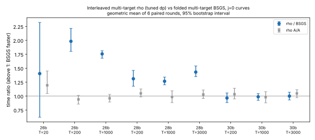

# Interleaved multi-target rho vs folded multi-target BSGS on j=0 curves (2026-11-14) — `[pcc:unverified]`

Protocol: [`PROTOCOL.md`](PROTOCOL.md), committed in `a8cc24a6fe` before any row. Runner `run.sh`, analysis `analyse.py` (as the protocol fixes it), graph `plot.py` → `rho_vs_bsgs.{svg,png,pdf}`, raw rows `rows/`, summary `summary.json`. Bench record `benchmarks/records/20261114T2202Z-j0-multirho-vs-bsgs-interleaved.json`.

Arms: the batched folded multi-target rho with Kuhn-Struik restarts and the dp rule `DPRULE=ks DPDIV=1.5` (PR #4144), the folded multi-target BSGS at `MC=1` (its author's tuning), and the rho run again as an A/A arm. Six rounds per cell; each round plants fresh targets (`INST0 = 100 + r`, 2 curves x 2 instances) shared by all three arms, with the arm order rotating through all six permutations. Every row recovered all T logs; no round was excluded. Local 4-core container, single thread, not isolated.

| bits | T | rounds | rho ms/problem | BSGS ms/problem | rho/BSGS [95%] | A/A [95%] | verdict | rho steps/W |
|---|---|---|---|---|---|---|---|---|
| 26 | 20 | 6 | 4.2 | 1.9 | 1.40 [0.62, 2.32] | 1.19 [1.05, 1.45] | unresolved (A/A failed: unreliable) | 3.42 |
| 26 | 200 | 6 | 9.3 | 5.0 | 1.98 [1.80, 2.22] | 0.94 [0.86, 1.01] | BSGS faster | 2.05 |
| 26 | 1000 | 6 | 23.6 | 13.4 | 1.76 [1.68, 1.81] | 0.96 [0.89, 1.03] | BSGS faster | 1.66 |
| 28 | 200 | 6 | 15.8 | 12.2 | 1.31 [1.18, 1.46] | 1.05 [0.99, 1.13] | BSGS faster | 1.96 |
| 28 | 1000 | 6 | 34.4 | 27.2 | 1.27 [1.20, 1.34] | 0.98 [0.88, 1.09] | BSGS faster | 1.65 |
| 28 | 3000 | 6 | 88.0 | 62.3 | 1.43 [1.35, 1.54] | 1.03 [0.96, 1.11] | BSGS faster | 1.45 |
| 30 | 200 | 6 | 26.4 | 27.4 | 0.97 [0.88, 1.06] | 1.03 [0.95, 1.14] | unresolved | 1.96 |
| 30 | 1000 | 6 | 60.8 | 63.2 | 0.99 [0.92, 1.04] | 0.98 [0.88, 1.08] | unresolved | 1.65 |
| 30 | 3000 | 6 | 126.8 | 125.2 | 1.00 [0.93, 1.07] | 1.05 [0.97, 1.11] | unresolved | 1.46 |

## Reading [pcc:unverified]

- **BSGS is faster at 26 and 28 bits** (rho takes 1.27x-1.98x its time, every interval above 1, A/A intervals contain 1). [pcc:unverified]
- **At 30 bits the two are tied**: rho/BSGS 0.97-1.00, every interval contains 1. The separate, non-interleaved runs in `../RESULTS_prime_fast_j0_sym.md` read rho as 0.83x-0.96x of BSGS there; the paired comparison does not confirm that lead, which is withdrawn.
- **26 bits, T = 20 is unreliable**: its A/A interval [1.05, 1.45] excludes 1 (runs of about 2-4 ms per problem, at the timer and scheduling noise floor), so no verdict.
- The ratio falls with size (about 1.8 at 26 bits, 1.3-1.4 at 28, 1.0 at 30). BSGS stores `m = sqrt(Tn/6)` table entries while rho stores only distinguished points, so a crossover in rho's favour at larger sizes is plausible, but nothing here measures it.
- Rho still takes 1.45x-2.05x of `W = sqrt(2nT/6)` steps (3.4x at 26 bits, T = 20, where 128 lanes in flight exceed W).

## Not done

No §5a band (wall time only), no isolated host, no sizes above 30 bits, the S3 checkpoint and raw upload skipped (no AWS credentials in this container).
