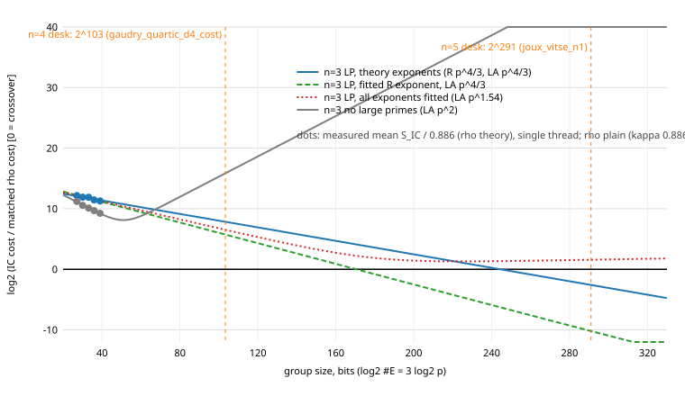

# Extension-field index calculus, n = 3: where (if ever) does it cross matched rho? (2026-11-19)

Protocol (frozen before any data): [`PROTOCOL.md`](PROTOCOL.md). Lane code: `run_ladder.sh`, `analyze.py`,
`make_figure.py`. Derived data: [`results.json`](results.json). Figure: [`figure.svg`](figure.svg).
Every number below is [pcc:unverified]. Single target per instance, charged cold; no multi-target method.

## Result

**On `E(F_{p^3})` index calculus loses to matched rho at every size this repository can run
(IC/rho = 600x to 4,600x at 27 to 39 bit groups), and the fitted cost model puts the crossover far
beyond any runnable size, or nowhere, depending on one term the data cannot pin down.**

| model (large-prime arm, Gaudry S4 solve, matched plain rho kappa = 0.886) | crossover group size | 95% interval (bootstrap over runs) |
|:--|--:|:--|
| theory exponents (relations p^{4/3}, LA p^{4/3}), fitted constants | `2^{245}` (p* = 2^{81.6}) | 2^{243} to 2^{246} |
| fitted relation exponent e = 1.24, LA p^{4/3} | `2^{171}` (p* = 2^{56.9}) | 2^{156} to 2^{188} |
| all exponents fitted (relations p^{1.24}, LA p^{1.52}) | **none** (ratio bottoms at 2^{1.3} = 2.5x rho at p = 2^{75}) | 80% of resamples have no crossover; the others 2^{183} to 2^{1760} |
| no large primes (Gaudry, LA p^2), any exponent choice | **none** (ratio bottoms at 2^{8.0 to 8.5} = 250x to 350x rho, at p = 2^{16} to 2^{17}) | 0 of 2,000 resamples cross |

With negation-map rho (kappa = 0.627) the large-prime crossovers move up by 6 to 9 bits (2^{254}, 2^{177}).
Rho charged 1.1 or 2 GAE per step (stand-in for the unpriced hash/canonicalisation work, see Deviations):
`2^{242}` and `2^{227}` (theory exponents), `2^{169}` and `2^{159}` (fitted e).
What-if only, not in the interval: an S4 solve 3x or 10x cheaper moves the theory-exponent crossover to
`2^{216}` and `2^{185}`, the fitted-e crossover to `2^{152}` and `2^{132}`.

Reading: the exponent gap `3/2 - 4/3 = 1/6` is so small that the constant `C3` (about 9.5e5 F_p multiplications
per S4 solve, flat in p) and the 63-multiplication group addition set the crossover at
`p* = (kappa' C3 / (63 kappa))^6`, a sixth power. A 10x change in a constant is 20 bits of p, 60 bits of group.
The asymptotic claim `q^{2-2/n}` against `q^{n/2}` is not contradicted, but at `n = 3` it only bites at group sizes of
`2^{170}` to `2^{255}`, and only if the linear algebra stays at `p^{4/3}`.

### Distance to matched rho (measured rows, mean over runs; S in GAE/sqrt(n); rho theory S = 0.886)

| arm | p | group bits | S_IC | IC / rho theory (kappa 0.886) | IC / rho negation (0.627) | IC / measured rho (single runs) | IC / (rho at 1.1 GAE per step) | IC / (rho at 2 GAE per step) |
|:--|--:|--:|--:|--:|--:|--:|--:|--:|
| no LP | 523 | 27.1 | 2087 | 2356 | 3329 | 1763 | 2142 | 1178 |
| no LP | 1039 | 30.1 | 1335 | 1507 | 2129 | 975 | 1370 | 753 |
| no LP | 2083 | 33.1 | 974 | 1099 | 1553 | 573 | 999 | 549 |
| no LP | 4003 | 36.0 | 731 | 825 | 1165 | 801 | 750 | 412 |
| no LP | 8101 | 39.0 | 536 | **605** | 854 | 300 | 550 | 302 |
| large primes | 523 | 27.1 | 4102 | 4629 | 6542 | 3465 | 4208 | 2315 |
| large primes | 1039 | 30.1 | 3396 | 3832 | 5416 | 2481 | 3484 | 1916 |
| large primes | 2083 | 33.1 | 3375 | 3809 | 5383 | 1987 | 3463 | 1905 |
| large primes | 4003 | 36.0 | 2496 | 2817 | 3981 | 2736 | 2561 | 1409 |
| large primes | 8101 | 39.0 | 2216 | **2501** | 3534 | 1243 | 2274 | 1251 |

"Measured rho" is the bench's own single rho run per instance (noisy, 0.9 to 1.8 S); the matched reference is the
theory column. `ecbench band` has no arm for this oracle, so the w = 0, 0.1, 1 band is not available from the tool;
the last two columns are the stand-in described under Deviations. IC unpriced native work is none (oracle
multiplications, group operations and mod-n LA operations are all counted, LA at 9/63 GAE per operation).

### Per-term fits (what the extrapolation rests on)

| term | no LP: measured | no LP: model | large primes: measured | large primes: model |
|:--|:--|:--|:--|:--|
| residuals R (trials) | p^{0.96} (CI 0.90 to 1.01); R / \|F\| = 5.8 to 7.1 | ~5.9 \|F\| = 3 p | p^{1.24} (CI 1.22 to 1.27); R / \|F\| grows 14.0 to 25.5 | p^{4/3} (theory), or p^{1.24} (fit) |
| cost per residual (S4 solve + checks) | 9.2e5 F_p mults at p = 523 rising to 9.7e5 at 8101: p^{0.03} | flat (C3 = 9.5e5; per residual 14,700 GAE) | same: p^{0.03} | flat |
| linear algebra (mod-n ops) | p^{2.14} (CI 2.02 to 2.25) | p^2 | p^{1.52} (CI 1.48 to 1.56) | p^{4/3} (theory); fitted 1.52 > 3/2 |
| decomposition rate | 0.145 to 0.174 (theory 1/6 = 0.167) | | 0.148 to 0.177 | |

The large-prime arm needs 1.97x, 2.56x, 3.52x, 3.57x, 4.38x the residuals of the plain arm at p = 523 to 8101.
The linear algebra is a negligible share of the measured IC cost (5e-4 at p = 8101), so its fitted exponent comes from
a handful of tiny numbers; it matters only in the extrapolation. The code comment in `gaudry_cubic.rs`
(`max_merge_level`) already records that the chained merging of large-prime relations raises row weight and
LA exponent above the ideal; this lane's 1.52 is consistent with that and is the reason the all-fitted model has no crossover.

### Other degrees (desk citations, not re-measured here)

| n | model crossover | source |
|:--|:--|:--|
| 3 (this lane) | `2^{171}` to `2^{255}` (above); none if LA stays at p^{1.52} | `results.json` |
| 4 (Gaudry, D4 oracle, `C4 = 6.9e7`) | `2^{103}` to `2^{104}` (h = 2); `2^{101}` (h = 1) | `research/gaudry_quartic_d4_cost_20261014/README.md`, Part C |
| 5 (Joux-Vitse n-1) | `2^{291}` (p* = 2^{58.2}) | `research/joux_vitse_n1_20261015/README.md` |

The n = 4 and n = 5 rows were not re-measured: the n = 4 session costs about 7,300 s per run and the n = 5 trial
costs 7.5e9 F_p multiplications. They are the repository's own prior models, themselves unverified here. Within the
tooling, n = 3 is the only degree measurable to complete DLPs at several sizes in the lane's budget.
The Joux-Vitse `n-1` route at n = 3 (pairs into two base points, no Groebner step) was not run: its relation count
is about 2p trials per relation times p/2 relations with a pair test of about 1.5e3 F_p multiplications, a p^2 route
against rho's p^{3/2}; the committed meet-in-the-middle run `experiments/21_gaudry_cubic.json` (S = 1157 to 3892 at p = 271 to 2083)
(a different oracle: a pair test against every base point per residual, so p^{5/2} overall) shows S rising with p, away from rho.



## Predictions (PROTOCOL.md, unedited) and outcomes

| id | prediction | outcome | evidence |
|:--|:--|:--|:--|
| P1 | log-log slope of oracle mults per residual in [-0.05, +0.15] | **held** | 0.030 for C3 alone (8.89e5 to 9.69e5), 0.033 (CI 0.032 to 0.034) for the per-residual GAE |
| P2 | decomposition rate in [0.10, 0.22] at every run | **held** | 0.122 to 0.186 |
| P3 | NL R / \|F\| in [4, 8] at every p | **held at every p (means 7.11, 5.92, 5.83, 5.77, 5.82); one run (p = 523, seed 2) is 8.21** | `results.json` runs |
| P4 | LP exponent e in [1.20, 1.50] | **held** | 1.244, CI 1.215 to 1.273 (below theory 4/3; pre-asymptotic) |
| P5 | LP needs more residuals than NL at every p, ratio rising, at least 2.5 at largest p | **held** | 1.97, 2.56, 3.52, 3.57, 4.38 |
| P6 | IC S above rho theory 0.886 everywhere; ratio at largest p at least 100 | **held** | 605 (NL), 2501 (LP) |
| P7 | LP slope of log S against log p in [-0.45, -0.05] | **held** | -0.22 (theory -1/6); NL -0.49 |
| P8 | NL model has no crossover; its minimum ratio at least 10 | **held** | min ratio 2^{8.0} to 2^{8.96} (250x to 500x) |
| P9 | LP crossover group size above 2^{150}, interval lower end above 2^{100} | **held** for the central models (2^{171} fitted e, 2^{245} theory; lower ends 2^{156}, 2^{243}); not held in the what-if with C3 divided by 10 (2^{132}, 2^{138} at kappa 0.627) which is outside the registered interval | `results.json` crossover |
| P10 | LP ratio falls by at most 5x per 40 group bits | **held for theory exponents (4.7x); not held for the fitted exponent 1.24 (about 10.6x per 40 bits)** | analytic from fits |

All ten were tested against the new runs. The committed legacy data (read before registering, stated in PROTOCOL.md)
had the same direction for P1 and P5.

## Deviations and limits (none edits a prediction)

- **Bootstrap size.** 4,000 resamples for exponent intervals and 2,000 for crossover intervals (protocol said 10,000).
  Intervals resample runs within each p (1 to 2 runs per p); they cover the fit, not model misspecification.
  The large-prime p = 4003 and 8101 points have 2 and 1 runs, so the exponent intervals are narrow for the
  wrong reason; the spread between the three model rows is the honest uncertainty.
- **Interval includes only constants and fitted exponents.** It excludes the unknown asymptotic LA exponent: the
  table's three scenarios differ by exactly that, and the data cannot choose among them (LA is 5e-4 of the cost at p = 8101).
- **Not run:** `--merge-cap` (holds LA row weight down at the cost of residuals), which is the lever that would test
  whether LA can be held at p^{4/3}; a measurement beyond p = 8101 (the LP run at p = 8101 took 574 s; p = 16033 would take
  about 25 min); a second p = 8101 seed; n = 4, 5 measurements; Joux-Vitse pair-only at n = 3.
- **Native-work weights.** `ecbench` has no Gaudry-cubic method (`ecbench methods` lists gaudry-d4 and gaudry-x-bin only),
  so `ecbench band`, `verify --replay` and the section 5a weights w = 0, 0.1, 1 cannot be applied; there is no replay
  certificate or validator report for these rows, so they cannot enter any leaderboard or benchmark table (and none is edited).
  Stand-in: rho charged 1, 1.1, 2 GAE per step.
- **Group-size map.** n is taken as p^3 (the measured prime orders have log2 n / log2 p within 0.5% of 3).
- **Wall clock.** Runs were single-threaded and pinned to one core but shared the host with two other lanes; wall times
  (9 s to 574 s) are descriptive only, S is counted and does not depend on them.
- **Whole-curve generator** `generate_instance3` limits p < 2^20, so the largest runnable curve is about 2^{60}; the
  crossover is 100 to 190 bits beyond it.
- Prime-field rho constants (0.627, 0.886) are the theory values `sqrt(pi/4)/sqrt(2)` and `sqrt(pi/4)`; the single measured
  rho runs scatter 0.9 to 1.8.

## Reproduce

```sh
cd /home/user/crypto && CARGO_INCREMENTAL=0 cargo build --release --example gaudry_cubic_bench
cd research/ic_ext_field_crossover_20261119
./run_ladder.sh            # about 35 min on one core; writes raw/*.json (gitignored), raw/ladder.status
python3 analyze.py         # writes results.json
python3 make_figure.py     # writes figure.svg
```

Raw files (gitignored under `raw/`), SHA-256 (the same hashes are in `results.json`, `raw_sha256`):

- `LP_p1039_s1.json` `ca54d6ad55c23bc175b64f7a78abc31cfbcc6f494d5d13858b1f326d96044dff`
- `LP_p1039_s2.json` `707225c1b53f66e4c65f80b7c4f379689d4c56ac40e5968f4e9a8e9d2877dac7`
- `LP_p2083_s1.json` `d654d6feaf2512bb5877435ebab45521808ef376db865b3d8764e56ff66aa1ef`
- `LP_p2083_s2.json` `386909cb4a2b087c98ac4596ebe5948d467490127ea15ded99896cdd29dfb9de`
- `LP_p4003_s1.json` `a42740f9fcb31d6f57dd9dc357f948d60287716c3acdba6596d2a5afe4e79364`
- `LP_p4003_s2.json` `f0b564471985039aa37f43b8a13bdbe802cb98cf85db5a0b8bcd53009a4d3a92`
- `LP_p523_s1.json` `7c05fb35f3a9788153c09b8b4b667570e3c5311529f8f62d6281e064e8743c6d`
- `LP_p523_s2.json` `062fe8271d0a30effc8451e7c2891392c3eecbdcace0126f1400f9cb10134255`
- `LP_p8101_s1.json` `6a71bbcb97521dc417aa18b030edd11b9d6971078f26abc5d8f9a551c159c221`
- `NL_p1039_s1.json` `39f6287abe9d7161d2c444823a45752a97990c8ba9bc50828f939ba0a41e2a29`
- `NL_p1039_s2.json` `624d0476e1db357447d4f9b4a5eeac6f8bb85fff889d80bbe6ac87ccae7c0abb`
- `NL_p2083_s1.json` `ad8610160fea51ff29d9dabc2da49ac406525f0d2346da7b3f7c632d793fcc3a`
- `NL_p2083_s2.json` `960b93b1da3f464633ba6fa9f3a49fadbc9895c712c248a246db023f93150c48`
- `NL_p4003_s1.json` `20855c37b06c4a9f1f778a411b19caf123454a544d9b28205af6325b888ac19e`
- `NL_p4003_s2.json` `4c56f15af2e5ebe6b2f437c7fb6374afa6e42b5c0a46bfd22014656a6f0172c3`
- `NL_p523_s1.json` `3b70684da5f36c318f1e6f2c5b1c7ea5289d5e7ad2a12ddc01beb2945bd2e274`
- `NL_p523_s2.json` `052a8a6da74f61a261a4de9d3a9a78db3f37ac828f5b96305eb8f975cb66c553`
- `NL_p8101_s1.json` `b2a8811e9806884ad946caa4d938943c68fdafab3c4d4c9babffbee199f8793f`

Binary: `target/release/examples/gaudry_cubic_bench` built 2026-11-19 from the working tree
(`CARGO_INCREMENTAL=0`, release); `sha256sum` it before replaying elsewhere. Host: 4 vCPU Intel Xeon (cloud container).
