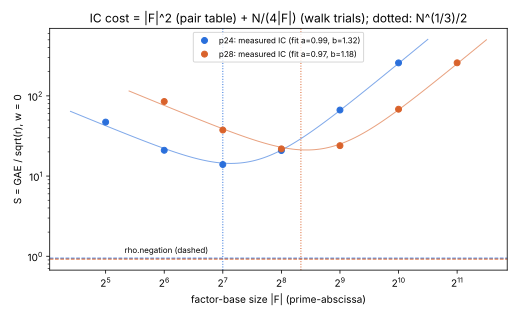

# Factor-base size and the cost of prime-field index calculus

2026-11-19. Protocol: [`PROTOCOL.md`](PROTOCOL.md), frozen in `08dffc5386` before any
data. PDF: [`REPORT.pdf`](REPORT.pdf). Part B (filter economics on binary curves):
[`FILTER_ECONOMICS.md`](FILTER_ECONOMICS.md). Every figure is **[pcc:unverified]**:
no validator report, no `VALIDATION.json`, no leaderboard row.

## Result in one paragraph

The counted cost of the prime-field pipeline (`prime-abscissa` base,
`mitm-prime-blocked:m=2`, `walk` targets, target-pinned `incremental-gauss`) is,
to within 11 % at every measured size, **GAE ≈ 0.98·|F|² + 1.2·N/(4|F|)**: an
|F|² pair table plus N/(4|F|) walk trials of one addition each. The cheapest
size is the grid point nearest N^{1/3}/2 (128 at 24 bits, 256 at 28 bits), and
the best S grows as N^{1/6} (measured ratio 1.57, model 1.59). Choosing |F|
therefore cannot reach rho: the distance at the optimum is **14.6× (p24) and
24.4× (p28) at w = 0** and grows with the curve. Every prediction M1–M6 held.



## Measurements (`sessions/p24`, `sessions/p28`; 336 records, all verified)

8 targets × 2 measured rounds per arm; `ecbench verify --replay 12`: 168/168 verified
and 12/12 replays reproduced on each curve ([`analysis/p24.audit.txt`](analysis/p24.audit.txt),
[`analysis/p28.audit.txt`](analysis/p28.audit.txt)). Isolation L2 (`--allow-busy`
was passed; the host was quiet enough). Fit: [`analysis/fit.py`](analysis/fit.py) →
[`analysis/fit.json`](analysis/fit.json). Band: [`analysis/p24.band.txt`](analysis/p24.band.txt),
[`analysis/p28.band.txt`](analysis/p28.band.txt).

| curve | \|F\| | S, w = 0 / 0.1 / 1 (band) | mean GAE | fit | trials / (N/4F) | relations / \|F\| |
|:--|--:|:--|--:|--:|--:|--:|
| p24 | 32 | 50.2 / 60.1 / 149.0 | 193,002 | +9.8 % | 1.45 | 0.65 |
| p24 | 64 | 20.4 / 24.2 / 59.0 | 85,924 | −5.4 % | 1.21 | 0.58 |
| p24 | **128** | **13.5 / 15.8 / 35.7** | 57,095 | −4.1 % | 1.17 | 0.57 |
| p24 | 256 | 21.0 / 23.6 / 46.5 | 85,272 | −1.3 % | 1.07 | 0.54 |
| p24 | 512 | 66.6 / 73.5 / 135.9 | 272,753 | +1.1 % | 1.04 | 0.51 |
| p24 | 1024 | 257.8 / 283.8 / 518.3 | 1,056,035 | +1.4 % | 1.14 | 0.53 |
| p24 | rho.negation | 0.93 / 1.01 / 1.77 | | | | |
| p28 | 64 | 85.0 / 102.0 / 254.3 | 1,393,769 | +10.6 % | 1.32 | 0.63 |
| p28 | 128 | 36.0 / 43.1 / 106.7 | 614,334 | −3.7 % | 1.14 | 0.57 |
| p28 | **256** | **21.4 / 25.3** / 60.1 | 357,839 | −4.6 % | 1.10 | 0.57 |
| p28 | 512 | 23.8 / 27.0 / **55.3** | 392,302 | −4.7 % | 0.97 | 0.49 |
| p28 | 1024 | 68.2 / 75.4 / 140.7 | 1,117,002 | +1.6 % | 0.99 | 0.49 |
| p28 | 2048 | 258.3 / 284.4 / 519.4 | 4,232,613 | +2.6 % | 1.03 | 0.50 |
| p28 | rho.negation | 0.88 / 0.96 / 1.73 | | | | |

"fit" is the relative residual (measured − fit)/measured of a·F² + b·N/(4F), with
a = 0.988, b = 1.320 (p24) and a = 0.974, b = 1.185 (p28).

| prediction | outcome |
|:--|:--|
| M1 trials within [0.5, 2] × N/(4F) | **held**: 0.97–1.45 |
| M2 relations within [0.4, 1.0] × F | **held**: 0.49–0.65 |
| M3 a, b ∈ [0.5, 2], residual ≤ 15 % | **held**: a ≈ 0.98, b = 1.19–1.32, worst residual 10.6 % |
| M4 cheapest F at w = 0 nearest N^{1/3}/2 | **held**: 128 (p24), 256 (p28; F* ≈ 323) |
| M5 optimum S ratio p28/p24 ∈ [1.2, 2.2] | **held**: 1.57 (model 1.59); rho flat (0.93 → 0.88) |
| M6 cheapest F at w = 1 ≥ cheapest at w = 0 | **held**: p24 128 → 128; p28 256 → 512 |

**Distance remaining to rho at the best measured size** (band means): p24 14.6× / 15.6× /
20.2× at w = 0 / 0.1 / 1; p28 24.4× / 26.3× / 32.0×.

## What this says about pruning and filtering

- **The two cost terms are the whole story.** The pair table is |F|² additions; the
  walk is N/(4|F|) additions. The decomposition test per trial (lookups, square roots,
  Legendre symbols) is native work only, so filtering it cannot move S at w = 0, and
  at w = 1 it only shifts the optimum up one size (M6).
- **Pruning the pair table is the only lever on the |F|² term, and it is capped.**
  Keep T sums instead of |F|²/2: the hit rate becomes about 2T/N, trials about
  0.55·|F|·N/(2T), so the cost is about T + 0.28·|F|·N/T, minimised at
  ≈ 1.05·√(|F|·N) [pcc:unverified: derivation from the fitted constants, not
  measured]. That is never below rho's ≈ 0.9·√N, and it approaches it only as |F|
  shrinks to a handful of points, where the method is a collision search. This is
  the same finding as `research/ic_planner_exhaustive_20261026` from the other side:
  its residual collector scales like rho (slope 0.46) and its gain is generic.
- **A correction to the 2026-11-15 study.** Its p28 rows used |F| = 128, which is
  1.7× off the optimum (S 36.0 against 21.4). Its p28 distance to rho, 42×, is
  therefore an over-statement for the best size; the distance at the optimum is 24.4×.
  The conclusions of that study (no relation-solving device moves S) do not depend on
  |F|. Whether `ic plan` already picks 256 at 28 bits was not checked here.

## Deviations

- No S3 resume checkpoint and no S3 raw-data upload: the container has no AWS identity
  (`scripts/checkpoint.sh push`: "no way to upload"). Specs, protocol and sessions are
  committed to Git instead, except the two raw `sessions/*/records.jsonl` (1.5 MB
  each), which the repository's artifact policy keeps out of Git. Their SHA-256s
  are in `benchmarks/records/20261119T1646Z-ic-fb-size-model.json`; the counted
  values in them are deterministic (`cost.deterministic: true`) and the
  "Reproduce" commands regenerate them in under a minute. The derived tables
  (`analysis/fit.json`, `analysis/*.band.txt`, `analysis/*.audit.txt`) are in Git.
- Runs were local, not on EKS (no AWS identity).
- `research-kb` and the `crypto-autoresearcher` lead atlas are not reachable from this
  container; prior work was located by searching this repository.

## Reproduce

```sh
cargo build --release --bin ecbench
for c in p24 p28; do
  ./target/release/ecbench run --wait --allow-busy --spec specs/$c.json --out sessions/$c
  ./target/release/ecbench verify --dir sessions/$c --replay 12
  ./target/release/ecbench band --dir sessions/$c
done
python3 analysis/fit.py && python3 analysis/figures.py
```
