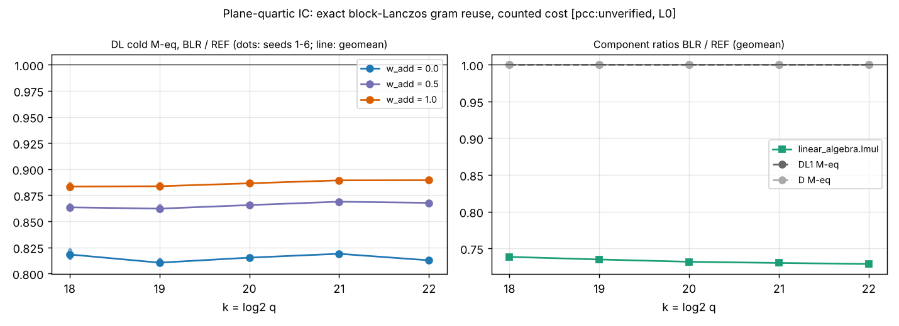

# Exact block-Lanczos gram reuse in the plane-quartic IC: counted cost

Scored against [`PROTOCOL.md`](PROTOCOL.md), frozen at commit `5c9dc91c48` before any unit of this study ran. Every
number below is an **unverified assertion** `[pcc:unverified]`: no validator report, replay certificate or matched
rho admission exists for it, so no leaderboard or `benchmarks/README.md` row moves (validation gate).

Scope: GHS-weak family `E0/F_{q^3}` (`#E0(K) = 4 ell`), driver `ic <q> <seed> D 3.0 1.7`, k = 18..22, seeds 1-6
(1-3 as in the earlier studies, 4-6 fresh), 60 units (REF and BLR, 30 (q, seed) cells). L0 route on the session
container (EKS budget hold, `../quartic_dl1_cd_sqrt_20261113/launch/BUDGET-HOLD.md`); up to 3 units ran concurrently,
which is harmless because the metric is counted operations (host-independent); CPU/wall seconds were not analysed.

Change (`src/la2.rs`, `block_lanczos` only): `MV_{i-1}^T MV_i` is read from the columns `sel_used` of the same iteration's
full gram `V_full^T M V`; `V_i^T V_0` (iterations >= 2, no narrowing at iteration 0) comes from the three-term
recurrence; direct grams otherwise. REF = `../ic_gw_fasthash_20261114/src` COMBO build.

## Result under the pre-registered rule

Gates: **G1** pass (30 pairs; the only differing counted fields are `linear_algebra.lmul`/`ladd` of the DL record, in all
30; 0 other mismatches), **G2** pass (same `s.bl_iters`, `s.bl_narrowed`), **G3** pass (all records `ok`,
`k_found == k`, all exit codes 0, 0 reruns), **G4** pass (REF reproduces the committed COMBO records of
`ic_gw_fasthash_20261114`, counted fields, 30 unit files = seeds 1-3 x 5 sizes x 2 passes, 0 mismatches).

Decision: **SUPPORTED**. The DL cold M-eq ratio BLR/REF is below 1 at all 30 (q, seed) cells and all
`w_add` in {0, 0.5, 1} (and also at every hash/cmp pricing `w_h` in {0, 0.1, 1} GAE). DL1 and D are exactly 1 at every cell.

DL cold M-eq BLR/REF, `w_h = 0`, geomean (max) over seeds 1-6:

| w_add | k = 18 | 19 | 20 | 21 | 22 |
|--:|--:|--:|--:|--:|--:|
| 0 | 0.8182 (0.8221) | 0.8104 (0.8136) | 0.8152 (0.8163) | 0.8189 (0.8193) | 0.8126 (0.8128) |
| 0.5 | 0.8634 (0.8654) | 0.8621 (0.8650) | 0.8656 (0.8663) | 0.8688 (0.8700) | 0.8677 (0.8687) |
| 1 | 0.8833 (0.8858) | 0.8836 (0.8863) | 0.8864 (0.8870) | 0.8892 (0.8905) | 0.8894 (0.8905) |

With hash+cmp priced at 0.1 / 1 GAE the ratio rises (geomean at k = 22, `w_add` = 0: 0.839 / 0.929), still below 1 (`tables.md`).
`linear_algebra.lmul` of the DL record, BLR/REF geomean: 0.738, 0.735, 0.732, 0.730, 0.729 (k = 18..22).
Prediction check (written before data): DL ratio 0.80-0.84 at `w_add` 0 and 0.87-0.90 at 1 held; linear-algebra lmul
ratio was predicted 0.75-0.80 and came out lower (0.73-0.74).

## Gap to the matched negation-map rho at k = 22 (distance remaining, not a gate)

REF reproduces the frozen combo band's IC numbers (`ic` in `gae_band` of
`../quartic_dl1_cd_sqrt_20261113/combo/validation/VALIDATION.json`; DL mean over seeds 1-3, `w_add` = 0) to relative
error < 1e-9: **yes**. IC side in cold M-eq (mean over seeds 1-3, `w_add = 0`, hash+cmp at `w*gae`); rho is the frozen negation-map reference:

| w | rho (neg) | IC REF | IC BLR | rho/IC REF | rho/IC BLR | IC/rho BLR |
|--:|--:|--:|--:|--:|--:|--:|
| 0 | 3.7959e11 | 1.0385e9 | 8.4399e8 | 365.5 | 449.8 | 0.00222 |
| 0.1 | 4.9091e11 | 1.2085e9 | 1.0140e9 | 406.2 | 484.1 | 0.00207 |
| 1 | 1.4928e12 | 2.7385e9 | 2.5440e9 | 545.1 | 586.8 | 0.00170 |

Caveat: the band prices additions at 0 (as that file does); at `w_add` = 1 the IC side is larger (see `tables.md` ratios;
absolute M-eq with additions were not part of the band). The rho reference is the frozen one; no new matched-rho
run, replay or validator is part of this study.

## Files

`PROTOCOL.md`, `make-units.sh` / `units.tsv`, `run-local.sh`, `analyze.py` -> `analysis.json`, `tables.md`;
`plot.py` -> `blreuse.svg/png`; `REPORT.typ` -> `REPORT.pdf`; `src/` (BLR sources); `runs-blreuse-20261115.tar.gz`
(raw JSONL of the 60 units + `binary.sha256`, `host.txt`, `run.log`, `SHA256SUMS`; sha256
`e24e4050ae88418fc16e3c7434109de23b72779409fc33a915f4191f5a22c3e7`). Binaries (not committed; `rustc 1.97.0`,
`rustc --edition 2021 -O v3.rs --cfg combo`): REF `00355034924e06661aed665f433063524c2e3964839c3ca671d54d64aaaa19a9`
(matches the recorded COMBO), BLR `13959249d43bdc5582dfda9427ede06334f0c880b2d3d4ffbe03928ea9c003b8`.
Benchmark record `benchmarks/records/20261115T0432Z-ic-gw-bl-reuse.json`.

Reproduce: `./make-units.sh`, build the two binaries, `./run-local.sh BIN_DIR OUT_DIR`, `python3 analyze.py OUT_DIR`.
