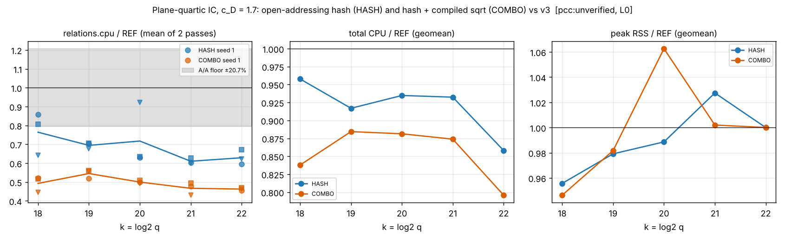

# Open-addressing hash tables and a compiled square root: relations-phase CPU of the plane-quartic IC

Scored against [`PROTOCOL.md`](PROTOCOL.md), frozen at commit `9d4e6aebc5` before any data of this study. Every number
below is an **unverified assertion** `[pcc:unverified]`: no validator report, replay certificate or matched rho
reference exists for it, so no leaderboard or `benchmarks/README.md` row moves (validation gate).

Scope: the GHS-weak family `E0/F_{q^3}` (`#E0(K) = 4 ell`), driver `ic <q> <seed> D 3.0 1.7`, k = 18..22,
seeds 1-3. L0 diagnostic on the session container; the Iso Lab EKS route was replaced by a local run
because the monthly budget is exceeded (owner decision; `../quartic_dl1_cd_sqrt_20261113/launch/BUDGET-HOLD.md`).
Primary metric is CPU at identical counted work, so the L0 caveat applies: shared 4-vCPU host, one unit at a
time under a lock shared with two sibling lanes, load1 1.00..2.30 at unit start.

## Result under the pre-registered rule

| arm | decision (frozen rule) | relations.cpu / REF, pass-mean over 15 (q, seed) |
|:--|:--|:--|
| HASH | **NOT SUPPORTED** (below 1 at the mean of every cell, but not at both passes of every cell, and not beyond the A/A floor) | 0.594 .. 0.923; geomean per size 0.764, 0.694, 0.717, 0.610, 0.629 (k = 18..22) |
| COMBO | **SUPPORTED** (every cell, both passes, below 1 - 20.7%) | 0.430 .. 0.561; geomean per size 0.493, 0.545, 0.500, 0.467, 0.463 |

Gate: 79 unit comparisons (237 `ic` records, full-line compare in order, REF/HASH/COMBO/REF2 and both passes): 0
mismatches, 0 verification failures, 0 retried units, all exit codes 0. Self test `combo fastcheck` 200,000
inputs (+7 edge values) at each of the five sizes: 0 mismatches against the interpreted chain and against modpow,
equal counted cost. Counted work is identical, so the counted M-eq and the gap to the matched rho
are unchanged by construction (this is a time-only change; no leaderboard distance moves).

**The A/A floor is large and decides the HASH verdict.** The REF-vs-REF2 `relations.cpu` pairs were 1.010 / 0.793
(q = 2097091, passes 1 / 2) and 1.030 / 1.015 (q = 4194271); the 0.793 comes from one slow REF unit (2.28 s against
1.93 s in pass 1 and 1.81 s for REF2) and sets the floor at 20.7% under the frozen max-abs rule. HASH's relations
ratio is 0.59-0.67 (pass-mean) for q >= 2097091; four single-pass values lie above 1 - floor = 0.793, in three
cells at the smaller sizes (q = 262111 seed 1: 0.914 and 0.804; q = 262111 seed 3 pass 2: 0.844; q = 1048507 seed 2 pass 1: 1.063). Post hoc, not part of the rule: the larger sizes show a consistent
~0.6 gain and the small-size cells are within the noise of a 1-2 s phase. Treat HASH as "probably a real gain at k >= 21,
not demonstrated at every cell" and COMBO as the supported result.

## Secondary measures (`tables.md`)

* Total CPU (DL record, all phases) / REF, geomean over 3 seeds x 2 passes: HASH 0.958, 0.917, 0.935, 0.932, 0.858;
  COMBO 0.838, 0.884, 0.881, 0.874, 0.796 (k = 18..22). A/A total CPU pairs were 1.111, 0.849 and 1.032, 0.912, so
  the totals are noisy (the linear algebra and the other lanes share the host); no threshold was frozen for them.
* Peak RSS (VmHWM, 0.2 s polling) ratio at q = 4194271: HASH 1.000, COMBO 1.000 (REF 916,545 kB geomean); at other sizes
  0.946-1.063 with per-unit scatter 0.85-1.16 (different polling instants). The relations-stage tables are not the peak
  allocation, so the open-addressing tables cost no measurable peak memory (the prediction of an up-to-2x increase did not occur).
* Prediction check (written before data): HASH 0.60-0.80 and COMBO 0.45-0.70 relations ratio held at every size
  (geomean over seeds, HASH 0.61-0.76, COMBO 0.46-0.55); the total-CPU prediction (closer to 1 at small q) is not supported
  (COMBO 0.84 at k = 18 against 0.80 at k = 22).

## Files

`PROTOCOL.md`, `make-units.sh` / `units.tsv`, `run-unit.sh`, `run-local.sh`, `analyze.py` -> `analysis.json`,
`tables.md`; `plot.py` -> `fasthash.svg/png`; `REPORT.typ` -> `REPORT.pdf`; `src/` (HASH sources; COMBO is the same
sources with `--cfg combo`); `runs-fasthash-20261114.tar.gz` (raw JSONL of the 94 units, sha256
`d9d301a42050b5073f10a8f330eb8e31cbc3c4144bc71dbf9706d2482c01b897`). Binaries (not committed):
REF `de500bc154f3...` (published v3), HASH `477fd569316d...`, COMBO `00355034924e...` (`rustc 1.97.0`,
`rustc --edition 2021 -O v3.rs [--cfg combo]`). Benchmark record `benchmarks/records/20261114T2208Z-ic-gw-fasthash.json`.

Reproduce: `./make-units.sh`, build the three binaries, `./run-local.sh BIN_DIR OUT_DIR LOCKFILE`, `python3 analyze.py OUT_DIR`.
