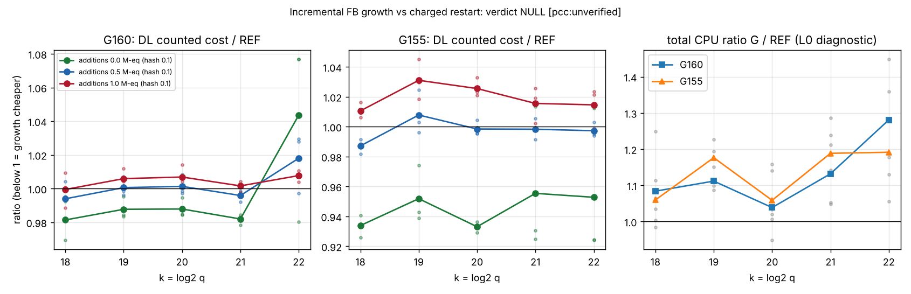

# Incremental factor-base growth vs the charged restart (plane-quartic double-large-prime IC, GHS-weak family)

Scored against [`PROTOCOL.md`](PROTOCOL.md), frozen at `0402ffb5c1` with the analysis script before any data.
Every number is an **unverified assertion** `[pcc:unverified]`; no validator report exists, so no leaderboard or
`benchmarks/README.md` row moves (validation gate). Scope: `E0/F_{q^3}`, `#E0(K) = 4 ell`, family D, k = 18..22.

*DL counted cost of the growth arms over the REF (v3, c_D = 1.7), geometric mean over seeds 1-3 (dots: single seeds),
hash priced at 0.1 M-eq; right panel: total CPU ratio (L0 diagnostic).*

## Result under the pre-registered rule: NULL for both arms (task closed as "no gain at the REF setting")

| gate | result |
|:--|:--|
| G-id (`v3g` vs scratch candidate, q = 262111 seed 1) | every counted field equal (`smoke/`, 6 / 6 records) |
| G-A/A (REF vs committed combo B170, same binary) | 45 arm records, 0 mismatches |
| G-ok (rc 0, last record ok, `k_found == k`) | 45 / 45 units, 0 failures |
| REF retries | 0 (REF needed one attempt in every unit, as the documentation step found for all earlier data) |
| load1 at lock | max 1.69 (<= 2.0 in every unit) |

DL counted M-eq ratio G / REF (geometric mean over seeds; the bracket is the worst seed), `tables.md`:

| arm, w_add / h | k = 18 | 19 | 20 | 21 | 22 |
|:--|--:|--:|--:|--:|--:|
| G160, 0 / 0.1 | 0.981 [0.992] | 0.988 [0.995] | 0.988 [0.995] | 0.982 [0.985] | **1.044 [1.077]** |
| G160, 0.5 / 0.1 | 0.994 [1.004] | 1.001 [1.007] | 1.001 [1.008] | 0.996 [0.998] | 1.018 [1.030] |
| G160, 1 / 0.1 | 0.999 [1.009] | 1.006 [1.012] | 1.007 [1.014] | 1.002 [1.004] | 1.008 [1.011] |
| G155, 0 / 0.1 | 0.934 [0.941] | 0.952 [0.974] | 0.933 [0.936] | 0.955 [1.014] | 0.953 [1.012] |
| G155, 0.5 / 0.1 | 0.987 [0.991] | 1.008 [1.025] | 0.998 [1.005] | 0.998 [1.005] | 0.997 [1.003] |
| G155, 1 / 0.1 | 1.011 [1.016] | 1.031 [1.045] | 1.026 [1.033] | 1.016 [1.026] | 1.015 [1.024] |

* The rule needs every one of the 15 (q, seed) cells below 1 at w in {0, 0.5, 1} and h in {0, 0.1}. G160 fails 20 of the
  30 (size, w, h) grid points and G155 22 of 30; the worst single cells are 1.077 (G160, k = 22) and 1.045 (G155,
  k = 19). Cells below 1 at w = 0 (h = 0.1): G160 13 of 15, G155 13 of 15; at w = 1: G160 2 of 15, G155 1 of 15.
* With additions free the best arm, G155, is 0.93-0.95 of REF for the geometric mean at every k (up to 1.01 for one
  seed at k = 21, 22), but additions at 0.5 M-eq already erase it (0.99-1.01) and at 1 M-eq it is 1.01-1.03.
  The saving sits in the fb, relations and linear algebra phases (0.92-0.98 at w = 0); the **descent phase grows
  1.3-2.7x** with the larger final factor base (`tables.md`), so part of the lower starting c_D is paid back.
* The hash work rises 1.5-2.0x (G160 at k = 22 doubles it: 4.1e7 vs 2.05e7 counted operations); pricing it at 0.1 M-eq
  changes the ratios by 0.001-0.002, at 1 M-eq by 0.01-0.02 (not decisive).
* DL1 follows DL (0.95-1.04); the plain D arm is dearer (1.02-1.13) except G160 at k = 22 (0.97).
* CPU (secondary, L0 diagnostic, three lanes serialised on one 4-vCPU host): total DL CPU is 0.95-1.45 of REF per cell,
  median 1.13 (G160) and 1.11 (G155), above 1 in 13 and 15 of 15 cells. No time gain; consistent with the pilot's
  1.16-1.52. The pilot's A/A floor (0.1% on `relations.cpu`, up to 7% on total CPU) is smaller than this effect but
  larger than the 1-3% counted gains, so CPU is no argument for either arm.
* Attempt records per DL unit: 2 in 26 of the 30 growth units (one heavy-row growth step), 3 in 4 of the
  large units (k = 21 G155 seed 3; k = 22 G160 seeds 1, 3, G155 seed 3); REF always 1.

Predicted before data: null for both arms (pilot: G160 about 0.98-0.99 and G155 0.93-0.95 at w = 0, above 1 at
w >= 0.5, CPU 1.06-1.32). Measured: as predicted, with k = 22 for G160 the one new feature (1.04 at w = 0).

## Documentation step (no new runs)

`audit_retries.py` -> `retries.json`: no D, DL1 or DL record at c_D >= 1.7 and q >= 262111 in the committed
`quartic_dl1_cd_sqrt_20261113` (runs, cd_sweep, combo) or `quartic_n4v2_20261020` records had a retry; the only retried
records are 6 pilot ones at c_D = 1.5 (seeds 101, 102, q = 262111) and 2 of the S/L0 families at q = 262111, seed 2.
So the charged restart costs nothing at c_D = 1.7, and growth's only possible gain is a lower starting c_D at cheaper
than restart cost, which the measurement above does not deliver.

## Distance to rho

Frozen matched plain rho (k = 22 from the supplement), DL M-eq of the IC arm with additions and hash free over rho at
its w = 0 price (and at w = 1):

| arm | k = 18 | 19 | 20 | 21 | 22 |
|:--|--:|--:|--:|--:|--:|
| REF | 0.01059 | 0.00708 | 0.00546 | 0.00324 | 0.00243 |
| G160 | 0.01038 | 0.00699 | 0.00539 | 0.00318 | 0.00253 |
| G155 | 0.00988 | 0.00673 | 0.00509 | 0.00309 | 0.00231 |

(rho at w = 1: half of each entry.) Moves of 0-7% from REF in the geometric mean, not robust, so no change in the
distance remaining is claimed `[pcc:unverified]`. No validated matched-rho band (section 5a) was recomputed here.

## Route deviation

Default route is Iso Lab EKS; the owner chose local L0 runs because the EKS monthly budget is exceeded
([`BUDGET-HOLD.md`](../quartic_dl1_cd_sqrt_20261113/launch/BUDGET-HOLD.md)). Intel Xeon 2.10 GHz, 4 vCPU, three study
lanes serialised by one host lock, one unit per acquisition. Counted metrics are host-independent; wall and CPU are L0
diagnostics.

## Binaries

| arm | sha256 |
|:--|:--|
| REF `v3` | `de500bc154f3074359badf434255605ae103b974f4ac2b00159fc84bd3a76bb6` |
| G160 / G155 `v3g` | `575ee3baec40f71ce3bc519dd5ed0d8273aa8fa9c1fa65cc5cb0d023ea68fe5e` (built from `src/`, `rustc --edition 2021 -O v3.rs`) |

## Files

`PROTOCOL.md` (frozen at `0402ffb5c1`), `src/`, `smoke/`, `make-units.sh` -> `units.tsv`, `run-local.sh`,
`audit_retries.py` -> `retries.json`, `analyze.py` -> `analysis.json`, `tables.md`, `plot.py` -> `fbgrow.{svg,png}`,
`REPORT.typ` -> `REPORT.pdf`, `runs-local-20261114.tar.gz` (45 unit records, `SHA256SUMS`, binary hashes, host).
Reproduce: `tar xzf runs-local-20261114.tar.gz -C runs` then `python3 analyze.py runs/local-20261114`.
