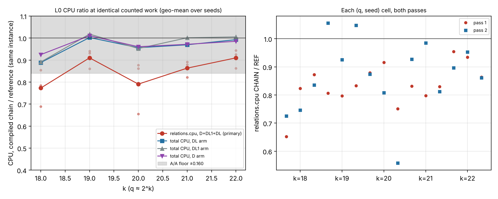

# Compiled fixed-exponent square root (FastChain + Barrett): plane-quartic double-large-prime IC, GHS-weak family

Scored against [`PROTOCOL.md`](PROTOCOL.md), frozen at `9e6252ffa3` before any data of this study. Every number is an
**unverified assertion** `[pcc:unverified]`: no validator report exists, so no leaderboard or
`benchmarks/README.md` row moves (validation gate). Scope: `E0/F_{q^3}`, `#E0(K) = 4 ell`, c_D = 1.7, k = 18..22.

## Result under the pre-registered rule: below 1 at every cell, not separated from the A/A floor

| gate | result |
|:--|:--|
| G0 smoke (`v3c` vs `v3`, q = 262111, seed 1) | every counted field equal (`smoke/`) |
| G1 counted fields identical in every REF/CHAIN pair, REF p1 vs p2, A/A | **PASS**, 8,580 counted fields compared REF vs CHAIN, 0 mismatches |
| G2 every unit verified, rc 0 | 64 / 64 |

Primary metric, `relations.cpu` CHAIN / REF (mean of two passes; `tables.md`):

| q (k) | seed 1 | seed 2 | seed 3 | geo-mean | total CPU DL | DL1 | D |
|--:|--:|--:|--:|--:|--:|--:|--:|
| 262111 (18) | 0.689 | 0.785 | 0.854 | 0.773 | 0.889 | 0.891 | 0.925 |
| 524287 (19) | 0.931 | 0.861 | 0.940 | 0.910 | 1.002 | 1.018 | 1.011 |
| 1048507 (20) | 0.876 | 0.862 | 0.655 | 0.791 | 0.956 | 0.952 | 0.961 |
| 2097091 (21) | 0.879 | 0.891 | 0.821 | 0.863 | 0.969 | 1.001 | 0.972 |
| 4194271 (22) | 0.926 | 0.944 | 0.863 | 0.910 | 0.993 | 1.005 | 0.985 |

Maximum cell ratio 0.944 (below 1 in all 15 cells, both passes' means). The A/A floor is
f = 0.160 (REF re-run ratio 0.989 at q = 2097091 and 1.160 at q = 4194271), so `m < 1 - f = 0.840` fails:
by the frozen rule the outcome is **below 1 but not separated from noise**. The REF pass-2/pass-1 ratio
of `relations.cpu` ranges 0.80-1.28 across cells (`analysis.json`), far above the pilot's 0.1% A/A, so the
shared container was much noisier than assumed; no unit had load1 > 2.0 at lock acquisition (max 1.44).
The consistent sign (15 of 15 cell means below 1) suggests a real
relation-stage gain of roughly 10-20%, but this study does not establish it at the pre-registered
resolution. Total CPU for DL is 0.89-1.00 of REF: a small gain at k = 18, 20, none at k = 19, 22.

Notes. The binary's three IC arms share one relations run, so `relations.cpu` is identical in D, DL1, DL
and the primary ratio equals the DL-arm ratio. Counted work is identical by G1, so no M-eq or gap-to-rho
changes: the distance to the matched rho is unchanged from the c_D = 1.7 rows of
[`../quartic_dl1_cd_sqrt_20261113/cd_sweep/`](../quartic_dl1_cd_sqrt_20261113/cd_sweep/README.md); this is
a time change at fixed counted work, not a counted improvement.

## Route deviation

Default route is Iso Lab EKS; the owner chose local L0 runs because the EKS monthly budget is exceeded
([`BUDGET-HOLD.md`](../quartic_dl1_cd_sqrt_20261113/launch/BUDGET-HOLD.md)). Intel Xeon 2.10 GHz, 4 vCPU,
three lanes serialized by one host lock. Wall and CPU are L0 diagnostics.

## Binaries

| arm | sha256 |
|:--|:--|
| REF `v3` | `de500bc154f3074359badf434255605ae103b974f4ac2b00159fc84bd3a76bb6` |
| CHAIN `v3c` | `cc6c211367a24b3a0f63c0dcc57f72d728dce357ab49d7d986777d88805cc58b` (built from `src/`, `rustc --edition 2021 -O v3.rs`) |

## Files

`PROTOCOL.md` (frozen), `src/`, `make-units.sh`/`units.tsv`, `run-local.sh`, `analyze.py` -> `analysis.json`,
`tables.md`, `plot.py` -> `sqrt_compiled.{svg,png}`, `REPORT.typ` -> `REPORT.pdf`,
`runs-local-20261114.tar.gz` (64 unit records, `SHA256SUMS`, binary hashes, host). Reproduce:
`tar xzf runs-local-20261114.tar.gz` then `python3 analyze.py runs/local-20261114`.
