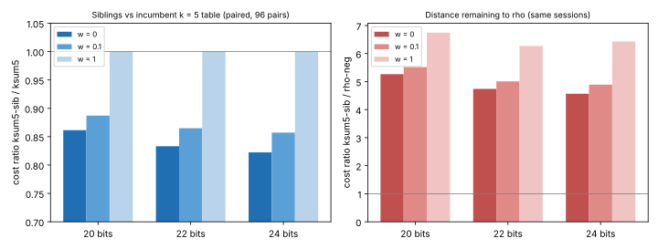

# x-only siblings in the k = 5 sum-table build (P2 KSUM-SIB), and the P1 x(iP) recurrence probe (2026-11-18)

Every number here is `[pcc:unverified]`. Protocol [`PROTOCOL.md`](PROTOCOL.md), frozen with the code in `b01bb12ed0` before any measured row. Runner `run.sh`; sessions `sessions/P20,P22,P24`; comparisons `compare-*.txt`; band `band-*.txt`; audits `audit-*.json`; `summary.json`; graph `ksum_sib.{svg,png,pdf}`. Bench record `benchmarks/records/20261118T0247Z-ksum-sibling-p2.json`. The two leads came from this session's idea-generator round (P1, P2, P3).

## P2: the change

`ksum:m=5,sib=1`: at the table's last level, each base pair ±P gives both keys x(S + P), x(S − P) from one inversion (`CountedGroup::sibling_pair`), charged as one group addition plus one `sibling_second_points` (sqr + 2 add), as in the walk's `sib`. The table, keys, witnesses, collisions and insert order are identical to the incumbent's (unit test `sibling_build_is_the_same_table_with_one_inversion_per_last_pair`).

## P2: result (three Table B curves, 48 public targets each, 2 rounds, L0, counted cost)

| bits | ksum5-sib / ksum5, w = 0 [95%] | w = 0.1 | w = 1 | A/A | setup GAE per solve, ksum5 → sib | ksum5-sib / rho-neg (w = 0 / 0.1 / 1) |
|---|---|---|---|---|---|---|
| 20 | 0.863 [0.860, 0.866] | 0.887 | 1.000 | 1.000 | 3,432 → 2,424 | 5.26 / 5.52 / 6.74 |
| 22 | 0.835 [0.831, 0.839] | 0.865 | 1.000 | 1.000 | 6,282 → 4,266 | 4.74 / 5.01 / 6.27 |
| 24 | 0.825 [0.820, 0.830] | 0.857 | 1.000 | 1.000 | 10,802 → 7,106 | 4.57 / 4.89 / 6.43 |

- **P-a held:** 576/576 runs verified per size; every replay reproduced (384 per size); 96/96 paired runs per size made identical trials and relations. The only difference is the table build, which drops by exactly the number of sibling pairs (1,008, 2,016 and 3,696). [pcc:unverified]
- **P-b held:** the ratio is below 0.95 at every size, with every upper 95% end below 1 and A/A exactly 1.
- **P-c failed at w = 1:** there the ratio is exactly 1.000 at every size. The band prices each `sibling_second_points` at w GAE, so at w = 1 a pair costs two GAE, the same as two additions. The order holds at w = 0 and 0.1 only.
- **Verdict under the frozen rule:** P-a and P-b hold, P-c does not, so this is not an improvement across the whole band. The kill rule does not fire (w = 0.1 is below 0.95). Read it as a 14–18 % cut at w = 0 and 11–14 % at w = 0.1, and a tie at w = 1 by construction of the pricing. The w = 1 reading prices the second point (one squaring and two additions) as a whole group addition.
- **Wall time:** end to end 1.01×, 0.98× and 0.93× of the incumbent; the per-GAE wall cost rises because the same field work is charged as fewer GAE.
- **Distance remaining to rho:** 4.6–5.3× at w = 0 and 6.3–6.7× at w = 1.
- **Not done:** not a leaderboard or `benchmarks/README.md` row, because the validation gate needs an independent replay certificate and validator report, which were not produced. L0 only, one host, no isolation.

## P1: does x(iP) satisfy a polynomial-coefficient linear recurrence? Killed.

`p1_recurrence/p1_holo.rs` (Rust, pre-registered by the idea generator; compiled and run here; output `p1_recurrence/p1_out.txt`). The probe searches for a recurrence Σ_{a ≤ d} c_a(i)·x(iP)_{i+a} = 0 with deg c_a ≤ r and (d+1)(r+1) ≤ E/2 unknowns, at d = 1..16, on five prime-order curves with p ≈ 2^10 (N ≈ 1,009–1,061).
- **Positive control:** i! mod 2003 gives kernel 1 at (d, r) = (1, 1).
- **Negative control:** a xorshift sequence gives kernel 0 at every d.
- **Curves:** kernel 0 at every d on all five. No low-complexity holonomic structure is visible, so the lead is closed under its kill rule.

## P3 (not run)

The small-denominator inverse table changes only field work inside pair additions, already charged as whole GAE. It can move the cost only at w > 0, and by the proposal's own estimate on about 2 % of the k = 5 arm. Deprioritised.
