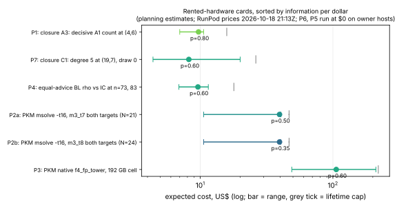

# IC leads on rented hardware: launch-ready cards (2026-10-18)

Owner request 2026-10-18: make every rented-hardware lead of the IC leads follow-up ready to launch the moment the RunPod balance is topped up. At writing it is about $21, with other campaigns' pods spending about $5.45/h. **No experiment pod was launched.** The only pod was the PMU probe (item 5): about 3.5 minutes on the cheapest CPU instance, under one cent, terminated.

Every card gives the host flavour, $/h (RunPod secure-cloud prices queried 21:13Z through `launch.py prices`), expected hours, expected cost, the exact launch command, and how results come back. Each card's protocol amendment was frozen before any of its data exists. All launches go through `research/dreg_closure_m4l6_20261018/pod/launch.py` with `RUNPOD_API_KEY` in the environment. The key now reaches curl on stdin, never argv, and is never placed on a pod.

## Cards, sorted by information per dollar

"p" is the card's own stated chance of reaching a non-inconclusive row of its decision rule. It is a judgment, not a measurement. The sort is by p ÷ expected cost; the two $0 cards run on the owner's machines. The minimal variants (P4-min, P2-min) sit next to their full cards; they are the configurations that fit the about $12 left after P1 and P7.

| # | run | card | host | $/h | expected h | expected cost (range) | cap | p |
|--:|---|---|---|--:|--:|--:|--:|--:|
| P6 | cross-host inherited-F4 counter drift: aarch64 half | [`cross_host/README.md`](../inherited_f4_replay_determinism_20261018/cross_host/README.md) | owner's Apple-silicon Mac (RunPod has no aarch64) | 0 | ≈ 1 | **$0** | — | 0.8 |
| P5 | K conversion at degree 4, N = 34–44, hardware counters | [`k_conversion_perf/LAUNCH.md`](k_conversion_perf/LAUNCH.md) | owner's Linux host with a PMU (not RunPod: probe below) | 0 | 18.5 (2–37) | **$0** | — | 0.8 |
| P1 | closure A3: decisive A1 count at (m, ℓ) = (4, 6), 3,000 fresh draws in parallel (**running**: pod `6sh5qyoyusv6ux`, launched 21:50Z by the parent session from `ee7a5d972`) | [`closure_a3/LAUNCH.md`](closure_a3/LAUNCH.md) | `cpu3m-32-256` | 1.76 | 5.5 | **$9.70** ($7.00–$10.60) | $15.84 | 0.8 |
| P7 | closure C1: degree 5 at m = 3, (19, 7), draw 0, above 280 GB (**running**: pod `9g6slrqws33cr8`, launched 21:50Z by the parent session; no 2 × L40 was available) | [`closure_c1/LAUNCH.md`](closure_c1/LAUNCH.md) | `cpu3m-64-512` (planned: 2 × L40 at $1.64/h, $8.20) | 3.52 | 5.0 | **$17.60** ($9.50–$43.00) | $56.32 | 0.6 |
| P4 | equal-advice BL rho vs compact-orbit IC, n = 73 and 83 | [`equal_advice_wide/LAUNCH.md`](equal_advice_wide/LAUNCH.md) | `cpu3g-32-128` | 1.28 | 7.5 | **$9.60** ($6.90–$11.50) | $17.92 | 0.6 |
| P4-min | the same, n = 83 only (minimal) | [`equal_advice_wide/LAUNCH.md`](equal_advice_wide/LAUNCH.md) | `cpu3g-32-128` | 1.28 | 3.5 | **$4.50** ($2.80–$5.90) | $7.68 | 0.6 |
| P2-min | PKM msolve `-t 16`, m3_t7 target 0 only, 6 h wall (minimal; reads H0 only) | [`pkm_msolve_mt/LAUNCH.md`](pkm_msolve_mt/LAUNCH.md) | `cpu3m-16-128` | 0.88 | 6.6 | **$5.80** | $6.60 | 0.3 |
| P2a | PKM m = 3, N = 21, msolve `-t 16`, both t7 targets, 22 h wall | [`pkm_msolve_mt/LAUNCH.md`](pkm_msolve_mt/LAUNCH.md) | `cpu3m-32-256` | 1.76 | 22.5 | **$39.60** ($10.60–$40.50) | $46.73 | 0.5 |
| P2b | PKM m = 3, N = 24, msolve `-t 16`, both t8 targets (target 1 never run) | [`pkm_msolve_mt/LAUNCH.md`](pkm_msolve_mt/LAUNCH.md) | `cpu3m-32-256` | 1.76 | 22.5 | **$39.60** ($10.60–$40.50) | $46.73 | 0.35 |
| P3 | PKM native `f4_fp_tower` 192 GB cell (frozen 2026-10-16) | [`pkm_f4_tower/LAUNCH.md`](pkm_f4_tower/LAUNCH.md) | `cpu3m-32-256` | 1.76 | 60 (28–120) | **$106** ($49–$211) | $220 | 0.6 |

**Totals (rented, expected):**

| scope | expected | at the lifetime caps |
|---|--:|--:|
| P1 + P7 (running, as launched) | **$27.30** | $72.16 |
| + P4-min + P2-min (the about $12 left) | **$37.60** | $86.44 |
| P1 + P7 + full P4 | **$36.90** | $90.08 |
| + P2a + P2b | **$116.10** | $183.54 |
| + P3 | **$222.10** | $403.54 |

Already done: **P0, the PMU probe** ([`pmu_probe/README.md`](pmu_probe/README.md)). RunPod hosts have a PMU, but `perf_event_paranoid = 4` gives EPERM for cycles and instructions inside the container. That is why P5 runs on the owner's host.

`cards.json` holds the numbers above; `plot.py` draws `cards.svg/png` from it; `REPORT.pdf` is the same as a report.

## What changed in the repository for these cards

- `examples/dreg_ladder.rs`: `--shard I/J --first-draw F`. Each shard samples the cell's one sequential stream for every draw and measures only its residue class, so draw generation runs on every core and every draw is the one the sequential run gives. Tested against committed draws: `tests/shard_replay_20261018/` and `tests/a3_steps_20261018/`.
- `research/dreg_closure_m4l6_20261018/`:
  - PROTOCOL.md §11 (amendment A3);
  - `run.sh` steps `gen-a3` (replay gate, then the fixed fresh range), `measure-a3` and `tally-a3`, plus `deg5`'s `DEG5_MIN_LIMIT`;
  - a fix to the cgroup-limit reader. An unlimited cgroup v1 limit overflowed `A`; that never happened on a pod.
- `pod/boot.sh`:
  - jobs `a3`, `c1`, `pkm-msolve-mt`, `ea-wide`;
  - a shallow clone;
  - `bc` installed (the first msolve pod's `.mem` files lack `wall_s` without it);
  - a configurable serving window (`SERVE_SECONDS`).
- `pod/launch.py`:
  - the key goes to curl as a config on stdin;
  - `prices` (GraphQL);
  - `fetch` (mirror a served sub-path);
  - `--boot`, `--dry-run`, and a comma list for `--gpu`.
- `research/pkm_m3_n21_msolve_20261018/`: Amendment A1 and `run_mt.sh` (`run.sh` with `-t`).
- `research/k_conversion_20261018/`: `PROTOCOL_AMENDMENT_A1_perf.md`, `perf/run_perf.sh`, `perf/analyze.py`, and `examples/k_conversion_perf.rs`.
- `research/inherited_f4_replay_determinism_20261018/cross_host/`: the owner's macOS/aarch64 script and the x86-64 half of the node dump.
- `equal_advice_wide/job.sh`: a pod wrapper. The frozen `run.sh` and `PROTOCOL.md` are unchanged; two problems found in them are listed in the P4 card.

## How to run any card

1. Top up the balance. Check prices with `python3 research/dreg_closure_m4l6_20261018/pod/launch.py prices`.
2. Run the card's launch command from a checkout of `main` after this PR merges (pods clone `--branch main`).
3. Watch `https://ID-8000.proxy.runpod.net/STATUS`. Fetch with `launch.py fetch ID DEST --path …` as the card says, then `launch.py terminate ID`.
   - A pod whose container has ended may still bill (or restart) until it is terminated.
   - Never fetch the top level recursively: it links the whole clone.
4. Commit the records and write the result by the card's frozen rule, with a run report (research-visuals skill).
