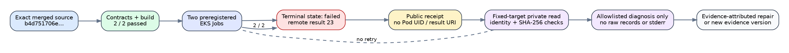

# Prime-IC line-layout tournament: terminal run report

**Run start:** 2026-11-01 01:21 UTC\
**Source:** `b4d751706eb2244314ebc9b84ba9545485ba4ac7`\
**Native SHA-256:** `0784fe47212d64dd2ee81510d3c28d2f604782086500135a3114c61738f854b7`\
**Outcome:** both preregistered EKS jobs terminated failed; performance decision unavailable.

The diagram is descriptive. It contains no timing or inferred speed result.
Its editable source is [`failure-flow.dot`](failure-flow.dot), with an SVG copy
at [`failure-flow.svg`](failure-flow.svg).

## Requested scope and evidence status

- **Two concurrent EKS sessions — verified complete.** Workflow runs
  41260778029 and 41260778856 bind the exact source and native binary.
- **Unchanged scientific gates — preserved but not completed.** Both Jobs
  failed before a successful payload was authenticated; no threshold changed.
- **End-to-end speed decision — blocked.** Neither run returned an
  authenticated session directory or comparison.
- **Zero outcome-driven retries — verified complete.** Exactly the two frozen
  trials ran and both failures are retained.
- **Privacy-preserving diagnosis — implemented but not yet run.** The fixed
  workflow emits only allowlisted failure metadata and hash-verifies every
  downloaded payload object that has a retained manifest.

## Observed execution

Both workflows passed their contract and credential-free build jobs. EKS Jobs
`gh-41260778029-1` and `gh-41260778856-1` then returned launcher state
`failed`, remote-result exit 23 and GitHub wrapper exit 26. The public receipts
contain Job UIDs but empty successful Pod UID and results URI fields.

The public evidence does not distinguish payload execution, native audit, L2,
A/A, owner instrumentation or infrastructure failure. The private launcher
prefixes retain `status.json`, `objects.json`, logs and any uploaded payload
artifacts. Raw records and stderr remain private.

## Excluded local diagnostic

The exact retained binary planned 360 executions and, under explicit
`--allow-busy`, verified all 360 outcomes and reproduced all 320 replay-eligible
records. Every execution graded L0 because this host lacks the required PSI
evidence. Those observations are correctness diagnostics only; their wall
values are not admitted and are not graphed or promoted.

\newpage

## Evidence-preserving diagnosis

The follow-up workflow is read-only and fixed to the two recorded workflow,
Job, launcher, request, source and binary identities. It validates the normalized
request hash, downloads only allowlisted diagnostic objects, checks each object
against the retained `SHA256SUMS`, and publishes a compact classification. It
does not run the binary, submit or retry a Job, print raw logs, or upload raw
measurements.

## Sources checked

- [`taskq/deploy/eks-karpenter/HARNESS.md`](../../../../taskq/deploy/eks-karpenter/HARNESS.md): request identity, failure states and private-result boundary.
- [`taskq/deploy/eks-karpenter/ACCESS.md`](../../../../taskq/deploy/eks-karpenter/ACCESS.md): existing GitHub OIDC role and scoped S3 read route.
- [`taskq/deploy/eks-karpenter/remote/run-request`](../../../../taskq/deploy/eks-karpenter/remote/run-request): exact launcher receipt and artifact locations.
- [GitHub OIDC with AWS](https://docs.github.com/en/actions/how-tos/secure-your-work/security-harden-deployments/oidc-in-aws): short-lived workflow identity; no static key is introduced.

## Claim and graph boundaries

This failed run supplies no admitted quantitative comparison. The index-calculus
scoreboard, leaderboard, progress timeline and lab browser were checked and left
unchanged because there is no verified numeric result to add. No `benchmarks/`
entry is created because no performance measurement was admitted.

The relation-yield pruning instrumentation from PR #3091 is a separate merged
engineering deliverable. This run report does not convert that instrumentation,
the line-layout implementation, or workflow success into an end-to-end speedup.
