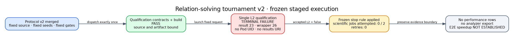

# Prime-IC relation-solving tournament v2: preflight report

**Qualification start:** 2026-11-01 04:00 UTC\
**Frozen protocol:** `IC-LINE-LAYOUT-E2E-FP20-V2-20261101`\
**Tested source:** `ea8e9ef71c3c82027dd9e01535302725519c3fca`\
**Outcome:** the single L2 qualification failed; the scientific tournament was
not dispatched.

The diagram is an execution-accounting graphic, not a performance graph. Its
editable source is [`failure-flow.dot`](failure-flow.dot), with an SVG copy at
[`failure-flow.svg`](failure-flow.svg).

## Requested scope and evidence status

| Requested or required item | Status | Evidence |
|---|---|---|
| Merge a frozen v2 protocol before data | Complete | PR #3151, merge `ea8e9ef71c3c82027dd9e01535302725519c3fca` |
| Run one fixed L2 qualification | Terminal failure | [Workflow 41271383665](https://github.com/isogeny-labs/crypto/actions/runs/41271383665) |
| Launch two scientific sessions only after accepted L2 | Not attempted | Frozen fail-closed rule applied |
| Analyze complete relation-solving pipelines | Unavailable | No results URI or authenticated session directory |
| Preserve zero outcome-driven retries | Complete | One qualification attempt; zero retries, replacement seeds or scientific jobs |
| Establish an end-to-end ECDLP speedup | Not established | Zero admitted performance rows or comparisons |

The execution counts are qualification planned/attempted/terminal/accepted-L2
`1/1/1/0` and scientific jobs conditionally planned/attempted `2/0`. This is a
terminal observation of the frozen v2 design, not candidate data.

## Identity-bound terminal receipt

The workflow contract and build jobs passed. Artifact `13069693394`
(`isolab-build-41271383665-1`) contains the build bound to the tested source; its
82,666,555-byte archive digest is
`sha256:29ab639216eadbc2041bd92467d98fb7a7d774f2bd0e0990b0f9f095a3bddd4d`.
The experiment job downloaded that exact digest, published immutable image
`sha256:3c4ad8bf8ee1bd1fdc327cb4c0e2597a1fc5ef1cdd889aa21e1b1294bdd22914`,
and launched the fixed request with native binary SHA-256
`73362eed4165d6db20fe1d398baa8fabefa2497aff6e78dab9ed8f31af31dd01`.

| Receipt field | Observed value |
|---|---|
| Workflow source revision | `e443a60f00839aa84a7734053b8d6b5b0bad0f40` |
| Tested source revision | `ea8e9ef71c3c82027dd9e01535302725519c3fca` |
| Qualification spec | `taskq/deploy/eks-karpenter/l2-validation.json` |
| Job / UID | `gh-41271383665-1` / `06bc6798-a65b-4805-9e43-47f16be8d97f` |
| Launcher ID | `c4090885-9236-4b36-8dba-8cea6f746655` |
| Request SHA-256 | `9e4c461dd35f5301360efb1a67351d6097735857d79cc79ae055427684f70971` |
| Terminal state | `failed`; remote-result exit 23; wrapper exit 26 |
| Successful Pod UID / results URI | absent / absent |

The receipt proves a terminal infrastructure-qualification failure. It does not
identify a payload exit code, an L2 predicate or a scientific result. The older
v1 diagnosis found exit 42 at `l2_isolation_gate` for two different fixed Jobs;
that classification is not transferable to this v2 qualification.

## Stopping rule and missing export

Protocol SHA-256
`0dc2be59cd4860fae6775d0dff823c1025d4fa999b2c9550bd4d7e19c030f92b`
required a manifest-verified accepted-L2 qualification before scientific
dispatch. The failed launcher receipt has no successful Pod UID or results URI,
so it cannot satisfy that gate. Both scientific sessions were therefore left
unsubmitted. There was no GitHub rerun, replacement seed, host selection,
factor-base retuning or threshold change.

The frozen analyzer accepts two authenticated `ecbench.session/v1`
directories. This run produced none. Consequently there is no honest
`experiment.export/v1`, replay receipt, A/A comparison, positive-control
comparison, candidate interval or numeric graph to publish. A flow diagram is
used because fewer than two comparable values—and in fact no timing values—are
available. The scoreboard, leaderboard and `benchmarks/` archive are unchanged.

## Evidence limits and next discriminating step

The public launcher receipt is the highest evidence available here. It carries
the fixed request, build and Job identities but no payload classification or
manifest-verified L2 detail. It is sufficient to apply the frozen stop rule and
insufficient to attribute the exact infrastructure cause. No candidate repair
or algorithmic conclusion follows from it.

The existing problem record requires either narrowly authorized,
manifest-bound diagnosis or a separately reviewed infrastructure
qualification. That future work must not rewrite this consumed qualification
or broaden its evidence into a speed claim. A new scientific evidence version
would still need the unchanged L2, replay, exact-operation, A/A,
positive-control and two-session confidence gates.

## Sources checked

- [`PROTOCOL-V2.md`](../../PROTOCOL-V2.md) and
  [`protocol-v2.json`](../../protocol-v2.json): frozen staged rule, claims and
  analysis boundary.
- [`taskq/deploy/eks-karpenter/HARNESS.md`](../../../../taskq/deploy/eks-karpenter/HARNESS.md):
  request identity, launcher result and private-payload boundary.
- [`taskq/deploy/eks-karpenter/ACCESS.md`](../../../../taskq/deploy/eks-karpenter/ACCESS.md):
  short-lived workflow identity and scoped artifact route.
- [GitHub workflow 41271383665](https://github.com/isogeny-labs/crypto/actions/runs/41271383665):
  exact build, publication and terminal public receipt.
- [`V2-PREFLIGHT-OBSERVATION-20261101.md`](../../V2-PREFLIGHT-OBSERVATION-20261101.md):
  concise human observation with the machine record beside it.

## Claim boundary

Relation-yield pruning instrumentation from PR #3091 is separately merged
engineering work. This preflight contains no scientific relation-solving
session and no admitted end-to-end timing. The full ECDLP index-calculus
speedup claim remains unestablished.
