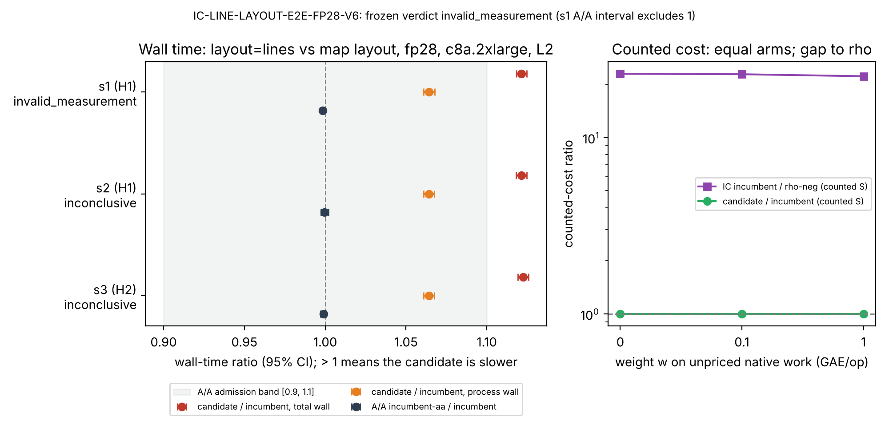

# IC line layout, v6 end-to-end tournament on fp28: results

**Verdict: `invalid_measurement`. This is not an improvement.** [pcc:unverified]

Under the frozen rule (DECISION-V6-REDESIGN-20261106.md §16), the combined
verdict is `invalid_measurement` because session s1 failed the A/A gate. Sessions
s2 and s3 each pass every gate except the one a speedup needs: the candidate's
total wall-time interval lies above 1, not below it. `layout=lines` is about
12 % slower in wall time than the incumbent, at exactly equal counted cost.
[pcc:unverified]

- Tournament: `IC-LINE-LAYOUT-E2E-FP28-V6-20261106`, as amended by V6-AMENDMENT-1
  (merged in #3531).
- Protocol sha256 (canonical): `2aedaaf8dd64f7bb7a481c25efc02a561022b9ebb85b78dac8fd53863b689873`.
- Incumbent: `prime-abscissa:size=407`, `mitm:negation_folded=1`, `targets=walk`.
- Candidate: the same arm plus `layout=lines`.
- Positive control: `pc-fb2x`. Rho references: `rho-neg` and its A/A twin
  `rho-neg-aa`.
- Hosts: c8a.2xlarge on EKS Spot. All sessions passed the L2 gate.
  - Host epoch H1 (sessions s1 and s2) and host epoch H2 (session s3) ran on
    distinct nodes.
- Pins:
  - image `isolab/tasks@sha256:3c4ad8bf…bd22914`
  - ecbench binary `73362eed…31dd01`
  - analysis script `analyze-v6.sh` `23e614ad…`

## Per-session wall-time results (candidate / incumbent, 128 pairs each)

| Session | Verdict | Total ratio (95 % CI) | Corrected ratio (95 % CI) | Process ratio (95 % CI) | A/A ratio (95 % CI) |
|:--|:--|:--|:--|:--|:--|
| s1 (H1) | invalid_measurement | 1.1214 [1.1183, 1.1246] | 1.1232 [1.1197, 1.1268] | 1.0643 [1.0608, 1.0679] | 0.99839 [0.99687, 0.99992] |
| s2 (H1) | inconclusive | 1.1216 [1.1183, 1.1249] | 1.1220 [1.1178, 1.1262] | 1.0643 [1.0609, 1.0676] | 0.99964 [0.99729, 1.00199] |
| s3 (H2) | inconclusive | 1.1225 [1.1193, 1.1258] | 1.1237 [1.1200, 1.1275] | 1.0641 [1.0608, 1.0675] | 0.99893 [0.99722, 1.00064] |

- **s1:** the frozen `aa_inside_0_9_1_1` gate evaluated false. The A/A
  interval [0.99687, 0.99992] does not contain 1. Under the frozen rule, that
  invalidates the session and, with it, the combined verdict. [pcc:unverified]
- **s2 and s3:** the only failing gate is `total_and_corrected_ci_below_1`.
  Both intervals lie above 1. [pcc:unverified]
- **All three sessions:**
  - The positive control was detected.
  - The replay passed.
  - The s1 determinism check was byte-equal.

## Counted cost (separate counted session, both curves, 64/64 runs checked per arm)

| Native-work weight w (GAE per op) | Candidate / incumbent (95 % CI) | IC / rho-neg (95 % CI) |
|--:|:--|:--|
| 0 | 1.000 [1.000, 1.000] | 22.998 [20.153, 26.244] |
| 0.1 | 1.000 [1.000, 1.000] | 22.869 [20.011, 26.136] |
| 1 | 1.000 [1.000, 1.000] | 22.281 [19.346, 25.662] |

- **Candidate against incumbent:** the counted cost is identical at every
  weight, and the order is unresolved across the §5a band.
- **Rho references:** both rho arms beat both IC arms at every weight.
- **Distance remaining:** the incumbent IC is about 22–23× matched negation
  rho in counted cost on fp28. That is the gap still to close; it is not a gate.
  [pcc:unverified]

## Figure

The figure is also available as [SVG](v6-wall-and-counted.svg) and
[PDF](v6-wall-and-counted.pdf). [`plot_v6.py`](plot_v6.py) regenerates it from
[`summary.json`](summary.json), which is derived from `analysis-a/` and
`analysis-b/`.

The pc-fb2x corrected ratio of 0.579 is omitted from the figure. It is a
property of the positive control, not of the candidate.

## Interpretation (coordinator §16)

- **H-layout:** `weaken`. [pcc:unverified]
  - P-wall (a wall-time speedup) is not supported.
  - P-parity (counted parity) held.
- **Lead status:** the `layout=lines` lead is closed for fp28 on c8a.2xlarge.
  §16 states the reopening conditions.
- **Not reported here:**
  - There is no benchmarks row.
  - There is no leaderboard section.
  - No `VALIDATION.json` row is committed, because this is not an improvement.
- **Disclosure:** the coordinator saw the wall block of the counted session
  by accident. That block was not used.

## Evidence

- `analysis-a/` holds the frozen analysis of sessions s1 and s2.
- `analysis-b/` holds the frozen analysis of sessions s3 and s1.
- [`ANALYSIS-SHA256SUMS`](ANALYSIS-SHA256SUMS) hashes both directories.
  - The files were copied byte for byte from the frozen analysis runs.
  - Empty `.stderr` files were dropped.
- `../../eks-results-v6/{s1,s2,s3,counted}/` holds the job exit records,
  runner identity, L2 gate, build info and audit output for each job,
  with the S3 SHA256SUMS of each job.

## Independent validation (VAL-20261106-9ce3e6)

**Validator verdict: passed, with caveats.** [pcc:unverified] The full report
is [`validation/VALIDATION-REPORT.md`](validation/VALIDATION-REPORT.md).

**Checks:**
- **Hashes:** the SHA256SUMS and job-exit records of all four jobs are
  byte-equal to their S3 originals.
- **Freeze hashes:** both reproduce (`2aedaaf8…` and the prior `12415faa…`).
- **Replay:** `ecbench verify --replay-all` was 512/512 identical in each of
  s1, s2, s3 and counted.
- **Recompute:**
  - The validator wrote its own code ([`validation/scripts/`](validation/scripts/)),
    which shares nothing with the producer's analysis.
  - The largest relative difference across all compared values was
    6.3e-16, against a tolerance of 1e-9 set in advance.
- **Gates and verdicts:** re-derived independently from the frozen rule text,
  with the same result (s1 `invalid_measurement`, s2 and s3 `inconclusive`).
- **Counted parity:** 0 mismatched cells.

**Caveats:**
- The replay uses the producer's pinned binary. It shows determinism, not an
  independent implementation.
- The raw `records.jsonl` files stay in S3 and are not in git. Their sha256
  values are:
  - s1 `bc60833b…`
  - s2 `ab4be90e…`
  - s3 `9aa25936…`
  - counted `1a7f3faa…`
- No VALIDATION.json is committed, because this result admits no row.

The A/A column above is `aa_ratio`, the point estimate paired with `aa_ci95`.
The analysis also writes `aa_median_ratio`, which is not used here.
