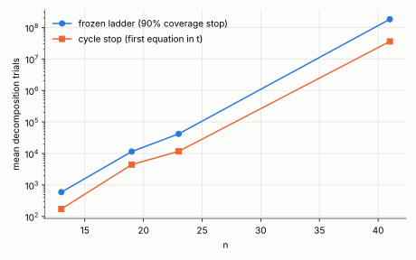
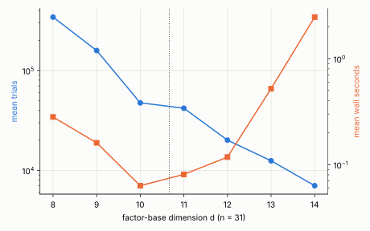

# New leads for the algebraic IC: prior art, a cycle stop, torsion anchors

**Status: exploratory.** No frozen protocol, no replay certificate, no validator
report, so nothing here is a leaderboard or benchmarks row. Producer:
`examples/ic_m2_cycle.rs` (branch `claude/ic-m2-cycle-stop-20261029`). Raw
records: `raw/`. One thread of a shared 4-vCPU cloud container; the n = 41 run
overlapped a d-sweep, so its same-process rho time is noisy (about 10 ms).

## Summary

1. **The landed ladder is not new algebra.** Two repository sweeps and a
   literature pass found the same construction earlier (below). The packaging
   (symmetric `s, p`, the no-reduction window `2d − 1 ≤ n`, the `2^{3d−1−n}`
   floor) was not found as a stated theorem, so it is at most an exposition.
2. **A cycle stop is a constant-factor gain.** 5.1× fewer trials and 5.3× less
   wall time at n = 41; 2.6–3.6× at n = 13–23. Same exponent.
3. **Torsion-randomized anchors make large-cofactor curves workable.** a = 0,
   n = 37 (cofactor 596) was stopped unfinished by the ladder after 99 s; it is
   solved here in 26 and 31 s. They *cost* 1.5× (n = 23) to 16× (n = 31) on
   cofactor-4 curves, so they are for large cofactors only.
4. **The wall-time optimum stays at d ≈ n/3.** Trials keep falling for larger d,
   but the per-trial solution enumeration grows as `2^{3d−1−n}`.
5. **Beating rho is closed for this family** if the ceiling argument below
   holds. The distance is about 9,700× at n = 41.

## Measurements

Same seed and secrets as the frozen ladder (`ic_m2_linear`, seed 20261024), so
rows pair by target. Every row verified (`[t]G = T`); the counters
`ic_bad_t` and `ic_inconsistent` were 0 on all rows.

| a | n | d | targets | ladder mean trials | cycle mean trials | ratio |
|--:|--:|--:|--:|--:|--:|--:|
| 0 | 13 | 4 | 8 | 592 | 172 | 3.4 |
| 0 | 19 | 6 | 8 | 11,477 | 4,427 | 2.6 |
| 1 | 19 | 6 | 8 | 12,077 | 3,961 | 3.0 |
| 0 | 23 | 8 | 8 | 41,856 | 11,678 | 3.6 |
| 1 | 23 | 8 | 8 | 48,821 | 18,521 | 2.6 |
| 0 | 41 | 14 | 4 | 181,803,464 | 35,847,188 | 5.1 |

n = 41 wall: 478.4 s (ladder) → 90.1 s (cycle), 5.3×. Per-target trial ratios
there are 7.2, 3.1, 2.9 and 50.7 (the last target stopped very early), so the
mean ratio is driven by four draws; treat the 5× as a point estimate with a
wide interval. Against this run's same-process strong rho (9.3 ms mean) the
cycle variant is 9,700× slower; the ladder's own record gave 36,440× because
its rho draws were slower (13.1 ms), and rho times at this scale are noisy.

**Torsion anchors** (`raw/cyc_tors_*`, `raw/cyc_a0_n31_t*`, `raw/cyc_a0_n23_t*`):

| curve | cofactor | torsion | mean trials | wall | verified |
|---|--:|--:|--:|--:|--:|
| a = 0, n = 37 | 596 | on | 16.4 M | 28 s | 2/2 |
| a = 0, n = 31 | 4 | off | 47,411 | 0.06 s | 4/4 |
| a = 0, n = 31 | 4 | on | 744,299 | 0.97 s | 4/4 |
| a = 0, n = 23 | 4 | off | 11,678 | | 8/8 |
| a = 0, n = 23 | 4 | on | 17,062 | | 8/8 |

The n = 37 run is two targets with no torsion-off comparison (the ladder could
not finish it), so the claim is "solvable", not a measured speedup.

**d-sweep at n = 31** (`raw/dsweep_*`, 4 targets each): trials 342k, 158k, 47k,
42k, 20k, 12k, 7k for d = 8…14; wall 0.28, 0.16, **0.063**, 0.080, 0.117,
0.52, 2.46 s. Minimum at d = 10 ≈ n/3.

## Prior art (what not to re-propose)

Repository paths are relative to `research/` of the `crypto` repository.

- Linear (A, P) oracle over a geometric V, n = 19–31: `geometric_v_linear_20261006`.
- Union-find, no linear algebra, n = 13–23, projected 2^85.7 at n = 131:
  `graph_cycle_ic_20261007` (its walk found a rho collision first in 20/20 runs).
- Same idea in the cryptanalysis repository: `experiments/linearized-half-decomposition`.
- Literature (read this session by a survey agent, claims marked there as
  verified from the PDF or from the abstract): Faugère–Perret–Petit–Renault
  2012 (subspace base, linearization, n = 41 and 131 tables), Petit–Quisquater
  2012, Kosters–Yeo 2015 (the S3 trace morphism gives first fall degree 2),
  Karabina and Semaev 2015 (chained S3), Galbraith–Gebregiyorgis 2014,
  Caminata–Ceria–Gorla 2023 (d_reg grows linearly in n).

**Ceiling argument (from the repo, not re-derived here):**
`decomposition_programme_20261016/PLAN.md` states that for prime n,
`dim(V·V) ≥ 2l − 1` (Hou–Leung–Xiang), so any pair test over a subspace base
needs about `2^{n−l}` tests and loses to rho unless `l > n/2`, which that bound
rules out. Even a free pair solver would only reach rho parity. I have not
independently checked this bound.

My own arithmetic check: a naive hybrid (guess `g` variables, linearize the
rest of the `2d`-variable quadratic system in `n` equations) costs about
`2^{2d − √(2n)}`, worse than the `2^{3d−1−n}` enumeration whenever
`d < n + 1 − √(2n)`, so it does not help in the range of interest.

## Leads, ranked

| # | lead | status | why |
|--:|---|---|---|
| 1 | Torsion anchors for large cofactors (N83 a = 1, h ≈ 1.1·10⁹) | **tested at h = 596; not at N83** | Only lead the sweeps found untried; first positive result. Next: n = 41 and 43-ish rungs with h ≥ 10³, torsion on/off. |
| 2 | Mixed-conjugate excess `dim(V·V^{2^k}) − (2l−1)` (W2) | proposed, not run | Could add free relations without changing the base. |
| 3 | 4–5-summand test inside a frozen budget (W3) | not run | Uses `S4 = G²` as one condition. Prior 13/40 → 0/40 full rank at l = 5, 6 (n = 131) limits reach. |
| 4 | Crossbred / last-fall-degree on Weil-descended S systems | never beyond n = 9 | Cheap instruments; end-to-end enumeration beat crossbred 3.4–1800× at n ≤ 13. |
| 5 | Splitting predicate as bilinear/MinRank for d in (n/3, n/2) | open, low ceiling | Best case approaches rho parity, not below it. |
| 6 | Decisive Weil-descent cell (m, l) = (4, 6) | blocked on about 70 GB | Memory, not ideas. |

**Caution on n = 41:** the survey agent notes
`ord_41(2) = 20`, so F_{2^41} has 20-dimensional Frobenius-invariant subspaces
and n = 41 is unrepresentative of n = 83 (`ord_83(2) = 82`) and n = 131.

## What this does not show

- No exponent change: the cycle stop is a constant factor (fit not rerun).
- Four targets at n = 41 and eight below; one container; no validator.
- The torsion result is one curve, two targets.
- Nothing extrapolates to N83. On a = 0 the projected cost is still about 2^55
  trials against 2^37 rho steps (from the landed report); on a = 1 torsion
  anchors are untested.
