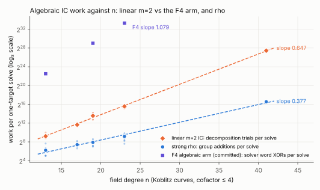
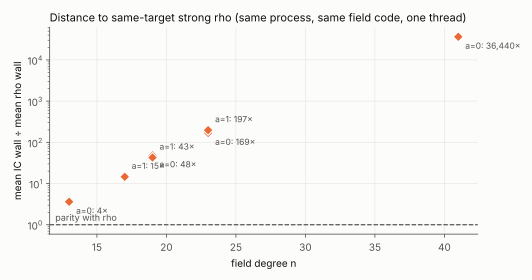

# Algebraic index calculus with a linear two-summand decomposition

**Result.** A Koblitz-curve index calculus whose relations come from solving the
Weil descent of Semaev's third summation polynomial over a subspace factor
base solved every target on seven rungs, n = 13 to 41 (52 one-target DLPs, each
verified as `[d]G = T`). Its work grows with a fitted slope of **0.647
[0.639, 0.655]** in log₂(decomposition trials) per bit of n (model 2/3). The
repository's F4 algebraic arm grows at **1.079** in log₂(solver word XORs) per bit
over n = 13–23 and timed out at n = 31. The method completes n = 41 in about 8
minutes per target. It is still far from rho: **36,440×** slower than
same-process strong rho at n = 41, and the gap widens with n.

## Criterion

Owner decision, 2026-10-24: an index-calculus pipeline counts only when its
relations come from solving summation-polynomial systems over an algebraically
defined factor base, without table collisions. The table-collision pipelines
(the N83 K1120 "PDP4root" baseline, `engine=rootfind`, the "aimed m = 3" recipe,
pair enumeration) are excluded. The repository's algebraic baseline is ecbench's
`pdp3-koblitz` with inherited F4 on the Weil descent of S4 over
`span{1..z^{d−1}}`, m = 3 ([`research/f6_ic_ecbench_ladder_20261005`](../f6_ic_ecbench_ladder_20261005/ANALYSIS.json)).

## Method

Factor base: every point whose x lies in `V = span{1, z, …, z^{d−1}}` (polynomial
basis, x ≠ 0), one column per x, `d = ⌊(n+1)/3⌋`. For a point R with known
logarithm, a relation `R = ε1 P1 + ε2 P2` solves

    S3(x1, x2, xR) = (x1 x2 + xR (x1 + x2))² + x1 x2 xR + b = p² + xR p + xR² s² + b,

with `s = x1 + x2 ∈ V` and `p = x1 x2 ∈ span{1..z^{2d−2}}`, which needs no reduction
when `2d − 1 ≤ n`. Squaring is F2-linear, so the Weil descent of S3 is a
**linear** system of n equations in `3d − 1` unknowns. Each solution `(s, p)` is
split by `x1² + s x1 = p` over `F2[z]_{<d}`, which is also linear. Each trial is
two small eliminations, against one F4 run per trial in the baseline. Every
relation is re-added in the group. With two points per relation, the linear
algebra mod r is union-find over the relation graph. A component whose
relations all have balanced signs (as the cofactor forces) is evaluated by
cancellation. Frobenius conjugates of each anchor are extra trials.

Model: a trial succeeds with probability about `2^{2d−n−2}`, and the base has
about `2^{d−1}` columns. A solve therefore takes about `2^{n−d+1}` trials,
smallest at `d ≈ n/3`, giving `2^{2n/3}`. Above `d = (n+1)/3` the linear
system has `2^{3d−1−n}` solutions per trial, so `2^{2n/3}` is this method's
floor.

## Runs

Frozen [protocol](PROTOCOL.md) (committed before timing; development runs on
seed 7 excluded). Binary SHA-256 in [`raw/binary.sha256`](raw/binary.sha256),
thin orchestration in [`raw/run.sh`](raw/run.sh), one thread, this session's
4-vCPU cloud container (L0, shared). Each target runs a cold IC solve, then the
repository's strong rho (`StrongRho`: signed Frobenius, 32 lanes, dp 4) on the
same point, in the same process, with the same `Gf2` field type.

| a | n | d | cofactor | log₂ r | targets | mean trials | mean IC s | mean rho s | IC ÷ rho (wall) |
|--:|--:|--:|--:|--:|--:|--:|--:|--:|--:|
| 0 | 13 | 4 | 4 | 11.0 | 8 | 592 | 0.0004 | 0.00011 | 4 |
| 1 | 17 | 6 | 2 | 16.0 | 8 | 3,231 | 0.0038 | 0.00026 | 15 |
| 0 | 19 | 6 | 4 | 17.0 | 8 | 11,477 | 0.0082 | 0.00017 | 48 |
| 1 | 19 | 6 | 2 | 18.0 | 8 | 12,077 | 0.0078 | 0.00018 | 43 |
| 0 | 23 | 8 | 4 | 21.0 | 8 | 41,856 | 0.046 | 0.00027 | 169 |
| 1 | 23 | 8 | 2 | 22.0 | 8 | 48,821 | 0.071 | 0.00036 | 197 |
| 0 | 41 | 14 | 4 | 39.0 | 4 | 181,803,464 | 478.4 | 0.0131 | 36,440 |

Every IC and rho scalar equals the secret mod r (52/52 each). The check rung
a = 0, n = 37 (cofactor 596) was stopped by the operator after 99 s. Its relation
graph splits into about 298 cofactor classes of about 7 of the 2,048 columns, so
the frozen stopping rule (largest component ≥ 0.9 of the base) cannot be met.
The protocol states this limit, and [`raw/operator-notes.txt`](raw/operator-notes.txt)
records the stop.

## Exponents

Least squares of log₂(rung mean) against n over the seven small-cofactor rungs,
with a 10,000-resample bootstrap of targets within rungs ([`fit.json`](fit.json)):

| quantity | slope per bit of n | 95% |
|---|--:|---|
| linear m=2 IC: trials | **0.647** | [0.639, 0.655] |
| linear m=2 IC: wall | 0.717 | [0.710, 0.724] |
| strong rho: group additions | 0.377 | [0.364, 0.393] |
| strong rho: wall | 0.250 | [0.241, 0.260] |
| F4 arm: solver word XORs (n = 13, 19, 23; committed) | 1.079 | three medians, no interval |

The rho slopes sit below 0.5 because the Frobenius fold divides rho's work by
√(2n), and fixed per-solve costs dominate at the smallest rungs. They are
reported as measured.

## §5a band

The IC's main work is unpriced native work: elimination word XORs plus about 3d
field operations per trial. Its counted group additions come from anchor
steps, factor-base projection and relation checks; rho's come from its walk.
Per solve, from the rung records:

| a | n | IC group additions | IC elimination XORs | rho group additions | IC ÷ rho at 0 GAE | at 0.1 GAE | at 1 GAE |
|--:|--:|--:|--:|--:|--:|--:|--:|
| 0 | 13 | 376 | 14,040 | 74 | 5.1 | 24 | 195 |
| 0 | 23 | 3,193 | 5,039,027 | 674 | 4.7 | 753 | 7,481 |
| 0 | 41 | 4,484,130 | 72,513,368,117 | 96,270 | 47 | 75,370 | 753,276 |

Rho is cheaper at 0, 0.1 and 1 GAE per unpriced operation on every rung, so
the order holds across the band. The rung records keep rho's group additions
and walk steps but not its unpriced counters. Bounding those by three per walk
step (one canonicalization, one partition hash, at most one table access)
raises rho's figure at 1 GAE at most fourfold, far inside the margin (at least
195× at 1 GAE); the IC column also omits its uncounted field multiplications,
which would only raise it. Neither changes the order.

## What this does and does not show

- It lowers the algebraic IC's fitted cost exponent from about 1.08 to about
  0.65 per bit of n, and extends the largest completed algebraic solve from
  n = 23 to n = 41. This is a measured improvement over the algebraic baseline
  under the owner's criterion.
- It does not approach rho. Its floor exponent 2/3 is above rho's 1/2, so the
  distance grows with n (log₂ slope of the ratio ≈ 0.47 per bit).
- **N83.** On the a = 0 curve (cofactor 4, 81-bit subgroup) the method would
  take about 2^{55} trials, against about 2^{37} rho steps. On the a = 1 curve
  (cofactor about 1.1·10⁹) the relation graph fragments as at n = 37, so the
  method does not apply as built.
- **Next levers.** Lowering the exponent below 2/3 needs new algebra. Symmetric
  S4 in (e1, e2, e3) has four nonlinear monomials (s3³, s2²s3, s1²s3, s1²s3²),
  so three summands do not linearize the same way. The large-cofactor case
  needs a factor base or relation scheme that does not split by cofactor
  class.

## Files

`PROTOCOL.md` · `raw/` (rung records, logs, orchestration, binary digest,
operator notes) · `fit.json` (`examples/ic_m2_ladder_fit.rs`) ·
`replay-certificate.json` (`examples/ic_m2_ladder_replay.rs`) ·
`validator-report.json` (independent validator) · `VALIDATION.json` ·
`plot.py`, `work_vs_n.svg/png`, `distance_to_rho.svg/png` · `REPORT.pdf` ·
producer `examples/ic_m2_linear.rs`.
