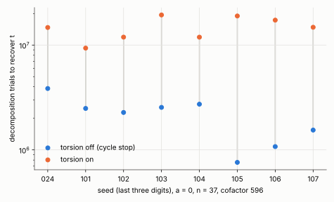

# Torsion anchors on the cofactor-596 curve (a = 0, n = 37)

**Status: exploratory** (local container, no replay certificate or validator report, not a
leaderboard row). Producer: `examples/ic_m2_cycle.rs` (source commit in `raw/source_commit.txt`,
binary SHA-256 in `raw/binary.sha256`). Protocol frozen before data: [PROTOCOL.md](PROTOCOL.md)
(commit 7893863417).

## Result

On a = 0, n = 37 (cofactor 596, d = 12, 2,011 columns), **torsion anchors make the solve about
7.5 times more expensive, not cheaper.** The cycle-stop variant without torsion already solves
this curve, which the frozen ladder (90% coverage stop) could not. Eight paired targets (same
secret, same binary, one target per process); all 16 runs verified (`[t]G = T`), all 8 rho
checks verified, no run reached the 1,800 s cap:

| | torsion off | torsion on |
|---|--:|--:|
| mean trials | 2.16 M (0.76 to 3.85 M) | 14.8 M (9.36 to 19.4 M) |
| mean wall | 3.4 s | 23.9 s |
| relations used (mean, range) | 126 (49 to 220) | 885 (559 to 1,098) |
| trials per relation | 17,062 | 16,707 |
| largest component at the stop (columns, mean) | 4 | 117 |
| mean wall / strong-rho wall (0.44 ms) | **7,700** | 54,600 |

Paired OFF / ON trials: geometric mean **0.134** (95% bootstrap [0.082, 0.205]); ratio of means
0.146; all 8 pairs below 1 (0.04 to 0.27). Wall time agrees (0.130). Per-seed table:
`pairs.txt`; the frozen analysis output is `analysis.txt`. Determinism check passed: seed
20261024 with torsion on reproduces the earlier record exactly (14,720,702 trials).

## What the counts say

The relation rate is unchanged by torsion (about 17,000 trials per relation in both arms), so
the whole difference is how many relations are needed before an equation in `t` closes. Without
torsion, every anchor lies in the prime-order subgroup, so each relation joins a column of
cofactor class `c` to one of class `c` or `-c` (by the sign pattern of the relation). The graph stays in components of 3 to 5 columns, and a
cycle inside a small component closes an equation after about 126 relations. With torsion, the
anchor's class is random, relations join classes at random, and the components grow to about 117
columns; the first closed equation then needs about 885 relations, roughly `K / 2.3`. This is
the explanation that fits the measured counts; I did not test it by another route.

The ladder's limitation (stopped at 99 s, "relation graph splits into about 298 cofactor
classes") belonged to its 90% coverage stop, which small components can never satisfy. A stop at
the first closed equation does not need a connected graph.

## What this does and does not show

- **It corrects earlier statements.** `research/ic_m2_cycle_leads_20261030/REPORT.md` says
  torsion anchors "solve a = 0, n = 37 ... that the frozen ladder could not finish" and calls
  them "for large cofactors only". Both read as if torsion were needed there. It is not: the
  cycle stop alone solves this curve 7.5x cheaper. Together with `ic_m2_torsion_n41_20261101`
  (no effect at cofactor 4, n = 41) and the n = 31 penalty (13x), torsion anchors have helped
  nowhere I measured. That report is not edited here, because PR #3126 edits the same lines.
- **It does not reach N83.** The a = 1 curve (n = 83, cofactor about 1.1e9) needs a base of
  about 2^27 columns, and the projected cost is far beyond this method with or without
  torsion. Whether torsion anchors help once the cofactor is much larger than the number of
  columns is a reasoned guess (isolated columns would make cycles rare), not a measurement;
  no supported curve in the range I could run has that ratio.
- Eight pairs on one curve and one cofactor. The interval is tight (about 5x to 12x) because
  all eight pairs agree in direction.
- One shared 4-vCPU cloud container, not the repository's default isolab-eks route (no AWS
  identity in this session). Strong rho is at 0.44 ms per solve, so wall ratios to rho carry
  timer noise at this scale.
- The distance to rho is large: 7,700x without torsion at n = 37.

## Files

`PROTOCOL.md`, `raw/` (16 run records and logs, `run_arm.sh`, `run_all.sh`, binary hash, source
commit), `pairs.txt`, `analysis.txt`, `plot.py`, `trials_off_vs_on.svg/png`, `REPORT.pdf`.
