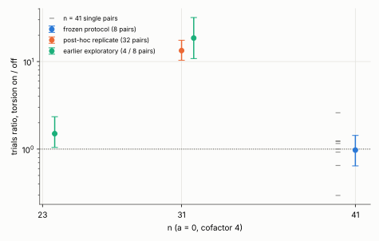

# Torsion anchors on and off at n = 41

**Status: exploratory** (local container, no replay certificate or validator report, not a
leaderboard row). Producer: `examples/ic_m2_cycle.rs` at the commit in `raw/source_commit.txt`,
binary SHA-256 in `raw/binary.sha256`. Protocol frozen before data: [PROTOCOL.md](PROTOCOL.md)
(commit baa2fcfa8).

## Result

At a = 0, n = 41 (cofactor 4, d = 14), torsion anchors make **no detectable difference** to the
cost of a cold single-target solve. Eight paired targets (same secret, same binary, one target
per process), all 16 runs verified (`[t]G = T`), none reached the 3,600 s cap:

| | torsion off | torsion on | on / off |
|---|--:|--:|--:|
| mean trials | 51.7 M | 54.7 M | 1.06 (ratio of means; 95% [0.80, 1.39]) |
| paired geometric mean of trials | | | **0.98** (95% [0.64, 1.43]) |
| paired geometric mean of wall | | | 0.97 (95% [0.65, 1.42]) |
| per-pair ratios | | | 2.60, 0.30, 1.23, 1.24, 1.00, 1.16, 0.92, 0.65 |

Per-pair table: `pairs.txt` (seed, off trials, off s, verified, on trials, on s, verified).
Determinism check passed: seed 20261024 with torsion off reproduces row 0 of the merged
n = 41 record exactly (26,535,644 trials).

## It contradicts what the earlier report said

`research/ic_m2_cycle_leads_20261030` (PR #3009, merged) stated that torsion anchors "cost 1.5x
(n = 23) to 16x (n = 31) on cofactor-4 curves". The n = 31 figure is real, the generalization is
not. A post-hoc replicate (not in the frozen protocol, labelled so): 32 paired targets at
n = 31 give **13.3x** more trials with torsion on (95% [10.3, 17.5]), mean 78,371 off against
934,850 on, all 64 runs verified. So the penalty exists at n = 31, is about 1.5x at n = 23, and
is absent at n = 41. It is not monotone in n; the mechanism is untested here. I did not
find a cause and make none.

The n = 23 and the earlier n = 31 points are the merged exploratory runs (8 and 4 pairs).

## What this does and does not show

- The "cofactor-4 penalty" is not a general property of torsion anchors; do not quote the
  1.5x-to-16x range. For cofactor 4 at n = 41 the cost is unchanged within a wide interval.
- It says nothing about large cofactors, where torsion anchors solved a = 0, n = 37
  (cofactor 596) in 26 to 31 s against an unfinished ladder (two targets, no torsion-off arm).
- Eight pairs with heavy-tailed trial counts: the interval spans roughly 0.6 to 1.4, so a
  moderate effect in either direction is not excluded.
- Other cofactor-4 sizes could not be added: a = 0 at n = 25, 27, 29, 33, 35 has no usable
  Koblitz subgroup in `KoblitzCurve::new` (the producer panics before any data). Supported
  sizes here are 13, 19, 23, 31, 41.
- One shared 4-vCPU cloud container, not the repository's default isolab-eks route (no AWS
  identity in this session). Wall times carry host noise; trials are counted.

## Files

`PROTOCOL.md`, `raw/` (16 run records and logs, `run_arm.sh`, binary hash, source commit,
post-hoc n = 31 records), `pairs.txt`, `ratios.csv`, `plot.py`, `torsion_ratio_vs_n.svg/png`,
`REPORT.pdf`.
