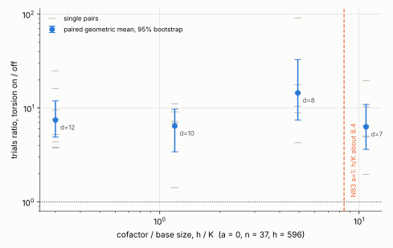

# Torsion anchors at the N83 cofactor-to-base ratio (proxy on a = 0, n = 37)

**The n = 83, a = 1 curve was not run.** This is a proxy at a matched cofactor-to-base ratio.
Status: exploratory (local container, no replay certificate or validator report, not a
leaderboard row). Protocol frozen before data: [PROTOCOL.md](PROTOCOL.md) (commit 4b40d62d05).

## Why n = 83 was not run

`ic_m2_cycle` uses a 64-bit field and asserts `3d - 1 <= 63`; n = 83 needs d = 28, so 83
unknowns. A wider field would not help: the solve takes about `2^(n - d + 1) = 2^56` trials
(about 7e16; about 5,700 core-years at 4e5 trials per second) over a base of about `2^27`
columns (about 3 GB). Torsion anchors would have to change that cost by a factor of 10^4 or
more to matter.

## What was run instead

The N83 curve has cofactor h = 1,128,547,018 and about `2^27` columns, so **h / K about 8.4**.
Earlier measurements had h / K <= 0.3. On a = 0, n = 37 (h = 596) the base size is about
`2^(d-1)`, so lowering the factor-base dimension d raises h / K. Paired torsion on / off, six
seeds per d, one target per process, 1,800 s cap, same binary and host:

| d | K (measured) | h / K | torsion off: mean trials (range), relations | torsion on: mean trials (range), relations | ON / OFF (paired geometric mean, 95% bootstrap) |
|--:|--:|--:|---|---|---|
| 12 (merged record, 8 pairs) | 2,011 | 0.30 | 2.16 M (0.76 to 3.85 M), 126 | 14.8 M (9.36 to 19.4 M), 885 | **7.46** [4.90, 11.92] |
| 10 | 500 | 1.19 | 7.47 M (3.66 to 10.2 M), 27 | 53.9 M (11.9 to 78.1 M), 203 | **6.45** [3.42, 9.72] |
| 8 | 121 | 4.93 | 30.0 M (3.66 to 59.1 M), 7 | 339 M (253 to 449 M), 73 | **14.49** [7.44, 32.85] |
| 7 | 55 | 10.84 | 102 M (36.8 to 170 M), 2 | 588 M (334 to 768 M), 26 | **6.31** [3.63, 10.94] |

All 36 new runs solved, none reached the cap, all scalars verified (`[t]G = T`). **All 18 new
pairs have torsion on more expensive than off** (per-pair ratios 1.42 to 91.4). The N83 ratio
(8.4) lies between d = 8 and d = 7, and both show a penalty (lower interval bounds 7.4 and 3.6).
No consistent trend across d: 6.45, 14.49, 6.31, with overlapping intervals, so by the
protocol's rule no trend statement is made.

Per-seed pairs: `analysis.txt`; per-run records: `raw/`; the table above is `ratios.csv` and
`analysis.txt`.

## Checks

- **Instrument:** seed 20261024 at d = 12 with torsion on reproduced the merged record exactly
  (14,720,702 trials) before the sweep started.
- **Internal consistency** (`consistency.txt`): for every seed and arm, trials never decrease
  as d shrinks (24 of 24). That is what nested bases (`V7 in V8 in V10 in V12`) and identical anchor
  walks should give, and it explains equal counts at different d (the same closing relation lies
  in the smaller base).

## Disclosures

- **Interruption.** The container was suspended twice (about 06:38 to 07:11 UTC, and again at
  some point between the 07:25 restart and 08:07), killing the sweep process and the RAM-backed binary. 16 and then 22 of 36
  runs had finished; the 20 and then 14 unfinished jobs had produced no result and were rerun
  identically with a resumable script (`raw/run_sweep.sh`). The binary was rebuilt (hash
  `raw/binary2.sha256`) and reproduced two finished jobs exactly (`raw/equiv_*.json`). Both builds
  are from the same producer source; main had gained 408 added lines in a dependency file between
  them.
- **Bootstrap.** The protocol called for a seeded bootstrap. `mawk`'s `srand(seed)` is not
  reproducible across runs, so earlier intervals (including in PRs #3126 and #3138) were not exactly
  reproducible. This analysis uses an explicit Park-Miller generator seeded 20261101; three runs give
  identical output. Recomputed with it, the earlier intervals move by at most 0.02
  (`bootstrap_recheck.txt`): n = 41 on / off 0.975 [0.641, 1.420] (was [0.643, 1.433]); n = 37, d = 12
  on / off 7.46 [4.90, 11.92] (was 0.134 [0.082, 0.205] off / on). No conclusion changes.
- **Expected h / K was off.** The protocol expected h / K about 9.3 at d = 7; the recorded K = 55
  gives 10.84, so the N83 ratio is bracketed by d = 8 and d = 7 and not matched exactly.

## What this does and does not show

- At every cofactor-to-base ratio from 0.3 to 10.8 on this curve, torsion anchors make the solve
  more expensive, by roughly 6x to 14x. Together with the earlier sizes (n = 23, 31, 37, 41),
  torsion anchors have not helped anywhere I measured.
- At the N83 ratio the proxy shows a penalty, not a gain. It does not prove the same on the real
  curve: the cofactor's structure differs (596 = 4 x 149 here), n differs, and K only scales as
  `2^(d-1)` here. Matching h / K is a necessary condition for the regime, not a proof of transfer.
- It does not change the N83 projection of about `2^56` trials, which this method cannot reach.
- Six pairs per d, heavy-tailed trials (the d = 8 ratios range 4.3 to 91.4). Local shared 4-vCPU
  container, not the default isolab-eks route (no AWS identity in this session). Exploratory.

## Files

`PROTOCOL.md`, `raw/` (36 run records and logs, equivalence reruns, instrument check, `run_sweep.sh`,
`jobs.txt`, `status.txt`, both binary hashes and source commits), `runs.txt`, `analyze.sh`,
`analysis.txt`, `ratios.csv`, `consistency.txt`, `bootstrap_recheck.txt`, `plot.py`,
`torsion_ratio_vs_hk.svg/png`, `REPORT.pdf`.
