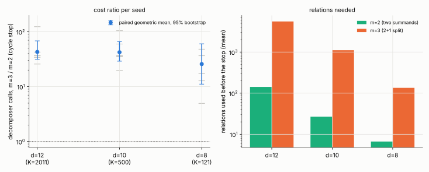

# Three summands (m = 3) with the cycle stop on a = 0, n = 37

**Status: exploratory** (local container, no replay certificate or validator report, not a
leaderboard row). Producer: `examples/ic_m3_cycle.rs` (source commit in `raw/source_commit.txt`,
binary SHA-256 in `raw/binary.sha256`). Protocol and prediction frozen before data:
[PROTOCOL.md](PROTOCOL.md) (commit 55ab3ad8a9).

## Result

With the same stop (first closed equation in `t`), relations with three summands cost **26 to 43
times more decomposer calls than the two-summand relations** on a = 0, n = 37 (cofactor 596), at every
factor-base size tested. All 18 pairs have m = 3 more expensive than m = 2 (per-seed ratios 4.96 to 154).
All 18 m = 3 runs solved and verified (`[t]G = T`, no bad or inconsistent equations); none reached the
1,800 s cap (slowest 992 s).

| d | K | m=2 (merged records): mean trials, relations | m=3: mean trials, relations, rank / K at the stop | trials m=3 / m=2 (paired geometric mean, 95% bootstrap) | group additions | wall |
|--:|--:|---|---|---|--:|--:|
| 12 | 2,011 | 2.44 M, 142 | 94.7 M, 5,550, 0.92 | **42.9** [31.5, 68.2] | 1,028x | 48x |
| 10 | 500 | 7.47 M, 27 | 317 M, 1,107, 0.74 | **42.3** [29.1, 66.3] | 1,496x | 50x |
| 8 | 121 | 30.0 M, 7 | 672 M, 135, 0.38 | **25.8** [11.1, 60.3] | 947x | 32x |

Six seeds per d, one target per process. The m = 2 reference is the torsion-off record of the same seed
and d from the merged runs. Per-seed table: `analysis.txt`; per-run records: `raw/`.

## Why: the same relation yield, many more relations needed

The prediction in the protocol (written before data) was that m = 3 costs more in trials at every d,
by at least 10x at d = 12. It held: 42.9x, lower interval bound 31.5.

- **Yield per trial is unchanged.** Each 2 + 1 trial is one two-summand solve on `R' = p - eP`, so
  trials per relation are about the same in both arms: about 17,000 (m = 3) against 17,000 (m = 2)
  at d = 12, about 286,000 against 277,000 at d = 10, about 5.0 M against 4.3 M at d = 8 (from the
  mean relation counts above, which are rounded).
- **The stop needs far more relations.** A dependency among three-term relations needs a rank near
  the column count (rank / K = 0.92 at d = 12), against a handful of two-term relations closing a small
  cycle (142, 27 and 7 relations). At smaller d, two-term relations (direct hits) in the m = 3 mix close
  dependencies earlier, so rank / K falls to 0.74 and 0.38, and the ratio narrows to 26x.
- So the cost ratio tracks the relation-count ratio (39x, 41x, 19x), as it should if yield is equal.

## Cost units (section 5a)

Both arms use the same decomposer, so the unpriced work per call is the same. m = 3 also adds one
group addition per trial (`p - eP`): about 1,000x the m = 2 additions. m = 3 is worse in decomposer
calls (26 to 43x), in counted group additions (about 950 to 1,500x) and in wall time (32 to 50x), so
the order does not depend on how the unpriced operations are priced.

## Checks

- **Instrument:** a rerun of d = 12, seed 20261024 reproduced its trial count exactly (99,355,964).
- **Correctness:** 32 of 32 verified at small n before the sweep (`raw/smalln/`: a = 0 at n = 13, 19, 23
  and a = 1 at n = 19). A throwaway pilot on seed 777 (`raw/pilot/`, excluded) gave 92.4 M trials at
  d = 12 and 237 M at d = 10, in line with the sweep.
- **Determinism of the analysis:** `analyze.sh` uses an explicit Park-Miller bootstrap seeded 20261101;
  repeated runs give identical output.

## What this does and does not show

- This 2 + 1 construction gives no advantage over two summands: more relations are needed per stop and
  the yield per trial does not improve. It does not test other three-summand constructions (for example
  a direct fourth summation polynomial, which the repository's earlier work found does not linearize).
- The d trend: the ratio falls as d falls (42.9, 42.3, 25.8), but the intervals overlap heavily
  (d = 8 spans 11 to 60), so I do not read a trend from it.
- Six pairs per d with heavy-tailed trial counts (per-seed ratios span 5 to 154). The m = 2 reference
  comes from earlier merged runs (same decomposer source and seeds, a different build and run time), so
  wall ratios carry host noise; trials are counted and comparable.
- It is a result on a = 0, n = 37 at d <= 12 only. One shared 4-vCPU container, not the default
  isolab-eks route (no AWS identity in this session). Exploratory.

## Files

`PROTOCOL.md`, `raw/` (18 run records and logs, determinism rerun, pilot, small-n checks, `run_sweep.sh`,
`jobs.txt`, `status.txt`, binary hash and source commit), `runs_m3.txt`, `runs_m2_ref.txt`, `analyze.sh`,
`analysis.txt`, `ratios.csv`, `plot.py`, `m3_vs_m2.svg/png`, `REPORT.pdf`.
