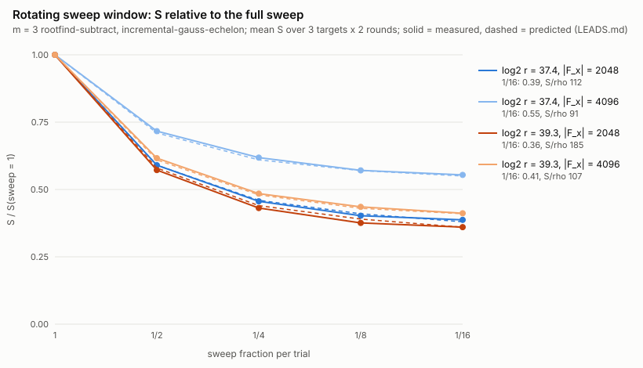

# Rotating sweep window for m = 3 rootfind-subtract (report)

Lead 1 of `research/ic_m3_cost_leads_20261115/LEADS.md`, run under the frozen
[`PROTOCOL.md`](PROTOCOL.md) (spec `specs/sweep.json`, commit c7535aafb1) with one recorded deviation
(the measurement seed, below). Local L0 run on a 4-core VM (`--cpus none --allow-busy`); counts are
deterministic and no wall time is read. Benchmark record
`benchmarks/records/20261118T1754Z-ic-m3-sweep-window.json`. All numbers here are
[pcc:unverified] until the validator's review.

## What changed
`RootfindSubtractOracle` takes `sweep=1/N`: trial t examines abscissae `(t * w + j) mod k`, `j < w`,
`w = ceil(k/N)`, then takes the next target. `sweep=1` (the default) is the old full sweep. The batched
inversion, the charges and the hit confirmation are unchanged and cover the window only.

## Result
144/144 records verified (recovered logarithm equals the planted one); the rho A/A copy is identical to
the reference on all 12 (workload, round) pairs. Mean S over 3 targets x 2 rounds per cell, S over the
f = 1 arm's, and S over the matched `rho.negation` (distance remaining, not a gate):

| log2 r | \|F_x\| | sweep | S | S / S(1) | predicted | S / rho (w = 0) | rows / a (max) | trials |
|--:|--:|--:|--:|--:|--:|--:|--:|--:|
| 37.4 | 2048 | 1 | 289.6 | 1.000 | | 289 | 0.925 | 30,338 |
| 37.4 | 2048 | 1/2 | 170.9 | 0.590 | 0.59 | 171 | 0.918 | 34,402 |
| 37.4 | 2048 | 1/4 | 132.1 | 0.456 | 0.46 | 132 | 0.928 | 51,468 |
| 37.4 | 2048 | 1/8 | 116.6 | 0.403 | 0.41 | 116 | 0.928 | 88,926 |
| 37.4 | 2048 | 1/16 | 112.2 | 0.387 | 0.38 | 112 | 0.925 | 169,236 |
| 37.4 | 4096 | 1 | 163.8 | 1.000 | | 164 | 0.926 | 9,321 |
| 37.4 | 4096 | 1/2 | 117.3 | 0.716 | 0.71 | 117 | 0.924 | 10,426 |
| 37.4 | 4096 | 1/4 | 101.3 | 0.618 | 0.61 | 101 | 0.924 | 14,855 |
| 37.4 | 4096 | 1/8 | 93.5 | 0.571 | 0.57 | 93 | 0.922 | 24,217 |
| 37.4 | 4096 | 1/16 | 90.7 | 0.554 | 0.55 | 91 | 0.927 | 44,003 |
| 39.3 | 2048 | 1 | 576.5 | 1.000 | | 515 | 0.931 | 117,901 |
| 39.3 | 2048 | 1/2 | 329.8 | 0.572 | 0.58 | 294 | 0.928 | 133,468 |
| 39.3 | 2048 | 1/4 | 248.5 | 0.431 | 0.44 | 222 | 0.924 | 199,341 |
| 39.3 | 2048 | 1/8 | 216.7 | 0.376 | 0.39 | 193 | 0.919 | 345,442 |
| 39.3 | 2048 | 1/16 | 207.6 | 0.360 | 0.36 | 185 | 0.937 | 658,900 |
| 39.3 | 4096 | 1 | 291.4 | 1.000 | | 260 | 0.928 | 30,486 |
| 39.3 | 4096 | 1/2 | 179.5 | 0.616 | 0.61 | 160 | 0.928 | 34,792 |
| 39.3 | 4096 | 1/4 | 141.2 | 0.485 | 0.48 | 126 | 0.927 | 51,410 |
| 39.3 | 4096 | 1/8 | 126.9 | 0.435 | 0.43 | 113 | 0.925 | 88,850 |
| 39.3 | 4096 | 1/16 | 120.0 | 0.412 | 0.41 | 107 | 0.922 | 164,292 |

- Every candidate arm's S is below its f = 1 arm's on every (workload, round) pair (24 of 24 per
  fraction). The measured ratios are within 0.015 of the frozen predictions in all 16 cells.
- Rows at the stop are 0.918–0.937 a (falsifier 1.05 a): the window does not skew the matrix.
- Relations per trial match 1 − exp(−μ(1 − (1 − f)³)), μ fitted on the f = 1 arm, within 1.8% in every
  cell (prediction 4, 5% tolerance).
- Trials and batched inversions rise with the window (4.7–5.6x at 1/16), as pre-registered; they are
  unpriced at w = 0 and priced in the band below.

## §5a band (`ecbench band`, default pricing of table work)
S over the f = 1 arm at w = 0, 0.1, 1, and S / rho at the same weights:

| log2 r | \|F_x\| | sweep | ratio w=0 / 0.1 / 1 | S / rho w=0 / 0.1 / 1 |
|--:|--:|--:|--:|--:|
| 37.4 | 2048 | 1/8 | 0.403 / 0.405 / 0.417 | 116 / 118 / 124 |
| 37.4 | 2048 | 1/16 | 0.387 / 0.390 / 0.402 | 112 / 113 / 119 |
| 37.4 | 4096 | 1/8 | 0.571 / 0.595 / 0.674 | 93 / 103 / 149 |
| 37.4 | 4096 | 1/16 | 0.554 / 0.577 / 0.653 | 91 / 100 / 144 |
| 39.3 | 2048 | 1/8 | 0.376 / 0.377 / 0.380 | 193 / 194 / 197 |
| 39.3 | 2048 | 1/16 | 0.360 / 0.361 / 0.365 | 185 / 186 / 189 |
| 39.3 | 4096 | 1/8 | 0.435 / 0.445 / 0.484 | 113 / 118 / 138 |
| 39.3 | 4096 | 1/16 | 0.412 / 0.420 / 0.453 | 107 / 111 / 129 |

The full band (all fractions, both pricings) is in `band.json` and `band_no_table.json`. In every cell,
each f < 1 arm is below its f = 1 arm at all three weights, with and without table-work pricing, so the
order holds across the band. At w = 1 the gain at |F_x| = 4096 is diluted (0.653 at 37.4 bits against
0.554 at w = 0; the skeptic estimated about 0.67), because the pair table's inserts and the linear
algebra are untouched. At w = 1 on the 37.4-bit curve, |F_x| = 2048 at 1/16 (119x rho) is below
|F_x| = 4096 at 1/16 (144x): the base-size optimum depends on the weight, which Lead 2 has to test.

## Replication and deviation
`specs/sweep.json` froze seed 20261182, not rf3la's 20261128 (recorded in PROTOCOL.md before the
session finished). The control `specs/replicate.json` reruns the curves at seed 20261128:
`replicate_check.py` finds all 36 `sweep=1` and rho records identical to round 5's
(`research/ic_gpu_rootfind_la_20261115/raw/out_rla.tgz`) in algorithm seed, S, targets tried and
recovered logarithm, and 60/60 verified. So `sweep=1` leaves the default path unchanged. The control's
f = 1/8 arms, an independent sample of the falsifier cell, give 0.403, 0.388, 0.562 and 0.433
(`replicate_check.txt`).

## Falsifiers (PROTOCOL.md)
- f = 1/8 at |F_x| = 4096 above 0.75 of f = 1 on both curves: no (0.571 and 0.435; control 0.562, 0.433).
- Rows above 1.05 a in any candidate record: no (max 0.937 a).
- A failed verification: no (144/144 and 60/60).

## Reading
A rotating sweep window lowers the counted cost of m = 3 rootfind-subtract by 1.8x to 2.8x at the
same recovered logarithm, on both curves and at both base sizes, across the §5a band. It is a
constant-factor change to this oracle, not to the exponent. The distance to rho remains large: the
lowest arm here is 91x rho at w = 0 (37.4 bits, |F_x| = 4096, 1/16) and 107x at 39.3 bits; at w = 1,
119x and 129x. This oracle is not the program's best index-calculus baseline (`ic plan`'s m = 2 pair
table), so this is an improvement of the m = 3 rootfind-subtract arm only.

## Audit
`ecbench verify --replay-all` re-executes every measured deterministic run of the main session and
requires identical counts; its receipt is `verify.json` (see "Files").

## Files
`PROTOCOL.md`, `specs/sweep.json`, `specs/replicate.json`, `analyze.py` → `results.json`,
`make_figure.py` → `fig_sweep.svg`, `band.json`, `band_no_table.json`, `replicate_check.py` →
`replicate_check.txt`, `raw/session.tgz` and `raw/replicate.tgz` with SHA-256 files, `verify.json`.

## Not in scope
The GPU oracle (refuses `sweep`), wall time, and the base-size grid (Lead 2). No leaderboard or
`benchmarks/README.md` row before validation.
